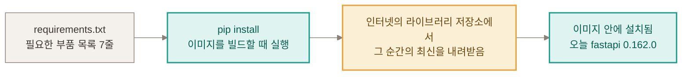

#### 라이브러리와 이미지는 같은 종류인가?

| | 라이브러리 | 이미지 |
|---|---|---|
| 정체 | 남이 미리 만들어 둔 기능 묶음(코드) | 앱과 필요한 것을 통째로 포장한 상자 |
| 둘의 관계 | 상자(이미지) 안에 들어가는 부품 | 부품을 넣어 만든 결과물 |
| 오늘의 예 | fastapi, pillow 같은 20개 | `routine-stamp-trial` 이미지 1개 |

- 아니다. 라이브러리는 이미지의 일종이 아니라 이미지 안에 들어가는 부품이다. 이미지를 빌드할 때 필요한 부품을 가져다 넣는다.
- 오늘 이미지를 빌드한 로그에는 설치된 라이브러리가 20개 찍혔다(fastapi 0.162.0, pillow 13.0.0, pytesseract 0.3.13 등). requirements.txt에 적은 것은 7줄인데 20개가 설치된 것은, 이 7개가 쓰는 다른 라이브러리를 pip가 함께 받기 때문으로 보인다(일반적인 동작이고 하나하나 확인하지는 않았다).

#### requirements.txt는 언제 쓰나?

- 앱에 필요한 라이브러리의 이름과 버전을 적어 둔 텍스트 파일이다(이 프로젝트는 7줄). 이미지를 만들 때 어떤 부품을 넣을지 알려 주는 부품 목록이다.
- 이 프로젝트에서는 Dockerfile 13~14줄이 이미지를 빌드하는 순간에 이 파일을 읽는다.

```text
COPY requirements.txt .
RUN pip install --no-cache-dir -r requirements.txt
```

- 첫 줄은 목록 파일을 이미지 안으로 복사하고, 둘째 줄에서 pip(파이썬 라이브러리 설치 도구)가 그 목록을 읽어 하나씩 설치한다.

#### 「이 버전 이거나 더 새 버전이면 아무거나(>=, 이상)」로 적으면 왜 빌드할 때마다 최신을 받나?



| 순서 | 일어나는 일 | 오늘 확인한 것 |
|---|---|---|
| 1 | 이미지를 빌드하면 Dockerfile의 `pip install -r requirements.txt`가 실행된다 | Dockerfile 14줄 |
| 2 | pip가 목록의 줄을 하나씩 읽고 인터넷에서 그 라이브러리를 내려받는다 | 빌드 로그에 `Downloading … .whl` 줄이 계속 나옴 |
| 3 | `fastapi>=0.115`는 「0.115이거나 더 새 버전이면 아무거나」라서, pip는 그 순간 나와 있는 가장 새 버전을 고른다 | 오늘은 fastapi 0.162.0이 설치됨 |
| 4 | 다 만든 이미지는 바뀌지 않으므로 그 안의 라이브러리 버전도 그대로다 | 이미지는 만든 뒤 바뀌지 않는다(Docker 1에서 확인) |
| 5 | 이미지를 다시 빌드하면 2~3번을 다시 해서 그날의 최신을 받을 수 있다 | 월요일·수요일 예시는 노드의 가상 예시 |

- 「그 순간의 최신」은 빌드를 하는 그 날, 그 시각에 저장소에 올라와 있는 가장 새 버전이다. 빌드한 날이 다르면 받는 버전이 다를 수 있다.
- 버전을 딱 하나로 못 박아 적으면(예: `fastapi==0.162.0`) 매번 같은 버전을 받는다. 이 프로젝트의 requirements.txt는 그렇게 적지 않았다(`==`가 「정확히 같다」는 뜻이라는 것은 일반적인 표기 설명이다).
- 예외로, Docker에는 캐시가 있어서 이미 처리한 줄은 그 결과를 재사용할 수 있다. 오늘 로컬에서 같은 이미지를 두 번째로 빌드했을 때 3~4초 만에 끝난 것도 캐시를 썼기 때문이다. 그래서 「빌드할 때마다 새로 받는다」는 노드의 설명은 새로 빌드할 때를 기준으로 한 말로 보인다(추정).
