# 신서연 — 서비스 배포 전략 1일차: 로드밸런서로 무중단 배포 구성하기

> 학습 템플릿 (2조) › 신서연. 노드 "로드밸런서로 무중단 배포 구성하기"(8번, 7스텝)를 끝까지 읽고, 새 버전이 나가는 순간 사용자의 요청이 지나가는 순서를 따라 정리했다. '오늘 학습 방식'의 추가 과제 3개는 이번에 시도하지 못했다(아래 "오늘의 미션").

## 한눈에 보기

- **문제**: 자동 배포를 하면 새 버전이 하루에도 여러 번 나간다. 새 버전으로 바뀌는 그 몇 초 동안 사용자가 오류를 보거나, 방금 나눈 대화가 사라질 수 있다.
- **원인**: 두 가지. ① server가 한 벌뿐이면 교체하는 동안 요청을 받을 곳이 없다. ② 대화와 약속을 container 메모리에만 두면, 요청이 다른 server로 가거나 container를 다시 시작할 때 보이지 않거나 사라진다.
- **해결**: server를 두 벌(blue, green) 두고 앞에 Nginx load balancer를 세워서, 설정 한 줄과 reload로 요청이 가는 방향만 바꾼다(블루그린). 대화는 server 밖의 DB(Supabase)에 둔다.
- **과제**: 추가 과제 3개(Compose 한 파일로 실습, Nginx로 롤링 배포, 능동 헬스체크 만들기)는 시도하지 않았다.
- **가장 헷갈렸던 것**: 「요청이 끊기지 않는 것」과 「하던 일이 이어지는 것」은 서로 다른 조건이라는 점 → 아래 1번 절.

---

## 오늘의 주제

**서비스를 끄지 않고 새 버전으로 바꾸는 법, 그리고 그때 사용자가 하던 일이 이어지게 하는 법.**

## 오늘의 목표

- availability, SPOF, 이중화, 무상태가 무엇이고 고가용성 서비스에서 각각 무엇을 막는지 설명한다.
- 롤링, 블루그린, 카나리 배포의 차이와, 무중단 배포에서 헬스체크, 그레이스풀 셧다운, DB 호환성이 필요한 이유를 설명한다.
- load balancer가 server를 고르고 고장 난 server를 알아채는 방식과, Nginx가 reverse proxy와 load balancer로 하는 일을 설정 파일로 읽는다.
- 내 컴퓨터에서 Nginx와 에이전트 서비스 두 벌을 container로 띄우고, 설정 한 줄로 블루그린 전환과 롤백을 하는 과정을 이해한다.
- 전환하는 동안과 server 하나가 멈췄을 때의 요청 실패를 측정하는 실험이 Nginx 설정과 어떻게 이어지는지 설명한다.
- Supabase에 데이터와 익명 로그인을 붙이면 어느 쪽으로 전환해도 대화가 이어지는 이유를 설명한다.

---

## 흐름으로 이해하기

> 노드 순서가 아니라 요청이 지나가는 순서로 정리했다. 용어의 정의는 그 개념이 처음 필요해지는 자리에 둔다. 그림은 내가 직접 설계한 모션 그림이고 Notion에는 GIF로 올린다. 모든 그림은 구성 요소별 파스텔 색(blue 하늘색, green 민트, Nginx 라벤더, DB 분홍, 사용자 노랑, 실패 코랄)으로 구분했다.

### 0. 한눈에 보기: 네 단계가 한 흐름이다

> [그림 1] ① 버틴다 → ② 바꾼다 → ③ 돌린다 → ④ 이어간다. 같은 구성(사용자, Nginx, blue, green, DB)에 부품이 하나씩 더해진다. ④에서는 같은 화면에서 메모리에 둘 때의 문제와 DB에 둘 때의 해결을 이어서 본다.

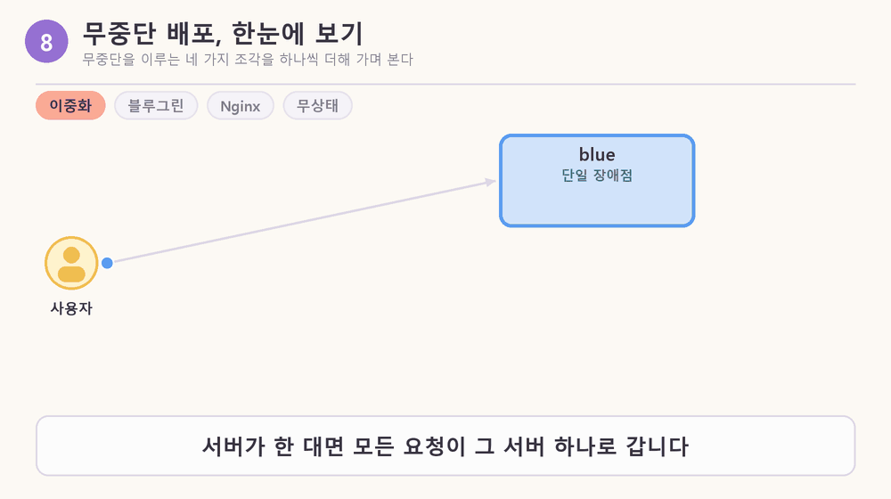

| 단계 | 한 줄 | 이름 |
|---|---|---|
| ① 버틴다 | 하나가 고장 나도 안 멈추게 같은 것을 두 벌 둔다 | 이중화, 고가용성 |
| ② 바꾼다 | 끄지 않고 새 것을 올린 뒤 방향만 바꾼다 | 블루그린 배포 |
| ③ 돌린다 | 방향을 바꾸는 장치가 Nginx. server가 한 줄이면 reverse proxy, 두 줄이면 load balancer | reverse proxy, load balancer |
| ④ 이어간다 | 기억을 server가 아니라 DB가 갖는다. 그래야 방향을 바꿔도 새 server가 대화를 이어받는다 | 무상태, Supabase |

### 1. 무중단이라고 부르려면 두 가지를 지켜야 한다

배포하는 순간 사용자에게 두 가지가 일어날 수 있다. 요청이 끊기거나, 하던 일이 사라진다. 두 가지는 서로 다른 조건이고 지키는 도구도 다르다.

| 확인할 것 | 해당하는 용어 | 노드 5장 실험에서 | 지키는 도구 |
|---|---|---|---|
| 요청이 끊기지 않음 | 무중단 배포 (zero-downtime deployment) | blue에서 green으로 전환하는 동안 실패 0건 | load balancer, 블루그린, 헬스체크, 그레이스풀 셧다운 |
| 하던 일이 이어짐 | 무상태 (stateless) | green으로 전환하니 방금 만든 약속이 보이지 않음 | 상태를 server 밖의 DB에 두기 |

- 요청이 하나도 실패하지 않았는데도 사용자가 방금 나눈 대화가 사라졌다면, 사용자에게는 서비스가 끊긴 것과 똑같다. 그래서 노드는 두 번째 조건까지 지켜야 무중단 배포라고 본다(노드 5장).
- 무상태는 server의 성질(요청 사이의 기억을 자기 안에 두지 않음)이고, 하던 일이 이어지는 것은 그 결과다.
- 영업 중인 식당의 보수공사로 빗대면, 주방을 닫고 고치는 것이 아니라 옆에 새 주방(green)을 지어 두고 손님을 옮기는 것이다. 직원이 주문을 머릿속에만 기억하면 직원을 바꾸는 순간 주문이 사라지고, 주문을 게시판(DB)에 적어 두면 누가 바뀌어도 이어진다. 노드의 "무상태여야 server를 마음대로 늘리고, 빼고, 새 버전으로 바꿀 수 있다"가 이 뜻이다.

### 2. 요청 하나가 server에 닿기까지

사용자는 Nginx 주소 하나만 알고, Nginx 설정 파일이 그 요청의 길을 정한다. 오늘 실습의 설정을 길의 순서대로 읽으면 이렇다.

```text
listen 80                          ← 80번 포트로 요청이 들어온다
location /                         ← 모든 경로 / 의 요청을
  proxy_pass http://active_app     ← active_app 이라는 이름의 목록으로 대신 넘기고
upstream active_app { ... }        ← 그 목록 안에서
  server blue:8080; server green:8080;   ← 규칙(round robin 등)으로 한 곳을 고른다
  zone active_app 64k;             ← 고르는 순서를 worker process들이 함께 센다
```

#### 2-1. 요청을 대신 받아 넘기는 proxy

proxy는 요청을 대신 받아 다른 곳에 넘기고, 응답도 대신 받아 돌려주는 중간 창구다. 사용자 쪽에 서면 forward proxy(나가는 요청을 대신 보냄), server 쪽에 서면 reverse proxy(들어오는 요청을 대신 받음)다. Nginx는 web server, reverse proxy, load balancer 세 역할을 하는 프로그램이고, 오늘 실습에서는 `proxy_pass` 줄이 reverse proxy 동작을 지정한다.

> [그림 2] proxy는 요청과 응답을 대신 받아 넘겨 주는 중간 창구다. 사용자 쪽에 서면 forward proxy, server 쪽에 서면 reverse proxy(Nginx의 역할)다.

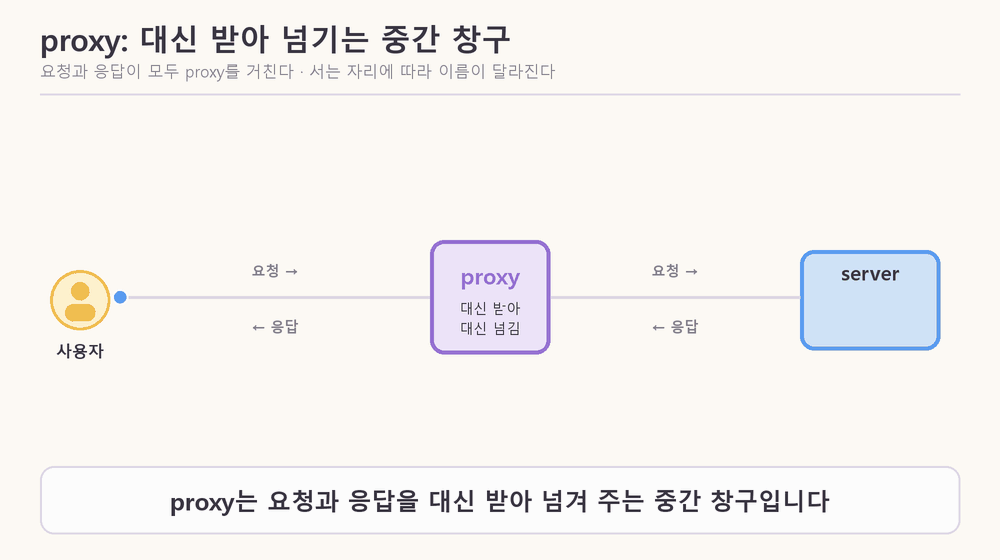

- blue와 green에는 `-p`로 포트를 열지 않았다. 그래서 내 컴퓨터에서 server에 직접 들어갈 수 없고, 같은 network의 Nginx만 요청을 넘길 수 있다.

#### 2-2. 넘겨받을 server의 목록, upstream

upstream은 Nginx가 요청을 넘겨받을 server들을 적어 둔 목록 블록이다. `proxy_pass http://active_app;`의 `active_app`이 이 블록의 이름이다. server가 한 줄이면 reverse proxy, 여러 줄이면 load balancer로 동작한다. upstream이라는 이름의 유래는 노드에 없다.

> [그림 3] upstream 블록은 server 줄의 목록이다. 줄 뒤의 옵션(weight, backup)과 실패 기록에 따라 요청을 받을 server가 정해진다.

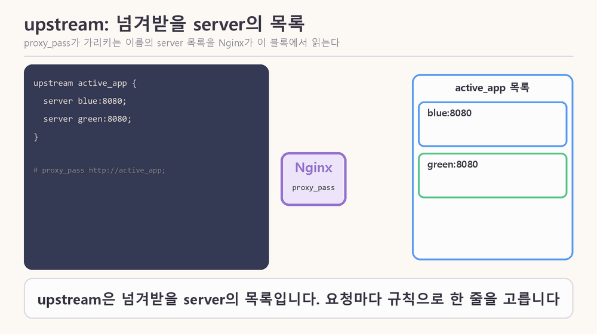

| 옵션 | 뜻 | 기본값 (Nginx 문서) |
|---|---|---|
| `weight=3` | 다른 server보다 3배 | 1 |
| `backup` | 다른 server가 모두 빠졌을 때만 요청을 받음 | 일반 server |
| `max_fails=1` | `fail_timeout` 안에 이 횟수만큼 실패하면 server를 뺌 | 1 |
| `fail_timeout=10s` | 실패를 세는 기간이자 server를 빼 두는 기간 | 10초 |

- `server spare:8080 backup;`의 `spare`는 그림용 이름이다. 노드의 예시는 `10.0.0.3:8080 backup`이다.

#### 2-3. 목록에서 한 곳을 고르는 규칙

load balancer는 여러 server에 요청을 나눠 보내는 장치이고, 어느 server로 보낼지는 정해 둔 규칙을 따른다 (노드 3장).

| 규칙 | 보내는 방식 | 쓰는 때 |
|---|---|---|
| round robin | 1번, 2번, 3번, 다시 1번처럼 순서대로 | server 성능이 비슷할 때. 가장 단순함 |
| least connections | 지금 처리 중인 요청이 가장 적은 server로 | 요청마다 처리 시간이 크게 다를 때. LLM 응답처럼 몇 초에서 수십 초 |
| weight | 정해 둔 비율대로 | 성능이 다른 server를 섞을 때, 카나리 배포 |
| IP hash | 같은 사용자는 늘 같은 server로 | server가 사용자 상태를 기억할 때 |

공항 보안 검색대로 빗대면 이렇다 (비유는 내 설명이다). 안내 직원이 load balancer이고 검색 레인이 server다. round robin은 레인에 한 명씩 차례로 보내는 것, weight는 신형 레인에 3명을 보낼 때 구형 레인에 1명을 보내는 것, least connections는 줄이 가장 짧은 레인으로 보내는 것, IP hash는 같은 승객을 늘 같은 레인으로 보내는 것이다.

- hash는 입력 값을 정해진 계산식에 넣어 일정한 범위의 값으로 바꾸는 것이고, 같은 입력은 항상 같은 결과가 나온다(일반적인 정의이고 노드에는 없음). IP hash는 사용자의 IP를 hash한 값으로 server를 고르므로 같은 IP는 늘 같은 server로 간다. 예시로 IP를 숫자로 보고 server 수 2로 나눈 나머지로 고른다고 하면 같은 IP는 늘 같은 server로 가지만, 실제 Nginx의 계산식은 확인하지 못했다.
- IP hash는 server가 상태를 기억할 때의 임시방편이다. 그 server가 멈추거나 새 버전으로 바뀌면 묶여 있던 사용자의 상태도 사라지고, 한 server에 사용자가 몰려도 다른 server로 나눌 수 없다(노드 3장).

**곁가지: round robin의 이름 유래.** 유래는 확실하지 않다. 가장 이른 청원서 뜻은 1730년 『The Weekly Journal』에 선원들의 용어로 기록되었고, 이름을 원형으로 서명해 누가 먼저 서명했는지(주동자)를 숨기는 방식이었다(phrases.org.uk). 컴퓨터에서는 반대로 순서가 정해져 드러나지만, 둘 다 원(순환) 구조라는 점이 같다. 프랑스어 `ruban rond`(둥근 리본)에서 왔다는 설은 어원학자 리버먼이 OUP 블로그에서 반박한다. 프랑스어 문헌에서 확인된 적 없는 유령 단어이고, 영어에 `robin round`라는 중간 형태가 없으며, 청원서 뜻보다 앞선 1536년에 이미 다른 뜻으로 쓰였다는 이유다. 컴퓨터 용법이 어원과 직접 이어졌는지는 읽은 페이지에 없다. 출처: [OUP 블로그](https://blog.oup.com/2019/01/the-last-shot-at-robin/) · [phrases.org.uk](https://phrases.org.uk/meanings/round-robin.html) · [World Wide Words](https://worldwidewords.org/qa-rou1.html). etymonline은 접근이 막혀(403) 읽지 못했고, 위 내용은 페이지 요약을 바탕으로 했다.

#### 2-4. 고르는 순서를 함께 세는 zone

`zone`은 upstream 블록 안의 설정 한 줄이고, worker process들이 round robin의 「다음 차례」와 실패 기록을 공유 메모리에서 함께 세게 한다. 형식은 `zone <이름> <크기>`이고 노드는 `64k`가 무엇인지 설명하지 않는다.

> [그림 4] 왼쪽 위는 zone 줄이 없을 때, 아래는 zone 줄이 있을 때 worker process 둘이 「다음 차례」를 세는 방식. 응답 순서는 노드 설명으로 만든 예시다.

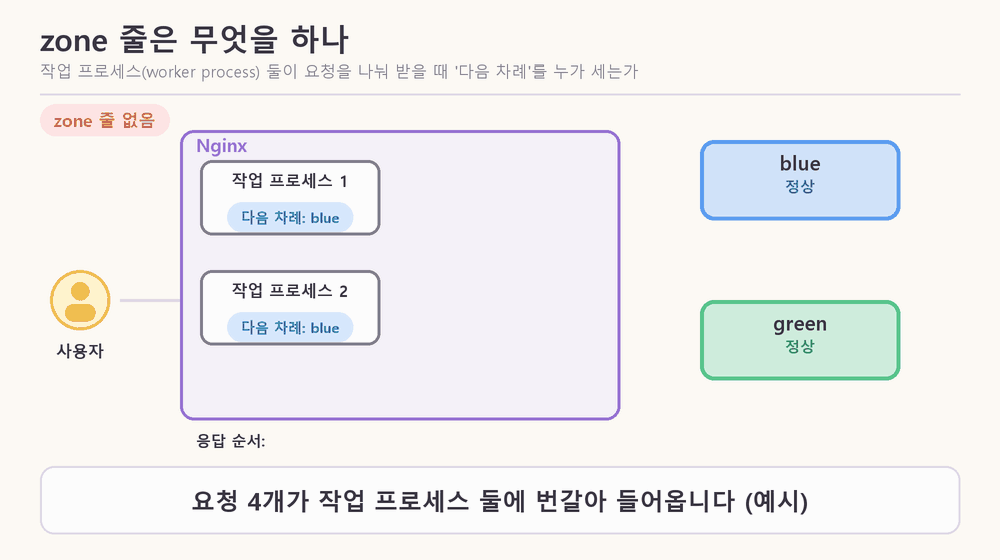

- worker process는 서로 메모리를 나눠 쓰지 않아서, `zone`이 없으면 각자 「다음 차례」를 따로 센다. 요청이 많을 때는 결과적으로 고르게 나뉘지만, 요청을 하나씩만 보내는 실습에서는 같은 server로만 가는 것처럼 보일 수 있다(노드 3장).
- 그림의 응답 순서(zone 없음: blue, blue, green, green / zone 있음: blue, green, blue, green)는 이 설명으로 만든 예시이고 실제 Nginx에서 돌려 본 결과가 아니다.
- 노드 퀴즈는 `upstream`에 `zone` 줄과 `server blue:8080;`, `server green:8080;`을 적고 reload한 뒤 요청을 계속 보내면 어떻게 보이는지 묻는다. 위 설명으로 풀 수 있다.

### 3. server를 바꾸는 방법

#### 3-1. 세 가지 배포 방식과 drain

세 방식 모두 load balancer가 요청 보내는 곳을 바꾸는 방법이다(노드 2장).

| 방식 | 뜻 |
|---|---|
| 롤링 (rolling update) | server를 한 대씩 돌아가며 새 버전으로 바꾼다. 바꾸는 동안 이전 버전과 새 버전이 함께 요청을 받는다 |
| 블루그린 (blue-green) | server 묶음을 두 벌 두고, 새 쪽을 다 준비한 뒤 방향을 한 번에 바꾼다 |
| 카나리 (canary) | 새 버전에 일부 요청만 먼저 보내 보고, 괜찮으면 비율을 올린다 |

- drain(드레이닝)은 server 한 대를 뺄 때 그 server로 새 요청은 끊고 하던 요청은 끝까지 마치게 한 뒤 끄는 동작이다. 배포 방식의 이름이 아니라, 롤링처럼 server를 하나씩 빼는 방식의 한 단계로 쓰이는 부품이다(노드 3장: 빼고 → 업데이트 → 헬스체크 통과 후 다시 넣기).
- 블루그린이나 카나리에서도 이전 server를 끌 때는 같은 「하던 요청 마무리」가 필요하다. 그레이스풀 셧다운은 끄는 server 쪽에서 하던 요청을 마친 뒤 끄는 것으로, 노드는 drain과 거의 같은 뜻으로 쓴다.
- 배포 방식을 설명하는 도식에서 "Cloud Run 기본 배포는 롤링이 아니라, 새 리비전이 준비되면 트래픽을 한꺼번에 넘기는 방식"이라는 설명을 봤다(그림 설명이고 내가 문서로 확인하지 못했다). Cloud Run 문서 요약에는 요청을 "최신의 정상 리비전으로 가능한 한 빨리" 보낸다고 적혀 있다.

#### 3-2. 방향을 바꾸는 법: reload

upstream의 server 줄을 `blue`에서 `green`으로 고친 뒤 `nginx -t`로 문법을 검사하고 `nginx -s reload`로 적용한다. reload는 Nginx를 다시 시작하지 않고 설정만 바꿔 끼운다.

> [그림 5] 왼쪽은 `nginx -s reload`, 오른쪽은 `docker restart blue`.

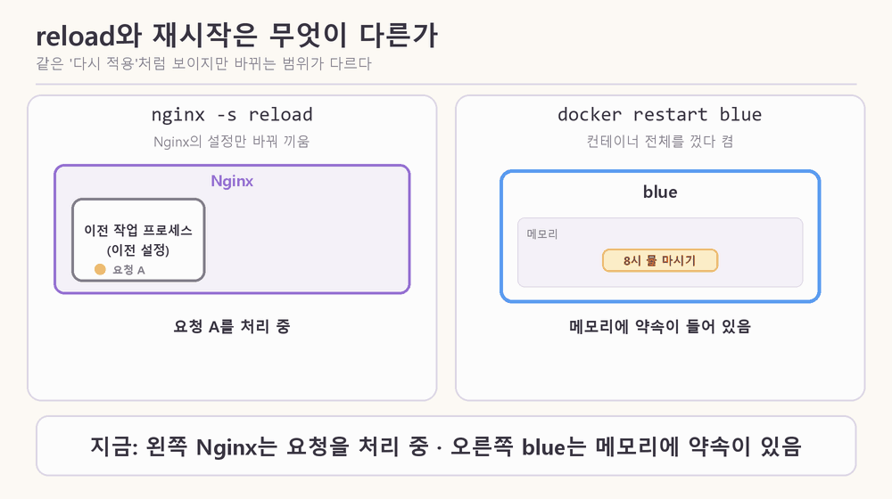

| | reload | 재시작 (`docker restart blue`) |
|---|---|---|
| 대상 | Nginx의 설정 | container 전체 |
| 처리 중이던 요청 | 이전 worker process가 마무리하고, 새 worker process가 새 설정으로 다음 요청부터 받음 | 노드에 설명 없음 |
| 메모리 | 영향 없음 | 비워짐 (노드 5장에서 약속이 사라짐) |

- 문법이 틀린 설정으로 reload하면 Nginx는 새 설정을 버리고 이전 설정으로 계속 돈다. 그래도 `nginx -t`로 먼저 검사하는 이유는 실패를 사람이 바로 보고 고치기 위해서다.
- reload는 Cloud Run의 리비전과 다르다. reload는 Nginx가 설정을 다시 읽는 일이고, 리비전은 배포할 때마다 생기는 버전 기록이다.

#### 3-3. 전환한 뒤에도 blue를 끄지 않는 이유

롤백은 이전 버전 프로그램으로 되돌리는 것이고, 되돌릴 수 있는 것은 blue를 끄지 않고 계속 돌려 두기 때문이다. blue는 v1 프로그램이 돌고 있는 container, green은 v2가 돌고 있는 container다.

- 전환한 직후 blue를 바로 끄면 두 가지를 잃는다. blue가 처리하던 요청이 끊기고(그레이스풀 셧다운 위반), 롤백할 곳도 사라진다.
- 이전 버전을 언제 꺼야 하는지는 노드가 오늘 정하지 않았다고 밝힌다. 구체적인 시간은 노드에 없다.
- 오늘 실습의 blue와 green은 사실 같은 이미지이고 환경변수 두 개(`K_REVISION`, `BANNER`)만 다르다. 노드는 "새 버전이 green에 올라갔다고 생각하고" 전환하게 한다. 즉 코드는 바뀌지 않는 전환 연습이다. `K_REVISION`은 어느 container가 응답했는지 알아보는 이름표로, 원래 Cloud Run이 리비전 이름을 알려 줄 때 쓰는 환경변수를 흉내 낸 것이다.

#### 3-4. 비율은 어떻게 정하나: weight

weight는 server마다 보내는 요청의 몫이다. 값은 설정 파일의 숫자라서 운영자가 정한다. 기본값은 1이고, Nginx 문서에는 값이 숫자여야 한다는 것만 있고 정수 여부나 최소·최대값 같은 제한은 적혀 있지 않다.

> [그림 6] green이 새 버전이라고 가정했을 때, 새 버전이 받는 요청의 비율이다.

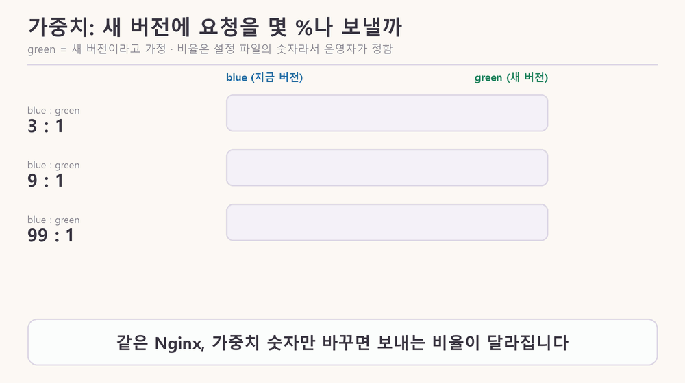

| 가중치 (blue : green) | green이 받는 요청 | 의미 |
|---|---|---|
| 3 : 1 | 25% | 노드의 실습 예시 (실습에서는 약 75% 대 25%) |
| 9 : 1 | 10% | 카나리: 일부에게만 시험 |
| 99 : 1 | 1% | 카나리: 아주 일부 |
| 44 : 55 | 약 55.6% | 산수로 계산한 값. 직접 돌려 보지는 않았다 |

**44 : 55 같은 비율은 의미가 있나, 보통 어떻게 정하나?**

- 44 : 55는 4 : 5와 같은 비율이다. 설정은 가능하지만 이 숫자에 특별한 의미는 없다. 정해진 목록은 없고 100% 운영자 마음이지만, 정하는 기준이 있다.
- 기준 ① 성능이 다른 server를 섞을 때는 성능에 비례해서 정한다(노드 3장).
- 기준 ② 카나리 배포는 작게 시작해서 단계적으로 올린다. 노드는 새 버전에 1%나 10%만 먼저 보낸다고 한다. 도구마다 단계 예시는 다르다. Cloud Deploy 문서의 예시는 10%, 25%, 50%, 75%이고, Argo Rollouts의 예시는 5%나 10%에서 시작하며, 한 블로그 스크립트는 1, 5, 10, 25, 50, 75, 100%였다. 하나로 정해진 표준은 아니고, 대체로 단계마다 지표를 확인하고 잠깐 멈춘 뒤 올린다. 위험이 낮은 변경이면 10% → 50% → 100%처럼 단계를 줄인다는 의견도 있었다(출처 대부분이 공식 문서가 아니라 블로그나 도구 문서라서 예시로만 본다).
- 44 : 55처럼 어중간한 숫자를 고를 이유는 일반적으로 없다고 보는 것은 내 해석이다. 거의 반반을 원하면 1 : 1이나 4 : 5처럼 단순한 비를 쓰는 편이 읽기 쉽다.
- 99 : 1의 "99"와 가용성 99%의 "99"는 겹쳐 보이지만 서로 다른 말이다. 가용성은 1년 중 쓸 수 있었던 시간의 비율이고, weight는 요청을 나눠 보내는 몫이다. 다만 새 버전을 1%에만 먼저 보내면 문제가 있어도 영향받는 사용자가 적으니 배포 위험을 줄여 가용성을 지키는 데 간접적으로 도움이 된다(이 연결은 내 해석이다).
- 블루그린, 카나리 같은 이름은 모두 배포 방식의 실제 이름이다. blue와 green이라는 container 이름은 실습에서 붙인 이름표라 A, B로 불러도 동작은 같다. 카나리는 광부가 유독가스를 먼저 알아채려고 카나리아를 데리고 갱도에 들어간 데서 왔다고 노드가 설명한다. blue와 green이 왜 하필 그 색인지는 노드에 없다.

### 4. 고장 났을 때

#### 4-1. 고장 난 server를 누가 먼저 알아채나: 헬스체크

수동 헬스체크(무료 Nginx)에서는 사용자의 요청이 먼저 실패하고, 능동 헬스체크에서는 load balancer가 먼저 알아챈다.

> [그림 7] 위: 수동 헬스체크(무료 Nginx). 아래: 능동 헬스체크.

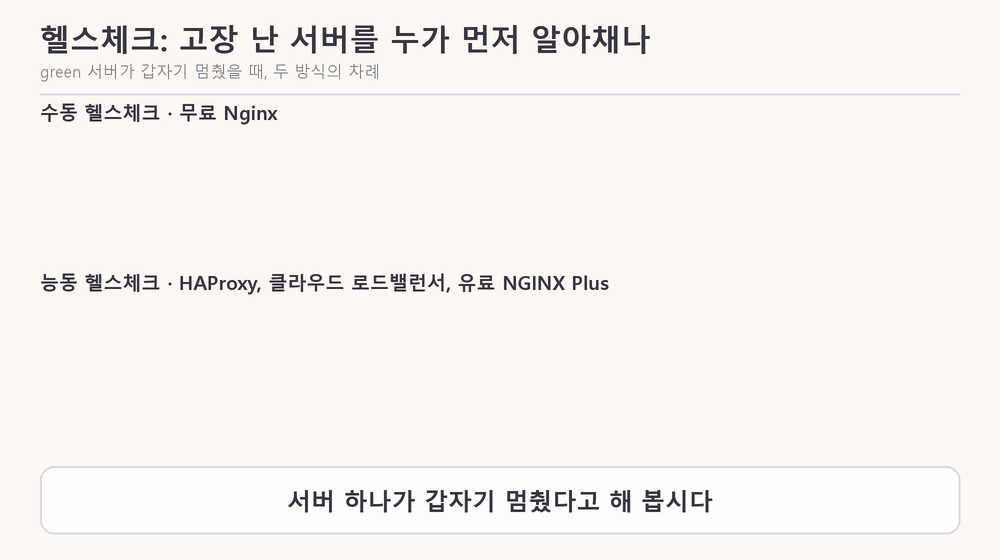

| | 능동 헬스체크 | 수동 헬스체크 |
|---|---|---|
| 알아채는 방법 | 몇 초마다 `/health`로 먼저 물어봄 | 실제 요청이 실패한 것을 보고 앎 |
| 먼저 알아채는 쪽 | load balancer | 사용자의 요청 |
| 사용자가 겪는 실패 | 확인 주기 사이에 간 요청 정도 | 알아채는 데 쓰인 요청과 그 요청이 실패하기까지 기다린 시간 |
| 지원 | HAProxy, 클라우드 load balancer, 유료 NGINX Plus | 무료 Nginx를 포함한 대부분 |

- 노드에는 Nginx가 server를 뺄 때 운영자에게 알려 주는 알림 이야기가 없다.
- 오늘 노드의 실습 대상은 내 도장 앱이 아니라 템플릿의 에이전트 서비스(`friend-agent`)다.

#### 4-2. 연결 대기 시간은 짧을수록 좋은가

짧으면 고장 난 server를 빨리 포기해서 빠르지만, 너무 짧으면 정상인데 조금 느린 server까지 실패로 판정한다.

> [그림 8] 기본값 60초와 1초를 같은 눈금에 놓으면 1초는 60분의 1이다. 아래 줄의 숫자는 설명용 예시다.

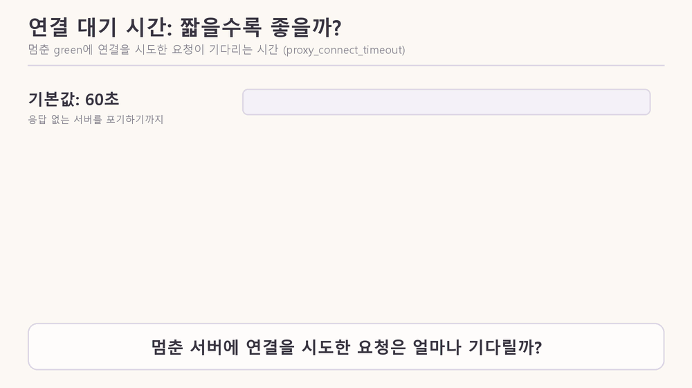

- 노드 5장에서 `proxy_connect_timeout`의 기본값은 60초다. server가 아예 응답하지 않으면 그 60초가 지나야 실패로 보고 다른 server로 넘기므로, 그동안 그 server 차례의 사용자는 멈춘 화면을 본다.
- 1초로 줄이면 실패가 거의 없어지지만, green 차례였던 요청은 1초쯤 늦게 응답한다. 그래서 정상일 때 걸리는 시간보다는 넉넉하게, 그러나 60초보다는 훨씬 짧게 잡는다. 구체적인 숫자는 노드에 없다.

> [그림 9] 같은 요청, 대기 한도만 다르다. 위는 기본값 60초, 아래는 1초. 시간 눈금과 blue의 응답 시간은 설명용 예시다.

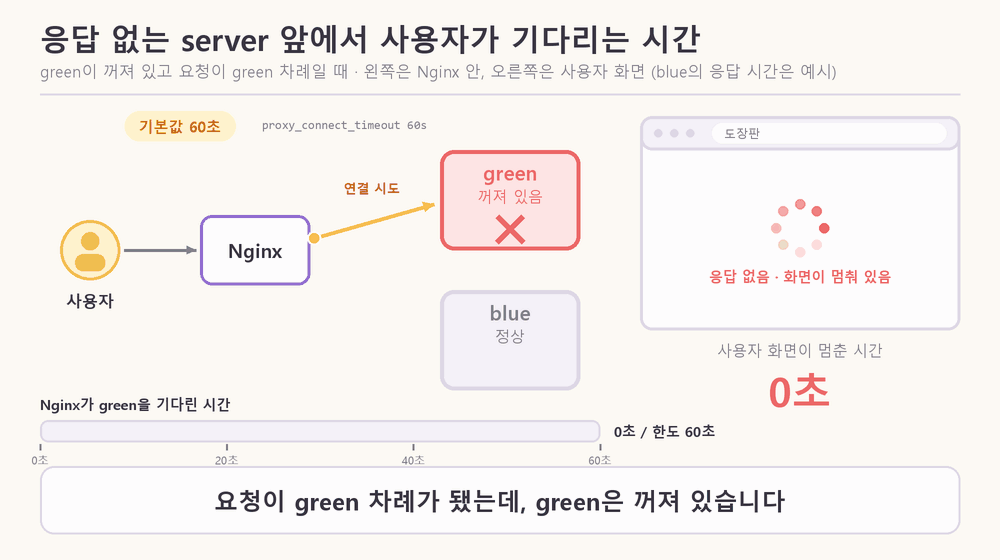

#### 4-3. Nginx 한 대가 단일 장애점인 이유

availability는 서비스를 쓸 수 있었던 시간의 비율이고, 99%는 1년에 약 3.65일 멈춰도 되는 수준이다. SPOF(단일 장애점)는 그것 하나만 고장 나도 전체가 멈추는 부분이고, 같은 일을 하는 것을 하나 더 두는 것이 이중화다. 사용자는 Nginx 주소 하나만 알기 때문에, Nginx가 멈추면 뒤의 server가 멀쩡해도 요청이 못 들어간다.

> [그림 10] availability가 99%, 99.9%, 99.99%, 99.999%일 때 1년 중 멈춰도 되는 시간(노드 2장). 막대 길이는 시간에 비례하고 99.99%와 99.999%는 너무 짧아 최소 두께로 그렸다.

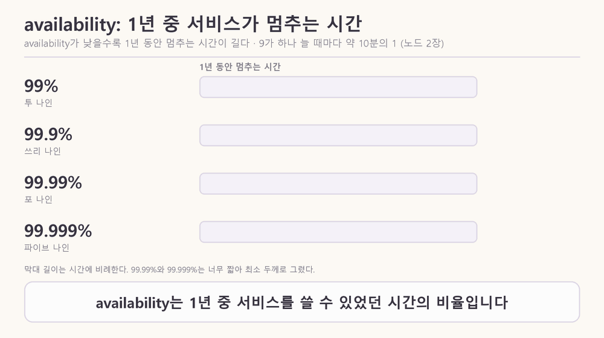

> [그림 11] A는 Nginx 한 대, B는 두 대(액티브-스탠바이)와 가상 IP.

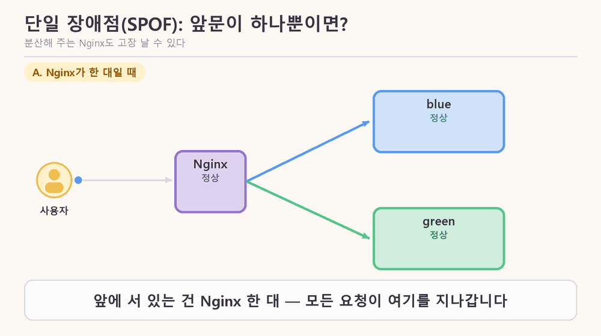

- 해결은 Nginx도 두 대로 두고 가상 IP 하나를 함께 쓰는 것이다. 평소에는 주 Nginx가 그 주소를 갖고 있다가, 멈추면 예비가 넘겨받는다. 사용자는 같은 주소로 접속하니 바뀐 줄 모른다.
- 이중화는 속도를 높이려는 것이 아니다. 액티브-스탠바이는 한 대가 일하고 한 대는 기다리는 방식이다. 노드도 Nginx를 여러 대 두면 빨라진다고는 말하지 않는다.

### 5. 전환하니 대화가 사라진 이유와 해결

#### 5-1. 상태가 container 메모리에 있었다

노드 5장에서 blue가 받을 때 "내일 아침 8시에 물 마시라고 알려 줘"를 보내면 약속이 만들어진다. 그다음 순서는 이렇다.

1. green으로 전환하면 약속이 보이지 않는다(blue 안에는 그대로 있다).
2. blue로 돌아오면 다시 보인다.
3. `docker restart blue`를 하면 메모리가 비워져 약속이 진짜로 사라진다.

원인은 약속을 container의 메모리에만 두었기 때문이다. 상태는 server가 요청 사이에 기억해 둔 정보이고, container의 메모리는 프로그램의 변수와 같아서 container마다 따로 있고 다시 시작하면 비워진다. 이 노드에서 「server」는 공간을 빌려주는 컴퓨터가 아니라 프로그램이 실제로 돌고 있는 것(container)이고, 기억을 오래 맡아 두는 곳은 DB다.

- 처음에 "방향을 바꾸면 사라진다"고 이해했던 것은 정확하지 않았다. 정확히는 새 방향에서는 안 보일 뿐이고, 재시작하거나 새 버전으로 교체할 때 진짜로 사라진다.
- 해결은 약속을 blue와 green이 함께 보는 DB(Supabase)에 저장하는 것이다. 그러면 어느 쪽으로 전환해도, container를 껐다 켜도 대화가 이어진다. 이렇게 상태를 자기 안에 두지 않는 server가 무상태 server다.

#### 5-2. DB를 붙인 뒤 새로 생기는 위험

DB는 하나인데 server는 두 벌이라, 두 버전이 같은 DB를 함께 쓰게 된다. 한쪽 버전이 테이블 구조를 바꾸면 다른 쪽이 바로 영향을 받는다.

| | DB 붙이기 전 | DB 붙인 뒤 |
|---|---|---|
| 기억이 있는 곳 | blue와 green이 각자의 메모리 | blue와 green이 같은 DB |
| 두 버전의 영향 | 서로 영향 없음 | 한쪽이 테이블 구조를 바꾸면 다른 쪽이 영향받음 |
| 대화 | 전환하면 안 이어짐 | 이어짐 |

식당으로 빗대면, 두 주방이 같은 주문 게시판을 쓰는데 새 주방이 게시판의 "메뉴" 칸 이름을 "음식"으로 바꾸면 옛 주방은 주문을 읽지 못한다. 전환 중에는 두 주방이 모두 일하고, 롤백해도 게시판은 이미 바뀐 상태다. 그래서 테이블 구조를 바꾸는 일은 여러 번에 나눈다. 이 순서를 확장-축소 패턴(expand and contract)이라고 한다.


- 오늘 실습에서는 두 container의 코드가 같아서 이 문제가 실제로 일어나지는 않고, 위험을 말로 짚어 준다.
- Supabase 익명 로그인을 붙이고 publishable key는 브라우저로, secret key는 server에서만 쓴다. secret key는 RLS(행 단위 접근 제한)를 건너뛰어 모든 사용자의 데이터를 읽고 쓸 수 있기 때문이다.

### 6. 내 프로젝트에서 이 일은 어디서 일어나고 있었나

#### 6-1. 배포 파이프라인의 마지막 칸

내 `deploy.yml`은 main에 push하면 위에서 아래로 자동 실행되는 다섯 칸이고, 마지막 칸 「Cloud Run 배포」 안에서 이전 버전이 새 버전으로 교체된다. 오늘 노드는 이 교체가 사용자에게 안 끊기게 하는 원리다.

> [그림 12] main에 push하면 다섯 칸이 차례로 자동 실행되고, 마지막 칸 안쪽에서 이전 리비전이 새 리비전으로 교체된다.

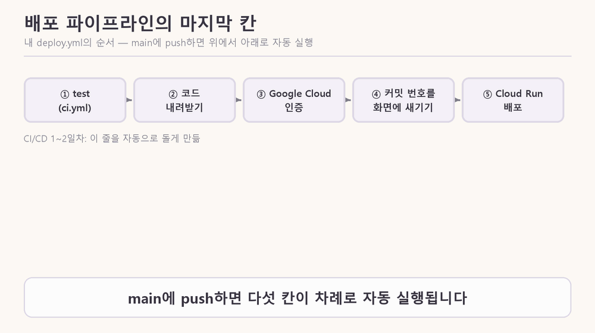

- 노드 1장은 "Dockerfile로 이미지를 만들 수 있는 상태에서 시작"한다고 하고, 오늘 실습은 Google Cloud 없이 내 컴퓨터의 Docker로만 한다. GitHub Actions도 Cloud Run도 오늘 실습에는 나오지 않는다.
- CI/CD 1일차에 만든 파이프라인이 "main에 합치면 자동 배포"까지였다면, 오늘은 그 마지막 칸이 사용자에게 안 끊기게 하는 원리다.

#### 6-2. Cloud Run이 대신 해 주던 일

> [그림 13] 왼쪽이 오늘 직접 만든 것, 오른쪽이 Cloud Run에서 대응하는 것.

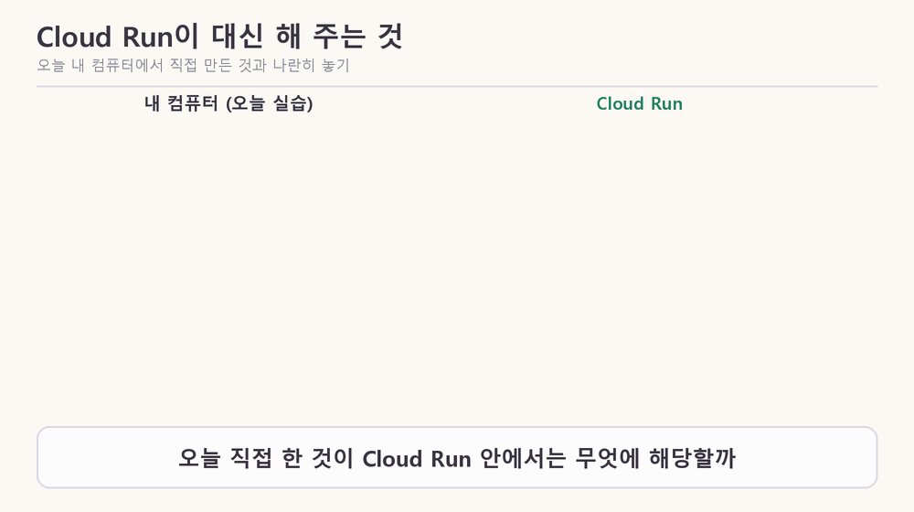

- 문서에 따르면 Cloud Run은 container를 실행하는 완전 관리형 플랫폼이고, 서비스는 안정적인 주소 하나로 요청을 받으며 무상태 container 인스턴스를 쓴다. 새 리비전에 트래픽 1%만 보내 보는 점진적 롤아웃도 지원한다.
- 리비전은 배포할 때마다 생기고, container 이미지와 환경변수·메모리 제한 같은 설정으로 이루어지며, 만든 뒤에는 수정할 수 없다(설정을 바꾸면 새 리비전).
- scale to zero는 요청이 없으면 인스턴스가 0개까지 줄고 새 요청이 오면 새로 만드는 것이다. 그러면 인스턴스 메모리의 대화도 같이 사라지니 DB가 필요하다(이 연결은 내 추론이다).
- 내 기록에는 CI/CD 1일차에 일부러 nginx 설정 오류를 넣은 PR #5를 배포했을 때 리비전 00003이 시작에 실패했고, 사용자는 00002를 계속 받았으며, PR #6으로 되돌리니 00004가 떴다고 적혀 있다. 새 버전이 못 뜨는 동안 이전 버전이 받는다는 점은 오늘 배운 블루그린과 같은 모양이다. 다만 Cloud Run이 그렇게 동작하는 내부 규칙은 읽은 문서에 없어서 확인하지 못했다.

#### 6-3. 내 도장 앱은 load balancer 뒤에 있나

- 도장 앱은 `index.html` 한 파일이고 main에 머지하면 Cloud Run에 자동 배포된다(README, deploy.yml). 앞단에 직접 만든 load balancer는 보이지 않는다.
- 1일차 Dockerfile(커밋 `cbe14b1`)의 첫 줄은 `FROM nginxinc/nginx-unprivileged:alpine`이고, 컨테이너 안의 Nginx는 파일을 내주는 web server 역할이다. 오늘 실습의 Nginx와는 다른 쓰임이다.

### 7. 실습 준비: Docker 이미지 찾기와 기본 명령

노드 4장의 `nginx:1.27-alpine`처럼 이미지 이름은 노드와 Dockerfile에 이미 있다. 직접 찾을 때는 hub.docker.com에서 `nginx`를 검색하거나 `docker search nginx`를 쓰고, Claude에게 요청해도 된다(노드에도 「코딩 에이전트에게 맡길 때」 프롬프트가 있다. 이름과 tag는 직접 확인한다).

- 이미지는 container를 실행하는 데 필요한 파일, 바이너리, 라이브러리, 설정을 담은 변경 불가(immutable) 패키지이고, Docker Hub가 기본 저장소다(Docker 문서).
- `docker run`은 문서에 「필요하면 이미지를 pull하고 container를 시작」한다고 되어 있고, 기본값(`--pull missing`)에서는 내 컴퓨터에 없을 때만 받는다. Nginx를 설치하는 것이 아니라 Nginx가 든 이미지를 받아 container로 실행하는 것이다.

| 명령 | 하는 일 |
|---|---|
| `docker search nginx` | Docker Hub에서 이미지 검색 (결과: `nginx` OFFICIAL [OK], STARS 21410 외 4건) |
| `docker pull nginx:1.27-alpine` | 이미지 내려받기 |
| `docker run -d --name bg-nginx -p 8080:80 nginx:1.27-alpine` | 이미지로 container 실행 |
| `docker images` | 내 컴퓨터의 이미지 목록 |
| `docker ps` | 실행 중인 container 목록 |
| `docker logs blue` | container 로그 |
| `docker exec bg-nginx nginx -t` | 실행 중인 container 안에서 명령 실행 |
| `docker stop` / `start` / `restart green` | 멈춤 / 시작 / 재시작 |
| `docker rm -f blue green` | container 삭제 |
| `docker network create bg-lab` | container끼리 이름으로 찾는 network 만들기 |

- 이 컴퓨터의 이미지는 `routine-stamp:pdf`, `routine-stamp:local`, `python:3.13-slim-bookworm`이다(Docker 29.9.2).

---

## 오늘의 미션

### 실습 환경

- 이번 세션에서는 노드의 실습(blue, green, Nginx container를 띄우고 전환·장애 실험)을 직접 실행하지 않았다. 노드 7장을 전부 읽고, 개념을 질문하며 이해하는 방식으로 진행했다.
- 이 컴퓨터에서 확인한 것: Docker 29.9.2가 설치되어 있다. 노드가 쓰는 이미지 `friend-agent:local`은 이 컴퓨터의 이미지 목록에 없고, 템플릿 폴더 루트에는 Dockerfile이 없다(`scripts/watch_requests.py`와 `docs/start-states.md`는 있다).

### 추가 과제 (오늘 학습 방식)

| 과제 | 하는 일 | 상태 |
|---|---|---|
| 실습을 Docker Compose 파일 하나로 진행하기 | blue, green, bg-nginx, network, 설정 폴더 연결을 `compose.yaml` 하나에 적고 `docker compose up` 한 번으로 띄움 | 시도하지 않음 |
| 롤링 배포를 Nginx로 직접 해보기 | container 세 개를 upstream에 두고 한 대씩 `down`으로 빼고 새 버전으로 바꾼 뒤 다시 넣기를 반복 | 시도하지 않음 |
| 능동 헬스체크를 직접 만들기 | 2초마다 green의 `/health`를 묻다가 두 번 연속 실패하면 upstream에서 빼고 reload하는 작은 스크립트 | 시도하지 않음 |

- 한계: 세 과제는 모두 이미지를 만들고 container를 띄워야 해서, 이번 세션에서는 준비하지 못했다.

---

## 잘 된 점 · 막힌 점 · 어떻게 해결했나

### 잘 된 점

| 잘 된 것 | 근거 |
|---|---|
| 노드 7장을 전부 읽었다 | LMS 7개 스텝을 Chrome으로 열어 본문 텍스트를 읽음 (그림과 시뮬레이터는 설명 글만 읽음) |
| 모르는 말을 넘기지 않고 맥락까지 확인했다 | proxy와 upstream의 관계, 상태가 메모리에 있다는 말, 롤백이 되는 이유를 노드 본문과 Nginx·Cloud Run 문서로 대조함 |
| 처음 이해가 틀린 곳을 바로잡았다 | "방향을 바꾸면 사라진다"를 "새 방향에서 안 보일 뿐"으로 정정 |

### 막힌 점

| 막힌 곳 | 원인 | 어떻게 풀었나 |
|---|---|---|
| LMS 주소가 로그인 화면으로 넘어감 | 도구에 내 로그인 세션이 없음 (307 리다이렉트) | `claude --chrome`으로 다시 접속해 로그인된 Chrome으로 읽음 |
| 노션 학습 페이지가 404 (`object_not_found`) | 노션 연결이 개인 워크스페이스에만 걸려 있음 (이유는 확인 못 함) | 재인증해도 같았음. 미해결이고, Chrome으로 읽는 것으로 대체 |
| 개념마다 용어가 먼저 나오고 설명이 뒤따라 이해가 끊김 | 정의 없이 용어를 쓰거나, 질문을 한꺼번에 받아 개념을 나란히 비교함 | 정의를 개념이 처음 필요해지는 자리에 두고, 요청이 지나가는 순서로 보고서를 재구성함 |

### 새로 알게 된 것

- 「요청이 안 끊김」과 「하던 일이 이어짐」은 다른 검사이고, 무상태는 뒤쪽을 가능하게 하는 조건이다.
- proxy는 요청을 넘기는 동작이고, upstream은 넘겨받을 server의 목록이며, `proxy_pass`가 upstream의 이름으로 둘을 잇는다.
- 무료 Nginx는 수동 헬스체크라서 고장을 사용자가 먼저 겪는다. 대기 시간(기본 60초)이 길수록 그 비용이 커진다.
- 블루그린의 롤백이 빠른 이유는 이전 버전을 끄지 않고 남겨 두기 때문이다.
- weight는 운영자가 정하는 숫자이고, 카나리는 작게 시작해 단계적으로 올린다.
- load balancer도 단일 장애점이 될 수 있다.
- DB를 붙이는 순간 코드만이 아니라 테이블 구조를 바꾸는 순서까지 신경 써야 한다.

---

## 오늘의 회고

### 처음 적은 답과 실제 비교

- 노드 1장의 시작 질문은 "에이전트 서비스가 새 버전으로 바뀌는 순간, 사용자에게는 무슨 일이 일어날 수 있을까요?"였다.
- 처음 적은 답: (신서연 님이 입력창에 적은 내용을 넣을 자리. 이 세션에서는 확인하지 못했다.)
- 실제로 알게 된 것: 일어날 수 있는 일은 두 가지로 나뉜다. 요청이 끊기는 것(오류, 멈춤)과 하던 일이 이어지지 않는 것(대화 사라짐).

### 같은 문제가 다시 생기면 확인할 순서

1. 배포하는 동안 요청이 끊겼나? (실패 수, 대기 시간)
2. 사용자가 하던 일이 이어졌나? (상태가 server 메모리에 있는지, DB에 있는지)
3. 요청이 어느 server로 가고 있나? (`/version`, load balancer 설정)
4. 고장을 누가 먼저 알아채는 구조인가? (능동인지 수동인지, 대기 시간)
5. 이전 버전이 남아 있어서 롤백할 수 있나?
6. DB를 함께 쓴다면 테이블 구조를 바꾼 것이 이전 버전을 깨뜨리지 않나?

### 남은 의문과 숙제

- 추가 과제 3개를 직접 해 보기.
- 가중치 44:55 같은 값을 실제로 넣으면 어떻게 나오는지 직접 확인하기.
- Cloud Run이 새 리비전이 못 뜰 때 이전 리비전을 계속 쓰는 내부 규칙 확인하기.
- 이전 버전을 언제 끄는 것이 적절한지에 대한 구체적인 기준.
- blue와 green이라는 이름이 어디서 왔는지.
- 노션 연결이 학습 워크스페이스를 읽지 못하는 원인.

---

## 부록

### 노드에 나온 명령어 (이번에는 직접 실행하지 않음)

```text
docker network create bg-lab
docker run -d --name blue  --network bg-lab -e LLM_PROVIDER=fake -e K_REVISION=blue  -e BANNER=BLUE  friend-agent:local
docker run -d --name green --network bg-lab -e LLM_PROVIDER=fake -e K_REVISION=green -e BANNER=GREEN friend-agent:local
docker run -d --name bg-nginx --network bg-lab -p 8080:80 -v "$HOME/bluegreen-lab:/etc/nginx/conf.d" nginx:1.27-alpine
docker exec bg-nginx nginx -t
docker exec bg-nginx nginx -s reload
python scripts/watch_requests.py http://localhost:8080 --seconds 60
docker stop green
docker restart blue
```

### 확인하지 못한 것

- 노드의 그림과 시뮬레이터: 설명 글만 읽었고 직접 돌려 보지 않았다.
- 노드의 실습과 추가 과제: 직접 실행하지 않았다.
- Cloud Run의 내부 규칙(리비전 전환 시 이전 인스턴스가 언제 종료되는지 등): 읽은 문서에 없다.
- blue와 green이 왜 그 색인지, Nginx를 재시작할 때 처리 중 요청이 어떻게 되는지: 노드에 없다.
- 처음 적은 시작 질문의 내 답: 이 세션에서 확인하지 못했다.

### 같이 정리한 것

- 모션 그림 11개와 제작 코드: `_drafts/notion-figs-d3/`, `_drafts/make_figs_d3/`
- 작업대장 기록: routine-stamp-trial W-003
