# 신서연 — 서비스 배포 전략 1일차: 로드밸런서로 무중단 배포 구성하기

> 학습 템플릿 (2조) › 신서연. 노드 "로드밸런서로 무중단 배포 구성하기"(8번, 7스텝)를 끝까지 읽고, 모르는 말을 하나씩 되물으며 이해했다. '오늘 학습 방식'의 추가 과제 3개는 이번 세션에서 시도하지 않았다(아래 "오늘의 미션" 참고).

## 한눈에 보기

- **문제**: 자동 배포를 하면 새 버전이 하루에도 여러 번 나간다. 새 버전으로 바뀌는 그 몇 초 동안 사용자가 오류를 보거나, 방금 나눈 대화가 사라질 수 있다.
- **원인**: 두 가지. ① 서버가 한 벌뿐이면 교체하는 동안 요청을 받을 곳이 없다. ② 대화와 약속을 서버(컨테이너) 메모리에만 두면, 요청이 다른 서버로 가거나 서버를 다시 시작할 때 보이지 않거나 사라진다.
- **해결**: 서버를 두 벌(blue, green) 두고 앞에 Nginx 로드밸런서를 세워서, 설정 한 줄과 reload로 요청이 가는 방향만 바꾼다(블루그린). 대화는 서버 밖의 DB(Supabase)에 두어 어느 서버로 가도 이어지게 한다.
- **과제**: 추가 과제 3개(Compose 한 파일로 실습, Nginx로 롤링 배포, 능동 헬스체크 만들기)는 아직 시도하지 않았다.
- **가장 헷갈렸던 것**: 「요청이 끊기지 않는 것」과 「하던 일이 이어지는 것」은 따로 확인해야 한다 → 아래 "그림으로 보기" 1번. 그 밖에 프록시와 로드밸런서, 상태가 서버 안에 있다는 말, 롤백이 되는 이유도 되물었다.

---

## 오늘의 주제

**서비스를 끄지 않고 새 버전으로 바꾸는 법, 그리고 그때 사용자가 하던 일이 이어지게 하는 법.**

## 오늘의 목표

- 가용성, 단일 장애점, 이중화, 무상태가 무엇이고 고가용성 서비스에서 각각 무엇을 막는지 설명한다.
- 롤링, 블루그린, 카나리 배포의 차이와, 무중단 배포에서 헬스체크, 그레이스풀 셧다운, DB 호환성이 필요한 이유를 설명한다.
- 로드밸런서가 서버를 고르고 고장 난 서버를 알아채는 방식과, Nginx가 리버스 프록시와 로드밸런서로 하는 일을 설정 파일로 읽는다.
- 내 컴퓨터에서 Nginx와 에이전트 서비스 두 벌을 컨테이너로 띄우고, 설정 한 줄로 블루그린 전환과 롤백을 하는 과정을 이해한다.
- 전환하는 동안과 서버 하나가 멈췄을 때의 요청 실패를 측정하는 실험이 Nginx 설정과 어떻게 이어지는지 설명한다.
- Supabase에 데이터와 익명 로그인을 붙이면 어느 쪽으로 전환해도 대화가 이어지는 이유를 설명한다.

---

## 오늘 나오는 낯선 말

> 이 보고서의 비유는 한 무대로만 쓴다. **식당**이다. 손님 = 사용자, 입구 안내 직원 = 로드밸런서(Nginx), 주방 = 서버, 주방 직원이 머릿속에 기억한 주문 = 서버 메모리, 모두가 보는 주문 게시판 = DB.

| 말 | 쉬운 뜻 | 노드에서 |
|---|---|---|
| 가용성 | 서비스를 쓸 수 있었던 시간의 비율. 99%는 1년에 약 3.65일 멈춰도 되는 수준 | 스텝 2 |
| 단일 장애점(SPOF) | 그것 하나만 고장 나도 전체가 멈추는 부분. 서버가 한 대면 그 서버가 SPOF | 스텝 2 |
| 이중화 | 같은 일을 하는 것을 하나 더 두어 SPOF를 없애는 것 | 스텝 2 |
| 무상태 서버 | 요청 사이의 기억을 자기 안에 두지 않는 서버. 기억은 서버 밖 공용 저장소(DB)에 둔다 | 스텝 2 |
| 로드밸런서 | 서비스 주소 하나로 온 요청을 뒤의 여러 서버에 나눠 보내는 장치 | 스텝 3 |
| 프록시 / 리버스 프록시 | 요청을 대신 받아 다른 곳에 넘기고 응답도 대신 돌려주는 중간 창구. 서버 쪽에 서서 바깥에서 들어오는 요청을 받으면 리버스 | 스텝 3 |
| 헬스체크 (능동 / 수동) | 서버가 살아 있는지 알아내는 방법. 능동은 먼저 물어보고, 수동은 실제 요청이 실패해야 앎 | 스텝 3 |
| 드레이닝 / 그레이스풀 셧다운 | 서버 한 대를 뺄 때 새 요청은 끊고 하던 요청은 끝까지 마치게 한 뒤 끄는 동작. 배포 방식의 이름이 아니라, 롤링 같은 방식의 한 단계로 쓰이는 부품 | 스텝 2·3 |
| 롤링 / 블루그린 / 카나리 | 서버를 한 대씩 교체 / 두 벌을 두고 방향을 한 번에 전환 / 일부 요청만 먼저 새 버전으로 | 스텝 2 |
| 가중치(weight) | 요청을 서버별로 몇 배씩 보낼지 정하는 설정 숫자. 가용성의 99%와 이름만 비슷하고 다른 개념 | 스텝 3·5 |
| 리비전 | Cloud Run에서 배포할 때마다 생기는 버전 기록. 이미지와 설정을 묶은 한 벌이고 만든 뒤 수정할 수 없다 | 문서 |
| scale to zero | 요청이 없으면 인스턴스가 0개까지 줄어드는 것 | 문서 |
| reload | Nginx를 다시 시작하지 않고 설정만 다시 읽게 하는 것 | 스텝 3·5 |

---

## 그림으로 보기

> 아래 그림은 내가 직접 설계한 모션 그림이고 Notion에는 움직이는 GIF로 올린다. 통합 흐름 그림(그림 1)은 구성 요소별 파스텔 색(blue 하늘색, green 민트, Nginx 라벤더, DB 분홍, 사용자 노랑, 실패 코랄)을 쓰고, 나머지 그림은 청록(blue), 앰버(green), 회색(Nginx), 빨강(실패)으로 통일했다. 그림이 안 보여도 읽을 수 있게 표를 함께 둔다.

### 0. 한눈에: 네 단계가 한 흐름이다

> [그림 1] ① 버틴다 → ② 바꾼다 → ③ 돌린다 → ④ 이어간다. 같은 구성(사용자, Nginx, blue, green, DB)에 부품이 하나씩 더해진다. ④에서는 같은 화면에서 메모리에 둘 때의 문제와 DB에 둘 때의 해결을 이어서 본다.

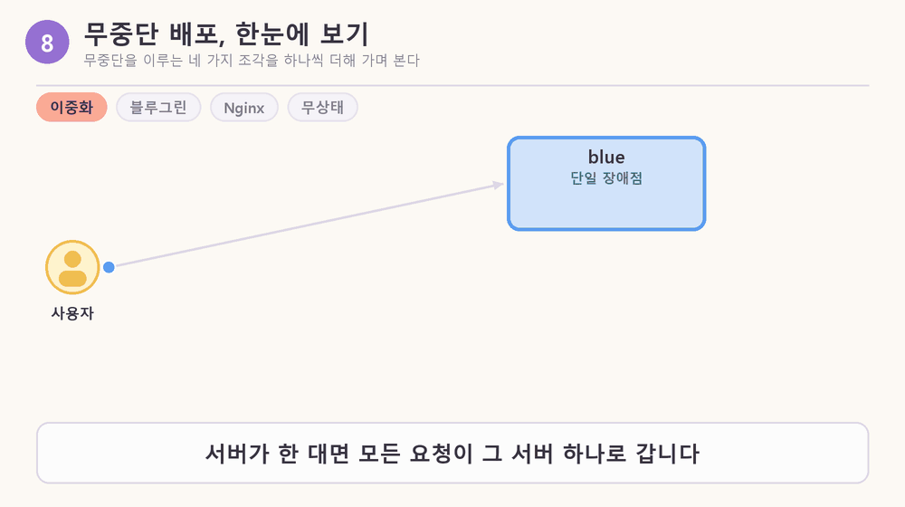

| 단계 | 한 줄 | 이름 |
|---|---|---|
| ① 버틴다 | 하나가 고장 나도 안 멈추게 같은 것을 두 벌 둔다 | 이중화, 고가용성 |
| ② 바꾼다 | 끄지 않고 새 것을 올린 뒤 방향만 바꾼다 | 블루그린 배포 |
| ③ 돌린다 | 방향을 바꾸는 장치가 Nginx. 서버 한 줄이면 리버스 프록시, 두 줄이면 로드밸런서 | 리버스 프록시, 로드밸런서 |
| ④ 이어간다 | 기억을 서버가 아니라 DB가 갖는다. 그래야 방향을 바꿔도 새 서버가 대화를 이어받는다 | 무상태, Supabase |

### 1. 「무중단」이라고 말하려면 무엇을 봐야 하나?

한 줄로: 무중단은 두 가지를 **따로** 확인해야 한다. 요청이 끊기지 않았는가, 사용자가 하던 일이 이어지는가.

| | 묻는 것 | 노드 실험 결과 | 해결 도구 |
|---|---|---|---|
| 요청이 끊기지 않음 | 배포하는 동안 사용자가 오류를 봤나 | blue에서 green으로 전환할 때 실패 0건 | 로드밸런서, 블루그린, 헬스체크 |
| 하던 일이 이어짐 | 대화와 약속이 그대로 남았나 | 전환하니 약속이 보이지 않음 | 무상태(상태를 DB로) |

- 무상태는 서버의 **성질**(기억을 자기 안에 두지 않음)이고, 하던 일이 이어지는 것은 그 **결과**다.
- 노드는 5장에서 요청이 안 끊겨도 대화가 사라진 상태를 "무중단 배포라고 하기 어렵다"고 한다.
- 영업 중인 식당의 보수공사로 빗대면, 주방을 닫고 고치는 것이 아니라 옆에 새 주방(green)을 지어 두고 손님을 옮기는 것이다. 이때 직원이 주문을 머릿속에만 기억하면 직원을 바꾸는 순간 주문이 사라지고, 주문을 게시판(DB)에 적어 두면 누가 바뀌어도 이어진다. 그래서 노드는 "무상태여야 서버를 마음대로 늘리고, 빼고, 새 버전으로 바꿀 수 있다"고 한다.

### 2. 프록시, 리버스 프록시, 로드밸런서는 무엇이 다른가?

한 줄로: Nginx는 한 가지 일만 하는 장치가 아니라 **여러 역할을 하는 프로그램**이고, 그중 한 역할이 로드밸런서다.

| 역할 | 하는 일 |
|---|---|
| 웹 서버 | HTML, 이미지 같은 파일을 그대로 꺼내 응답 |
| 리버스 프록시 | 요청을 받아 뒤의 서버에 넘기고 응답을 사용자에게 돌려줌. 뒤의 서버는 바깥에 직접 드러나지 않음 |
| 로드밸런서 | 리버스 프록시를 넓힌 것. 뒤의 서버가 여러 대면 규칙(라운드 로빈, 가중치 등)으로 나눠 보냄 |

- 오늘 실습에서 `upstream`에 서버를 한 줄만 두면 리버스 프록시, 두 줄을 두면 로드밸런서로 동작한다. 같은 Nginx이고 설정만 다르다.
- blue와 green에는 `-p`로 포트를 열지 않았다. 그래서 내 컴퓨터에서 직접 들어갈 수 없고 같은 네트워크의 Nginx만 요청을 넘길 수 있다.

> [그림 2] proxy는 요청과 응답을 대신 받아 넘겨 주는 중간 창구다. 사용자 쪽에 서면 forward proxy, server 쪽에 서면 reverse proxy(Nginx의 역할)다.

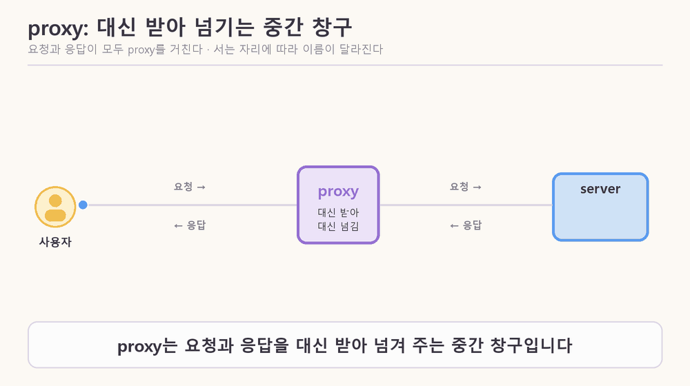

### 3. 「상태가 서버 안에 있다」는 말은 무슨 뜻인가?

한 줄로: 상태는 서버가 요청 사이에 **기억해 둔 정보**이고, 서버 안에 있다는 것은 그 정보가 컨테이너의 **메모리**에 있다는 뜻이다.

- 컨테이너의 메모리는 프로그램의 변수와 같다. 컨테이너마다 따로 있고 컨테이너를 다시 시작하면 비워진다.
- 이 노드에서 「서버」는 공간을 빌려주는 컴퓨터가 아니라 **프로그램이 실제로 돌고 있는 것**(컨테이너)이다. 기억을 오래 맡아 두는 곳은 DB다.
- 노드 5장 순서: blue가 받을 때 약속을 만들면 blue 메모리에 저장된다 → green으로 전환하면 약속이 보이지 않는다(blue 안에는 그대로 있음) → blue로 돌아오면 다시 보인다 → `docker restart blue`를 하면 메모리가 비워져 진짜로 사라진다.
- 처음에 "방향을 바꾸면 사라진다"고 설명했던 것은 정확하지 않았다. 정확히는 **새 방향에서는 안 보일 뿐이고, 재시작하거나 새 버전으로 교체할 때 진짜로 사라진다.**

### 4. 고장 난 서버를 누가 먼저 알아채나?

한 줄로: 무료 Nginx는 실제 요청이 실패해야 알아채므로 **사용자가 먼저 겪고**, 능동 헬스체크는 로드밸런서가 먼저 물어서 알아챈다.

> [그림 3] 위: 수동 헬스체크(무료 Nginx). 아래: 능동 헬스체크.

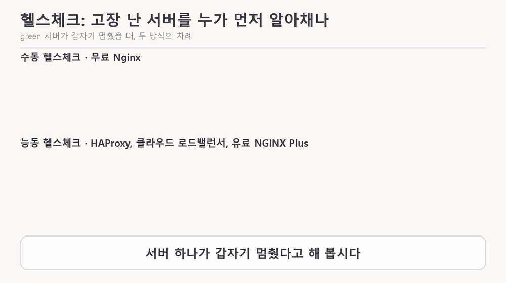

| | 능동 헬스체크 | 수동 헬스체크 |
|---|---|---|
| 알아채는 방법 | 몇 초마다 `/health`로 먼저 물어봄 | 실제 요청이 실패한 것을 보고 앎 |
| 사용자가 겪는 실패 | 확인 주기 사이에 간 요청 정도 | 알아채는 데 쓰인 요청과 그 요청이 실패하기까지 기다린 시간 |
| 지원 | HAProxy, 클라우드 로드밸런서, 유료 NGINX Plus | 무료 Nginx를 포함한 대부분 |

- 오늘 노드의 실습 대상은 내 도장 앱이 아니라 템플릿의 에이전트 서비스(`friend-agent`)다. 도장 앱은 `index.html` 한 파일이고 Cloud Run에 바로 배포하며, deploy.yml과 README로 보면 앞단에 직접 만든 로드밸런서는 없다.
- 노드에는 Nginx가 서버를 뺄 때 운영자에게 알려 주는 알림 이야기가 없다.

### 5. 연결 대기 시간은 짧을수록 좋은가?

한 줄로: 짧으면 고장 난 서버를 빨리 포기해서 빠르지만, **너무 짧으면 정상인데 조금 느린 서버까지 실패로 판정**한다.

> [그림 4] 기본값 60초와 1초를 같은 눈금에 놓으면 1초는 60분의 1이다. 아래 줄의 숫자는 설명용 예시다.

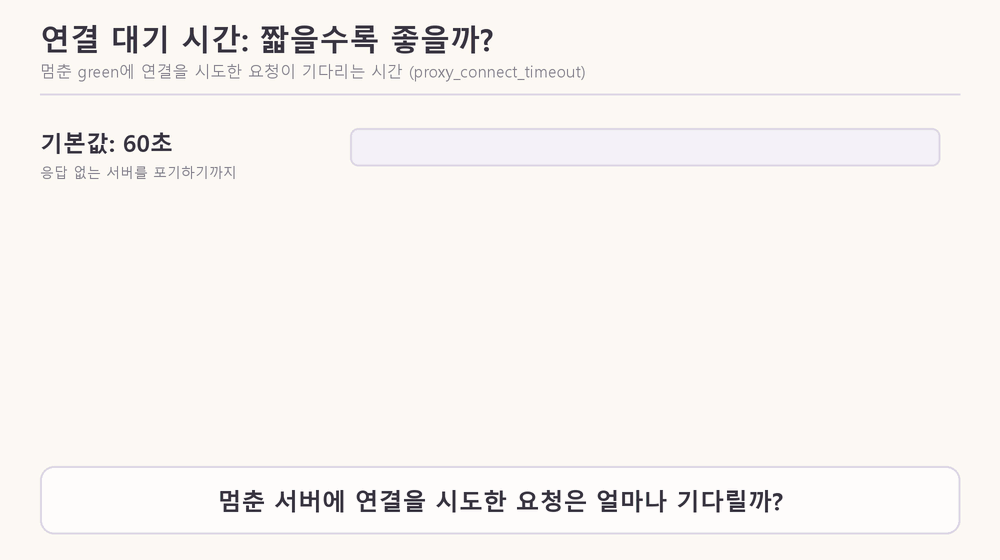

- 노드 5장에서 `proxy_connect_timeout`의 기본값은 60초다. 서버가 아예 응답하지 않으면 그 60초가 지나야 실패로 보고 다른 서버로 넘기므로, 그동안 그 서버 차례의 사용자는 멈춘 화면을 본다.
- 1초로 줄이면 실패가 거의 없어지지만, green 차례였던 요청은 1초쯤 늦게 응답한다. 그래서 정상일 때 걸리는 시간보다는 넉넉하게, 그러나 60초보다는 훨씬 짧게 잡는다. 구체적인 숫자는 노드에 없다.

### 6. 가중치 3:1, 9:1, 99:1은 무엇인가?

한 줄로: **요청을 서버별로 몇 개씩 보낼지의 비율**이고, 설정 파일의 숫자라서 운영자가 정한다. 가용성의 99%와는 다른 개념이다.

> [그림 5] green이 새 버전이라고 가정했을 때, 새 버전이 받는 요청의 비율이다.

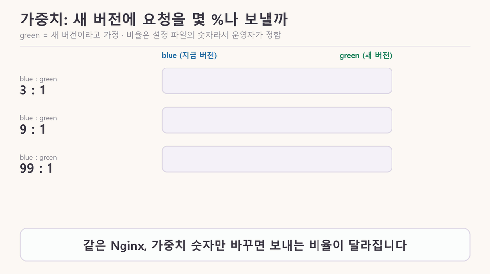

| 가중치 (blue : green) | green이 받는 요청 | 의미 |
|---|---|---|
| 3 : 1 | 25% | 노드의 실습 예시 (실습에서는 약 75% 대 25%) |
| 9 : 1 | 10% | 카나리: 일부에게만 시험 |
| 99 : 1 | 1% | 카나리: 아주 일부 |
| 44 : 55 | 약 55.6% | 산수로 계산한 값. 직접 돌려 보지는 않았다 |

- 카나리 배포 도식의 "이전 리비전 90% : 새 리비전 10%"도 같은 비율이다. 90은 이전 버전이 받는 요청의 비율, 10은 새 버전이 받는 요청의 비율이다(Cloud Run은 이 비율을 리비전별 트래픽 비율로 다룬다).
- 99 : 1의 "99"와 가용성 99%의 "99"는 겹쳐 보이지만 서로 다른 말이다. 가용성은 1년 중 쓸 수 있었던 시간의 비율이고, 가중치는 요청을 나눠 보내는 몫이다. 다만 새 버전을 1%에만 먼저 보내면 문제가 있어도 영향받는 사용자가 적으니 배포 위험을 줄여 가용성을 지키는 데 간접적으로 도움이 된다(이 연결은 내 해석이다).
- 블루그린, 카나리 같은 이름은 모두 배포 방식의 실제 이름이다. blue와 green이라는 컨테이너 이름은 실습에서 붙인 이름표라 A, B로 불러도 동작은 같다. 카나리는 광부가 유독가스를 먼저 알아채려고 카나리아를 데리고 갱도에 들어간 데서 왔다고 노드가 설명한다. blue와 green이 왜 하필 그 색인지는 노드에 없다.

### 7. reload와 재시작은 무엇이 다른가?

한 줄로: reload는 **설정만 바꿔 끼우는 것**이고, 재시작은 **다 껐다 켜는 것**이다.

> [그림 6] 왼쪽은 `nginx -s reload`, 오른쪽은 `docker restart blue`.

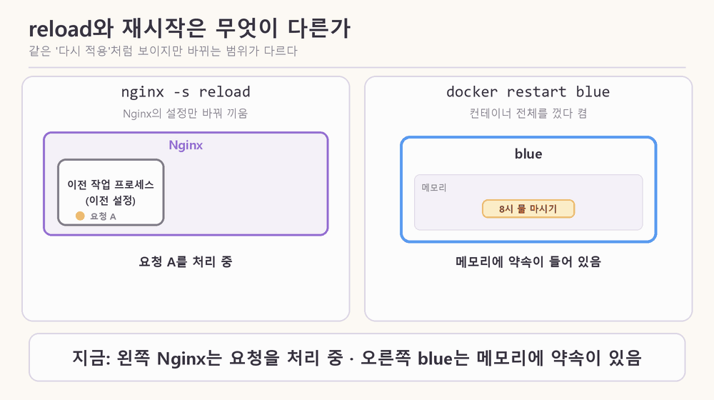

| | reload | 재시작 (`docker restart blue`) |
|---|---|---|
| 대상 | Nginx의 설정 | 컨테이너 전체 |
| 처리 중이던 요청 | 이전 작업 프로세스가 마무리하고, 새 작업 프로세스가 새 설정으로 다음 요청부터 받음 | 노드에 설명 없음 |
| 메모리 | 영향 없음 | 비워짐 (노드 5장에서 약속이 사라짐) |

- 문법이 틀린 설정으로 reload하면 Nginx는 새 설정을 버리고 이전 설정으로 계속 돈다. 그래도 `nginx -t`로 먼저 검사하는 이유는 실패를 사람이 바로 보고 고치기 위해서다.
- reload는 Cloud Run의 리비전과 다르다. reload는 Nginx가 설정을 다시 읽는 일이고, 리비전은 배포할 때마다 생기는 버전 기록이다.

### 8. 롤백은 왜 되나? 서버를 바꾸는데 무슨 내용이 바뀌나?

한 줄로: 롤백은 **이전 버전 프로그램으로 되돌리는 것**이고, 되돌릴 수 있는 것은 이전 서버(blue)를 끄지 않고 계속 돌려 두기 때문이다.

- 블루그린에서 blue는 v1 프로그램이 돌고 있는 컨테이너, green은 v2가 돌고 있는 컨테이너다. 그래서 서버를 바꾼다는 것은 곧 프로그램의 버전을 바꾼다는 뜻이다.
- 전환한 직후 blue를 바로 끄면 두 가지를 잃는다. blue가 처리하던 요청이 끊기고(그레이스풀 셧다운 위반), 롤백할 곳도 사라진다. 노드는 이전 버전을 언제 꺼야 하는지는 오늘 정하지 않았다고 밝힌다. 구체적인 시간은 노드에 없다.
- **오늘 실습의 blue와 green은 사실 같은 이미지**이고 환경변수 두 개(`K_REVISION`, `BANNER`)만 다르다. 노드는 "새 버전이 green에 올라갔다고 생각하고" 전환하게 한다. 즉 실제 코드는 바뀌지 않는 **전환 연습**이다.
- `K_REVISION`은 어느 컨테이너가 응답했는지 알아보는 이름표다. 원래는 Cloud Run이 리비전 이름을 알려 줄 때 쓰는 환경변수이고, 실습에서는 직접 넣어서 `/version` 응답으로 구별한다.

### 9. 배포 파이프라인의 「마지막 칸」은 무엇인가?

한 줄로: 내 `deploy.yml`의 마지막 단계인 **Cloud Run 배포**이고, 오늘 노드는 그 안에서 일어나는 「교체」의 원리다.

> [그림 7] main에 push하면 다섯 칸이 차례로 자동 실행되고, 마지막 칸 안쪽에서 이전 리비전이 새 리비전으로 교체된다.

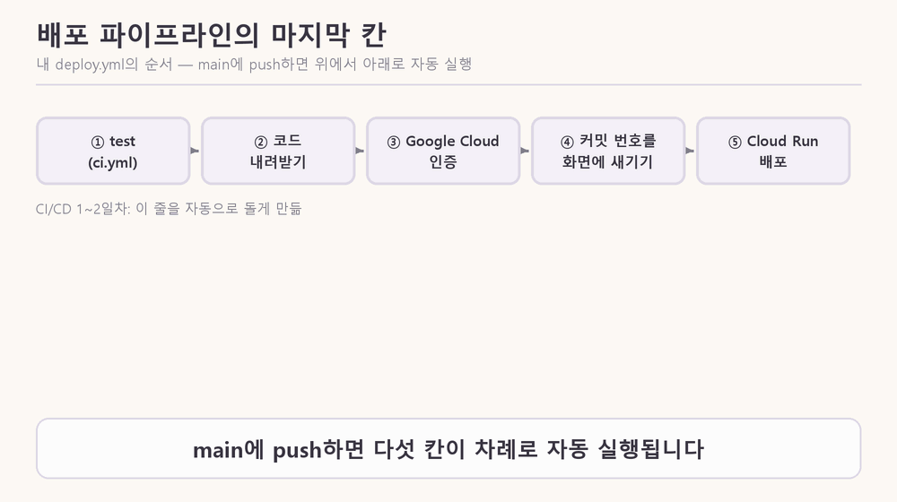

- 노드 1장은 "Dockerfile로 이미지를 만들 수 있는 상태에서 시작"한다고 하고, 오늘 실습은 Google Cloud 없이 내 컴퓨터의 Docker로만 한다. GitHub Actions도 Cloud Run도 오늘 실습에는 나오지 않는다.
- CI/CD 1일차에 만든 파이프라인이 "main에 합치면 자동 배포"까지였다면, 오늘은 그 마지막 칸이 사용자에게 안 끊기게 하는 원리다.

### 10. Nginx 한 대는 왜 단일 장애점인가?

한 줄로: 사용자는 Nginx 주소 하나만 알기 때문에, **Nginx가 멈추면 뒤의 서버가 멀쩡해도 요청이 못 들어간다.**

> [그림 8] A는 Nginx 한 대, B는 두 대(액티브-스탠바이)와 가상 IP.

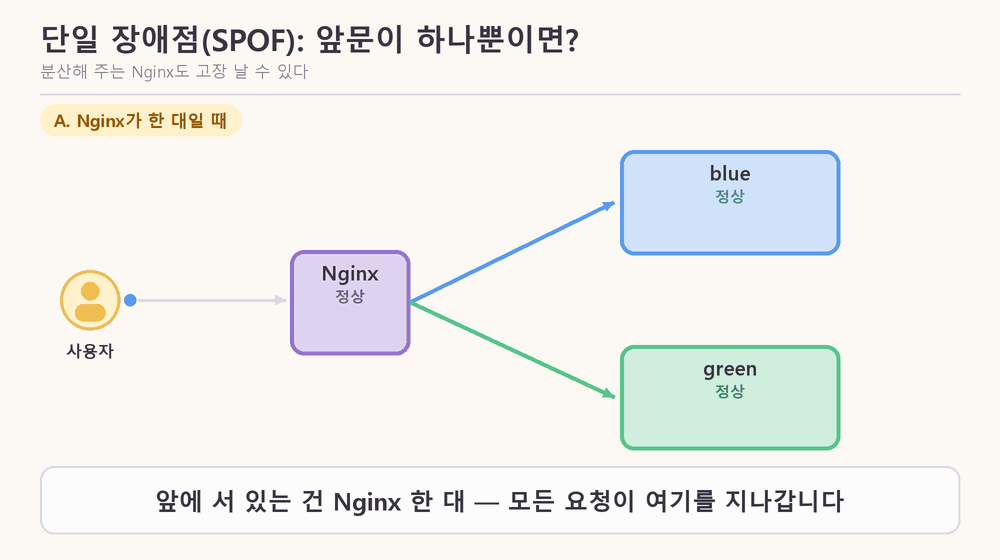

- 해결은 Nginx도 두 대로 두고 가상 IP 하나를 함께 쓰는 것이다. 평소에는 주 Nginx가 그 주소를 갖고 있다가, 멈추면 예비가 넘겨받는다. 사용자는 같은 주소로 접속하니 바뀐 줄 모른다.
- 이중화는 속도를 높이려는 것이 아니다. 액티브-스탠바이는 한 대가 일하고 한 대는 기다리는 방식이다. 노드도 Nginx를 여러 대 두면 빨라진다고는 말하지 않는다.

### 11. Cloud Run은 이 일을 대신 해 주나?

한 줄로: 오늘 내 컴퓨터에서 손으로 한 일을 Cloud Run이 서비스 안에서 대신 한다. 그래서 지금까지 배포가 「그냥 됐던」 것이다.

> [그림 9] 왼쪽이 오늘 직접 만든 것, 오른쪽이 Cloud Run에서 대응하는 것.

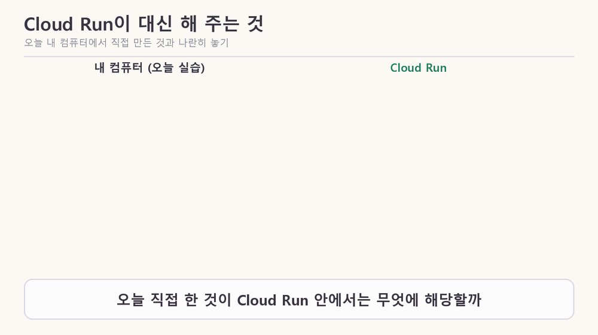

- 문서에 따르면 Cloud Run은 컨테이너를 실행하는 완전 관리형 플랫폼이고, 서비스는 안정적인 주소 하나로 요청을 받으며 무상태 컨테이너 인스턴스를 쓴다. 새 리비전에 트래픽 1%만 보내 보는 점진적 롤아웃도 지원한다.
- 리비전은 배포할 때마다 생기고, 컨테이너 이미지와 환경변수·메모리 제한 같은 설정으로 이루어지며, 만든 뒤에는 수정할 수 없다(설정을 바꾸면 새 리비전).
- 배포 방식 그림에서는 Cloud Run의 기본 배포가 롤링이 아니라, 새 리비전이 준비되면 트래픽을 한꺼번에 새 리비전으로 넘기는 방식이라고 설명한다(그림 설명이고 내가 문서로 확인한 것이 아니다). 문서 요약에는 요청을 "최신의 정상 리비전으로 가능한 한 빨리" 보낸다고만 적혀 있다.
- 내 기록에는 CI/CD 1일차에 일부러 nginx 설정 오류를 넣은 PR #5를 배포했을 때 리비전 00003이 시작에 실패했고, 사용자는 00002를 계속 받았으며, PR #6으로 되돌리니 00004가 떴다고 적혀 있다. 새 버전이 못 뜨는 동안 이전 버전이 받는다는 점은 오늘 배운 블루그린과 같은 모양이다. 다만 Cloud Run이 그렇게 동작하는 내부 규칙은 읽은 문서에 없어서 확인하지 못했다.
- scale to zero 때문에 요청이 없으면 인스턴스가 0개가 되고 새 요청이 오면 새로 만든다. 그러면 인스턴스 메모리의 대화도 같이 사라지니 DB가 필요하다(이 연결은 내 추론이다).

### 12. DB를 붙이면 버전이 두 개인 것이 왜 문제인가?

한 줄로: DB는 하나인데 서버는 두 벌이라, **두 버전이 같은 DB를 함께 쓰게 되기 때문**이다.

| | DB 붙이기 전 | DB 붙인 뒤 |
|---|---|---|
| 기억이 있는 곳 | blue와 green이 각자의 메모리 | blue와 green이 같은 DB |
| 두 버전의 영향 | 서로 영향 없음 | 한쪽이 테이블 구조를 바꾸면 다른 쪽이 영향받음 |
| 대화 | 전환하면 안 이어짐 | 이어짐 |

식당으로 빗대면, 두 주방이 같은 주문 게시판을 쓰는데 새 주방이 게시판의 "메뉴" 칸 이름을 "음식"으로 바꾸면 옛 주방은 주문을 읽지 못한다. 전환 중에는 두 주방이 모두 일하고, 롤백해도 게시판은 이미 바뀐 상태다.


- 이 순서를 노드는 확장-축소 패턴이라고 부른다. 오늘 실습에서는 두 컨테이너의 코드가 같아서 이 문제가 실제로 일어나지는 않고, 위험을 말로 짚어 준다.
- 노드는 `friend-agent`에 Supabase 익명 로그인을 붙이고 publishable key는 브라우저로, secret key는 서버에서만 쓰게 한다. secret key는 RLS(행 단위 접근 제한)를 건너뛰어 모든 사용자의 데이터를 읽고 쓸 수 있기 때문이다.

### 13. upstream은 무엇인가?

한 줄로: **upstream은 Nginx가 요청을 넘겨받을 server들을 적어 둔 목록 블록이다.** `proxy_pass`가 이 블록의 이름(`active_app`)을 가리킨다.

> [그림 10] upstream 블록은 server 줄의 목록이다. 줄 뒤의 옵션(weight, backup)과 실패 기록에 따라 요청을 받을 server가 정해진다.

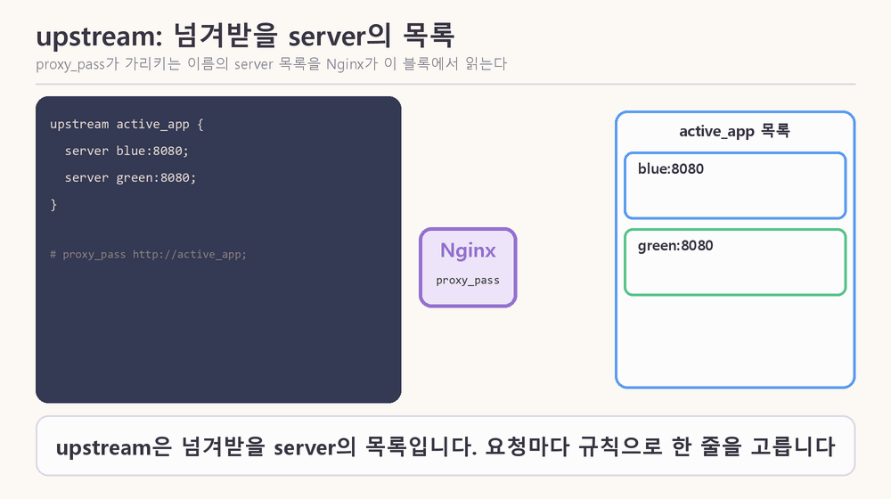

- 요청이 오면 Nginx는 목록에서 규칙(기본은 round robin)으로 server 한 줄을 고른다.
- server 줄 뒤에 옵션을 붙인다 (노드 3장 표): `weight=3`은 다른 server보다 3배, `backup`은 다른 server가 모두 빠졌을 때만, `max_fails=1 fail_timeout=10s`는 10초 안에 1번 실패하면 10초 동안 뺀다(적지 않으면 이 값).
- 무료 Nginx는 실제 요청이 실패해야 server를 빼므로(수동 헬스체크), 그림에서 실패한 요청은 사용자의 요청이다. `fail_timeout`이 지나면 Nginx가 실제 요청 하나를 다시 보내 본다 (노드 5장).
- `server spare:8080 backup;`의 `spare`는 그림용 이름이다. 노드의 예시는 `10.0.0.3:8080 backup`이다.
- upstream이라는 이름의 유래는 노드에 없다.

### 14. zone 줄은 무엇을 하나?

한 줄로: `zone`은 upstream 블록 안의 설정 한 줄이고, worker process들이 round robin의 「다음 차례」와 실패 기록을 **공유 메모리**에서 함께 세게 한다.

> [그림 11] 왼쪽 위는 zone 줄이 없을 때, 아래는 zone 줄이 있을 때 worker process 둘이 「다음 차례」를 세는 방식. 응답 순서는 노드 설명으로 만든 예시다.

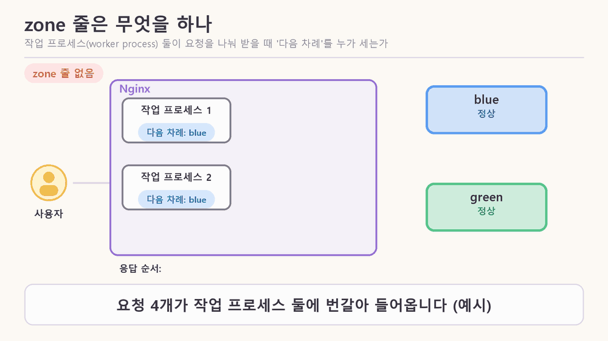

- 형식은 `zone <이름> <크기>`다. 노드는 `64k`가 무엇인지 설명하지 않는다.
- worker process는 서로 메모리를 나눠 쓰지 않아서, `zone`이 없으면 각자 「다음 차례」를 따로 센다. 요청이 많을 때는 결과적으로 고르게 나뉘지만, 요청을 하나씩만 보내는 실습에서는 같은 server로만 가는 것처럼 보일 수 있다 (노드 3장).
- 그림의 응답 순서(zone 없음: blue, blue, green, green / zone 있음: blue, green, blue, green)는 이 설명으로 만든 예시이고, 실제 Nginx에서 돌려 본 결과가 아니다.
- 노드 퀴즈는 `upstream`에 `zone` 줄과 `server blue:8080;`, `server green:8080;`을 적고 reload한 뒤 요청을 계속 보내면 어떻게 보이는지 묻는다. 위 설명으로 풀 수 있다.

### 15. round robin은 왜 round robin인가?

한 줄로: 이름의 유래는 확실하지 않다. 오래된 청원서의 뜻은 「이름을 원형으로 서명해 주동자를 숨기는 것」이고, 컴퓨터에서는 반대로 「순서가 정해진 순환」이다.

| 연도 | 일어난 일 | 출처 |
|---|---|---|
| 1536 | 성찬용 웨이퍼를 가리키는 말로 쓰인 기록. 뜻은 「빵 한 조각, 쿠키, 팬케이크」에 가까움 | OUP |
| 1546 | 마일스 커버데일(Miles Coverdale)의 글이 가장 이른 예로 제시됨. 비꼬는 별명 | phrases.org.uk |
| 16세기 중반 | 성찬의 빵을 경멸해서 부르는 속어 | worldwidewords |
| 1662 · 1707 · 1721 | 의회파(Roundheads)를 가리킴 · 놀이 이름 · 울새(robin)를 가리킴 | phrases.org.uk |
| 1730년 1월 | 『The Weekly Journal』에 선원들의 용어로 기록. 이름을 원형으로 서명한 청원서 | phrases.org.uk |
| 1802 | 찰스 제임스(Charles James)가 프랑스어 `ruban rond`의 와전이라는 설을 처음 제시. 웹스터 사전에는 1864년까지 실림 | OUP |
| 1889 | 찰녹(Richard Stephen Charnock)이 `round ribbon` 설을 책에 냄 | OUP |
| 1895 | 뉴욕 『Official Lawn Tennis Bulletin』에 모두가 서로 겨루는 리그전의 뜻이 가장 이르게 나옴 | phrases.org.uk |

- 청원서의 배경: 선원들이 불만을 적은 청원서에 이름을 원형으로 서명해서 누가 먼저 서명했는지, 곧 주동자가 누구인지 알아내기 어렵게 만들었다. 당시 반란은 교수형에 처해지는 중죄였기 때문에 선원들이 이 방식을 선호했다고 한다.
- 가장 이른 기록은 출처마다 1536년(OUP)과 1546년(phrases.org.uk)으로 다르다.

**옥스퍼드(OUP 블로그, 어원학자 아나톨리 리버먼)가 프랑스어 설에 의문을 제기하는 이유**

1. `ruban rond`는 프랑스어 문헌에서 확인된 적이 없는 유령 단어(ghost word)다. 1802년에 제시된 뒤 책에서 책으로 되풀이되었을 뿐이다.
2. 프랑스어에 정말 있었더라도 영국 선원들의 영어에서 빌려 간 것으로 봐야 하고, `ruban rouge`, `ruban bleu` 같은 표현을 본떠 만들어졌다고 본다.
3. 영어가 프랑스어를 와전한 거라면 `robin round` 같은 중간 형태가 있어야 하는데, 영어에는 그런 형태가 존재한 적이 없다.
4. `round roband`(돛을 묶는 밧줄) 설은 입증된 적이 없고, `round ribbon` 설은 「wild guess」에 가까운 추측이다.
5. 청원서 뜻(1730)보다 앞선 1536년에 이미 다른 뜻으로 쓰였으므로, 청원서나 프랑스어와 무관하게 먼저 존재했다고 본다.

- 리버먼의 결론: 누가 어떤 상황에서 만들었는지는 아마 영원히 알 수 없고, 「원형 청원서」의 뜻과 「팬케이크, 쿠키」의 뜻을 따로 떼어 생각하지 않는 편이 합리적이다.
- 컴퓨터에서의 round robin은 노드 3장에서 「1번, 2번, 3번, 다시 1번처럼 순서대로」 보내는 규칙이다. 어원은 순서를 숨기고 컴퓨터는 순서가 드러나지만, 둘 다 **원(순환) 구조**라는 점이 같다.
- 컴퓨터 용법이 어원과 직접 이어졌는지는 읽은 페이지에 없다. 중간에 1895년 리그전 뜻이 있다는 것만 나오고, 컴퓨터 용법이 거기서 왔다는 것은 내 연상이며 출처가 없다.
- 한계: etymonline은 접근이 막혀(403) 읽지 못했다. 위 내용은 페이지 요약을 바탕으로 했다.

출처: [OUP 블로그](https://blog.oup.com/2019/01/the-last-shot-at-robin/) · [phrases.org.uk](https://phrases.org.uk/meanings/round-robin.html) · [World Wide Words](https://worldwidewords.org/qa-rou1.html)

### 16. weight와 IP hash는 무엇인가? (공항 보안 검색대로 보기)

한 줄로: weight는 server마다 보내는 요청의 몫이고, IP hash는 사용자의 IP로 server를 정해서 같은 사용자를 늘 같은 server로 보내는 방식이다.

| 검색대 | load balancer | 규칙 |
|---|---|---|
| 안내 직원 | load balancer (Nginx) | 승객(요청)을 레인(server)으로 보냄 |
| 레인 차례대로 한 명씩 | round robin | 1번, 2번, 3번, 다시 1번 |
| 신형 레인에 3명, 구형 레인에 1명 | weight | 성능이 다른 server를 섞을 때. `weight=3`이면 다른 server보다 3배 |
| 새 장비 레인에 1%만 먼저 | canary | 문제가 없으면 비율을 올림 |
| 줄이 가장 짧은 레인으로 | least connections | 요청마다 처리 시간이 크게 다를 때 |
| 같은 승객은 늘 같은 레인 | IP hash (sticky session) | 같은 사용자는 늘 같은 server로 |

- 비유는 내 설명이고 노드의 표현이 아니다.
- hash는 입력 값을 정해진 계산식에 넣어 일정한 범위의 값으로 바꾸는 것이다. 같은 입력은 항상 같은 결과가 나온다 (일반적인 정의이고 노드에는 정의가 없다).
- IP hash는 사용자의 IP 주소를 hash한 값으로 server를 고른다. 같은 IP는 늘 같은 server로 간다.
- 예시: IP를 숫자로 보고 server 수 2로 나눈 나머지로 고른다고 하면 같은 IP는 늘 같은 server로 간다. 실제 Nginx의 계산식은 확인하지 못했다.
- 노드 3장: 서버가 사용자 상태를 기억할 때의 임시방편이다. 그 server가 멈추거나 새 버전으로 바뀌면 묶여 있던 사용자의 상태도 사라지고, 한 server에 사용자가 몰려도 다른 server로 나눌 수 없다.

### 17. Docker 이미지는 어디서 찾고 어떻게 쓰나?

한 줄로: 이름은 노드와 내 Dockerfile에 이미 있고, 직접 찾을 때는 Docker Hub나 `docker search`를 쓴다. `docker run`은 이미지가 내 컴퓨터에 없을 때만 pull한다.

- 이미 쓴 이름: 노드 4장의 `nginx:1.27-alpine`, 1일차 Dockerfile(커밋 `cbe14b1`)의 `FROM nginxinc/nginx-unprivileged:alpine`.
- 찾는 방법 ① hub.docker.com에서 `nginx` 검색 ② `docker search nginx` ③ Claude에게 요청 (노드에도 「코딩 에이전트에게 맡길 때」 프롬프트가 있다. 이름과 tag는 직접 확인한다).
- `docker search nginx --limit 5` 결과는 아래와 같다 (검색만 했고 받지는 않았다).

| NAME | DESCRIPTION | STARS | OFFICIAL |
|---|---|---|---|
| nginx | Official build of Nginx. | 21410 | [OK] |
| nginx/nginx-ingress | NGINX and NGINX Plus Ingress Controllers | 124 | |
| nginx/nginx-prometheus-exporter | NGINX Prometheus Exporter | 53 | |
| nginx/nginx-ingress-operator | NGINX Ingress Operator | 5 | |
| nginx/nginx-unprivileged | Unprivileged NGINX images | 2 | |

- 이미지는 container를 실행하는 데 필요한 파일, 바이너리, 라이브러리, 설정을 담은 변경 불가(immutable) 패키지이고, Docker Hub가 기본 저장소다 (Docker 문서).
- `docker run`은 문서에 「필요하면 이미지를 pull하고 container를 시작」한다고 되어 있고, 기본값(`--pull missing`)에서는 내 컴퓨터에 없을 때만 받는다.

| 명령 | 하는 일 |
|---|---|
| `docker search nginx` | Docker Hub에서 이미지 검색 |
| `docker pull nginx:1.27-alpine` | 이미지 내려받기 |
| `docker run -d --name bg-nginx -p 8080:80 nginx:1.27-alpine` | 이미지로 container 실행 |
| `docker images` | 내 컴퓨터의 이미지 목록 |
| `docker ps` | 실행 중인 container 목록 |
| `docker logs blue` | container 로그 |
| `docker exec bg-nginx nginx -t` | 실행 중인 container 안에서 명령 실행 |
| `docker stop` / `start` / `restart green` | 멈춤 / 시작 / 재시작 |
| `docker rm -f blue green` | container 삭제 |
| `docker network create bg-lab` | container끼리 이름으로 찾는 network 만들기 |

- 이 컴퓨터의 이미지는 `routine-stamp:pdf`, `routine-stamp:local`, `python:3.13-slim-bookworm`이다 (Docker 29.9.2).

#### 이어서 던진 질문과 답

| 질문 | 답 요약 |
|---|---|
| 캐럿이 무엇인가? | 글자를 입력할 위치를 나타내는 깜박이는 세로 막대(텍스트 커서)다 |
| upstream은 proxy와 같은가? proxy가 upstream을 넘겨 주나? | 같지 않다. proxy는 넘기는 동작(`proxy_pass`), upstream은 넘겨받을 server 목록이다. proxy가 요청을 upstream 안의 server 하나로 넘긴다 |
| upstream과 프록시의 개념을 모르겠다. 모션 그래픽으로 각각 넣어 달라 | proxy는 [그림 2]로 2번 절에, upstream은 [그림 10]으로 13번 절에 각각 넣었다 |
| upstream 안의 zone 줄 구조를 이해 못하겠다 | `zone`은 upstream 블록 안의 한 줄이고 worker process들이 「다음 차례」를 공유 메모리에서 함께 세게 한다 |
| round robin은 이름이 왜 round robin인가? | 유래는 확실하지 않다. 가장 이른 설명은 이름을 원형으로 서명한 청원서(1730 기록)이고 프랑스어 `ruban rond` 설이 있지만 증거가 없다 |
| 어원은 순서를 숨기는데 컴퓨터 용어는 순서를 알 수 있게 하는 것이 맞나? | 맞다. 둘 다 원(순환) 구조라는 점은 같다. 직접 이어졌는지는 읽은 페이지에 없다 |
| 옥스퍼드는 왜 의문을 제기하나? | `ruban rond`가 유령 단어이고, `robin round`가 없으며, 청원서 뜻보다 앞선 기록이 있기 때문이다 |
| weight를 공항 보안 검색대로 비유하면? | 레인마다 보내는 인원의 비율이다. 신형 레인에 더 많이 보내는 것이 weight, 새 장비 레인에 1%만 먼저 보내는 것이 canary다 |
| IP hash와 hash는 무엇인가? | hash는 같은 입력에 항상 같은 결과를 내는 계산, IP hash는 IP로 server를 정해 같은 사용자를 같은 server로 보내는 방식이다 |
| `upstream`과 `zone`은 어디서 나온 용어인가? | Nginx 설정 문법이다. `upstream`은 server 목록 블록, `zone`은 공유 메모리 설정 한 줄이다 |
| Docker로 Nginx를 다운로드 없이 쓸 수 있다는 말은? | Nginx를 설치하지 않고 Nginx가 든 이미지를 받아 container로 실행한다는 뜻이다. `docker run`은 없을 때만 pull한다 |
| Nginx가 든 이미지는 어떻게 찾나? Claude에게 요청하나? | 노드와 Dockerfile에 이름이 있다. 직접은 Docker Hub나 `docker search`로 찾고, Claude에게 요청해도 된다 |
| Docker 사용법을 잘 모르겠다 | `search`, `pull`, `run`, `images`, `ps`, `logs`, `exec`, `stop`, `rm` 등 명령 표로 정리했다 |
| Claude CLI에서 새 세션을 시작하는 법은? | `claude`가 기본으로 새 대화다. 이어가기는 `-c`나 `-r`, Chrome 연동은 `--chrome` |
| 새 세션에서 실습하고 싶다 | 작업대장 인계(W-003 → W-004)를 마쳤다. 새 세션이 `resume`으로 인계 문서를 읽고 시작한다 |

---

## 오늘의 미션

### 실습 환경

- 이번 세션에서는 노드의 실습(blue, green, Nginx 컨테이너를 띄우고 전환·장애 실험)을 **직접 실행하지 않았다.** 노드 7장을 전부 읽고, 개념을 질문하며 이해하는 방식으로 진행했다.
- 이 컴퓨터에서 확인한 것: Docker 29.9.2가 설치되어 있다. 노드가 쓰는 이미지 `friend-agent:local`은 이 컴퓨터의 이미지 목록(`routine-stamp:pdf`, `routine-stamp:local`, `python:3.13-slim-bookworm`)에 없다. 템플릿 폴더 `friend-agent-template`는 있다.

### 추가 과제 (오늘 학습 방식)

| 과제 | 하는 일 | 상태 |
|---|---|---|
| 실습을 Docker Compose 파일 하나로 진행하기 | blue, green, bg-nginx, 네트워크, 설정 폴더 연결을 `compose.yaml` 하나에 적고 `docker compose up` 한 번으로 띄움 | 시도하지 않음 |
| 롤링 배포를 Nginx로 직접 해보기 | 컨테이너 세 개를 upstream에 두고 한 대씩 `down`으로 빼고 새 버전으로 바꾼 뒤 다시 넣기를 반복 | 시도하지 않음 |
| 능동 헬스체크를 직접 만들기 | 2초마다 green의 `/health`를 묻다가 두 번 연속 실패하면 upstream에서 빼고 reload하는 작은 스크립트 | 시도하지 않음 |

- 한계: 세 과제는 모두 위의 이미지를 만들고 컨테이너를 띄워야 해서, 이번 세션에서는 준비하지 못했다.

---

## 잘 된 점 · 막힌 점 · 어떻게 해결했나

### 잘 된 점

| 잘 된 것 | 근거 |
|---|---|
| 노드 7장을 전부 읽었다 | LMS 7개 스텝을 Chrome으로 열어 본문 텍스트를 읽음 (그림과 시뮬레이터는 설명 글만 읽음) |
| 모르는 말을 넘기지 않고 되물었다 | 프록시, SPOF, 그레이스풀 셧다운, 리비전, scale to zero 등을 하나씩 질문함 |
| 설명이 틀린 곳을 바로잡았다 | "방향을 바꾸면 사라진다"를 "새 방향에서 안 보일 뿐"으로 정정 |

### 막힌 점

| 막힌 곳 | 원인 | 어떻게 풀었나 |
|---|---|---|
| LMS 주소가 로그인 화면으로 넘어감 | 도구에 내 로그인 세션이 없음 (307 리다이렉트) | `claude --chrome`으로 다시 접속해 로그인된 Chrome으로 읽음 |
| 노션 학습 페이지가 404 (`object_not_found`) | 노션 연결이 개인 워크스페이스에만 걸려 있음 (이유는 확인 못 함) | 재인증해도 같았음. 미해결이고, Chrome으로 읽는 것으로 대체 |
| 용어 설명이 부족해서 질문이 계속 나옴 | 처음 설명에서 SPOF, 프록시 같은 말을 풀지 않고 씀 | 낯선 말 표와 문제별 상세 설명을 추가 |
| 그림 글자가 겹치거나 기호(✓, ↻)가 깨짐 | 폰트가 그 기호를 그리지 못함, 그림 요소가 겹침 | 프레임을 직접 열어 확인하고 글자로 바꾸거나 위치를 옮김 |

### 새로 알게 된 것

- 「요청이 안 끊김」과 「하던 일이 이어짐」은 다른 검사이고, 무상태는 뒤쪽을 가능하게 하는 조건이다.
- 무료 Nginx는 수동 헬스체크라서 고장을 사용자가 먼저 겪는다. 대기 시간(기본 60초)이 길수록 그 비용이 커진다.
- 블루그린의 롤백이 빠른 이유는 이전 버전을 끄지 않고 남겨 두기 때문이다.
- 로드밸런서도 단일 장애점이 될 수 있다.
- DB를 붙이는 순간 코드만이 아니라 테이블 구조를 바꾸는 순서까지 신경 써야 한다.

---

## 이 세션에서 내가 던진 질문과 답

| 질문 | 답 요약 |
|---|---|
| Nginx가 로드밸런서의 일종인가? 프록시와 리버스 프록시는? | 여러 역할을 하는 프로그램이고 그중 하나가 로드밸런서다. 서버 한 줄이면 리버스 프록시, 두 줄이면 로드밸런서다. 프록시는 대신 받아 넘기는 중간 창구다 |
| 상태가 서버 안에 있다, 방향을 바꾸면 사라진다는 말은? | 상태는 요청 사이에 기억한 정보로 메모리에 있다. 새 방향에서 안 보일 뿐이고 재시작해야 진짜 사라진다 |
| '이어간다' 단계의 한 줄이 이해가 안 된다. 그림으로 표현할 수 있나? | "기억을 서버가 아니라 DB가 갖는다"로 고치고 통합 모션 그림으로 만들었다 |
| 3번의 요지가 무중단과 무상태의 차이인가? | 목표와 수단의 관계다. 끊김 없음은 로드밸런서와 블루그린, 이어짐은 무상태가 맡는다 |
| 대기 시간을 "넉넉하게" 잡는다는 말이 이해가 안 된다 | 짧을수록 빠르지만 너무 짧으면 정상 서버도 실패로 본다 |
| 능동 헬스체크는? | 로드밸런서가 먼저 물어본다. 수동은 실제 요청이 실패해야 안다 |
| 3:1, 9:1, 99:1은 무엇인가? 내가 정해도 되나? | 요청을 나눠 보내는 비율이고 설정 숫자라서 운영자가 정한다. 3:1은 노드의 예시다 |
| 블루, 그린, 카나리는 컴퓨터 용어인가? 왜 색깔인가? | 셋 다 배포 방식 이름이다. 색 이름의 이유는 노드에 없다. 카나리는 광부의 카나리아에서 왔다 |
| 오늘 노드는 배포 이후인가, 머지부터 배포까지인가? | 파이프라인의 마지막 칸인 교체 순간이다 |
| Cloud Run과 GCP를 이해하지 못했다 | Cloud Run은 컨테이너를 돌려 주는 관리형 플랫폼이고, 오늘 직접 한 일을 대신 한다. 대응표를 그림으로 정리했다 |
| "8시 물 약속"이 무슨 뜻인가? | 실습에서 에이전트에 만든 약속(reminder)의 예시다. 문구를 "8시 물 마시기"로 바꿨다 |
| 사람이 손으로 했다는 게 무슨 말인가? | 확인, 수정, 검사, reload를 사람이 터미널에서 직접 쳤다는 뜻이다. 자동화 도구가 대신 칠 수 있다 |
| Nginx 한 대가 왜 단일 장애점인가? 여러 대면 더 빠른가? | 앞문이 하나뿐이라서다. 이중화는 속도가 아니라 안 멈추려는 것이다 |
| 이전 버전을 언제 끌지도 정해야 하나? | 정해야 한다. 처리 중인 요청이 끝난 뒤, 롤백 가능성이 남은 동안은 둔다. 구체적인 시간은 노드에 없다 |
| 7번 확인 질문의 설명이 부족하다 | blue를 안 끄는 이유, 메모리 상태와 서버 두 대, reload가 안 끊기는 이유, DB 공유의 위험을 예시와 함께 다시 설명했다 |
| 무상태가 무슨 말인가? 영업 중에 보수공사를 어떻게 하나? | 옆에 새 주방을 지어 놓고 손님을 옮긴다. 주문을 게시판(DB)에 두면 직원이 바뀌어도 이어진다 |
| 무료 Nginx를 쓰면 내 도장 앱의 문제를 내가 먼저 알아채나? | 오늘 실습 대상은 도장 앱이 아니다. 수동 헬스체크라서 사용자가 먼저 겪는다 |
| 44:55도 되나? 비율별 의미는? 블루/그린/카나리 배포의 의미는? | 4:5와 같은 비율이라 green이 약 55.6%를 받는다(직접 돌려 보지는 않음). 비율은 새 버전이 받는 요청 몫이다 |
| 블루, 그린은 임의이고 카나리만 실제 용어인가? | 세 방식 모두 실제 용어이고, 임의인 것은 컨테이너에 붙인 이름뿐이다 |
| 파이프라인의 마지막 칸이 무슨 뜻인가? | deploy.yml의 다섯 단계 중 마지막인 Cloud Run 배포다 |
| K_REVISION이란? reload는 리비전인가? | 응답한 컨테이너를 알려 주는 환경변수 이름표다. reload는 설정 재읽기이고 리비전은 이미지와 설정을 묶은 버전 기록이다 |
| scale to zero란? | 요청이 없으면 인스턴스가 0개까지 줄어드는 것이다 |
| "8시 물 마시기"가 더 자연스럽지 않나? | 맞아서 모든 그림에 반영했다 |
| 사람이 안 치면 누가 치나? 사람이 로드밸런서가 되는 건가? | 자동화 도구가 친다. 요청은 계속 Nginx가 나눠 보내고, 사람은 방향을 결정하고 적용시킨다 |
| SPOF란? | 단일 장애점이다. 그것 하나만 고장 나도 전체가 멈추는 부분이다 |
| 그레이스풀 셧다운이란? | 서버를 끌 때 처리 중이던 요청을 끝까지 마친 뒤 끄는 것이다 |
| blue를 껐다 켜면 내용이 남나? 롤백은 왜 되나? 서버는 공간만 빌려주는 것 아닌가? | 서버는 프로그램이 돌고 있는 것이다. 코드는 남고 메모리는 비워진다. 롤백은 이전 버전을 끄지 않아서 된다. 오늘은 같은 이미지로 하는 연습이다 |
| 재시작과 reload의 차이는? | reload는 설정만, 재시작은 컨테이너 전체를 다시 시작하고 메모리가 비워진다 |
| DB를 붙이는 것과 버전이 2개인 것이 무슨 상관인가? | 두 버전이 같은 DB를 함께 쓰므로 한쪽이 구조를 바꾸면 다른 쪽이 영향받는다 |
| 카나리 도식의 "이전 리비전 90% / 10%"는 무엇인가? | 90은 이전 버전이 받는 요청의 비율, 10은 새 버전이 받는 비율이다. 9:1과 같다 |
| 3:1, 9:1, 99:1은 가용성과 관련이 있나? | 직접 관련은 없는 다른 개념이다. 새 버전에 일부만 먼저 보내 위험을 줄이는 점에서만 간접적으로 이어진다 |
| 드레이닝과 롤링 업데이트의 차이는? 둘 다 처리 중이던 요청을 마저 끝내는 것 같은데? | 롤링은 서버를 한 대씩 새 버전으로 바꾸는 배포 방식이고, 드레이닝은 서버 한 대를 뺄 때 하던 요청을 마치게 하는 동작이다. 드레이닝이 롤링의 한 단계로 들어간다 |
| 그림의 "넘어가는 동안 처리 중이던 요청만 끊기지 않고 마저 처리됩니다"가 롤링의 정의인가? | 아니다. 같은 칸에 "Cloud Run 기본 배포는 롤링 업데이트가 아닙니다"라고 먼저 적혀 있어서, 그 문장은 롤링이 아닌 기본 배포에서도 하던 요청이 마저 처리된다는 설명이다. 롤링의 정의는 그림의 막대(이전 100% → 이전 50%·새 50% → 새 100%)처럼 조금씩 바꾸는 것이다 |

---

## 오늘의 회고

### 처음 적은 답과 실제 비교

- 노드 1장의 시작 질문은 "에이전트 서비스가 새 버전으로 바뀌는 순간, 사용자에게는 무슨 일이 일어날 수 있을까요?"였다.
- 처음 적은 답: (신서연 님이 입력창에 적은 내용을 넣을 자리. 이 세션에서는 확인하지 못했다.)
- 실제로 알게 된 것: 일어날 수 있는 일은 두 가지로 나뉜다. 요청이 끊기는 것(오류, 멈춤)과 하던 일이 이어지지 않는 것(대화 사라짐).

### 같은 문제가 다시 생기면 확인할 순서

1. 배포하는 동안 요청이 끊겼나? (실패 수, 대기 시간)
2. 사용자가 하던 일이 이어졌나? (상태가 서버 메모리에 있는지, DB에 있는지)
3. 요청이 어느 서버로 가고 있나? (`/version`, 로드밸런서 설정)
4. 고장을 누가 먼저 알아채는 구조인가? (능동인지 수동인지, 대기 시간)
5. 이전 버전이 남아 있어서 롤백할 수 있나?
6. DB를 함께 쓴다면 테이블 구조를 바꾼 것이 이전 버전을 깨뜨리지 않나?

### 남은 의문과 숙제

- 추가 과제 3개를 직접 해 보기.
- 가중치 44:55 같은 값을 실제로 넣으면 어떻게 나오는지 직접 확인하기.
- Cloud Run이 새 리비전이 못 뜰 때 이전 리비전을 계속 쓰는 내부 규칙 확인하기.
- 이전 버전을 언제 끄는 것이 적절한지에 대한 구체적인 기준.
- blue와 green이라는 이름이 어디서 왔는지.
- 노션 연결이 학습 워크스페이스를 읽지 못하는 원인.

---

## 부록

### 노드에 나온 명령어 (이번에는 직접 실행하지 않음)

```text
docker network create bg-lab
docker run -d --name blue  --network bg-lab -e LLM_PROVIDER=fake -e K_REVISION=blue  -e BANNER=BLUE  friend-agent:local
docker run -d --name green --network bg-lab -e LLM_PROVIDER=fake -e K_REVISION=green -e BANNER=GREEN friend-agent:local
docker run -d --name bg-nginx --network bg-lab -p 8080:80 -v "$HOME/bluegreen-lab:/etc/nginx/conf.d" nginx:1.27-alpine
docker exec bg-nginx nginx -t
docker exec bg-nginx nginx -s reload
python scripts/watch_requests.py http://localhost:8080 --seconds 60
docker stop green
docker restart blue
```

### 확인하지 못한 것

- 노드의 그림과 시뮬레이터: 설명 글만 읽었고 직접 돌려 보지 않았다.
- 노드의 실습과 추가 과제: 직접 실행하지 않았다.
- Cloud Run의 내부 규칙(리비전 전환 시 이전 인스턴스가 언제 종료되는지 등): 읽은 문서에 없다.
- blue와 green이 왜 그 색인지, Nginx를 재시작할 때 처리 중 요청이 어떻게 되는지: 노드에 없다.
- 처음 적은 시작 질문의 내 답: 이 세션에서 확인하지 못했다.

### 같이 정리한 것

- 모션 그림 11개와 제작 코드: `_drafts/notion-figs-d3/`, `_drafts/make_figs_d3/`
- 작업대장 기록: routine-stamp-trial W-003
