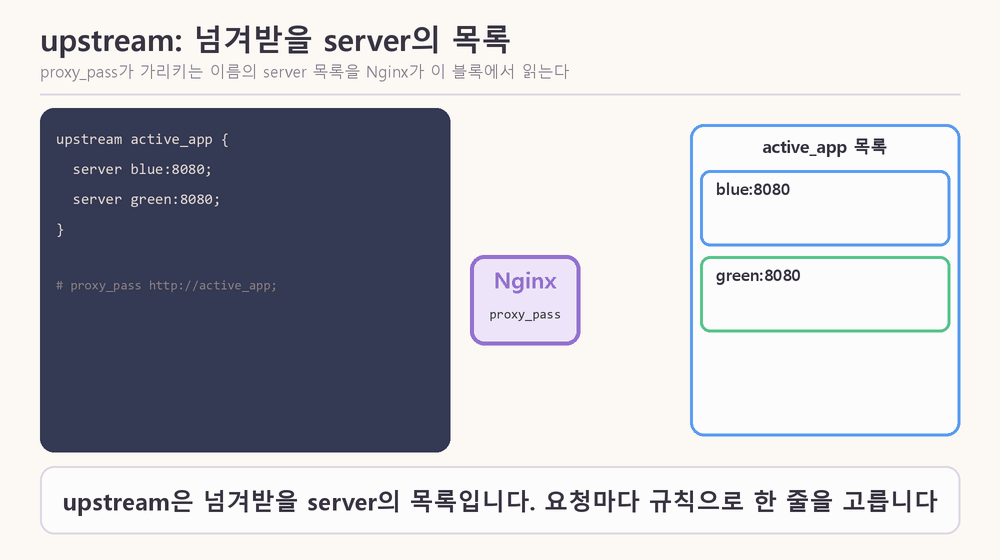
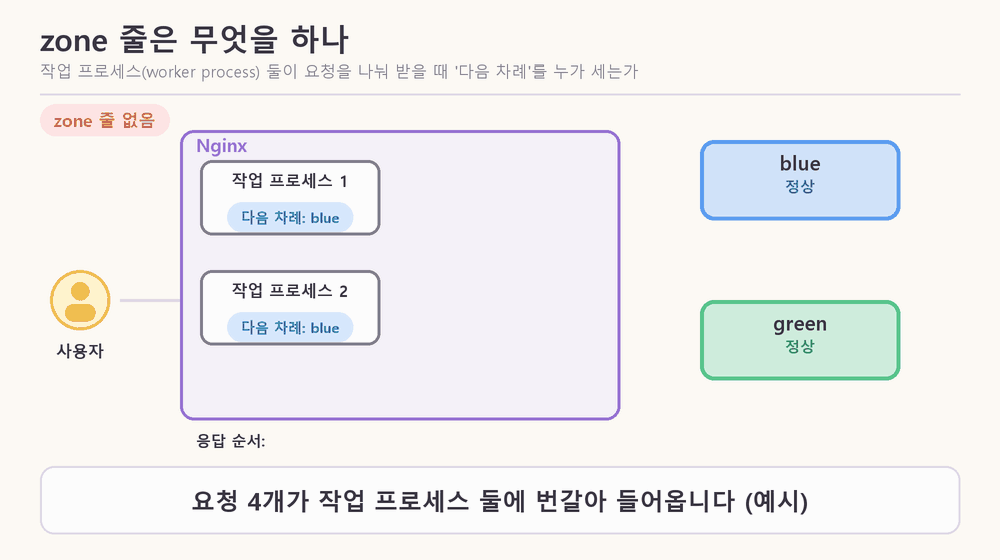

### 13. upstream은 무엇인가?

한 줄로: **upstream은 Nginx가 요청을 넘겨받을 server들을 적어 둔 목록 블록이다.** `proxy_pass`가 이 블록의 이름(`active_app`)을 가리킨다.

> [그림 10] upstream 블록은 server 줄의 목록이다. 줄 뒤의 옵션(weight, backup)과 실패 기록에 따라 요청을 받을 server가 정해진다.

- 요청이 오면 Nginx는 목록에서 규칙(기본은 round robin)으로 server 한 줄을 고른다.
- server 줄 뒤에 옵션을 붙인다 (노드 3장 표): `weight=3`은 다른 server보다 3배, `backup`은 다른 server가 모두 빠졌을 때만, `max_fails=1 fail_timeout=10s`는 10초 안에 1번 실패하면 10초 동안 뺀다(적지 않으면 이 값).
- 무료 Nginx는 실제 요청이 실패해야 server를 빼므로(수동 헬스체크), 그림에서 실패한 요청은 사용자의 요청이다. `fail_timeout`이 지나면 Nginx가 실제 요청 하나를 다시 보내 본다 (노드 5장).
- `server spare:8080 backup;`의 `spare`는 그림용 이름이다. 노드의 예시는 `10.0.0.3:8080 backup`이다.
- upstream이라는 이름의 유래는 노드에 없다.

### 14. zone 줄은 무엇을 하나?

한 줄로: `zone`은 upstream 블록 안의 설정 한 줄이고, worker process들이 round robin의 「다음 차례」와 실패 기록을 **공유 메모리**에서 함께 세게 한다.

> [그림 11] 왼쪽 위는 zone 줄이 없을 때, 아래는 zone 줄이 있을 때 worker process 둘이 「다음 차례」를 세는 방식. 응답 순서는 노드 설명으로 만든 예시다.

- 형식은 `zone <이름> <크기>`다. 노드는 `64k`가 무엇인지 설명하지 않는다.
- worker process는 서로 메모리를 나눠 쓰지 않아서, `zone`이 없으면 각자 「다음 차례」를 따로 센다. 요청이 많을 때는 결과적으로 고르게 나뉘지만, 요청을 하나씩만 보내는 실습에서는 같은 server로만 가는 것처럼 보일 수 있다 (노드 3장).
- 그림의 응답 순서(zone 없음: blue, blue, green, green / zone 있음: blue, green, blue, green)는 이 설명으로 만든 예시이고, 실제 Nginx에서 돌려 본 결과가 아니다.
- 노드 퀴즈는 `upstream`에 `zone` 줄과 `server blue:8080;`, `server green:8080;`을 적고 reload한 뒤 요청을 계속 보내면 어떻게 보이는지 묻는다. 위 설명으로 풀 수 있다.

### 15. round robin은 왜 round robin인가?

한 줄로: 이름의 유래는 확실하지 않다. 오래된 청원서의 뜻은 「이름을 원형으로 서명해 주동자를 숨기는 것」이고, 컴퓨터에서는 반대로 「순서가 정해진 순환」이다.

| 연도 | 일어난 일 | 출처 |
|---|---|---|
| 1536 | 성찬용 웨이퍼를 가리키는 말로 쓰인 기록. 뜻은 「빵 한 조각, 쿠키, 팬케이크」에 가까움 | OUP |
| 1546 | 마일스 커버데일(Miles Coverdale)의 글이 가장 이른 예로 제시됨. 비꼬는 별명 | phrases.org.uk |
| 16세기 중반 | 성찬의 빵을 경멸해서 부르는 속어 | worldwidewords |
| 1662 · 1707 · 1721 | 의회파(Roundheads)를 가리킴 · 놀이 이름 · 울새(robin)를 가리킴 | phrases.org.uk |
| 1730년 1월 | 『The Weekly Journal』에 선원들의 용어로 기록. 이름을 원형으로 서명한 청원서 | phrases.org.uk |
| 1802 | 찰스 제임스(Charles James)가 프랑스어 `ruban rond`의 와전이라는 설을 처음 제시. 웹스터 사전에는 1864년까지 실림 | OUP |
| 1889 | 찰녹(Richard Stephen Charnock)이 `round ribbon` 설을 책에 냄 | OUP |
| 1895 | 뉴욕 『Official Lawn Tennis Bulletin』에 모두가 서로 겨루는 리그전의 뜻이 가장 이르게 나옴 | phrases.org.uk |

- 청원서의 배경: 선원들이 불만을 적은 청원서에 이름을 원형으로 서명해서 누가 먼저 서명했는지, 곧 주동자가 누구인지 알아내기 어렵게 만들었다. 당시 반란은 교수형에 처해지는 중죄였기 때문에 선원들이 이 방식을 선호했다고 한다.
- 가장 이른 기록은 출처마다 1536년(OUP)과 1546년(phrases.org.uk)으로 다르다.

**옥스퍼드(OUP 블로그, 어원학자 아나톨리 리버먼)가 프랑스어 설에 의문을 제기하는 이유**

1. `ruban rond`는 프랑스어 문헌에서 확인된 적이 없는 유령 단어(ghost word)다. 1802년에 제시된 뒤 책에서 책으로 되풀이되었을 뿐이다.
2. 프랑스어에 정말 있었더라도 영국 선원들의 영어에서 빌려 간 것으로 봐야 하고, `ruban rouge`, `ruban bleu` 같은 표현을 본떠 만들어졌다고 본다.
3. 영어가 프랑스어를 와전한 거라면 `robin round` 같은 중간 형태가 있어야 하는데, 영어에는 그런 형태가 존재한 적이 없다.
4. `round roband`(돛을 묶는 밧줄) 설은 입증된 적이 없고, `round ribbon` 설은 「wild guess」에 가까운 추측이다.
5. 청원서 뜻(1730)보다 앞선 1536년에 이미 다른 뜻으로 쓰였으므로, 청원서나 프랑스어와 무관하게 먼저 존재했다고 본다.

- 리버먼의 결론: 누가 어떤 상황에서 만들었는지는 아마 영원히 알 수 없고, 「원형 청원서」의 뜻과 「팬케이크, 쿠키」의 뜻을 따로 떼어 생각하지 않는 편이 합리적이다.
- 컴퓨터에서의 round robin은 노드 3장에서 「1번, 2번, 3번, 다시 1번처럼 순서대로」 보내는 규칙이다. 어원은 순서를 숨기고 컴퓨터는 순서가 드러나지만, 둘 다 **원(순환) 구조**라는 점이 같다.
- 컴퓨터 용법이 어원과 직접 이어졌는지는 읽은 페이지에 없다. 중간에 1895년 리그전 뜻이 있다는 것만 나오고, 컴퓨터 용법이 거기서 왔다는 것은 내 연상이며 출처가 없다.
- 한계: etymonline은 접근이 막혀(403) 읽지 못했다. 위 내용은 페이지 요약을 바탕으로 했다.

출처: [OUP 블로그](https://blog.oup.com/2019/01/the-last-shot-at-robin/) · [phrases.org.uk](https://phrases.org.uk/meanings/round-robin.html) · [World Wide Words](https://worldwidewords.org/qa-rou1.html)

### 16. weight와 IP hash는 무엇인가? (공항 보안 검색대로 보기)

한 줄로: weight는 server마다 보내는 요청의 몫이고, IP hash는 사용자의 IP로 server를 정해서 같은 사용자를 늘 같은 server로 보내는 방식이다.

| 검색대 | load balancer | 규칙 |
|---|---|---|
| 안내 직원 | load balancer (Nginx) | 승객(요청)을 레인(server)으로 보냄 |
| 레인 차례대로 한 명씩 | round robin | 1번, 2번, 3번, 다시 1번 |
| 신형 레인에 3명, 구형 레인에 1명 | weight | 성능이 다른 server를 섞을 때. `weight=3`이면 다른 server보다 3배 |
| 새 장비 레인에 1%만 먼저 | canary | 문제가 없으면 비율을 올림 |
| 줄이 가장 짧은 레인으로 | least connections | 요청마다 처리 시간이 크게 다를 때 |
| 같은 승객은 늘 같은 레인 | IP hash (sticky session) | 같은 사용자는 늘 같은 server로 |

- 비유는 내 설명이고 노드의 표현이 아니다.
- hash는 입력 값을 정해진 계산식에 넣어 일정한 범위의 값으로 바꾸는 것이다. 같은 입력은 항상 같은 결과가 나온다 (일반적인 정의이고 노드에는 정의가 없다).
- IP hash는 사용자의 IP 주소를 hash한 값으로 server를 고른다. 같은 IP는 늘 같은 server로 간다.
- 예시: IP를 숫자로 보고 server 수 2로 나눈 나머지로 고른다고 하면 같은 IP는 늘 같은 server로 간다. 실제 Nginx의 계산식은 확인하지 못했다.
- 노드 3장: 서버가 사용자 상태를 기억할 때의 임시방편이다. 그 server가 멈추거나 새 버전으로 바뀌면 묶여 있던 사용자의 상태도 사라지고, 한 server에 사용자가 몰려도 다른 server로 나눌 수 없다.

### 17. Docker 이미지는 어디서 찾고 어떻게 쓰나?

한 줄로: 이름은 노드와 내 Dockerfile에 이미 있고, 직접 찾을 때는 Docker Hub나 `docker search`를 쓴다. `docker run`은 이미지가 내 컴퓨터에 없을 때만 pull한다.

- 이미 쓴 이름: 노드 4장의 `nginx:1.27-alpine`, 1일차 Dockerfile(커밋 `cbe14b1`)의 `FROM nginxinc/nginx-unprivileged:alpine`.
- 찾는 방법 ① hub.docker.com에서 `nginx` 검색 ② `docker search nginx` ③ Claude에게 요청 (노드에도 「코딩 에이전트에게 맡길 때」 프롬프트가 있다. 이름과 tag는 직접 확인한다).
- `docker search nginx --limit 5` 결과는 아래와 같다 (검색만 했고 받지는 않았다).

| NAME | DESCRIPTION | STARS | OFFICIAL |
|---|---|---|---|
| nginx | Official build of Nginx. | 21410 | [OK] |
| nginx/nginx-ingress | NGINX and NGINX Plus Ingress Controllers | 124 | |
| nginx/nginx-prometheus-exporter | NGINX Prometheus Exporter | 53 | |
| nginx/nginx-ingress-operator | NGINX Ingress Operator | 5 | |
| nginx/nginx-unprivileged | Unprivileged NGINX images | 2 | |

- 이미지는 container를 실행하는 데 필요한 파일, 바이너리, 라이브러리, 설정을 담은 변경 불가(immutable) 패키지이고, Docker Hub가 기본 저장소다 (Docker 문서).
- `docker run`은 문서에 「필요하면 이미지를 pull하고 container를 시작」한다고 되어 있고, 기본값(`--pull missing`)에서는 내 컴퓨터에 없을 때만 받는다.

| 명령 | 하는 일 |
|---|---|
| `docker search nginx` | Docker Hub에서 이미지 검색 |
| `docker pull nginx:1.27-alpine` | 이미지 내려받기 |
| `docker run -d --name bg-nginx -p 8080:80 nginx:1.27-alpine` | 이미지로 container 실행 |
| `docker images` | 내 컴퓨터의 이미지 목록 |
| `docker ps` | 실행 중인 container 목록 |
| `docker logs blue` | container 로그 |
| `docker exec bg-nginx nginx -t` | 실행 중인 container 안에서 명령 실행 |
| `docker stop` / `start` / `restart green` | 멈춤 / 시작 / 재시작 |
| `docker rm -f blue green` | container 삭제 |
| `docker network create bg-lab` | container끼리 이름으로 찾는 network 만들기 |

- 이 컴퓨터의 이미지는 `routine-stamp:pdf`, `routine-stamp:local`, `python:3.13-slim-bookworm`이다 (Docker 29.9.2).

#### 이어서 던진 질문과 답

| 질문 | 답 요약 |
|---|---|
| 캐럿이 무엇인가? | 글자를 입력할 위치를 나타내는 깜박이는 세로 막대(텍스트 커서)다 |
| upstream은 proxy와 같은가? proxy가 upstream을 넘겨 주나? | 같지 않다. proxy는 넘기는 동작(`proxy_pass`), upstream은 넘겨받을 server 목록이다. proxy가 요청을 upstream 안의 server 하나로 넘긴다 |
| upstream과 프록시의 개념을 모르겠다. 모션 그래픽으로 각각 넣어 달라 | proxy는 [그림 2]로 2번 절에, upstream은 [그림 10]으로 13번 절에 각각 넣었다 |
| upstream 안의 zone 줄 구조를 이해 못하겠다 | `zone`은 upstream 블록 안의 한 줄이고 worker process들이 「다음 차례」를 공유 메모리에서 함께 세게 한다 |
| round robin은 이름이 왜 round robin인가? | 유래는 확실하지 않다. 가장 이른 설명은 이름을 원형으로 서명한 청원서(1730 기록)이고 프랑스어 `ruban rond` 설이 있지만 증거가 없다 |
| 어원은 순서를 숨기는데 컴퓨터 용어는 순서를 알 수 있게 하는 것이 맞나? | 맞다. 둘 다 원(순환) 구조라는 점은 같다. 직접 이어졌는지는 읽은 페이지에 없다 |
| 옥스퍼드는 왜 의문을 제기하나? | `ruban rond`가 유령 단어이고, `robin round`가 없으며, 청원서 뜻보다 앞선 기록이 있기 때문이다 |
| weight를 공항 보안 검색대로 비유하면? | 레인마다 보내는 인원의 비율이다. 신형 레인에 더 많이 보내는 것이 weight, 새 장비 레인에 1%만 먼저 보내는 것이 canary다 |
| IP hash와 hash는 무엇인가? | hash는 같은 입력에 항상 같은 결과를 내는 계산, IP hash는 IP로 server를 정해 같은 사용자를 같은 server로 보내는 방식이다 |
| `upstream`과 `zone`은 어디서 나온 용어인가? | Nginx 설정 문법이다. `upstream`은 server 목록 블록, `zone`은 공유 메모리 설정 한 줄이다 |
| Docker로 Nginx를 다운로드 없이 쓸 수 있다는 말은? | Nginx를 설치하지 않고 Nginx가 든 이미지를 받아 container로 실행한다는 뜻이다. `docker run`은 없을 때만 pull한다 |
| Nginx가 든 이미지는 어떻게 찾나? Claude에게 요청하나? | 노드와 Dockerfile에 이름이 있다. 직접은 Docker Hub나 `docker search`로 찾고, Claude에게 요청해도 된다 |
| Docker 사용법을 잘 모르겠다 | `search`, `pull`, `run`, `images`, `ps`, `logs`, `exec`, `stop`, `rm` 등 명령 표로 정리했다 |
| Claude CLI에서 새 세션을 시작하는 법은? | `claude`가 기본으로 새 대화다. 이어가기는 `-c`나 `-r`, Chrome 연동은 `--chrome` |
| 새 세션에서 실습하고 싶다 | 작업대장 인계(W-003 → W-004)를 마쳤다. 새 세션이 `resume`으로 인계 문서를 읽고 시작한다 |
