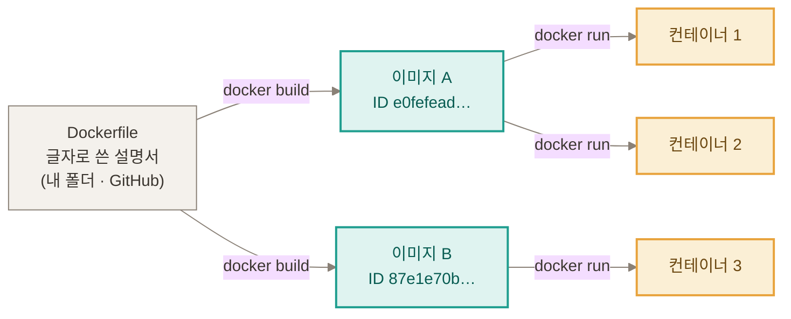
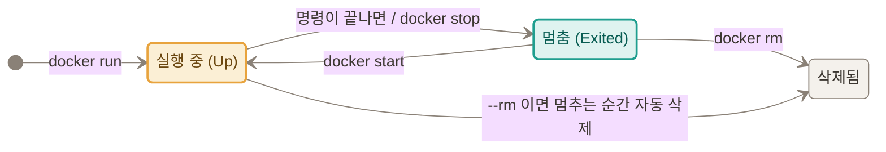

# 신서연 — Docker 1일차: Dockerfile로 실행환경 정하기

> 학습 템플릿 (2조) › 신서연. 노드 "Dockerfile로 실행환경 정하기"를 8스텝 끝까지 읽고, 7번 "직접 해보기" 과제 1~3을 실행해 기록했다.

## 한눈에 보기

- **문제**: 내 컴퓨터에서는 사진 속 글자 읽기(OCR)가 되는데 staging 서버에서만 실패(500). 코드는 한 글자도 같은데.
- **원인**: 코드가 아니라 **실행 환경**. 내 컴퓨터에만 설치해 둔 프로그램(tesseract)이 서버 이미지에 없었다. buildpacks는 코드에 적힌 것(파이썬 버전, 라이브러리)만 챙긴다.
- **해결**: **Dockerfile**에 필요한 프로그램의 설치 줄을 적어 저장소에 넣는다. → 로컬 컨테이너, staging, production에서 같은 결과(6줄)가 나왔다.
- **과제**: 과제 1(컨테이너 들여다보기), 과제 2(같은 Dockerfile 두 번 빌드), 과제 3(PDF 시간표 + HEIC)을 모두 실행했다.
- **가장 헷갈렸던 것**: Dockerfile · 이미지 · 컨테이너의 관계 → 아래 "그림으로 보기"에서 한 장으로 정리했다.

---

## 오늘의 주제

**"내 컴퓨터에서는 되는데 서버에서만 안 되는" 이유와, Dockerfile 한 파일로 실행 환경을 정해 고치는 방법.**

## 오늘의 목표

- 로컬에서는 되고 서버에서는 안 될 때 **화면 안내가 아니라 로그의 오류 줄**에서 원인을 찾는다.
- 이미지와 컨테이너의 차이를 직접 확인한다.
- Dockerfile을 줄마다 읽고 5가지 기준(버전 고정, 필요한 시스템 패키지, `.env` 제외, `PORT` 사용, non-root)으로 검토한다.
- 로컬에서 이미지를 빌드해 컨테이너로 실행하고, staging과 production에 Dockerfile로 배포한다.
- 7번 과제 1~3을 해 본다.

---

## 그림으로 보기

> 아래 그림은 내 블로그 글에 만든 모션 그림(점선이 흐르고 칸이 깜박이는 SVG)이고, Notion에는 움직이는 GIF로 올렸다. 그림마다 Mermaid 도식도 같이 둬서, 그림이 안 보여도 흐름을 읽을 수 있게 했다.

### 1. Dockerfile · 이미지 · 컨테이너의 관계 (가장 헷갈렸던 것)

> [그림 1] 같은 Dockerfile에서 이미지 두 개(ID가 다름), 이미지에서 컨테이너 세 개. 화살표 위 명령이 "만드는" 명령.



| | Dockerfile | 이미지 | 컨테이너 |
|---|---|---|---|
| 정체 | 글자로 쓴 설명서(텍스트 파일) | 설명서대로 만들어 봉한 결과물 | 이미지를 실행한 것 |
| 어디에 있나 | 내 폴더, GitHub 저장소 맨 위 폴더 | 내 컴퓨터(`docker images`), 배포하면 Artifact Registry | 내 컴퓨터(`docker ps`), 배포하면 Cloud Run 인스턴스 |
| 바뀌나 | 내가 고치면 바뀜 | 만든 뒤에는 **안 바뀜**(고치려면 다시 빌드해서 새 이미지) | 실행 중 파일이 바뀜, 지우면 사라짐 |
| 만드는 명령 | 편집기로 씀 | `docker build` | `docker run` |
| 지우는 명령 | 파일 삭제 | `docker rmi` | `docker rm` |
| 몇 개 생기나 | 하나를 계속 고쳐 씀 | build 할 때마다 하나(캐시를 안 쓰면 매번 다른 ID) | run 할 때마다 하나 |

**헷갈릴 때 외울 문장**: Dockerfile은 레시피, 이미지는 레시피대로 만든 밀키트 상자, 컨테이너는 그 상자를 뜯어 불에 올린 요리. 상자를 고치고 싶으면 레시피를 고쳐서 상자를 새로 만들어야 한다.

### 2. 컨테이너는 실행 직후 사라질까? (직접 재 본 결과)

> [그림 2] 컨테이너의 상태 변화: 실행 중 ↔ 멈춤(`Exited`) → 삭제됨. 기본은 멈춰도 남아 있고 `docker rm`을 해야 삭제된다. `--rm`을 붙이면 멈추는 순간 자동으로 삭제된다.



**답: 아니다. 지우거나 `--rm`을 줬을 때만 사라진다.** `--rm` 없이 실행한 컨테이너는 멈춘 뒤에도 `Exited`로 남는다. `--rm`을 주면 컨테이너가 **멈추는 순간 자동으로 삭제**되는데, `python --version`처럼 0.1초 만에 끝나는 명령은 컨테이너도 곧바로 멈추므로 삭제도 곧바로 일어난다(실제로 삭제되는 것이다).

| 한 일 | 결과 |
|---|---|
| `docker run --rm 이미지 python --version` | 출력 후 `docker ps -a`가 **빈 목록** (명령이 끝나 컨테이너가 멈추는 순간 `--rm`이 실제로 지움) |
| 같은 명령을 `--rm` 없이 | `Exited (0)`으로 **남음** |
| `docker run -d … sleep 300` (계속 도는 명령) | `Up` |
| 그 안에 파일을 만들고 `docker stop` | `Exited (137)` |
| 멈춘 컨테이너를 `docker start` 후 파일 확인 | **파일이 그대로 있음** |
| 컨테이너가 남아 있는데 `docker rmi 이미지` | **오류** `conflict: … container … is using its referenced image` |
| 컨테이너를 `docker rm -f`로 지우고 같은 이미지로 새로 띄움 | **파일 없음** |
| 컨테이너를 모두 지운 뒤 `docker rmi 이미지` | 지워짐 |

- 컨테이너는 **시작 명령(컨테이너 안에서 처음 실행한 프로그램)이 끝나면 같이 멈춘다**(서버처럼 계속 도는 명령이면 계속 `Up`).
- `--rm`은 "컨테이너가 멈추는 순간 자동으로 지워 달라"는 옵션이다. 바로 끝나는 명령은 곧바로 지워지고, 서버처럼 안 끝나는 프로그램은 멈출 때까지 지워지지 않는다.
- `docker ps`는 **돌고 있는 것만**, `docker ps -a`는 끝난 것까지 보여 준다.
- 컨테이너 안의 파일은 컨테이너가 **있는 동안** 남고(멈췄다 켜도), 컨테이너를 **지우면** 사라진다.
- 이미지는 컨테이너가 **하나라도 남아 있으면** 못 지운다(멈춘 컨테이너도 이미지를 쓰는 것으로 본다).
- 서버(Cloud Run)에서 새 리비전을 배포하면 새 컨테이너로 시작하므로 컨테이너 안에만 둔 데이터는 사라진다.
- `Exited (137)`의 정확한 뜻은 확인하지 못했다(멈추라는 요청을 1초 안에 못 받아 강제로 끝낸 것으로 보임).

### 3. 같은 코드인데 결과가 갈린다 (내 컴퓨터 / buildpacks 이미지 / Dockerfile 이미지)

> [그림 3] 파이썬·라이브러리는 세 곳 다 있고, tesseract 한 칸만 buildpacks 이미지에서 빠짐.

| | 내 컴퓨터 | buildpacks 이미지(staging) | Dockerfile 이미지 |
|---|---|---|---|
| 파이썬 | ✓ | ✓ | ✓ |
| 라이브러리(requirements.txt) | ✓ | ✓ | ✓ |
| tesseract + 한국어 | ✓ (내가 직접 설치) | **✕** (코드에 안 적혀서 빠짐) | ✓ (Dockerfile에 적음) |
| `POST /api/ocr` | 200 (6줄) | **500 프로그램 없음** | 200 (6줄) |

### 4. 레이어: Dockerfile의 줄이 하나씩 쌓인다 + 캐시

> [그림 4] 줄이 아래부터 위로 레이어 하나씩 쌓이는 모습과 크기·시간. [그림 5] 세 번의 빌드에서 어느 줄이 새로 만들어지는지.

| 쌓인 순서 | Dockerfile 줄 | 레이어 크기 | 걸린 시간 |
|---|---|---|---|
| 1 | `FROM python:3.13-slim-bookworm` | (기존 이미지 183MB) | 이미 있음 |
| 2 | `RUN apt-get … tesseract` | **94.9MB** | **24.1초** |
| 3 | `WORKDIR /app` | 8kB | 0.1초 |
| 4 | `COPY requirements.txt .` | 12kB | 0.1초 |
| 5 | `RUN pip install` | 52.5MB | 9.9초 |
| 6 | `COPY . .` | 152kB | 0.2초 |
| 7 | `RUN useradd` · `USER` · `CMD` | 약 70kB | 0.6초 |

| 빌드 | 바꾼 것 | tesseract 설치 | pip install | 코드 복사 | 시간 |
|---|---|---|---|---|---|
| 1차 | 처음 | 새로 실행 | 새로 실행 | 새로 실행 | **53초** |
| 2차 | 안 바꿈 | CACHED | CACHED | CACHED | **2.1초** |
| 3차 | `README.md`에 빈 줄 | CACHED | CACHED | **CACHED** | 2.2초 |
| 4차 | `app/__init__.py`에 빈 줄 | CACHED | CACHED | **새로 실행** | **3.5초** |

- **레이어 캐시**: Dockerfile은 위에서 아래로 한 줄씩 실행된다. 어느 줄을 바꾸면 그 줄과 그 뒤에 실행되는 줄은 모두 다시 실행되고, 그 앞 줄은 지난 결과를 그대로 쓴다.
- 그래서 오래 걸리고 잘 안 바뀌는 설치(tesseract 24.1초, pip 9.9초)를 파일의 **위쪽**에, 자주 바뀌는 코드 복사를 **아래쪽**에 둔다. `requirements.txt`만 먼저 복사하는 것도 같은 이유.
- 그림 4는 쌓이는 모습이라 순서가 거꾸로다(아래가 먼저, 위가 나중). 과제 3에서 apt 줄(7단계 중 2번째)을 바꿨더니 2~7번, 6단계가 모두 "새로 실행"이었다. 그림 5는 위 표의 1·2·4차 빌드를 보여 준다. 3차에서 코드 복사가 CACHED인 것은 `README.md`가 `.dockerignore`에 들어 있어 이미지에 안 보냈기 때문이다.

### 5. 포트: `docker run -p 9000:8000`은 어느 쪽으로 접속하나

> [그림 6] 브라우저는 컨테이너 바깥에서 오는 손님이라 **바깥 포트(앞 숫자)로** 접속. 안쪽 8000은 컨테이너만 아는 번호.

- `docker run -d -p 9000:8000 …`과 `-p 9001:8000 …`으로 컨테이너 둘을 띄움 → `localhost:9000`, `localhost:9001`은 열리고(200), **`localhost:8000`은 안 열림**.
- 이미 쓰는 9000번으로 하나 더 띄우면 `Bind for 0.0.0.0:9000 failed: port is already allocated`.
- 여러 개를 띄울 때는 안쪽 포트는 같게 두고 **바깥 포트만 바꾼다**.

### 6. Dockerfile은 어디에 저장되나 (GitHub vs GCP)

> [그림 7] Dockerfile이 지나가는 곳: 내 컴퓨터 → GitHub 저장소 → Actions 서버 → GCP 임시 보관(zip) → Cloud Build → Artifact Registry → Cloud Run.

| 단계 | 어디에 |
|---|---|
| ① 작성 | 내 컴퓨터의 프로젝트 폴더 |
| ② 커밋·push | **GitHub 저장소 맨 위 폴더**(`README.md`, `index.html`과 같은 위치) — 원본 |
| ③ 배포하는 순간 | GCP 임시 저장소(Cloud Storage)에 폴더가 zip으로 올라감 |
| ④ 빌드 중 | Cloud Build 작업 폴더, 빌드 로그에 `inflating: /workspace/Dockerfile` |
| ⑤ 빌드 결과 | Artifact Registry에 **이미지**로 저장 (Dockerfile 파일이 아니라 결과물) |
| ⑥ 이미지 안 | `COPY . .` 때문에 `/app/Dockerfile` 사본도 들어 있음 |

- **소스 배포는 GCP(Cloud Run)의 기능**이고, GitHub는 코드를 보관하고 배포를 자동으로 시키는 쪽이다(GitHub Actions).
- Dockerfile은 반드시 **저장소 맨 위 폴더에 `Dockerfile`이라는 이름**으로 둬야 소스 배포가 찾는다(이름을 바꾸거나 다른 폴더에 두는 것은 직접 시험하지 않았다).

---

## 오늘의 미션 (7. 직접 해보기)

### 실습 환경

- 노드의 예제 서비스(friend-agent) 대신 **직접 만든 작은 앱(도장판, `routine-stamp-trial`)으로** 진행했다.
- 이 앱에는 원래 서버가 없어서, **작은 파이썬 서버(FastAPI) + 연습용 OCR(`/api/ocr`)을** 붙이고, staging/production 자동 배포(GitHub Actions + Cloud Run)도 직접 구성했다. 노드가 "시작 상태"로 깔아 주는 것을 내가 직접 만든 셈이다.
- 앱의 기획 문서(PRD)와 맞지 않는 부분이 있어서(PRD는 일정표 기능을 하지 않는다고 적음) **"오늘은 실습용으로만"** 정했고, PRD는 건드리지 않았다. OCR 기능은 이 실습을 위한 연습용이다.

### 과제 1. 실행 중인 컨테이너 들여다보기

| 단계 | 한 일 | 결과 |
|---|---|---|
| 1 | 이미지로 컨테이너 `routine-test`를 뒤에서 실행 | `Up`, 포트 `0.0.0.0:8080->8080/tcp` |
| 2 | `docker exec`로 안에서 실행 | `whoami` → `appuser`, `pwd` → `/app`, `ls` → `Dockerfile`, `Procfile`, `app`, `index.html`, `requirements.txt` |
| 3 | 컨테이너 안에 `/tmp/hello.txt`를 만들고 읽기 | `안녕` |
| 4 | 컨테이너를 지우고 **같은 이미지로 다시** 띄워 파일 확인 | **`파일 없음`** |

- 확인한 것: **컨테이너는 실행할 때마다 이미지에서 새로 시작한다.**
- 노드의 예시(대화가 사라짐) 대신 내 앱에는 서버에 쌓이는 대화가 없어서 **파일을 직접 만드는 방식**으로 바꿨다. `--env-file`은 `.env`가 없어서 쓰지 않았다.

### 과제 2. 같은 Dockerfile로 두 번 빌드하기

| 비교 | 결과 |
|---|---|
| 빌드 시간 | `try-a` 48초, `try-b` 49초 |
| **이미지 ID** | `e0fefead622a…` ↔ `87e1e70b665e…` → **서로 다름** |
| 생성 시각 | 05:41:13 ↔ 05:42:02 (약 49초 차이) |
| 파이썬 패키지 (`pip freeze`) | 18개 ↔ 18개, 다른 줄 0개 |
| tesseract 패키지 (`dpkg`) | `tesseract-ocr 5.3.0-2`, `tesseract-ocr-kor 1:4.1.0-2` 양쪽 같음 |

- 확인한 것: **Dockerfile이 같아도 따로 빌드한 이미지는 서로 다른 이미지다.** 패키지와 버전이 같은데도 ID가 달랐다.
- 의미: staging과 production은 같은 Dockerfile로 이미지를 **각각 따로** 만든다. 확인한 이미지를 그대로 내보내려면 이미지를 한 번만 만들어 두 환경에 보내야 한다(오늘은 거기까지 가지 않음).
- 한계: ID가 다른 직접 원인이 생성 시각 차이인지는 확인하지 못했다. 며칠 간격으로 빌드하면 패키지 버전이 달라질 수 있다는 것도 직접 확인한 것이 아니다.

### 과제 3. 시스템 프로그램이 필요한 기능 하나 더 붙이기

**기능: 시간표를 PDF로 올려도 글자를 읽어 칸 이름 후보로 만든다 (+ 덤으로 아이폰 사진 HEIC도 읽기).**

- 착안: 습관 만들기가 어려운 사람은 일정을 일일이 입력하는 것도 귀찮을 것 같아서, 이미 가진 시간표 파일을 올리면 되게 하는 방향.
- **Dockerfile에서 바꾼 줄 (한 줄):**
  ```
  - apt-get install -y --no-install-recommends tesseract-ocr tesseract-ocr-kor
  + apt-get install -y --no-install-recommends tesseract-ocr tesseract-ocr-kor poppler-utils
  ```
- 코드: `app/ocr.py`가 `%PDF-`로 시작하는 파일은 앞 3쪽을 이미지로 바꿔(`pdf2image`) 기존 OCR로 읽고, HEIC를 열 수 있게 등록(`pillow-heif`)하고, 모든 이미지를 RGB로 바꿔 tesseract에 넘긴다.
- **한 문장 설명:** PDF를 이미지로 바꾸는 `pdftoppm`은 파이썬 패키지(`pdf2image`)가 부르는 **운영체제 프로그램(poppler-utils)이라서** pip로는 깔리지 않고, Dockerfile에서 apt로 따로 설치해야 하기 때문이다.

| 확인 위치 | 결과 |
|---|---|
| 내 컴퓨터(Windows) | **건너뜀** (poppler는 커뮤니티가 만든 Windows 빌드 압축 파일뿐이라 설치하지 않기로 함) |
| **로컬 컨테이너, poppler 줄 없을 때** | PDF → **500** "PDF를 이미지로 바꾸는 프로그램이 서버에 없습니다.", 로그 `poppler 프로그램(pdftoppm)을 찾을 수 없습니다 … poppler-utils가 설치되어 있지 않습니다` |
| **로컬 컨테이너, poppler 줄 있을 때** | PDF → **200**, 6줄 (이미지 안 `pdftoppm version 22.12.0`) |
| **staging** (리비전 `…-00004-hvj`) | PDF → **200**, 로컬 컨테이너와 같은 6줄. 빌드 로그에 `poppler-utils` 설치가 찍힘 |

- **그 줄이 없었다면 문제가 처음 드러난 곳: 로컬 컨테이너.** (내 컴퓨터 확인은 건너뛰었고, 컨테이너를 안 만들었다면 staging에서 처음 드러났을 것 — 오늘 OCR이 실제로 그랬다.)
- **HEIC(덤):** `pip`로 `pillow-heif`만 설치해도 열렸다. libheif가 파이썬 패키지 안에 들어 있어서 **Dockerfile에 시스템 프로그램 줄이 필요 없었다.** 그래서 과제 3의 핵심은 PDF/poppler. 한계: HEIC 샘플은 내가 PNG를 변환해 만든 것(기본 품질의 손실 압축)이라 글자 일부가 깨졌다(`10월 212! 수요일`). 실제 아이폰 사진이 같은지는 확인하지 못했다. JPEG는 정확히 읽혔다.
- 이미지 크기 385MB → 431MB (poppler, pdf2image, pillow-heif 중 무엇이 얼마인지는 나눠 재지 않음).
- production에는 과제 3 변경을 올리지 않았다(staging까지만).

---

## 잘 된 점 · 막힌 점 · 어떻게 해결했나

### 잘 된 점

| 잘 된 것 | 근거 |
|---|---|
| **문제를 일부러 재현하고 로그로 원인을 찾았다** | staging에서 500 → Cloud Run 로그 두 줄(요청 로그 500, 컨테이너 로그 `tesseract 프로그램을 찾을 수 없습니다`) |
| **같은 결과를 네 곳에서 확인했다** | 내 컴퓨터, 로컬 컨테이너, staging, production 모두 같은 6줄 |
| **Dockerfile 한 줄로 고쳤다** | 서버 코드는 안 바꾸고 환경만 바꿔 500 → 200 |
| **캐시 효과를 숫자로 확인했다** | 53초 → 2.1초(안 바꿈) / 3.5초(코드만 바꿈) |
| **한계를 숨기지 않고 적었다** | 로컬 poppler 설치 생략, HEIC 샘플 품질, `.env` 제외 효과 미증명 등 |
| **production 배포는 승인 단계를 거쳤다** | `production` 환경에 승인자를 지정해 두고 직접 승인 |

### 막힌 점과 해결

| 막힌 곳 | 원인 | 어떻게 풀었나 |
|---|---|---|
| **서버에서만 OCR 실패** (500) | 서버 이미지에 tesseract가 없음. buildpacks는 코드에 적힌 것만 챙김 | Cloud Run 로그의 오류 줄에서 원인 확인 → Dockerfile에 `apt-get install … tesseract-ocr tesseract-ocr-kor` |
| **어느 프로젝트로 실습할지** | 노드는 friend-agent(staging 서비스 있음)를 쓰는데, 나는 도장판 앱으로 하고 싶었음. 도장판에는 서버·OCR·staging이 없었음 | 도장판에 작은 서버와 OCR을 붙이고, GitHub 환경(`staging`, `production`)과 변수, 배포 설정을 직접 구성. staging 서비스는 첫 배포 때 자동으로 만들어짐 |
| **README를 바꿨는데 캐시가 안 깨짐** | 내가 `.dockerignore`에 `README.md`를 넣어 둠. 제외한 파일은 빌드에 안 보내서 Docker 눈에는 안 바뀐 것 | 이미지에 실제로 들어가는 `app/__init__.py`를 바꿔 다시 확인 → `COPY . .`부터 새로 실행 |
| **`-p 9000:8080`에서 어느 포트로 접속?** (헷갈렸던 질문) | 8080은 컨테이너 안쪽 번호, 브라우저는 바깥(내 컴퓨터)에서 옴 | 컨테이너 둘(9000→8000, 9001→8000)을 띄워 `localhost:9000/9001`은 열리고 `8000`은 안 열리는 것을 직접 확인, 그림으로 정리 |
| **Docker 명령이 "없다"** | 설치 직후 열려 있던 세션이 **옛 PATH**를 쓰고 있었음. `docker-credential-desktop`을 못 찾아 이미지 내려받기 전에 실패 | 이미지가 안 받아졌음을 확인한 뒤, 그 명령 안에서만 PATH를 더해 다시 실행. 새 터미널은 PATH가 적용됨 |
| **Docker Desktop 설치가 끝나지 않는 것처럼 보임** | winget 설치 프로세스가 10분 넘게 대기(이유는 확인 못 함) | 설치 폴더(170개 파일), 제어판 설치 목록, `docker --version`으로 설치 완료를 확인 → 바탕화면 아이콘으로 실행 |
| **Docker 약관이 자동 동의됨** | winget이 설치 프로그램에 `--accept-license`를 자동으로 붙임. "동의는 내가 하지 않겠다"고 안내했던 것과 달랐음 | 로그에서 발견해 바로 정정하고, 약관 링크와 제거 방법을 안내 |
| **tesseract 설치 때 Korean이 안 보임** | 설치 화면 구성이 달랐던 것으로 보임(이유는 확인 못 함) | 설치 폴더를 열어 보니 `kor.traineddata`가 이미 있었고 `tesseract --list-langs`에 `kor` 확인 |
| **tesseract 명령이 안 잡힘** | 설치 폴더가 PATH에 없었음 | 사용자 PATH에 `C:\Program Files\Tesseract-OCR` 추가 후 터미널 재시작 |
| **확인 명령이 오류** (`git ls-remote`, `gh api`) | 프로젝트 폴더가 아니라 **홈 폴더**에서 실행했음 | 프로젝트 폴더로 이동해서 한 줄씩 실행. `gh api`의 `ParameterSpecifiedAlready`는 원인을 확인하지 못함 |
| **한 줄에 여러 명령을 붙여 넣었더니 문법 오류** | PowerShell이 통째로 해석에 실패해 **아무것도 실행되지 않음** | 컨테이너와 포트가 그대로인지 먼저 확인하고, 단순한 명령으로 다시 실행 |
| **종료 코드 255** | PowerShell이 docker/gcloud의 진행 메시지를 오류로 취급한 경우가 있었음(진짜 실패 아님) | 로그의 마지막 줄(`종료코드: 0`), 결과 출력으로 실제 성공을 확인 |
| **한글 로그가 깨져 보임** | 터미널 출력 인코딩 문제로 보임 | 파일 내용은 정상. Cloud Run 로그 화면에서의 한글은 확인하지 못함 |
| **HEIC를 OCR에 넘기면 실패** (`Unsupported image format/type`) | HEIC 이미지를 그대로 `pytesseract`에 넘긴 것 | 모든 이미지를 RGB로 바꿔서 넘기도록 코드 수정 → 200 |
| **HEIC 글자가 일부 깨짐** | 샘플을 기본 품질로 변환한 손실 압축 때문일 수 있음(확인 못 함) | 한계로 기록. 실제 아이폰 사진으로 확인하는 것을 숙제로 남김 |
| **내 컴퓨터에서 poppler 확인을 못 함** | Windows용은 커뮤니티 빌드뿐이라 설치를 망설임 | 설치를 생략하고 로컬 컨테이너와 staging 두 곳에서 확인, 사실을 보고서에 명시 |

### 새로 알게 된 것 (배운 점)

- 서버에서만 안 될 때 화면 안내는 **결과**이고 원인은 **로그**에 있다. 서비스가 정상으로 시작하고 요청이 들어와 프로그램을 부르는 순간에 실패하면 배포는 성공으로 끝난다.
- CI 통과와 서버에서의 동작은 별개다(CI가 돈 환경과 서버 이미지는 다르다).
- 이미지는 안 바뀌고, 컨테이너는 이미지에서 새로 시작하며, 컨테이너를 지워야 이미지를 지울 수 있다.
- **`.dockerignore`에 적힌 파일은 바꿔도 캐시가 안 깨진다.**
- 이 일은 **로컬 → 로컬 컨테이너 → staging → production** 순서로 올리는 것이 안전하다. 문제가 어디서 처음 드러나는지가 달라진다.

---

## 이 세션에서 내가 던진 질문과 답

| 질문 | 답(요약) |
|---|---|
| OCR 기능을 켜는 것과 오늘 배우는 docker가 무슨 상관? | OCR은 오늘의 예제 기능일 뿐이고, 핵심은 "서버에 필요한 프로그램까지 Dockerfile로 적어 환경을 내가 정하는 것". 로컬에 tesseract를 설치한 것은 "내 컴퓨터에서는 된다"를 일부러 만들기 위해서 |
| `-p 9000:8080`이면 브라우저는 앞 번호가 아니라 뒤 번호로 가야 하는 것 아닌가? | 브라우저는 컨테이너 바깥(내 컴퓨터)에서 오므로 **앞 숫자(바깥 포트)로** 간다. 8080은 컨테이너 안쪽 번호 |
| 컨테이너 `note-a`가 종료된 것인지 어떻게 아나? | `docker ps`(돌고 있는 것만)에 안 보이고, `docker ps -a`에 `Exited (0)`, `docker inspect`의 `Status=exited`, `ExitCode=0` |
| 지금 돌고 있는 것을 어떻게 보나? | `docker ps`(실행 중), `docker ps -a`(끝난 것 포함), `docker images`(이미지), Docker Desktop의 Containers/Images 화면 |
| 레이어 줄이 쌓이는 모습을 볼 수 있나? | `docker history 이미지`로 레이어별 크기, 빌드 로그(`--progress=plain`)에서 줄이 쌓이는 순서. Docker Desktop 이미지 화면은 직접 열어 보지 못함 |
| 레이어 캐시의 의미와 역할은? | 안 바뀐 줄은 이전 결과를 다시 쓰고, 바뀐 줄과 그 뒤 줄만 다시 실행한다. 빌드 시간을 줄이고 줄 순서(오래 걸리는 설치를 위쪽에)를 정하는 기준이 된다 |
| 컨테이너는 실행 직후 사라지나? | 아니다. 컨테이너 안의 시작 명령이 끝나면 컨테이너가 멈출 뿐이고, 멈춘 컨테이너는 `docker rm`으로 지우거나 `--rm`을 줬을 때(멈추는 순간 자동 삭제)만 사라진다 |
| SHA256이 뭔가? | 파일의 지문. 받은 설치 파일이 게시자가 올린 것과 같은지 확인하는 용도(winget이 설치 전에 자동 대조) |
| PATH에 폴더를 넣는다는 것은 무슨 작업? | 프로그램을 이름만으로 찾을 때 뒤져 볼 폴더 목록에 그 폴더를 한 줄 더하는 일. 서버는 이 목록을 모르므로 Dockerfile이 대신한다 |
| 소스 배포는 GCP와 GitHub 중 어디와 관련 있나? | "소스 배포"는 Cloud Run(GCP)의 기능, GitHub는 코드를 보관하고 Actions로 배포를 자동으로 시킨다 |
| Dockerfile은 어디에 저장되나? GitHub에서는 어느 위치? | 내 폴더 → GitHub 저장소 **맨 위 폴더(루트)** → 배포 때 GCP 임시 저장소 zip → Cloud Build 작업 폴더 → (결과) Artifact Registry 이미지, 이미지 안에도 사본 |
| "컨테이너가 뜨면 브라우저에서 localhost:8080을 열고 사진을 보낸다"가 무슨 뜻? | 노드의 서비스에는 📷 버튼이 있다는 전제. 내 앱에는 화면이 아직 없어서 서버의 `/docs` 시험 페이지나 명령어로 보냈다 |
| 루틴도장 앱에서 일정을 일일이 입력하는 게 귀찮은 사람을 위한 OCR 기능은? | 시간표 PDF·사진을 올리면 칸 이름 후보를 만드는 방향(과제 3으로 PDF + HEIC 구현). 앱의 기획과 맞는지는 기획 문서를 다시 잡을 때 정하기로 하고 오늘은 실습용 |
| 아이폰, 안드로이드를 둘 다 지원하면 작업이 큰가? | 안 크다. JPEG(안드로이드)는 이미 읽히고, HEIC(아이폰)는 pip 패키지만으로 열림. 다만 HEIC는 Dockerfile 시스템 프로그램이 필요 없어서 과제 3의 핵심은 PDF/poppler |

---

## 오늘의 회고

**처음 적은 답과 오늘 실제로 달랐던 것 비교**
- 처음에는 로컬과 서버가 다를 수 있는 것으로 운영체제, 설치된 프로그램, 파이썬과 라이브러리 버전, 환경변수와 키, 포트를 막연히 적었다.
- 오늘 실제로 달랐던 것은 **내 컴퓨터에만 설치해 둔 프로그램(tesseract)이었다.** 코드, 파이썬 버전, 라이브러리 목록은 같았다.

**같은 종류의 문제가 다시 생기면 어디부터 확인할까**
1. 화면 안내가 아니라 **Cloud Run 로그의 오류 줄**(요청이 500인 줄과 앱이 남긴 줄)
2. **Dockerfile에 필요한 프로그램의 설치 줄이 있는지**(`apt-get install …`)
3. 빌드 로그에 그 설치 단계가 찍혔는지, Dockerfile로 빌드됐는지(`Step 1/…: FROM` 줄)
4. `.dockerignore`와 `PORT`, 이미지 안 파일(`docker exec 컨테이너 ls -a /app`)

**남은 의문·숙제**
- 확인한 이미지와 나간 이미지가 같다고 말하려면 이미지를 한 번만 만들어 staging과 production에 보내야 한다(지금은 각각 따로 빌드).
- 지금 production에서 도는 이미지가 어느 커밋으로 만든 것인지 이름만 보고는 알기 어렵고, 이미지가 385~431MB라 배포마다 쌓이는 저장 공간도 아직 관리하지 않는다.
- 서버(Cloud Build)의 배포 빌드에서도 같은 레이어 캐시가 쓰이는지 확인하지 못했다.
- `.dockerignore`의 `.env` 줄이 실제로 키 파일을 막는지는 이 폴더에 `.env`가 없어 증명하지 못했다.
- 실제 아이폰으로 찍은 HEIC 사진으로 OCR 품질을 확인하지 못했다.

---

## 부록

### 오늘 쓴 명령어 모음

| 하는 일 | 명령 |
|---|---|
| 이미지 만들기 | `docker build -t 이름:태그 .` (캐시 없이: `--no-cache`) |
| 컨테이너 실행 | `docker run -d --name 이름 -p 바깥:안쪽 -e 키=값 이미지` (끝나면 자동 삭제: `--rm`) |
| 돌고 있는 것 / 전체 | `docker ps` / `docker ps -a` |
| 이미지 목록 / 레이어 | `docker images` / `docker history 이미지` |
| 컨테이너 안에서 명령 | `docker exec 컨테이너 명령` |
| 멈추기 / 다시 켜기 | `docker stop 컨테이너` / `docker start 컨테이너` |
| 지우기 | 컨테이너 `docker rm`, 이미지 `docker rmi` |
| 상태 자세히 | `docker inspect 컨테이너` |
| 서비스 환경변수 추가 | `gcloud run services update 서비스 --region … --update-env-vars 키=값` |

### 확인하지 못한 것 (한눈에)

- Cloud Build 배포 빌드의 레이어 캐시, Windows 로컬 환경에서의 poppler 동작, 실제 아이폰 HEIC 사진의 인식률, `Exited (137)`의 정확한 뜻, `.env` 제외 효과, 이미지 이름이 없는 이전 빌드 이미지가 남아 있는지.

### 같이 정리한 것

- 블로그 글 "로컬에서는 되는데 서버에서만 안 되는 이유 — Dockerfile로 실행 환경 정하기 (4)"에 위 그림 7개를 모션 그림으로 넣었다(내 블로그, 로컬에 커밋만 했고 push 전).
