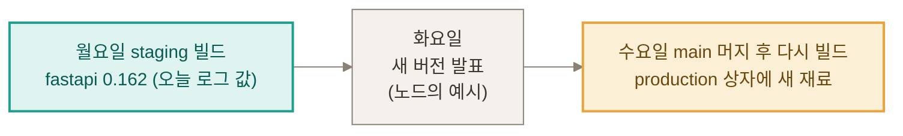
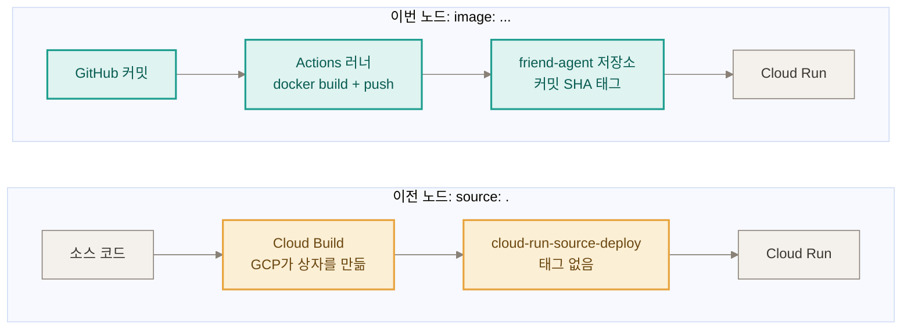
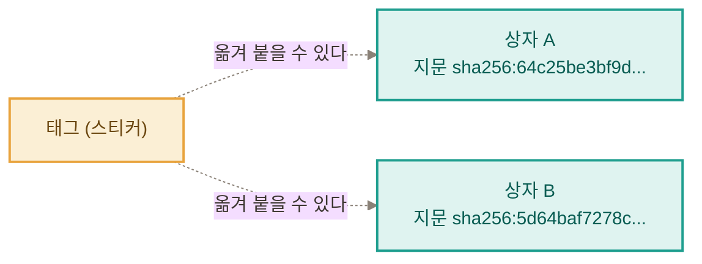
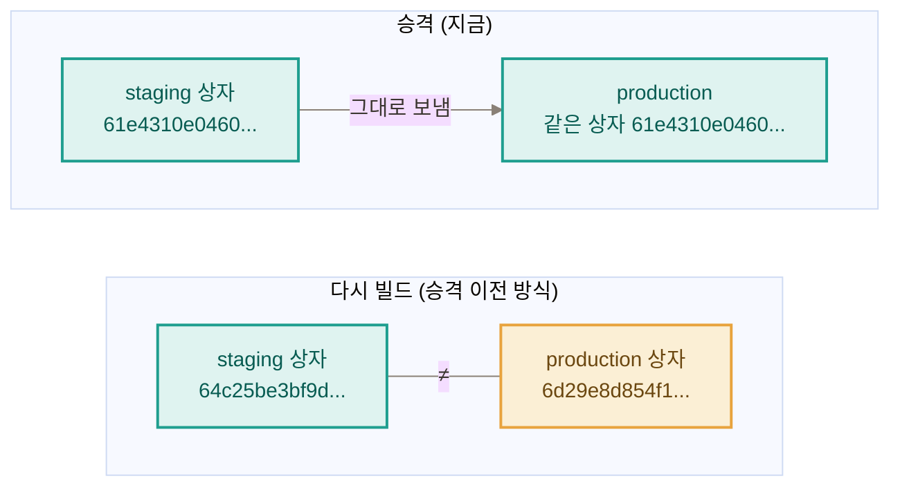
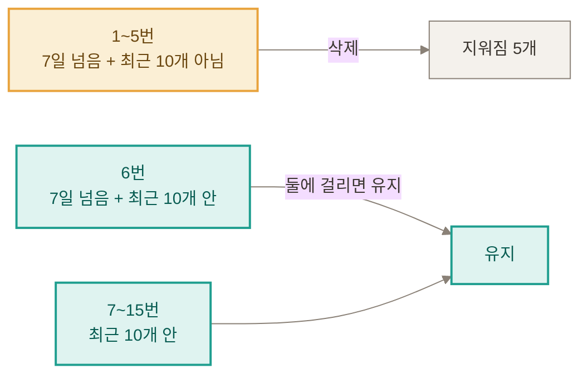
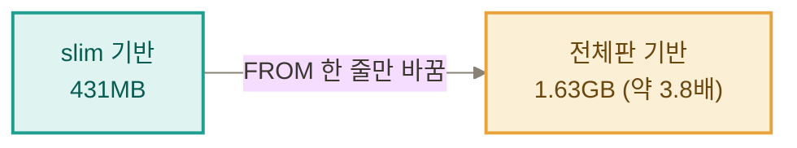

# 신서연 — Docker 2일차: 한 번 만든 이미지로 배포하기

> 학습 템플릿 (2조) › 신서연. 노드 "한 번 만든 이미지로 배포하기"를 7스텝 끝까지 읽고, 내 프로젝트(루틴 도장)로 스텝 3~7의 실습과 7번 "직접 해보기" 과제 1·3·4를 실행해 기록했다. (과제 2와 고장 난 Dockerfile A·D는 하지 않았다.)

## 한눈에 보기

- **문제**: production에서 신고가 들어왔을 때 세 가지를 바로 답하기 어렵다. 지금 도는 코드가 어느 커밋인지, 정상이던 이전 버전으로 되돌릴 수 있는지, 지금 production 이미지가 staging에서 확인한 그 이미지인지.
- **원인**: 세 가지. ① 이미지에 «어느 커밋의 코드인가»를 적은 이름표(태그)가 없었다. ② staging용과 production용 이미지를 각각 따로 새로 빌드해서, 시험한 이미지와 내보내는 이미지가 같다는 보장이 없었다. ③ requirements.txt에 라이브러리 버전을 «이 버전 이상»이라는 범위로만 적어 두면(>=), 빌드하는 날 조건에 맞는 가장 새 버전이 들어와서 코드가 같아도 재료가 달라질 수 있다.
- **해결**: GitHub Actions에서 이미지를 한 번만 만들고 커밋 SHA를 태그로 붙인다. staging에서 확인한 이미지를 다이제스트 주소로 production에 그대로 보낸다(승격). 쌓이는 이미지는 정리 정책으로 관리한다.
- **과제**: 과제 1(손으로 롤백 훈련), 과제 3(slim과 전체 이미지 크기 비교), 과제 4(배포 기록 자동화)를 실행했다. 고장 난 Dockerfile은 B와 C를 재현했다.
- **가장 헷갈렸던 것**: 태그와 다이제스트의 차이, 커밋 SHA·태그·다이제스트·리비전의 관계, /version이 없는 앱에서 어떻게 확인하는지 → 아래 "그림으로 보기"에서 정리했다.

---

## 오늘의 주제

**「검사한 이미지와 내보낸 이미지가 같다」는 것을 증거로 말할 수 있게 만드는 법.**

## 오늘의 목표

- 이미지 이름의 구조를 읽고 태그와 다이제스트가 어떻게 다른지 설명한다.
- 커밋 SHA를 태그로 붙여 커밋, 이미지, 리비전, 화면을 한 줄로 잇는다(연결표).
- staging에서 확인한 이미지를 다시 빌드하지 않고 다이제스트로 production에 승격한다.
- 롤백에 필요한 이미지를 남기는 기준으로 정리 정책을 정한다.
- 고장 난 Dockerfile을 증상만 보고 원인을 찾고, 7번 과제를 해 본다.

---

## 오늘 나오는 낯선 말

| 말 | 쉬운 뜻 | 오늘 노드에서 |
|---|---|---|
| 승격(promotion) | staging에서 확인한 이미지를 새로 만들지 않고 그대로 production으로 보내는 것 | 스텝 4 |
| slim | 실행에 꼭 필요한 파일만 남긴 가벼운 베이스 이미지(`FROM python:3.13-slim-bookworm`의 slim) | 스텝 6 과제 3 |
| 베이스 이미지 | Dockerfile이 출발점으로 삼는 이미지(`FROM`) | 스텝 6 과제 3 |
| 환경 | 이 프로젝트에서는 staging(시험)과 production(실제) 두 개 | 스텝 2·4 |

---

## 그림으로 보기

> 아래 그림은 내가 만든 모션 그림(점선이 흐르고 칸이 깜박이고 상자가 움직이는 SVG)이고, Notion에는 움직이는 GIF로 올렸다. 그림마다 Mermaid 도식도 같이 둬서 그림이 안 보여도 흐름을 읽을 수 있게 했다. 이 보고서의 비유는 한 무대로만 쓴다. staging은 검수실, production은 매장, 이미지는 포장된 상자다.

### 1. 왜 환경마다 이미지를 따로 새로 만들면 안 되나?

한 줄로: 환경마다 이미지를 따로 만들면, 같은 코드여도 이미지 안에 든 라이브러리(재료)의 버전이 달라질 수 있어서 시험한 이미지와 내보내는 이미지가 달라진다. 라이브러리는 그 이유를 보여 주는 예다.

> [그림 1] requirements.txt에 「이 버전 이거나 더 새 버전이면 아무거나(>=, 이상)」로 적으면 빌드할 때마다 그 순간의 최신 라이브러리를 받는다. 월요일에 시험한 상자와 수요일에 다시 빌드한 상자는 재료가 다를 수 있다.



| 용어 | 쉬운 뜻 | 이 프로젝트의 실제 예 |
|---|---|---|
| 라이브러리 | 남이 미리 만들어 둔 기능 묶음. 직접 다 만들지 않고 가져다 쓴다 | fastapi(웹 서버), pytesseract(사진 속 글자 읽기), pillow(이미지 처리) |
| requirements.txt | 가져다 쓸 라이브러리의 목록 | `fastapi>=0.115`, `pillow>=10.4`, … (7줄) |
| `>=0.115` | 「0.115이거나 더 새 버전이면 아무거나」 | 오늘 빌드 로그에는 fastapi 0.162.0, pillow 13.0.0이 설치됨 |

#### 라이브러리와 이미지는 같은 종류인가?

| | 라이브러리 | 이미지 |
|---|---|---|
| 정체 | 남이 미리 만들어 둔 기능 묶음(코드) | 앱과 필요한 것을 통째로 포장한 상자 |
| 둘의 관계 | 상자(이미지) 안에 들어가는 부품 | 부품을 넣어 만든 결과물 |
| 오늘의 예 | fastapi, pillow 같은 20개 | `routine-stamp-trial` 이미지 1개 |

- 아니다. 라이브러리는 이미지의 일종이 아니라 이미지 안에 들어가는 부품이다. 이미지를 빌드할 때 필요한 부품을 가져다 넣는다.
- 오늘 이미지를 빌드한 로그에는 설치된 라이브러리가 20개 찍혔다(fastapi 0.162.0, pillow 13.0.0, pytesseract 0.3.13 등). requirements.txt에 적은 것은 7줄인데 20개가 설치된 것은, 이 7개가 쓰는 다른 라이브러리를 pip가 함께 받기 때문으로 보인다(일반적인 동작이고 하나하나 확인하지는 않았다).

#### requirements.txt는 언제 쓰나?

- 앱에 필요한 라이브러리의 이름과 버전을 적어 둔 텍스트 파일이다(이 프로젝트는 7줄). 이미지를 만들 때 어떤 부품을 넣을지 알려 주는 부품 목록이다.
- 이 프로젝트에서는 Dockerfile 13~14줄이 이미지를 빌드하는 순간에 이 파일을 읽는다.

```text
COPY requirements.txt .
RUN pip install --no-cache-dir -r requirements.txt
```

- 첫 줄은 목록 파일을 이미지 안으로 복사하고, 둘째 줄에서 pip(파이썬 라이브러리 설치 도구)가 그 목록을 읽어 하나씩 설치한다.

**왜 requirements.txt를 코드 전체 복사(`COPY . .`)보다 먼저 복사하나?**

- Docker는 Dockerfile의 줄(단계)마다 결과를 저장해 두었다가, 그 줄과 앞 단계가 그대로이면 다시 하지 않고 재사용한다(캐시).
- 코드는 자주 바뀌고 requirements.txt는 드물게 바뀐다. 목록만 먼저 복사해 `pip install`까지 끝내 두면, 코드만 고친 빌드에서는 라이브러리 설치 단계를 재사용해서 빠르다.
- 코드를 먼저 복사하면 코드를 한 줄만 고쳐도 그 뒤의 `pip install`을 매번 다시 하게 된다.
- 루틴 도장 Dockerfile의 3번 주석에도 「requirements.txt 만 먼저 복사하면 코드만 바뀐 빌드에서 이 단계를 다시 쓰지 않는다」고 적혀 있다(저장소 staging 브랜치에서 읽음). 이 주석은 이 단계를 다시 쓰지 않아도 된다는 뜻으로 읽힌다.

**requirements.txt에는 무엇이 들어가나?**

한 줄에 라이브러리 이름과 버전 조건을 적는다(`이름>=최소버전`). 이 프로젝트는 7줄이다(staging·main 브랜치 파일 기준).

| 줄 | 하는 일 |
|---|---|
| `fastapi>=0.115` | 웹 서버 만들기(주소별로 요청 받기) |
| `uvicorn>=0.30` | 그 서버를 실제로 띄우는 프로그램(Dockerfile의 `CMD`가 호출) |
| `python-multipart>=0.0.9` | 사진·파일 업로드 받기(일반적인 용도, 이 프로젝트에서 따로 확인하지 않음) |
| `pytesseract>=0.3.10` | 사진 속 글자 읽기(OCR) |
| `pillow>=10.4` | 이미지 열기·바꾸기 |
| `pdf2image>=1.17` | PDF를 이미지로 바꾸기 |
| `pillow-heif>=0.18` | HEIC 사진 열기(일반적인 용도, 이 프로젝트에서 따로 확인하지 않음) |

- 라이브러리 이름과 버전 조건만 들어 있고, 내 앱 코드는 들어 있지 않다.
- pytesseract·pdf2image는 운영체제 프로그램(tesseract, poppler)이 따로 필요해서 Dockerfile이 `apt-get`으로 먼저 설치한다.

#### 「이 버전 이거나 더 새 버전이면 아무거나(>=, 이상)」로 적으면 왜 빌드할 때마다 최신을 받나?

| 순서 | 일어나는 일 | 오늘 확인한 것 |
|---|---|---|
| 1 | 이미지를 빌드하면 Dockerfile의 `pip install -r requirements.txt`가 실행된다 | Dockerfile 14줄 |
| 2 | pip가 목록의 줄을 하나씩 읽고 인터넷에서 그 라이브러리를 내려받는다 | 빌드 로그에 `Downloading … .whl` 줄이 계속 나옴 |
| 3 | `fastapi>=0.115`는 「0.115이거나 더 새 버전이면 아무거나」라서, pip는 그 순간 나와 있는 가장 새 버전을 고른다 | 오늘은 fastapi 0.162.0이 설치됨 |
| 4 | 다 만든 이미지는 바뀌지 않으므로 그 안의 라이브러리 버전도 그대로다 | 이미지는 만든 뒤 바뀌지 않는다(Docker 1에서 확인) |
| 5 | 이미지를 다시 빌드하면 2~3번을 다시 해서 그날의 최신을 받을 수 있다 | 월요일·수요일 예시는 노드의 가상 예시 |

- 「그 순간의 최신」은 빌드를 하는 그 날, 그 시각에 저장소에 올라와 있는 가장 새 버전이다. 빌드한 날이 다르면 받는 버전이 다를 수 있다.
- 비유: 「우유 1리터 이상이면 조건에 맞는 것 중 제일 새것으로 사 와」라고 적은 장보기 목록과 같다. 목록은 그대로여도 오늘은 1리터짜리를 사 오고, 며칠 뒤 더 큰 우유가 진열돼 있으면 그걸 사 온다. 버전을 `==`로 못 박는 것은 「이 상표 1리터짜리 우유」처럼 딱 하나만 적는 것이다.
- 버전을 딱 하나로 못 박아 적으면(예: `fastapi==0.162.0`) 매번 같은 버전을 받는다. 이 프로젝트의 requirements.txt는 그렇게 적지 않았다(`==`가 「정확히 같다」는 뜻이라는 것은 일반적인 표기 설명이다).
- 예외로, Docker에는 캐시가 있어서 이미 처리한 줄은 그 결과를 재사용할 수 있다. 오늘 로컬에서 같은 이미지를 두 번째로 빌드했을 때 3~4초 만에 끝난 것도 캐시를 썼기 때문이다. 그래서 「빌드할 때마다 새로 받는다」는 노드의 설명은 새로 빌드할 때를 기준으로 한 말로 보인다(추정).

**한 줄 요약**: 「이거나 더 새 버전이면 아무거나(>=)」로 적으면 날마다 재료가 달라질 수 있으니, 시험한 상자를 다시 만들지 말고 그 상자를 그대로 보낸다. (0.163은 노드가 든 가상의 예시이고, 이 프로젝트에서 실제로 일어난 사고가 아니다.)

### 2. 이전 노드(Cloud Build가 이미지를 만듦)와 이번 노드(Actions 러너가 이미지를 만듦)는 뭐가 다른가?

> [그림 2] 이전 노드까지는 소스 코드를 Cloud Run에 넘기면 GCP의 Cloud Build가 이미지를 자동으로 만들었다(태그 없음). 이번 노드에서는 GitHub Actions 러너가 docker build로 직접 만들어 내 저장소에 올리고, Cloud Run에는 만들어진 이미지를 넘긴다.



| | 이전 노드(Cloud Build가 만듦) | 이번 노드(Actions 러너가 만듦) |
|---|---|---|
| 배포 단계에 넘기는 것 | `source: .` (소스 통째로) | `image: …` (만들어진 이미지) |
| 이미지를 만드는 곳 | GCP의 Cloud Build | GitHub Actions 러너 |
| 보관 위치 | 자동 저장소 `cloud-run-source-deploy` (태그 없음) | 내가 만든 저장소 `friend-agent` (커밋 SHA 태그) |
| 좋은 점 | 설정이 적다 | 검토·테스트를 거친 커밋으로만 만들어지고, 누가 언제 만들었는지 기록이 남는다 |

**핵심 차이**: 둘 다 GitHub Actions가 배포를 시작한다. 달라지는 것은 이미지를 누가 만드느냐이다. 이전에는 GCP(Cloud Build)가 이미지를 자동으로 만들고 이름표(태그) 없이 두었다. 이번에는 우리가 이미지를 직접 만들고 커밋 SHA를 이름표로 붙인다. 그래서 「이 이미지가 어느 커밋인가」를 이름만 보고 알 수 있다. (노드는 GitHub에서 만드는 이유로 위 표의 「좋은 점」을 든다. GCP에서는 이름을 못 붙인다는 뜻이 아니고, 이 차이는 노드의 설명이다.)

**「누가 언제 만들었는지」를 알면 왜 좋은가?**

- 기록이 있으면: 문제가 생겼을 때 이미지에서 커밋을 찾아 어느 코드인지 알고, 되돌릴 대상을 정할 수 있다.
- 기록이 없으면(내 컴퓨터에서 만든 이미지): 어느 코드로 만들었는지, 누가 만들었는지 모르고 같은 이미지를 다시 만들 수도 없다.
- 오늘 확인한 것: 이미지 태그가 커밋 SHA라서 이름만 보고 GitHub 커밋을 찾을 수 있다. (노드의 설명이고, 이번 프로젝트에서 실제 사고로 써 본 것은 아니다.)

**한 줄 요약**: 이제 `main`에서는 이미지를 아예 만들지 않고, staging에서 만든 이미지를 받아 쓰기만 한다.

### 3. 태그와 다이제스트는 뭐가 다른가?

> [그림 3] 태그는 이미지에 붙인 이름표(스티커)라서 다른 이미지로 옮겨 붙일 수 있다. 다이제스트는 이미지 내용으로 계산되는 지문이라 그 이미지에서 떨어지지 않는다. (같은 태그가 옮겨 가는 장면은 개념 설명용이고, 오늘 AR의 이미지 3개는 태그가 모두 달랐다.)



| | 태그 | 다이제스트 |
|---|---|---|
| 비유 | 스티커 | 지문 |
| 모양(오늘 본 값) | `92d2c86647dd…` (커밋 SHA를 그대로 씀) | `sha256:61e4310e0460…` (64자리) |
| 바뀔 수 있나 | 다른 이미지로 옮겨 붙일 수 있다 | 내용으로 정해져 바뀌지 않는다 |
| 쓰임 | 사람이 찾아갈 때 | 실제로 무엇이 실행 중인지 확인하고 고정할 때, 승격할 때 |

**한 줄 요약**: 스티커는 떼어 옮길 수 있고, 지문은 상자에서 떨어지지 않는다. 승격에는 지문을 쓴다.

### 4. 커밋 SHA, 태그, 다이제스트, 리비전은 어떤 관계인가?

> [그림 4-1] 커밋 SHA(코드의 지문)와 이미지 태그는 글자가 같다. 태그는 SHA를 복사해서 이미지에 붙인 이름표이기 때문이다. 다이제스트(이미지의 지문)는 이미지 내용에서 따로 계산되어 글자가 전혀 다르다.

- 커밋 SHA: 코드(커밋)의 지문이다. git이 자동으로 만든다(40자리).
- 이미지 태그: 이미지에 붙인 이름표다. 우리가 위 SHA 글자를 복사해 적었다.
- 다이제스트: 이미지의 지문이다. 이미지 내용에서 자동으로 계산된다(64자리). SHA와 글자가 다르다.

> [그림 4] 커밋 SHA는 코드의 지문이고, 그것을 이미지 태그 이름으로 쓴다. 다이제스트는 이미지 내용에서 계산되는 지문이다. 리비전은 Cloud Run이 배포마다 남기는 기록이고 어느 다이제스트를 쓰는지 고정한다. 화면에는 커밋 앞 7자리가 새겨진다.

| 이름 | 무엇의 지문·기록인가 | 어디서 보나 |
|---|---|---|
| 커밋 SHA (40자리) | 코드(커밋) | GitHub |
| 이미지 태그 | 이름표(여기서는 커밋 SHA와 같은 글자) | Artifact Registry |
| 다이제스트 (64자리) | 이미지 내용 | Artifact Registry, 리비전 상세 |
| 리비전 | Cloud Run의 배포 기록(번호일 뿐 커밋 정보가 없다) | Cloud Run |
| 화면의 `v …` | 앱이 직접 보여 주는 커밋 앞 7자리 | 앱을 열면 보임 |

**한 줄 요약**: 이름이 비슷한 SHA 두 개는 대상이 다르다. 커밋 SHA는 코드, 다이제스트는 이미지다.

#### 앱이 「지금 나는 어느 커밋이다」를 알려 주는 방법: 이 앱은 화면 구석의 v 값

- `/version`이란: 앱 주소 뒤에 붙여 여는 페이지로, 앱이 「나는 어느 커밋이다」를 직접 알려 준다. 노드는 이 페이지로 확인하라고 한다.
- 이 앱(루틴 도장)에는 그 페이지가 없다. 코드에서 `version`, `COMMIT_SHA`, `K_REVISION`을 검색했는데 일치가 없었고, 서버가 가진 주소는 `/`, `/health`, `/api/ocr` 세 개뿐이었다(검색 범위는 `app/`와 `index.html`).
- 대신 앱 화면 구석에 작은 글씨 `v 92d2c86`이 보인다. 이 글자는 배포할 때 컴퓨터가 자동으로 넣은 커밋 번호(앞 7자리)다.
- 그래서 「화면의 v 값 = 지금 실행 중인 이미지의 커밋」으로 확인한다.
- 리비전 이름(`00011-vgr`)으로는 알 수 없다. 번호일 뿐이라 커밋 정보가 없다. 리비전 상세에서 다이제스트를 찾고 AR에서 태그를 찾아야 커밋이 나온다.

> [그림 4-2] 배포할 때 sed가 index.html의 자리 표시 `__COMMIT__`을 커밋 앞 7자리로 바꾼다. 바뀐 파일이 이미지에 들어가서, 앱을 열면 화면 구석에 `v 92d2c86`이 보인다.

`sed`는 글자를 자동으로 바꿔 주는 명령어다(워드의 「찾아 바꾸기」를 명령으로 한 것).

```text
sed -i "s/__COMMIT__/${GITHUB_SHA::7}/" index.html
var v='__COMMIT__'   →   var v='92d2c86'
```

### 5. 「한 번 만들고, staging과 production에 그대로 보낸다」는 무슨 뜻인가?

**승격(promotion)이란?** staging(시험)에서 확인한 이미지를 새로 만들지 않고 그대로 production(실제)으로 보내는 것이다. 시험 단계에서 실제 단계로 한 칸 올린다는 뜻이다(노드 스텝 4의 용어). 이 프로젝트의 환경은 staging과 production 두 개이고, 노드는 일반적으로 「다음 환경」이라고 쓴다.

> [그림 5] 위: 머지 때 이미지를 다시 만들면 production 상자가 staging 상자와 달라진다. 아래: 승격은 staging에서 확인한 상자를 새로 만들지 않고 그대로 production으로 옮긴다. 「여러 환경」은 staging과 production을 말한다.



| 환경 | 서비스 | 역할 |
|---|---|---|
| staging | `routine-stamp-trial-staging` | 시험용(검수실) |
| production | `routine-stamp-trial` | 실제 사용자용(매장) |

**한 줄 요약**: 오늘 production 리비전 00011-vgr과 staging 리비전 00009-cbp의 다이제스트는 64자리가 모두 같았다. (위쪽 그림의 `6d29e8d854f1…`은 옛 production 이미지, 소스 배포의 앞 12자리다.)

**승격 워크플로로 바꾼 뒤, main에 머지하면 무슨 일이 일어나나?**

- 「이미지 만들기와 올리기」 단계를 건너뛴다. main에서는 새 이미지를 만들지 않는다.
- 대신 「staging 이미지 찾기」 단계가 staging에서 확인한 이미지를 찾아, 다이제스트 주소 그대로 production에 배포한다.
- production 배포는 승인 대기로 멈춘다. 승인하면 진행된다.

| | 승격 전 방식 | 승격 워크플로 |
|---|---|---|
| main 머지 때 | production용 이미지를 새로 빌드 | 이미지 만들기를 건너뜀 |
| production이 쓰는 이미지 | 새로 만든 이미지(staging과 다이제스트가 다를 수 있음) | staging 이미지 그대로 |
| 오늘 확인한 것 | 노드: 다시 만든 production 이미지는 staging과 다이제스트가 달랐다 | PR #23 머지 뒤 production 리비전 `00010-bv7`의 다이제스트 `5d64baf7278c`가 staging과 같음(환경변수·IAM 그대로). PR #25 머지 뒤 `00011-vgr`의 `61e4310e0460`도 staging과 64자리 동일 |

- main 실행에서 「이미지 만들기」는 건너뛰고 「staging 이미지 찾기」가 실행된 것은 PR #23 머지 때 확인했다.
- 새로 만들지 않으므로, 시험한 이미지와 내보낸 이미지 사이에 재료(라이브러리 버전)가 달라질 일이 없다.

### 6. 되돌리면(롤백) 옛 리비전으로 「복귀」하는 건가?

> [그림 6] 승격도 롤백도 새 리비전을 만든다. production은 00008 → 00009 → 00010 → 00011로 늘어났고, staging 롤백 훈련도 00006 → 00007(롤백) → 00008(복구)로 번호가 올랐다.

**답: 아니다. 이전 이미지로 「새 리비전」을 만드는 것이다.** 옛 리비전은 남아 있지만 번호는 계속 올라간다. 롤백 중에는 이미지 주소와 `COMMIT_SHA` 환경변수를 함께 바꿔야 한다. 환경변수는 이미지와 따로 남기 때문이다.

### 7. 정리 정책 「7일 넘으면 삭제, 최근 10개 유지」에서 몇 개가 지워지나?

> [그림 7] 이미지 15개 중 6개가 7일보다 오래됐다면, 삭제 조건은 1~6번이고 유지 조건은 6~15번이다. 두 조건에 모두 걸린 6번은 유지되어, 지워지는 것은 1~5번의 5개다.



| 번호 | 7일 넘음(삭제 조건) | 최근 10개(유지 조건) | 결과 |
|---|---|---|---|
| 1~5 | ✓ | ✕ | 삭제 |
| 6 | ✓ | ✓ | 유지(둘에 걸리면 유지) |
| 7~15 | ✕ | ✓ | 유지 |

**한 줄 요약**: 「최근 10개」는 저장소 전체가 아니라 패키지(이미지 이름)마다 센다(공식 문서). 남기는 수의 기준은 롤백이다. (퀴즈의 5개는 내 계산이고 제출 해설은 보지 못했다.)

### 8. slim 이미지와 전체 이미지는 얼마나 다른가?

> [그림 8] Dockerfile의 FROM 한 줄(python:3.13-slim-bookworm → python:3.13-bookworm)만 바꿨더니 로컬 이미지가 431MB에서 1.63GB로 약 3.8배가 됐다.



| 측정 | 값 |
|---|---|
| slim 기반 `routine:good` (로컬) | 431MB |
| 전체판 기반 `routine:full` (로컬) | 1.63GB (+약 1.2GB) |
| AR에 저장된 slim 기반 이미지 (압축) | 약 106MiB (111,483,083바이트) |
| 전체판 베이스만 내려받은 양 (압축) | 약 383MB (빌드 로그의 레이어 크기 합) |

**한 줄 요약**: 로컬 크기는 압축 풀린 값이고 AR은 압축해서 저장한다. 전체판 이미지가 무료 0.5GB의 약 77% 이상일 것으로 추정하지만 push해 보지 않아 실제 값은 모른다.

---

## 오늘의 미션

### 실습 환경

- 노드의 예제는 friend-agent 앱이지만, 내 프로젝트인 **루틴 도장**(`tigermorning/routine-stamp-trial`)으로 실습했다. 처음에는 friend-agent 템플릿 기준으로 환경을 확인했다가 중간에 기준을 루틴 도장으로 바꿨다(그때 만든 AR 저장소 `friend-agent`는 그대로 썼다).
- GCP 프로젝트 `friend-agent-512201`, Cloud Run 서비스는 `routine-stamp-trial-staging`과 `routine-stamp-trial`, 이미지 저장소는 Artifact Registry `friend-agent`이다.
- 노드 예제와 다른 점: 앱에 /version이 없어 화면 값(`var v=`)으로 확인했고, 서비스가 비공개라 신원 토큰으로 요청했다(토큰은 출력·저장하지 않았다). 템플릿의 이미지용 워크플로를 통째로 복사하면 커밋 번호 새기기와 `--no-allow-unauthenticated`가 사라져서, 기존 워크플로에 필요한 부분만 더했다.

### 미션 1. 이미지를 Actions에서 만들어 배포하기 (스텝 3)

| 단계 | 한 일 | 결과 |
|---|---|---|
| 1 | AR 저장소 `friend-agent` 생성 | 이미지·패키지 0개, 0MB로 시작 |
| 2 | `github-deployer`에 저장소 하나에만 `roles/artifactregistry.writer` | `repositories` 대상이고 역할이 writer임을 실행 전에 확인, 정책 조회로 확인 |
| 3 | 루틴 도장 저장소에 변수 `AR_REPO` 설정 | 다른 저장소(friend-agent-template)의 변수는 5개 그대로 |
| 4 | `deploy.yml` 수정 PR #21 → staging 머지 | CI 2개 통과, deploy 성공, 권한 오류 없음 |

```diff
-          source: .
+          image: ${{ env.IMAGE }}
-          flags: ... --build-service-account=... --clear-base-image
+          flags: --no-allow-unauthenticated --service-account=${{ vars.RUNTIME_SA }}
+      - name: 이미지 만들기와 올리기
+        run: |
+          docker build --tag "$IMAGE" .
+          docker push "$IMAGE"
```

- 확인한 것: AR에 이미지 1개(태그 `fc01d21e2bea…`, 다이제스트 `sha256:64c25be3bf9d…`), staging 리비전 `00005-5rh`가 그 이미지를 썼다.
- 한계: `--build-service-account`와 `--clear-base-image`를 빼도 되는지는 배포가 성공했다는 사실로만 확인했다.

### 미션 2. 연결표와 이미지 승격 (스텝 4)

| 단계 | 한 일 | 결과 |
|---|---|---|
| 1 | 연결표 staging 줄 채우기 | 커밋 `fc01d21e…` → 태그 → 다이제스트 `64c25be3bf9d` → 리비전 `00005-5rh` → 화면 `v='fc01d21'` |
| 2 | production 상태를 읽기 전용으로 확인 | 리비전 `00008-bt5`, 이미지 `6d29e8d854f1`(소스 배포), env 3개, IAM 비어 있음 |
| 3 | 손으로 승격 (`--image …@sha256:… --update-env-vars COMMIT_SHA=…`) | 리비전 `00009-7gr`, 다이제스트가 staging과 64자리 동일, ENV·OCR_ENABLED·IAM 그대로 |
| 4 | 워크플로로 옮기는 PR #22 → staging, PR #23 → main | `main` 실행에서 「이미지 만들기」는 건너뛰고 「staging 이미지 찾기」가 실행 |
| 5 | production 승인 후 비교 | 리비전 `00010-bv7`, 다이제스트 `5d64baf7278c`(staging과 동일), COMMIT_SHA 갱신, env·IAM 그대로 |

- 승격 때 `--set-env-vars`가 아니라 `--update-env-vars`를 쓴 이유: 앞의 것은 기존 환경변수를 지운다.
- `main` 실행에서 staging 조회 권한이 있는지는 실제로 실행해 보고서야 알 수 있었고, 성공했다.
- 한계: production에서 실제로 되돌려 본 적은 없다(staging만 시험했다).

### 미션 3. 저장 공간 정리 정책 (스텝 5)

| 단계 | 한 일 | 결과 |
|---|---|---|
| 1 | 현재 상태 조회 | 두 저장소 모두 정책 없음. `cloud-run-source-deploy`는 이미지 60개(routine-coach 38개 등 다른 서비스와 공유) |
| 2 | 정책 파일(7일 삭제, 최근 10개 유지)을 저장소가 아니라 임시 폴더에 작성 | 문법 통과, 정책 2개 |
| 3 | 두 저장소에 `--dry-run`으로 적용 | 「Dry run is disabled」→「Dry run is enabled」, 이미지는 2개·60개 그대로 |

- 지금 데이터에 대입하면 삭제 후보는 0개로 계산된다(내 계산).
- 한계: 드라이런이 실제로 무엇을 지웠을지는 하루 뒤 감사 로그로만 확인할 수 있어 오늘은 확인하지 못했다. `--no-dry-run`은 쓰지 않았다.

### 미션 4. 고장 난 Dockerfile B·C (스텝 6)

(저장소는 건드리지 않고 임시 복사본에서만 했고, 이미지는 push하지 않았다. 정상 이미지는 431MB, 실행 사용자 `appuser`, `/app`에 `.env` 없음, `amd64/linux`였다.)

| 문제 | 고장 | 증상 | 원인 |
|---|---|---|---|
| B | `.dockerignore`에서 `.env` 한 줄 삭제 | `ls -a /app`에 `.env`가 나타남, `docker cp`로 꺼내 읽힘(시험용 가짜 값), 크기는 같음 | `COPY . .`가 .dockerignore에 없는 것을 모두 복사 |
| C | `RUN useradd`와 `USER appuser` 두 줄 삭제 | `whoami`가 root, `Config.User`가 빈 값, `/etc` 쓰기 성공(정상은 Permission denied), 크기는 같음 | `USER`가 없으면 기본 사용자가 root |

- 문제 C에서는 지운 줄 위의 주석(「관리자가 아닌 사용자로 실행한다」)이 남아 거짓 주석이 됐다.
- 하지 않은 것: 문제 A(OCR 안 됨)와 D(포트 고정). 템플릿 고장 파일이 friend-agent 기준이라 루틴 도장에 맞는지 비교가 필요했다.

### 과제 1. 손으로 롤백 훈련 (staging만)

| 단계 | 리비전 | 다이제스트 | 화면 | 배포 시간 |
|---|---|---|---|---|
| 시작 | `00006-ppb` | `5d64baf7278c` | `0304f99` | – |
| 롤백 (이미지 주소 + COMMIT_SHA를 함께 변경) | `00007-jrz` | `64c25be3bf9d` | `fc01d21` | 24초 |
| 복구 (최신) | `00008-fnl` | `5d64baf7278c` | `0304f99` | 36초 |

- 확인한 것: 롤백 중 다이제스트와 화면이 한 커밋 전의 값, 복구 뒤에는 최신 값. 환경변수와 IAM은 그대로, production과 `main`은 변하지 않음.
- 한계: 시간은 배포 명령이 걸린 시간이다(조사·확인 시간 제외). `COMMIT_SHA`를 안 바꿨을 때 어떻게 보이는지는 시험하지 않았다.

### 과제 3. slim 이미지와 전체 이미지 크기 비교

- `FROM` 한 줄만 바꿔 빌드(92초, 그중 전체판 베이스 내려받기 약 36초). slim 431MB, 전체판 1.63GB(약 3.8배). 자세한 값은 그림 8의 표에 있다.
- 한계: 전체판 베이스 이미지 자체의 크기는 측정하지 못했다(이 환경의 Docker가 별도 이미지로 남기지 않았다). 배포 때 내려받는 시간은 Cloud Run에서 재지 않았고, 이 PC에서 36초였다는 것만 안다.

### 과제 4. 배포 기록 자동으로 남기기

| 단계 | 한 일 | 결과 |
|---|---|---|
| 1 | 배포 끝에 단계 추가 → PR #24 → staging 머지 | 실행 요약에 표 생성, 리비전 `00009-cbp`·다이제스트 `61e4310e0460`이 Cloud Run 값과 일치 |
| 2 | PR #25 → main 머지, production 승인 | 이미지 찾기와 기록 단계 ✓, 표의 리비전 `00011-vgr`·다이제스트 `61e4310e0460`이 일치, production과 staging 다이제스트 64자리 동일 |

- 표(실행 요약, 실제 화면에서 읽음): `production | routine-stamp-trial | 92d2c86647dd | routine-stamp-trial-00011-vgr | 61e4310e0460`
- 표의 커밋 칸에는 머지 커밋이 아니라 이미지를 만든 staging 커밋이 적힌다(의도한 동작).
- 한계: 커밋 칸은 12자리 비교다. 과제 2(태그 덮어쓰기 막기)는 하지 않았다.

---

## 잘 된 점 · 막힌 점 · 어떻게 해결했나

### 잘 된 것

| 잘 된 것 | 근거 |
|---|---|
| 권한을 필요한 만큼만 줬다 | 저장소 하나에 writer 역할, 프로젝트 전체 권한은 주지 않음 |
| 변경 전후를 읽어서 비교했다 | 승격·롤백·승인 때마다 리비전·다이제스트·환경변수·IAM을 전후로 읽음 |
| 위험한 일은 확인을 받고 했다 | 정책은 `--dry-run`만, production 승인과 머지는 매번 명시적으로 받음 |
| 저장소를 더럽히지 않고 실험했다 | Docker 문제는 임시 복사본에서, 정책 파일은 임시 폴더에서 |
| 한 번 만든 상자가 두 환경에서 같다 | production과 staging 다이제스트 64자리 동일 |

### 막힌 곳과 해결

| 막힌 곳 | 원인 | 어떻게 풀었나 |
|---|---|---|
| 처음에 friend-agent 템플릿 기준으로 환경을 확인함 | 실습 대상이 루틴 도장이라는 걸 나중에 알게 됨 | 루틴 도장 저장소·서비스 기준으로 다시 확인. 임시로 복사했던 파일은 삭제 |
| 템플릿의 이미지용 워크플로를 그대로 못 씀 | 커밋 번호 새기기와 `--no-allow-unauthenticated`가 템플릿에 없음 | 기존 워크플로에 필요한 줄만 더함 |
| 첫 production 승인 요청이 거절됨(HTTP 400) | JSON 본문 형식 오류(PowerShell 파이프 인코딩으로 추정) | 승인되지 않았음을 확인하고, BOM 없는 UTF-8 파일로 다시 보냄 |
| `gcloud run services proxy`가 실행되지 않음 | `cloud-run-proxy` 구성요소 설치를 요구하는데 비대화형이라 설치할 수 없음 | 설치(다운로드)는 하지 않고 신원 토큰으로 `GET /` 한 번만 보냄 |
| 서비스가 비공개라 화면 값을 확인하기 어려움 | `--no-allow-unauthenticated` | 토큰을 출력·저장하지 않고 요청 |
| `Exit code 255`와 `NativeCommandError`가 자주 보임 | PowerShell 5.1이 gcloud·docker의 진행 메시지(stderr)를 오류로 표시함(실패 아님) | 출력의 `Done`, `Updated …` 같은 줄로 성공 판단 |
| Docker 문제를 하려는데 Docker가 꺼져 있음 | Docker Desktop 미실행 | 사용자가 켠 뒤 진행 |
| 롤백 후보 이미지가 7일 뒤 지워진다고 잘못 말함 | 「최근 10개」가 패키지별 기준이라는 걸 확인 전이었음 | 공식 문서를 읽고 정정 |
| 실행 요약 표를 로그에서 볼 수 없음 | 로그에는 명령만 나오고 표는 별도로 렌더링됨 | Actions 실행 화면에서 직접 읽음 |
| 노드 본문이 도구 출력에서 잘림 | 한 번에 읽을 수 있는 글자 수 제한 | 잘린 곳을 나눠 다시 읽음. 끝내 못 읽은 구간은 아래 부록에 적음 |

### 새로 알게 된 것

- 이미지 안의 `.env`는 실행하지 않고도 꺼낼 수 있고, 크기로는 알 수 없다.
- 컨테이너가 root인지는 서비스가 정상이어도 겉으로 드러나지 않는다.
- 롤백도 승격도 새 리비전을 만든다. 번호는 늘어난다.
- 리비전은 배포 기록이고 커밋 정보가 없다. 커밋은 화면 값이나 AR 태그에서 찾는다.
- 정리 정책의 「최근 10개」는 패키지마다 센다. 공유 저장소에 걸면 다른 서비스의 이미지도 대상이 된다.
- 승격 구조에서는 `main` 머지가 이미지를 만들지 않아서, 이미지가 쌓이는 속도는 staging 머지 횟수를 따른다.
- 원인을 확인하지 못한 것: 롤백 중 staging이 옛 이미지로 정상 응답하는지는 화면 값(`v='fc01d21'`, HTTP 200)까지만 봤고 OCR 기능은 시험하지 않았다.

---

## 이 세션에서 내가 던진 질문과 답

| 질문 | 답 요약 |
|---|---|
| 시작 퀴즈의 정답은? | 주관식이라 정해진 정답을 보지 못했다. 세 질문(커밋, 롤백, 같은 이미지)을 노드 본문 근거로 쓴 예시 답을 줬다. |
| 다이제스트가 오늘 노드에서 배울 내용이야? | 학습 목표 1·4·5에 직접 들어 있다(태그와 다이제스트의 차이, 다이제스트로 승격). |
| 라이브러리가 뭐야? 「이 버전 이거나 더 새 버전이면 아무거나(>=, 이상)」가 왜 문제야? | 남이 만든 기능 묶음. `>=`는 새 버전 아무거나 받으니 날마다 재료가 달라질 수 있다. |
| 「여러 환경」은 production만 말하는 게 아니지? | 맞다. staging과 production을 말한다. |
| 이미지를 예전엔 GCP에서, 이번엔 GitHub에서 만드는 거지? | 맞다. 이전 노드는 Cloud Build(`source: .`), 이번 노드는 Actions 러너(`image:`). |
| 다이제스트와 SHA는 같은 건가? 리비전과의 관계는? | 다른 지문이다. 커밋 SHA는 코드, 다이제스트는 이미지, 리비전은 배포 기록(다이제스트로 고정). |
| 왜 /version이 없나? 리비전이 /version 아닌가? | 리비전은 번호뿐인 배포 기록이고, /version은 앱이 직접 알려 주는 커밋이다. 이 앱은 /version 대신 화면에 커밋을 새긴다. |
| sed는 뭐야? | 글자를 자동으로 바꿔 주는 명령어. 배포 때 자리 표시 글자를 커밋 앞 7자리로 바꾼다. |
| 노드 내용을 몰라서 네가 정해야 해 | 롤백은 노드 방식(이미지 주소 + COMMIT_SHA)으로 정해 진행하고 최신으로 복구했다. |
| 「이 버전 이상」이 이상하다는 뜻이야? | 아니다. 以上(이상)은 기준 숫자를 포함해 그보다 같거나 큰 것을 말한다. `>=`와 같다. 그래서 문구를 「이 버전 이거나 더 새 버전이면 아무거나(>=, 이상)」로 풀어 썼다. |
| 라이브러리는 이미지의 일종이야? | 아니다. 이미지 안에 들어가는 부품이다. 이미지를 빌드할 때 필요한 라이브러리를 가져다 넣는다. |
| requirements.txt는 언제 쓰는 거야? | 이미지를 빌드하는 순간에 Dockerfile 13~14줄(`COPY`, `pip install -r`)이 읽는 부품 목록이다. |
| 그림 아래 Mermaid 코드는 에러 코드 아니야? | 에러가 아니라 도식을 글로 적은 원본이다. 그림을 이해하는 데 필요 없어서 코드는 숨기고 그림만 보이게(미리보기) 바꿨다. |
| 「외울 문장」은 외우라는 거야? | 외우라는 뜻이 아니라 그림의 핵심을 한 줄로 줄인 것이다. 오해하기 쉬워서 「한 줄 요약」으로 이름을 바꿨다. |
| 2번 제목의 「예전」은 무슨 뜻이야? | 이전 노드까지의 방식(GCP가 자동으로 이미지를 만듦)이라는 뜻인데 모호했다. 차이를 그대로 말하는 제목으로 바꿨다. |
| 1번의 요지는 라이브러리를 다시 빌드하면 안 된다는 거야? | 아니다. 환경마다 이미지를 따로 새로 만들면 시험한 이미지와 내보내는 이미지가 달라질 수 있다는 것이 요지이고, 라이브러리는 그 예다. |
| 소스 배포와 이미지 배포는 GCP와 GitHub의 차이야? | 반만 맞다. 둘 다 GitHub Actions가 배포를 시작한다. 달라지는 것은 이미지를 Cloud Build가 만드느냐(`source: .`), Actions 러너가 만드느냐(`image:`)이다. |
| 누가 언제 만들었는지 알면 왜 좋아? | 문제가 생겼을 때 이미지에서 커밋을 찾아 어느 코드인지 알고 되돌릴 대상을 정할 수 있다. 로컬에서 만든 이미지는 이런 기록이 없다(노드의 설명이고 이번에 사고로 써 보지는 않았다). |
| 태그가 커밋 SHA를 적은 거야? | 태그는 이미지에 붙인 이름표이고, 그 글자를 커밋 SHA와 똑같이 복사해 적었다. 다이제스트는 이미지 내용에서 따로 계산되어 글자가 다르다. |
| 승격이 무슨 말이야? | staging에서 확인한 이미지를 새로 만들지 않고 그대로 production으로 보내는 것(노드 스텝 4의 용어)이다. |
| slim은 어디서 나온 말이야? | 오늘 노드 스텝 6 과제 3에 나온다. 실행에 꼭 필요한 파일만 남긴 가벼운 베이스 이미지(`FROM python:3.13-slim-bookworm`)다. |
| /version이 없는 앱 부분이 이해가 안 돼 | 쉬운 말로 다시 썼다. 앱이 어느 커밋인지 알려 주는 페이지(/version)는 없고, 화면 구석의 `v 92d2c86`이 대신한다. |
| 그림이 너무 작아 | 작아서 안 보이는 도식은 지우고 GIF만 남겼다. 새 그림은 글자를 크게 만들었다. |

---

## 오늘의 회고

### 처음 생각과 실제 비교

- 노드 시작 질문에 쓴 예시 답은 「콘솔에서 리비전의 이미지 태그를 보고 커밋을 찾는다」였다. 실제로는 리비전 이름이 번호일 뿐이라 리비전 상세 → 다이제스트 → AR 태그 순서로 찾아야 커밋이 나왔고, 이 앱에서는 화면 값이 가장 빨랐다.
- 스텝 7의 세 질문을 지금 구조로 풀었다(읽기 전용, 화면 값·리비전 상세·AR 태그만 사용): 현재 production 커밋 `92d2c86647dd…`(32.6초), 직전 리비전 `00010-bv7`로 되돌릴 수 있음(21.0초), staging과 같은 이미지(33.1초). 합계 약 86.7초는 명령이 돈 시간이다. 구조를 바꾸기 전 훈련을 같은 방식으로 재지 못해 시간 비교는 못 했다.

### 같은 문제가 다시 생기면 확인할 순서

1. 화면 값으로 지금 도는 커밋(앞 7자리)을 본다.
2. 리비전 상세에서 다이제스트와 `COMMIT_SHA`를 본다.
3. AR에서 그 다이제스트의 태그(커밋)를 찾아 GitHub 커밋을 연다.
4. 되돌릴 대상은 직전 리비전의 다이제스트가 AR에 남아 있는지 본다.
5. staging과 production의 다이제스트 64자리를 비교한다.

### 남은 의문과 숙제

- staging에서 확인하는 동안 다른 변경이 staging에 머지되면 확인하지 않은 이미지가 승격될 수 있다(노드가 남은 과제로 든 것).
- 롤백이 아직 수동 작업이고, 새 리비전으로 바뀌는 순간 사용자가 오류를 보는지는 측정하지 못했다.
- 정리 정책의 실제 드라이런 결과(하루 뒤 감사 로그), production에서 실제로 되돌려 보기, 과제 2, 문제 A·D는 아직 못 했다.

---

## 부록

### 오늘 쓴 명령어 모음

```text
# 저장소 만들기와 권한 (저장소 하나에만)
gcloud artifacts repositories create friend-agent --project <프로젝트> --repository-format docker --location us-central1
gcloud artifacts repositories add-iam-policy-binding friend-agent --project <프로젝트> --location us-central1 --member "serviceAccount:<배포 계정>" --role roles/artifactregistry.writer

# 변수와 PR
gh variable set AR_REPO --repo <저장소> --body <리전>-docker.pkg.dev/<프로젝트>/friend-agent
gh pr create --repo <저장소> --base staging --head <브랜치> --title "…" --body-file <파일>

# 손으로 승격 (태그가 아니라 @sha256: 다이제스트, 환경변수는 --update-env-vars)
gcloud run deploy <production 서비스> --region us-central1 --image <저장소>/<이미지>@sha256:<다이제스트> --update-env-vars COMMIT_SHA=<커밋>

# 읽어서 확인
gcloud run revisions describe <리비전> --region us-central1 --format "value(status.imageDigest)"
gcloud artifacts docker images list <저장소 경로> --include-tags

# 정리 정책 (드라이런만)
gcloud artifacts repositories set-cleanup-policies <저장소> --project <프로젝트> --location us-central1 --policy <파일> --dry-run
gcloud artifacts repositories list-cleanup-policies <저장소> --location us-central1

# Docker (임시 복사본에서)
docker build -t <이름> <폴더>
docker run --rm <이름> whoami
docker run --rm <이름> ls -a /app
docker images --format "{{.Repository}}:{{.Tag}}  {{.Size}}"
```

### 확인하지 못한 것 (한눈에)

- 정리 정책 드라이런의 실제 결과(하루 뒤 감사 로그)
- production에서 실제로 되돌려 보기(staging만 시험)
- Apple Silicon에서의 arm64 실패(이 PC는 x86_64)
- 전체판 이미지를 push했을 때의 압축 크기, 전체판 베이스 이미지 자체의 크기
- 구조를 바꾸기 전 첫 훈련과의 시간 비교
- 노드 본문 중 출력이 잘려 끝내 읽지 못한 구간(스텝 2 중간, 스텝 3 중간, 스텝 6 마지막 퀴즈와 참고 자료)
- 하지 않은 것: 과제 2, 고장 난 Dockerfile A·D

### 같이 정리한 것

- 이 보고서의 그림은 내가 직접 만든 모션 SVG(점선이 흐르고 칸이 깜박이는 방식)이고, Notion에는 GIF로 올렸다. 원본은 블로그 저장소의 `_drafts/notion-figs-d2/`에 있다.
