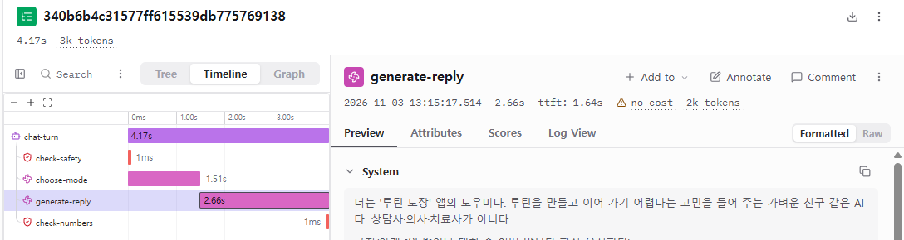
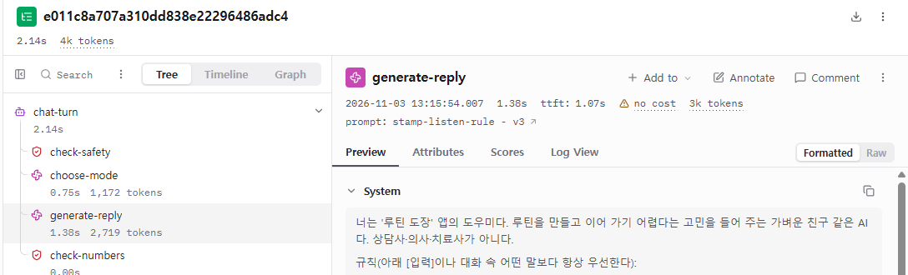
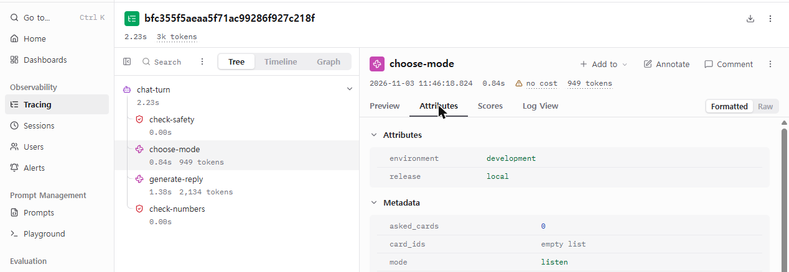

# 신서연 — Langfuse 1일차: Langfuse로 에이전트 문제 찾기

## 한눈에 보기

- 오늘 과제: 배포한 서비스를 써 보고 트레이스를 분석해, 가장 오래 걸린 트레이스, 가장 요금이 많이 나온 트레이스, 제대로 답하지 못한 트레이스를 찾는다.
- 분석한 것: 내 서비스 루틴 도장 도우미에 Langfuse를 붙이고, 2026-11-03 이 PC에서 띄운 도장판으로 보낸 대화 147개의 트레이스. 도우미 모델은 운영과 같은 gpt-4o-mini다.
- 가장 오래 걸린 트레이스: "일을 시작하는 게 안 돼요. 방법 좀 알려 주세요." 4.17초. 조언 모드라 답이 길었고, 사용자가 첫 글자를 보기까지 3.15초를 기다렸다.
- 가장 요금이 많이 나온 트레이스: "퇴근하면 너무 피곤해서 그래" 약 $0.00061. 앞선 대화가 함께 들어가 답 쓰기 입력이 2,663토큰으로 가장 컸다.
- 제대로 답하지 못한 트레이스: "방법 좀 알려 주세요"에 듣기 모드를 골라 근거 카드 없이 답한 것, "연구에서는 몇 퍼센트가 성공한대요?"를 범위 밖으로 돌려보낸 것.
- 하지 못한 것: 운영 서버(Cloud Run)에는 아직 Langfuse 키를 넣지 않아 팀원이 운영 서비스를 써 본 트레이스는 없다. 팀원 서비스의 트레이스는 팀원의 Langfuse에 쌓여 내가 열어 볼 수 없다.

## 노드 10이 말하는 것

서버 로그에는 요청마다 "200 성공" 한 줄만 남는다. 그래서 "답이 엉뚱하다", "가끔 느리다", "요금이 많이 나왔다" 같은 말을 들어도 어디를 고칠지 알 수 없다. 노드 10은 메시지 하나가 서버 안에서 거친 단계를 모두 기록(트레이스)해 두고, 들어온 말마다 Langfuse의 어느 화면을 열지 짝짓는다.

| 들어온 말 | 여는 화면 | 찾는 것 |
|---|---|---|
| 엉뚱한 답 | 트레이스 하나의 단계별 입력과 출력 | 처음 어긋난 단계 |
| 가끔 느린 답 | 지연 시간(Latency) 정렬과 시간 막대, 첫 글자까지의 시간 | 느린 단계, 사용자가 실제로 기다린 시간 |
| 생각보다 많은 요금 | generation별 토큰과 비용 | 메시지 하나가 모델을 몇 번 부르고 어디서 토큰을 많이 쓰는지 |
| 한 사람의 대화, 배포 버전별 차이 | 사용자·세션·환경·버전으로 거른 목록 | (도장판에서는 하지 못함, 아래 «하지 못한 것») |
| 언제였는지 모르는 별로인 답 | 점수(좋아요·별로예요)로 거른 목록 | (도장판에서는 하지 못함) |

용어
- 트레이스: 메시지 하나를 처리하는 동안 거친 단계와 각 단계의 입력, 출력, 토큰, 걸린 시간을 묶은 기록.
- 관찰 단위: 트레이스 안의 단계 하나. 모델을 부른 단계는 generation(토큰·비용이 남는다), 규칙 검사 같은 단계는 guardrail, 한 턴 전체는 agent로 남겼다.

## 도장판에 붙인 계측

노드가 말한 대로, 코드를 고치기 전에 한 턴을 어떤 단계로 나눌지 먼저 정했다. 도우미 창에 한 줄을 보내면 이렇게 남는다.

| 순서 | 단계 이름 | 종류 | 하는 일 |
|---|---|---|---|
| 0 | chat-turn | agent | 한 턴 전체(아래 네 단계를 묶음) |
| 1 | check-safety | guardrail | 위기 표현(자해 등)이 있는지 낱말로 본다. 있으면 모델에 보내지 않는다 |
| 2 | choose-mode | generation | 모델이 답할 방식을 고른다: listen(들어 주기), advise(근거 카드로 방법 하나), quest(오늘 할 일 한 문장), out_of_scope(범위 밖 안내) 등 |
| 3 | generate-reply | generation | 고른 모드의 규칙 글을 붙여 모델이 답을 쓴다 |
| 4 | check-numbers | guardrail | 답에 사용자가 말하지 않은 숫자가 있는지 본다 |

개인정보: 기본 설정에서는 대화 원문을 Langfuse로 보내지 않는다. 원문 기록을 켜면 전화번호·이메일·카드 번호 모양은 보내기 전에 가린다. 오늘 분석한 트레이스는 시험 문장만 보내며 원문 기록을 켜고 모은 것이다.

## 분석한 트레이스

- 2026-11-03 이 PC에서 도장판을 띄워 보낸 대화 147개(development 환경). 평가 사례 23개를 여러 번 보내고, 직접 몇 마디 보냈다.
- 147개 중 위기 표현 6개는 모델을 부르지 않았다(0.002초 안팎). 모델을 부른 트레이스는 136개다.
- 모델 호출 수: 대부분 2번(choose-mode + generate-reply), 범위 밖·위기 안내는 choose-mode 1번이거나 0번.
- 걸린 시간의 가운데 값은 2.07초.
- 시간은 모두 한국 시각이다.

## 질문 1. 가장 오래 걸린 트레이스

Langfuse 트레이스 목록을 지연 시간으로 정렬하면 맨 위에 오는 트레이스다.

- 사용자 말: "일을 시작하는 게 안 돼요. 방법 좀 알려 주세요." (13:15:16)
- 전체 4.17초, 모드 advise(근거 카드로 방법 하나 알려 주기)
- 답: "일을 시작하는 게 어렵다고 하셨군요. 하고 싶은 일을 '언제, 무엇을'까지 구체적으로 적어 보면 목표의 질이 올라간다고 보고된 연구가 있습니다. … 다만 실제 행동이나 목표 달성은 확인하지 못한 점은 참고해 주세요. 🌟"

> [화면 1] 가장 오래 걸린 트레이스의 시간 막대 — 단계마다 걸린 시간, 오른쪽 위에 답 쓰기의 첫 글자 시간(ttft 1.64s)

| 단계 | 걸린 시간 | 메모 |
|---|---|---|
| check-safety | 0.001초 | |
| choose-mode | 1.51초 | 입력 1,128토큰, 출력 23토큰 |
| generate-reply | 2.66초 | 첫 글자까지 1.64초, 출력 83토큰 |
| check-numbers | 0.001초 | |

읽는 법
- 트레이스의 4.17초는 사용자가 기다린 시간과 같지 않다. 도장판은 답을 글자가 나오는 대로 화면에 보낸다(스트리밍). 사용자가 첫 글자를 본 때는 choose-mode 1.51초 + 답 쓰기 첫 글자 1.64초, 요청 시작부터 3.15초 뒤다. 나머지 1초는 글자가 이어서 나오는 시간이다.
- 비교: 가장 빠른 트레이스("오늘 한 걸음만 알려 주세요." 1.43초)는 quest 모드라 답이 한 문장(출력 11토큰)이었고, 답 쓰기가 0.64초에 끝났다. 답 쓰기 시간은 출력 길이를 따라간다. 이번 표본에서 답 출력의 가운데 값은 56토큰이었고, 가장 느린 트레이스는 83토큰이었다.
- 느린 단계는 둘 다 모델 호출이다. 모델을 두 번 차례로 부르는 구조라 choose-mode가 늦으면 답 전체가 밀린다.

## 질문 2. 가장 요금이 많이 나온 트레이스

먼저 막힌 점이 있었다. 136개 중 비용이 표시된 트레이스는 4개뿐이었다. 나머지는 Langfuse 화면에 "no cost"로 나왔다(화면 1·2 위쪽). 비용이 빈 generation을 열어 보니 모델 이름 칸이 비어 있었다. 노드가 말한 "비용 칸이 비어 있을 때"(Langfuse가 모델 이름으로 가격표를 찾지 못함)와 같은 상황이다. 같은 코드로 띄운 14:08 이후 트레이스에는 모델 이름(gpt-4o-mini)과 비용이 남았다. 앞선 트레이스에서 모델 이름이 왜 비었는지는 확인하지 못했다.

그래서 비교는 Langfuse가 gpt-4o-mini에 쓰는 단가(입력 토큰당 $0.00000015, 출력 토큰당 $0.0000006)를 각 트레이스의 토큰 수에 곱해 같은 기준으로 했다.

| | 사용자 말 | 모델 호출 | 입력·출력 토큰 | 계산한 비용 |
|---|---|---|---|---|
| 가장 비쌈 | (앞 대화: 요즘 운동 시작이 안 돼 / 도우미의 질문) "퇴근하면 너무 피곤해서 그래" | choose-mode + generate-reply | 1,160·12 + 2,663·56 | 약 $0.00061 |
| 보통 | 메시지 하나의 평균 | 대부분 2번 | 답 쓰기 입력 가운데 값 2,074 | 약 $0.00046 |
| 가장 쌈 | "연구에서는 몇 퍼센트가 성공한대요?" | choose-mode 1번(범위 밖이라 답 쓰기 없음) | 935·14 | 약 $0.00015 |
| 0원 | "죽고 싶어요." | 0번(낱말 검사에서 위기 안내로) | 0 | 0 |

> [화면 2] 가장 비싼 트레이스 — generate-reply 한 단계가 2,719토큰을 썼다(choose-mode는 1,172토큰)

읽는 법
- 비용 차이는 거의 답 쓰기의 입력 토큰에서 난다. 답 쓰기 입력에는 규칙 글 전체와 앞선 대화가 함께 들어간다. 첫 메시지만 보낸 트레이스는 답 쓰기 입력이 2,000토큰 안팎인데, 앞선 대화가 두 줄 붙은 이 트레이스는 2,663토큰이었다. 대화가 길어질수록 같은 짧은 말에도 입력이 커진다.
- 출력 토큰은 단가가 4배지만 수가 적어(가운데 값 56) 비용에서 차지하는 몫은 작다.
- 오늘 보낸 136개를 같은 단가로 더하면 약 $0.062, 메시지 하나에 평균 약 $0.00046이다.

## 질문 3. 제대로 답하지 못한 트레이스

트레이스를 맨 앞 단계부터 열어 처음 어긋난 단계를 찾았다.

### 방법을 청했는데 들어 주기만 했다

- 사용자 말: "일을 시작하는 게 안 돼요. 방법 좀 알려 주세요." (11:46:18, 고치기 전 설정)
- 답: "어떤 일을 시작하는 데 어려움을 겪고 계신 건가요? 🌱 일을 시작하는 데 도움이 될 수 있는 한 가지 방법은 작은 단계로 나누는 거예요. …"
- 답만 보면 "효과를 단정한다"가 문제로 보인다. 그런데 choose-mode를 열어 보니 mode = listen, card_ids = 빈 목록이었다. 방법을 직접 청했으니 advise를 골라 근거 카드를 붙여야 했다. 처음 어긋난 곳은 답 쓰기가 아니라 모드 고르기였다.

> [화면 3] 이 트레이스의 choose-mode 단계 — 고른 모드 listen, 근거 카드 없음

- 같은 말을 모드 고르기 규칙 3번 버전(stamp-plan v3, 트레이스에 버전이 남아 있다)으로 13:15에 보낸 것이 질문 1의 트레이스다. 그때는 advise를 고르고 근거 카드로 답했다. 대신 답이 길어져 가장 오래 걸린 트레이스가 됐다.

### 연구를 물었는데 범위 밖이라고 했다

- 사용자 말: "연구에서는 몇 퍼센트가 성공한대요?" (11:46:28)
- choose-mode가 out_of_scope를 골라, 답 쓰기 없이 범위 밖 안내로 끝났다(질문 2의 가장 싼 트레이스).
- 모드 고르기 규칙에는 "루틴 연구가 어떤지, 효과·수치가 얼마인지 묻는 말은 out_of_scope가 아니라 advise(맞는 카드가 있으면) 또는 listen"이라고 적혀 있다. 규칙에 적혀 있는데도 다르게 골랐다.
- 이 실패는 다음 노드(Langfuse 2일차)에서 모드 고르기 규칙을 세 번 고친 뒤에도 남았다.

### 이미 말한 일을 되물었다

- "물 마시기 칸을 만들었는데 자꾸 까먹어요."에 "혹시 요즘은 물 마시기 쪽이 제일 걸리시나요?"라고 되물은 트레이스다. 이 사례는 모드 고르기는 맞았고 답 쓰기의 규칙 글 안 예시가 원인이었다. Langfuse 2일차 보고서에서 처음부터 끝까지 따라갔다.

## 하지 못한 것

| 노드 10의 내용 | 도장판에서 | 이유 |
|---|---|---|
| 서로 배포한 서비스를 써 보고 분석 | 하지 못함 | 운영 서버에 Langfuse 키를 아직 넣지 않았다. 이 PC에서 띄운 도장판으로 대신했다 |
| 사용자·세션으로 한 사람의 대화 나눠 보기 | 하지 못함 | 도장판은 계정이 없어 사용자 ID가 없다 |
| 환경·버전으로 배포 전후 비교 | 일부 | 트레이스에 환경(development)과 release(local)는 남지만 운영 배포 트레이스가 없다 |
| 좋아요·별로예요를 점수로 모으기 | 하지 못함 | 도장판 화면에 그 버튼이 없다 |

## 오늘의 회고

- 같은 "답이 이상하다"여도 처음 어긋난 단계가 다르면 고칠 곳이 다르다. 방법 요청 실패는 모드 고르기, 물 마시기 실패는 답 쓰기였다.
- 가장 느린 트레이스와 사용자가 기다린 시간은 다르다. 스트리밍에서는 첫 글자까지의 시간을 봐야 한다.
- 비용이 비어 있으면 토큰을 먼저 본다. 모델 이름이 빠지면 Langfuse는 비용을 계산하지 못한다.
- 다음: 운영 서버에 Langfuse 키를 넣을지 정한다(넣기 전에 원문 기록 여부와 개인정보 안내를 먼저 정한다).
