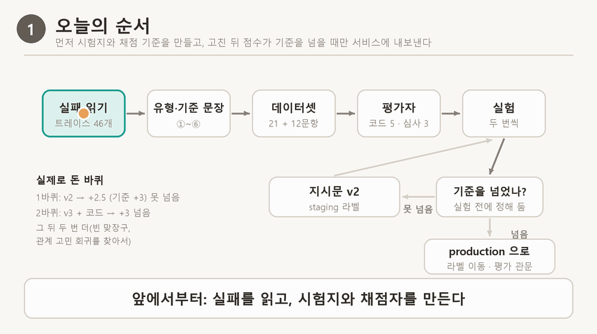
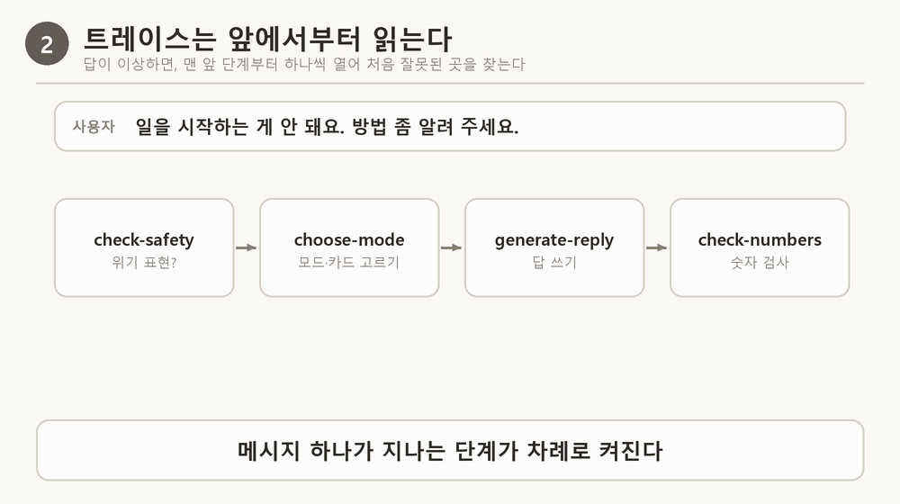
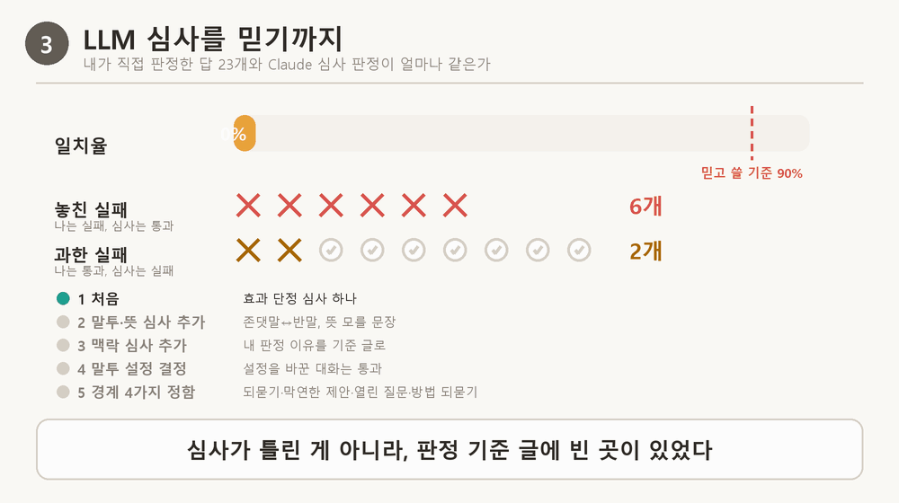
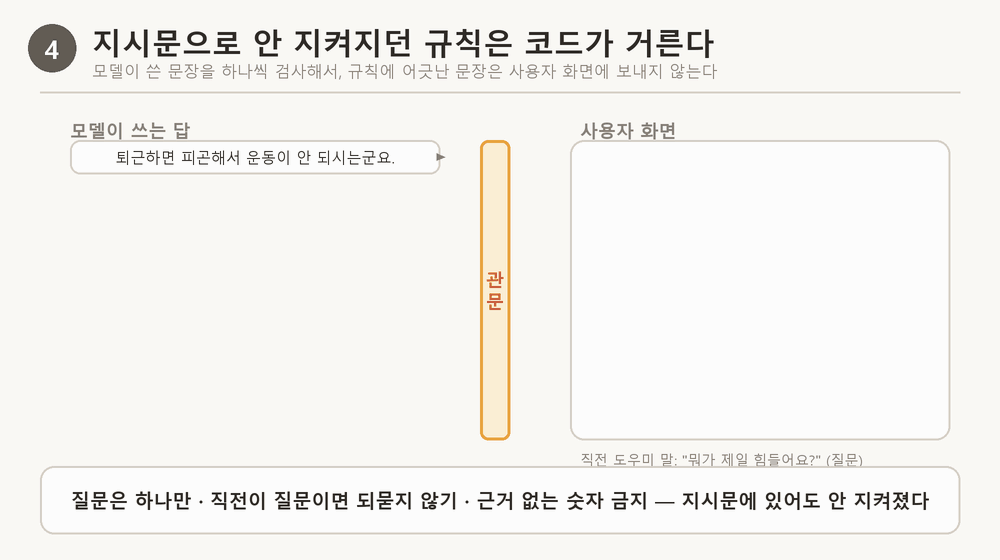
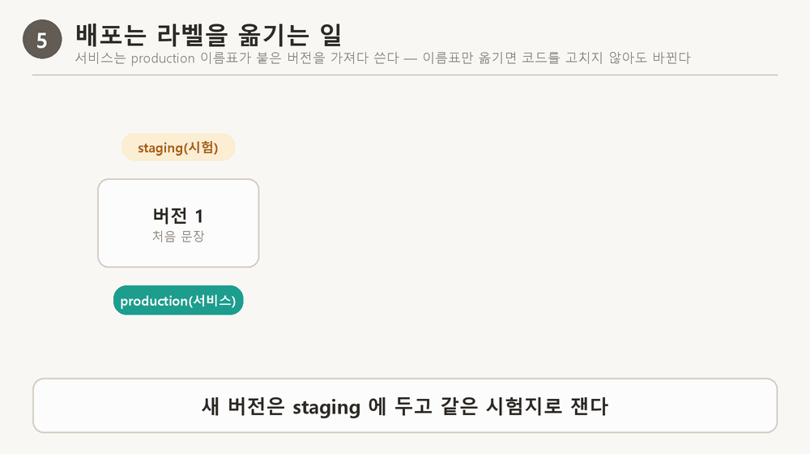
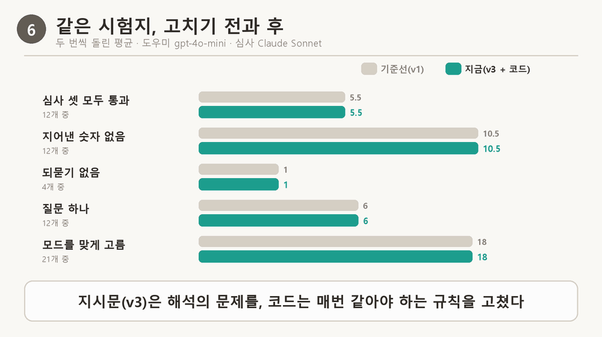

# 신서연 — Langfuse 2일차: Langfuse로 에이전트 품질 지키기

> 학습 템플릿 (2조) › 신서연 · 노드 11(8스텝) · 과제: 내 서비스(루틴 도장 도우미)의 실패를 데이터셋으로 모으고, LLM-as-a-Judge로 채점하고, 프롬프트를 고쳐 다시 재서 점수가 오르는지 보기

## 한눈에 보기

- **문제**: 루틴 도장 도우미가 "물 마시기를 자꾸 까먹어요"라는 말에 "물 마시기 쪽이 제일 걸리나요?"처럼 이미 들은 말을 되묻고, "작은 목표부터 해 보세요"처럼 무엇을 하라는지 모를 제안을 하고, 근거 없는 "5분"을 지어냈다. 서버 로그로는 이게 안 보였다.
- **원인**: 트레이스를 앞 단계부터 읽으니 틀린 자리가 둘로 갈렸다. 모드를 잘못 고르는 단계(choose-mode)와 답을 쓰는 단계(generate-reply). 답 쪽은 듣기 지시문 안의 예시("아침 먹기 쪽이 제일 걸리나요?")를 모델이 그대로 따라 한 것도 있었다.
- **해결**: 해석의 문제는 지시문을 고쳐 버전으로 관리했고(Langfuse 프롬프트 v1→v3), "질문은 하나만"처럼 매번 같아야 하는 규칙은 코드가 문장 단위로 걸러 내게 했다.
- **결과**: 같은 데이터셋·같은 심사로 두 번씩 재서, 듣기 답 12개 중 심사 셋을 모두 통과한 답이 **평균 5.5개 → 10.5개**, 모드를 맞게 고른 것이 **18개 → 20개(21개 중)**, 지어낸 숫자·되묻기·질문 여러 개는 **모두 0개**가 됐다.
- **가장 헷갈렸던 것**: LLM 심사를 믿어도 되나. 내가 직접 붙인 판정과 처음엔 65%만 같았다 → 아래 «그림 3».

## 오늘의 주제

지시문을 한 줄 고쳤을 때 "나아졌다"고 말하려면, 같은 실패 묶음(데이터셋)을 같은 채점 기준(평가자)으로 고치기 전과 후에 재서 보여 줘야 한다.

## 오늘의 목표

- 실패 트레이스를 앞 단계부터 읽어 처음 어긋난 단계를 찾고 실패 유형표를 만든다.
- 실패를 담은 데이터셋과 평가자(코드 채점, LLM 심사)를 만들고, 심사가 사람 판단과 맞는지 확인한다.
- 프롬프트를 Langfuse로 옮겨 버전·라벨로 배포·롤백하고, 버전끼리 같은 기준으로 실험한다.
- 프롬프트로 고칠 실패와 코드로 고칠 실패를 가른다.
- 다음 수정 때도 이 확인을 빠뜨리지 않도록 배포 흐름에 평가 관문을 건다.

## 용어 먼저

| 용어 | 쉬운 말 | 루틴 도장에서는 |
|---|---|---|
| 트레이스 | 메시지 하나가 처리되는 동안 거친 단계를 순서대로 남긴 기록 | 위기 검사 → 모드 고르기 → 답 쓰기 → 숫자 검사 |
| 데이터셋 | 매번 똑같이 쓰는 시험 문항 묶음(입력 + 기대 결과) | stamp-mode 21개, stamp-listen-reply 12개 |
| 평가자 | 답 하나를 받아 통과·실패를 매기는 것 | 코드 채점 5개 + Claude 심사 3개 |
| LLM-as-a-Judge(LLM 심사) | 판정 기준을 글로 주고 다른 LLM에게 판정하게 하는 것 | 효과 단정, 말투·뜻, 맥락 |
| 실험 | 데이터셋의 모든 문항에 같은 작업을 돌리고 평가자로 매긴 한 번의 실행 | 기준선 A, 지시문만 B, 지시문+코드 C·D·E |
| 라벨 | 여러 프롬프트 버전 중 지금 쓸 것을 가리키는 이름표 | production(서비스), staging(시험) |

## 그림으로 보기

### 1. 오늘 한 일은 어떤 순서로 이어지나

> [그림 1] 실패 읽기 → 유형·기준 → 데이터셋 → 평가자 → 실험. 기준을 못 넘으면 지시문으로 돌아가고, 넘으면 production 으로 간다



- 주황 점이 오늘 실제로 돈 길이다. 1바퀴(듣기 지시문 v2)는 기준(심사 통과 +3)을 못 넘어 지시문으로 돌아갔고, 2바퀴(v3 + 코드)에서 넘었다.
- 기준은 결과를 보기 전에 정했다. 결과를 보고 정하면 결과에 맞는 기준을 고르게 된다.

### 2. 트레이스는 앞에서부터 읽는다

> [그림 2] "방법 좀 알려 주세요"가 틀린 답이 된 길 — 처음 틀린 곳은 모드 고르기



- 답에 나온 근거 없는 "5분"만 보면 답 지시문을 고치고 싶어진다. 하지만 처음 틀린 곳은 앞 단계(choose-mode가 advise 대신 listen을 고름)였다.
- 앞 단계가 틀리면 뒤 단계가 맞게 돌아도 답이 틀린다. 그래서 처음 틀린 단계 하나만 고친다(스텝 2 퀴즈의 답도 같은 이유).

### 3. LLM 심사를 믿어도 되나

> [그림 3] 내가 판정한 답 23개와 심사 판정의 일치율 — 65% → 91%, 놓친 실패 6 → 0



| 단계 | 내가 한 것 | 일치율 | 놓친 실패(나는 실패, 심사는 통과) |
|---|---|---|---|
| 처음 | 심사에 "효과를 단정하지 않는다" 기준 하나만 줌 | 65% | 6개 |
| 기준 더하기 | 나는 말투가 존댓말↔반말로 흔들리거나 뜻을 모를 문장도 실패로 봤다 → 심사 ⑤ 추가 | 74% | 5개 |
| 결정 반영 | 대화 중 말투 설정을 바꾼 경우는 바뀐 말투가 맞다고 정함 | 87% | 3개 |
| 경계 정하기 | 이미 말한 일 되묻기는 항상 실패 / 구체적인 일에 "작은 목표부터"는 실패 / 열어 두는 "다른 활동은요?"는 통과 / 방법을 되묻는 것만 실패 | 91% | 0개 |

외울 문장: 심사가 틀린 게 아니라 판정 기준 문장에 빈 곳이 있었다. 사람이 먼저 판정하고, 갈린 답의 이유를 기준 문장으로 옮긴다.

### 4. 지시문으로 안 지켜지던 규칙은 코드가 거른다

> [그림 4] 모델이 쓴 문장이 하나씩 관문을 지난다 — 숫자·되묻기·두 번째 질문은 막히고, 제안은 통과



| 실패 | 지시문에 이미 있었나 | 고친 곳 | 결과(두 번 실행) |
|---|---|---|---|
| 질문을 여러 개 함 | 있었다("질문은 하나만") | 코드 | 6·6 → 12·12 (12개 중) |
| 직전이 질문인데 또 되물음 | 있었다(변주 힌트) | 코드 | 1·1 → 4·4 (4개 중) |
| 근거 없는 "5분" | 있었다 | 코드(문장 차단) | 10·11 → 12·12 |
| 방법을 청했는데 듣기만 함 | 없었다 | 지시문 | 모드 18 → 20 |
| 효과 단정, 막연한 제안, 되묻기 | 일부 | 지시문 | 심사 셋 통과 5.5 → 10.5 |

- 기준: 말의 뜻을 해석하는 일은 지시문으로, 매번 같아야 하는 규칙은 코드로. 지시문에 이미 적혀 있는데 모델이 안 지킨 것은 지시문을 더 세게 쓰지 않고 코드로 옮겼다.
- 함정: "~해 볼까요?"는 물음표로 끝나지만 되묻기가 아니라 제안이다. 처음엔 이것까지 지워서 "저녁만 되면 눕게 되는군요." 한 줄만 남는 답이 실행마다 2~4개 나왔다.

### 5. 배포와 롤백은 라벨을 옮기는 일

> [그림 5] stamp-listen-rule 의 버전 1·2·3과 라벨 — production 이름표가 v1에서 v3로, 롤백은 거꾸로



- 서비스는 라벨로 지시문을 가져오고, Langfuse에 닿지 못하면 코드에 남긴 같은 문장으로 답한다. 트레이스에서 답마다 "stamp-listen-rule 버전 3"이 보인다.
- 새 버전은 staging에 두고 같은 시험지로 두 번 잰 뒤, 기준을 넘으면 production 이름표만 옮긴다. 코드를 다시 배포하지 않는다.

## 오늘의 미션

### 실습 환경

- 서비스: 루틴 도장 도우미(`routine-stamp-trial`). 노드 예제(AI 친구 에이전트) 대신 내 서비스로 했다. 노드의 "도구 선택" 자리는 도장판에서 "모드·근거 카드 고르기(choose-mode)"다.
- 도우미 모델: gpt-4o-mini(운영 서버와 같은 모델 — 개선이 실제 서비스에 대한 말이 되려면 같은 모델로 재야 한다). 심사 모델: Claude Sonnet(claude-sonnet-5-5).
- Langfuse Cloud(US), Python SDK langfuse 5.1.0. 실험은 화면이 아니라 SDK로 돌렸다: 도장판의 답 지시문은 모드·카드·말투로 그때그때 조립돼 화면 프롬프트로 옮기면 실제와 달라지기 때문이다. 결과는 Langfuse Datasets 화면에서 비교했다.
- 개인정보: 도장판은 대화 원문을 Langfuse로 보내지 않는다(개인정보 안내 약속). 오류 분석을 위한 시험 실행에서만 원문 수집을 켰고, 시험 문장이라 실제 사용자 대화는 없다.

### 과제 1. 제대로 답하지 못한 문제를 데이터셋으로 저장

| 단계 | 한 일 | 결과 |
|---|---|---|
| 트레이스 모으기 | 평가 사례 23건을 두 번씩 보냄 | 트레이스 46개, 코드 채점 실패 17개 |
| 처음 어긋난 단계 읽기 | 앞 단계부터 읽고 메모를 트레이스 댓글로 | 댓글 17개. 채점기 오탐 4개도 따로 적음 |
| 실패 유형표 | 메모를 묶음 | ① 모드 오분류 6 ② 효과 단정·범위 밖 제안 4 ③ 되묻기 되풀이 3 ④ 질문 여러 개 1 |
| 데이터셋 | 실패 + 정상 사례 | stamp-mode 21개, stamp-listen-reply 12개(모드를 listen으로 고정하고 답만 잼). 두 번 올려도 항목이 늘지 않음 확인 |

확인한 것: 모드를 고정한 데이터셋 덕분에 답이 틀렸을 때 "모드를 잘못 골라서"인지 "답 지시문 때문"인지 갈라졌다.
한계: 12개는 작다. 드문 실패는 담지 못한다.

### 과제 2. LLM-as-a-Judge로 테스트

| 단계 | 한 일 | 결과 |
|---|---|---|
| 심사 만들기 | 효과 단정 심사 하나 | 기준선 실험 두 번 |
| 심사가 점수를 못 남김 | 원인 찾기 | ① anthropic 패키지가 없었다(SDK가 오류를 삼켜 점수만 빠진 채 "성공") ② 응답이 400토큰에서 잘려 빈 점수 → Langfuse가 거절 |
| 사람 라벨 | 답 23개에 내가 직접 통과·실패 | 일치율 65% |
| 보정 | 그림 2 | 일치율 91%, 놓친 실패 0 |

### 과제 3. 프롬프트를 개선하고 다시 테스트

> [그림 6] 같은 시험지, 고치기 전(기준선 v1)과 후(v3 + 코드) — 두 번씩 돌린 평균



| 실험 | 지시문 | 코드 걸러 내기 | 심사 셋 통과 | 지어낸 숫자 없음 | 되묻기 없음 | 질문 하나 | 빈 맞장구 아님 |
|---|---|---|---|---|---|---|---|
| A 기준선 | v1 | 끔 | 6·5 | 10·11 | 1·1 | 6·6 | 12·12 |
| B | v2 | 끔 | 10·8 | 9·8 | 0·1 | 5·9 | 12·12 |
| C | v2 | 켬(1판) | 8·8 | 12·12 | 4·3 | 12·12 | 8·10 |
| D | v3 | 켬(2판) | 8·9 | 12·12 | 4·4 | 12·12 | 8·8 |
| **E 지금** | **v3** | **켬(3판)** | **12·9** | **12·12** | **4·4** | **12·12** | **12·12** |

(심사 셋·숫자·질문 하나·빈 맞장구는 12개 중, 되묻기는 직전이 질문인 4개 중. 빈 맞장구 평가자는 D 뒤에 만들어서, A~D 값은 저장된 답으로 나중에 센 것)

모드 고르기(stamp-mode 21개): v1 18·18 → v2 20·20 → v3 20·20. v1에서 맞던 항목이 틀린 적은 없다.

**같은 말, 전과 후의 답** (A 기준선 → E 지금)

| 사용자 말 | 전 | 후 |
|---|---|---|
| 물 마시기 칸을 만들었는데 자꾸 까먹어요 | 물 마시기 칸을 만드는 건 좋은 시작이네요! 혹시 요즘 물 마시기 쪽이 제일 걸리나요? … 물병을 눈에 잘 보이는 곳에 두는 것도 도움이 될 수 있어요. 어떤 방법이 좋을 것 같아요? | 물 마시기를 자꾸 까먹으신 것 같군요. 오늘은 물 한 컵을 마시는 것만 해 볼까요? |
| 아침에 일어나는 게 너무 힘들어요 | 아침에 일어나는 것이 힘드시군요. 혹시 아침 먹기 쪽이 제일 걸리나요? 또는 다른 부분에서 도움이 필요하신가요? | 아침에 일어나는 게 힘드시군요. … 오늘 아침 일어나는 것에 대해 어떤 부분이 가장 힘드셨는지 여쭤봐도 될까요? |
| (운동을 못 하고 있어요 → 어떤 점이 어렵나요?) 글쎄요, 그냥 계속 미루게 돼요 | 운동을 계속 미루게 되시는군요. 혹시 운동을 시작하는 게 힘든 건가요, 아니면 어떤 운동을 할지 정하는 게 어렵나요? … | 계속 운동을 미루고 계시는 것 같군요. 그럼 오늘은 운동복으로 갈아입기까지만 해 볼까요? |
| (운동 시작이 안 돼요 → 뭐가 제일 힘들어?) 퇴근하면 너무 피곤해서요 | … 예를 들어 5분 정도 간단한 스트레칭이나 산책하기 같은 작은 목표를 설정하면 도움이 될 수 있습니다. 혹시 운동이 잘 안 되는 다른 이유도 있으신가요? | 퇴근하면 너무 피곤해서 운동 시작이 안 되신 거군요. 오늘은 편안한 스트레칭 몇 분만 해 볼까요? |
| (공부가 손에 안 잡혀요 → 언제가 제일 힘드세요?) 저녁만 되면 그냥 눕게 돼요 | … 그렇다면 저녁에 5분만 앉아서 공부하는 걸 시도해 보시는 건 어떨까요? | 저녁만 되면 그냥 눕게 되신다고요. 오늘 저녁에는 먼저 앉아서 책을 펼쳐 보시는 건 어떠세요? |

### 과제 4. 다음 수정 때도 확인을 빠뜨리지 않기

- `deploy.sh --eval-gate`: 배포 전에 두 데이터셋 실험을 두 번 돌리고, 바닥값(지금 결과에서 흔들림 1~2개를 뺀 값)에 못 미치면 배포를 멈춘다. 실험 한 번에 모델 호출이 수십 번이라 기본은 꺼 두고 지시문·대화 코드를 바꿀 때만 켠다.
- 첫 실행: 통과(모드 평균 19.0, 심사 셋 10.5, 숫자 12, 되묻기 4, 질문 하나 12).
- A/B 테스트는 하지 않았다: 도장판에는 사용자 ID도 좋아요·별로예요 버튼도 없어 그룹을 나누거나 반응을 셀 수 없다.

## 잘 된 점 · 막힌 점 · 어떻게 해결했나

| 잘 된 것 | 근거 |
|---|---|
| 지시문이 아니라 코드로 옮긴 규칙은 확실히 지켜졌다 | 질문 하나 12·12, 되묻기 없음 4·4, 지어낸 숫자 없음 12·12 |
| 내 판정으로 심사를 보정해 믿을 수 있게 됐다 | 일치율 65% → 91%, 놓친 실패 0 |
| 회귀를 실험이 먼저 잡았다 | 관계 고민("남자친구랑 헤어질까 고민이에요")을 v2가 듣기로 보냈는데 전체 사례 회귀 확인에서 발견 → v3에서 고침 |

| 막힌 곳 | 원인 | 어떻게 풀었나 |
|---|---|---|
| 노드 스텝이 1개만 보였다 | LMS 커리큘럼 칸이 진도에 따라 앞 스텝만 보여 줬다(이유는 확인 못 함) | 다음 스텝 주소를 직접 열어 8스텝을 모두 받음 |
| Langfuse 키 화면을 잘못 찾음 | 처음 연 화면은 Claude Console 키 화면이었다 | us.cloud.langfuse.com → Settings → API Keys |
| 심사 점수가 하나도 안 남음 | anthropic 패키지 미설치, SDK가 평가자 오류를 삼킴 | 설치 후 한 항목으로 직접 불러 확인 |
| 심사 점수 일부를 Langfuse가 거절 | max_tokens 400에서 응답이 잘려 빈 BOOLEAN 점수 | max_tokens 2000, 못 읽으면 점수를 보내지 않음 |
| 첫 걸러 내기가 답을 한 줄로 끝냄 | "질문 하나 뒤 멈춤" — 첫 문장이 되받는 질문이면 거기서 끝 | 두 번째 질문부터 버리기로 |
| 둘째 걸러 내기가 빈 맞장구를 만듦("저녁만 되면 눕게 되는군요." 한 줄) | 한국어 제안은 "~해 볼까요?"로 끝나 되묻기로 오인해 지움. 평가자는 모두 통과라 숫자에 안 잡힘 | 전후 답을 읽다 발견. 제안형 물음은 남기고 "빈 맞장구" 평가자를 더함 |
| 관계 고민 회귀 | v2의 "자기 경험은 listen" 규칙이 범위 밖 고민까지 잡음 | v3에서 "루틴·이 앱"으로 좁힘 |

새로 알게 된 것
- 점수가 오른 것만 보면 안 된다. 평가자가 보지 않는 곳(빈 맞장구)에서 새 실패가 생길 수 있어서, 전후 답을 직접 읽어야 한다.
- 같은 설정에서도 두 번 사이에 2~4개씩 흔들린다. 한두 개 차이로는 "나아졌다"고 말할 수 없다.
- 지시문 속 예시는 규칙보다 세게 따라 한다. "아침 먹기 쪽이 제일 걸리나요?" 예시 하나가 엉뚱한 되묻기를 만들고 있었다.

## 이 세션에서 내가 던진 질문과 답

| 질문 | 답 요약 |
|---|---|
| 트레이스가 뭐지? | 메시지 하나가 거친 단계를 순서대로 남긴 기록. 서버 로그엔 "200 성공" 한 줄뿐이라 어디서 틀렸는지 안 보인다 |
| Langfuse는 어떤 서비스? 회원가입도 해야 해? | 트레이싱·프롬프트 관리·평가를 하는 LLM 엔지니어링 플랫폼. 계정과 프로젝트 API 키가 필요하다 |
| LANGFUSE 키 세 개는 어디서 받아? | Langfuse 프로젝트 → Settings → API Keys (Public, Secret, Host) |
| 스텝 2 퀴즈 답이 왜 2번? | 처음 틀린 단계(도구 선택의 기간)를 고쳐야 한다. 답 지시문을 고쳐도 기간이 그대로면 같은 실패가 난다 |
| 계측 요청문(app/agent.py run_turn)은 진행한 건가? | 템플릿에는 안 했고 도장판에 맞춰 했다. user_id·session_id는 계정이 없는 서비스라 넣지 않았다 |
| Haiku로 하는 의미가 있나? | 개선은 운영 모델로 재야 의미가 있다 → 도우미는 gpt-4o-mini, Claude는 심사(Sonnet)로 |
| Claude 키는 어디서 봐? | platform.claude.com → 키 및 액세스 → API 키. 기존 키는 끝자리만 보여서 새로 만듦 |

## 오늘의 회고

같은 문제가 다시 생기면 확인할 순서
1. 트레이스를 앞 단계부터 읽는다: check-safety → choose-mode(고른 모드·카드) → generate-reply(지시문 버전) → check-numbers.
2. 처음 틀린 단계가 모드면 stamp-plan, 답이면 stamp-listen-rule. 지시문에 이미 있는 규칙인데 안 지키면 코드로 옮길지 본다.
3. 새 버전은 staging 라벨로 두고 같은 데이터셋으로 두 번 실험한다. 전후 답을 직접 몇 개 읽는다.
4. 기준을 넘으면 production 라벨을 옮기고, 코드 문장도 같게 맞춘다. 배포 전 `--eval-gate`.

남은 의문·숙제
- 연구 수치 질문("연구에서는 몇 퍼센트가 성공한대요?")은 지시문 세 버전 모두 범위 밖으로 보낸다. 다음엔 코드로 고칠지 정한다.
- 운영 서버(Cloud Run)에는 아직 Langfuse 키가 없다. 지금 운영은 코드 문장(=production v3)으로 답하고 트레이스를 남기지 않는다.
- 데이터셋 12개·21개는 작고, 사람 라벨도 23개뿐이다.
- 사용자 반응 점수(좋아요·별로예요)와 session_id는 "계정·추적 없음" 원칙과 맞는지 먼저 정해야 한다.

## 부록

오늘 쓴 명령어

```
python evals/langfuse_experiment.py upload                       # 데이터셋 올리기
python evals/langfuse_experiment.py run listen 실행이름          # 실험(PROMPT_LABEL, REPLY_GATE 로 설정)
python evals/prompt_versions.py labels                           # 라벨이 가리키는 버전
python evals/prompt_versions.py promote stamp-listen-rule 3      # production 라벨 옮기기(롤백도 같은 명령)
python evals/eval_gate.py --runs 2                               # 평가 관문
./deploy.sh --eval-gate                                          # 배포 전 점검에 평가 관문 더하기
npx langfuse-cli api experiment-items list --experiment-id … --fields core,io,scores   # 항목별 결과
```

확인하지 못한 것
- 운영 서버에서 Langfuse 프롬프트 가져오기(키를 넣지 않음).
- Langfuse 화면에서 실험을 돌리는 방법(UI 실험) — SDK 실험만 했다.
- 비용 합계: 한 턴에 약 $0.0005(gpt-4o-mini)는 확인했지만, 오늘 실험 전체(OpenAI 수백 번, Claude Sonnet 수백 번)의 청구 금액은 확인하지 않았다.

같이 정리한 것
- 블로그: «로그에는 200만 찍혔는데 사용자는 엉뚱한 답을 봤다 — Langfuse로 에이전트 문제 찾기 (11)», «규칙 한 줄을 넣었더니 나아졌다는 증거 — Langfuse로 에이전트 품질 지키기 (12)»
- 도장판 저장소 `OBSERVABILITY.md` «노드 11을 적용한 결과»
