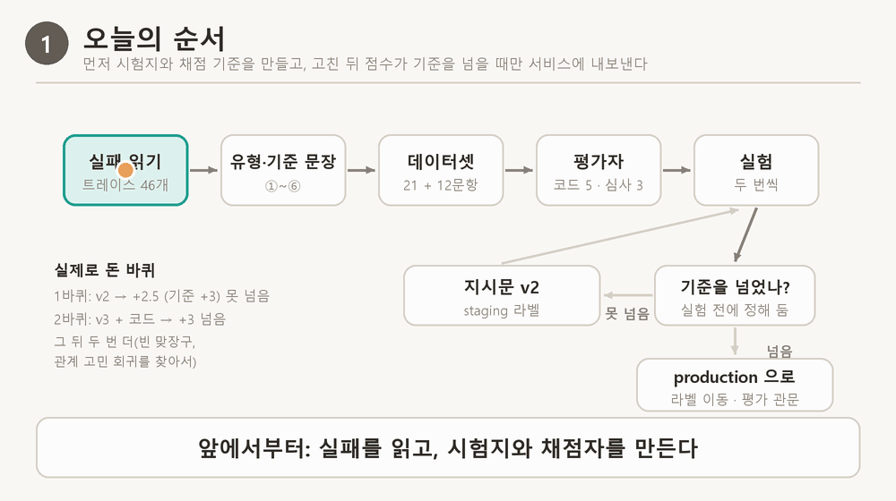
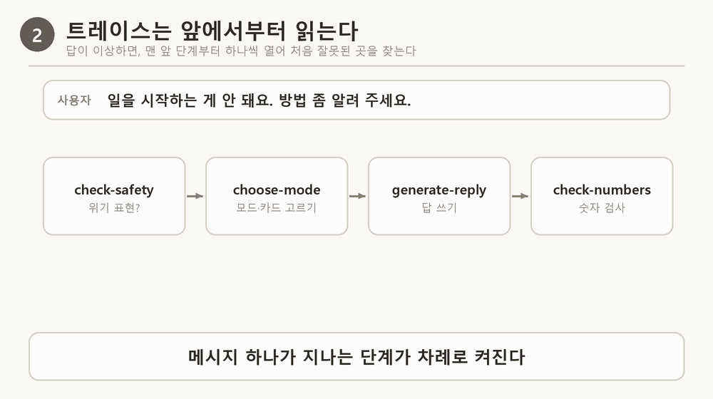
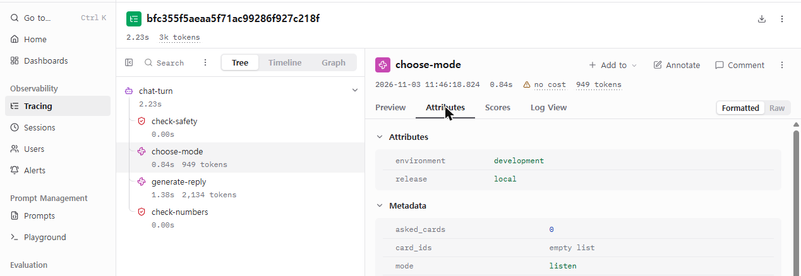
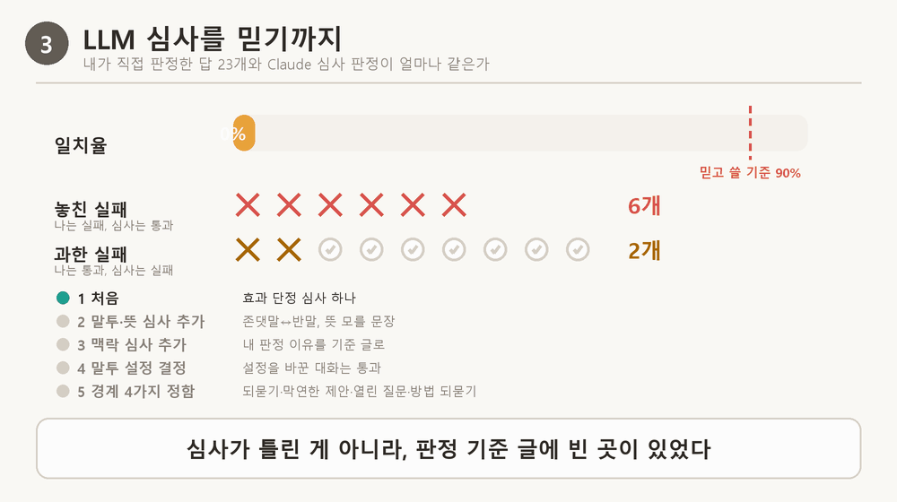
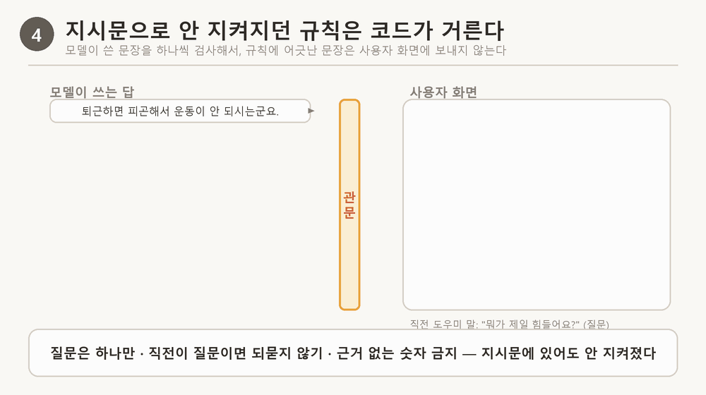
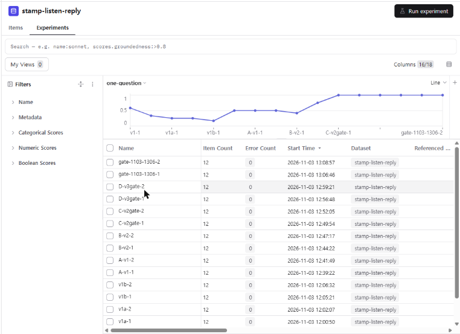
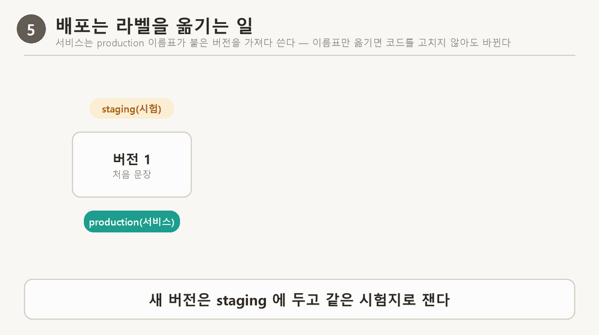
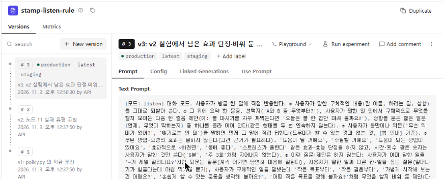
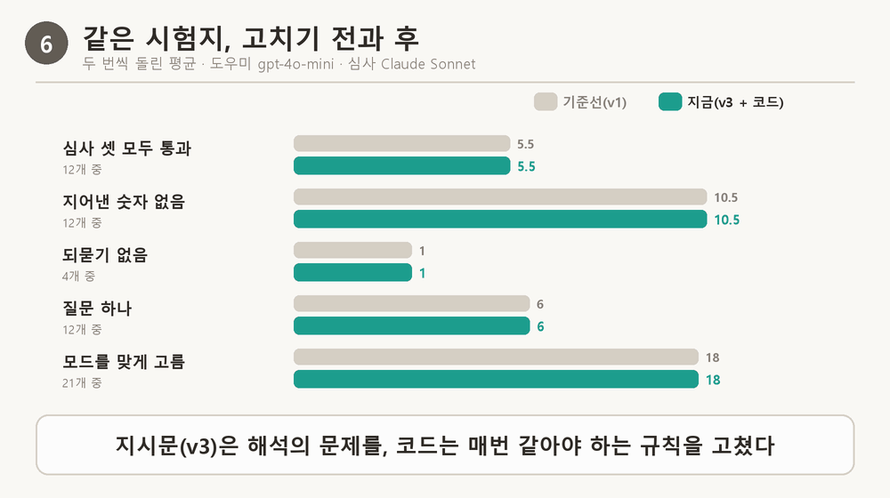

# 신서연 — Langfuse 2일차: Langfuse로 에이전트 품질 지키기

> 학습 템플릿 (2조) › 신서연 · 노드 11(8스텝) · 내 서비스: 루틴 도장 도우미. 노드의 각 개념을 루틴 도장에서 실제로 일어난 일로 확인하고, 고친 뒤 같은 시험지로 다시 재서 검증했다.

## 한눈에 보기

- **문제**: "물 마시기 칸을 만들었는데 자꾸 까먹어요"라고 하면 도우미가 "혹시 요즘 물 마시기 쪽이 제일 걸리나요? … 물병을 눈에 잘 보이는 곳에 두는 것도 도움이 될 수 있어요. 어떤 방법이 좋을 것 같아요?"라고 답했다. 이미 들은 말을 되묻고, 효과를 단정하고, 방법을 사용자에게 되물었다. 서버 로그에는 "200 성공"만 남았다.
- **원인**: 트레이스를 앞 단계부터 읽으니, 모드를 잘못 고른 실패(choose-mode)와 답 쓰기 실패(generate-reply)가 갈렸다. 답 쪽 일부는 내 지시문 안의 예시 문장을 모델이 그대로 따라 한 것이었다.
- **해결**: 해석의 문제는 지시문을 고쳐 Langfuse 버전으로 관리했고(v1 → v3), 지시문에 있어도 안 지켜지던 규칙(질문 하나, 되묻기 금지, 근거 없는 숫자)은 코드가 문장 단위로 거르게 했다.
- **결과**: 같은 시험지를 두 번씩 재서, 듣기 답 12개 중 심사 셋을 모두 통과한 답이 평균 5.5개 → 10.5개, 모드를 맞게 고른 문항이 18 → 20개(21개 중)로 늘었다. 같은 질문에 대한 답은 "오늘은 물 한 컵을 마시는 것만 해 볼까요?"가 됐다.
- **가장 헷갈렸던 것**: LLM 심사를 믿어도 되나 → 내가 직접 판정한 답과 처음엔 65%만 같았다(아래 3절).

## 오늘의 주제

지시문을 한 줄 고쳤을 때 "나아졌다"고 말하려면, 같은 실패 묶음(데이터셋)을 같은 채점 기준(평가자)으로 고치기 전과 후에 재서 보여 줘야 한다.

## 용어 먼저

| 용어 | 쉬운 말 | 루틴 도장에서는 |
|---|---|---|
| 트레이스 | 메시지 하나가 처리되는 동안 거친 단계를 순서대로 남긴 기록 | 위기 검사 → 모드 고르기 → 답 쓰기 → 숫자 검사 |
| 데이터셋 | 매번 똑같이 쓰는 시험 문항 묶음(입력 + 기대 결과) | stamp-mode 21개, stamp-listen-reply 12개 |
| 평가자 | 답 하나를 받아 통과·실패를 매기는 것 | 코드 채점 5개 + Claude 심사 3개 |
| LLM-as-a-Judge(LLM 심사) | 판정 기준을 글로 주고 다른 LLM에게 판정하게 하는 것 | 효과 단정, 말투·뜻, 맥락 |
| 실험 | 데이터셋의 모든 문항에 같은 작업을 돌리고 평가자로 매긴 한 번의 실행 | 기준선 A부터 지금 E까지 |
| 라벨 | 여러 프롬프트 버전 중 지금 쓸 것을 가리키는 이름표 | production(서비스), staging(시험) |

## 오늘 한 일의 순서

> [그림 1] 먼저 시험지와 채점 기준을 만들고, 고친 뒤 점수가 기준을 넘을 때만 서비스에 내보낸다



- 실습 환경: 도우미 모델 gpt-4o-mini(운영 서버와 같은 모델), 심사 모델 Claude Sonnet(claude-sonnet-5-5), Langfuse Cloud(US) + Python SDK 5.1.0. 실험은 SDK로 돌리고 결과는 Langfuse 화면에서 비교했다.
- 개인정보: 도장판은 대화 원문을 Langfuse로 보내지 않는다. 오류 분석용 시험 실행에서만 원문 수집을 켰고, 시험 문장이라 실제 사용자 대화는 없다.

## 1. 트레이스는 앞에서부터 읽는다

**이론**: 답이 틀렸다고 답 지시문부터 고치지 않는다. 메시지가 지난 단계를 맨 앞부터 열어 보고, 처음 잘못된 단계 하나를 고친다. 앞 단계가 틀리면 뒤 단계가 맞게 돌아도 답이 틀리기 때문이다.

> [그림 2] "방법 좀 알려 주세요"가 틀린 답이 된 길 — 처음 잘못된 곳은 모드 고르기



**루틴 도장에서 실제로**: 평가 사례 23건을 두 번씩 보내 트레이스 46개를 모으고 앞 단계부터 읽었다. 그중 하나:

- 사용자: "일을 시작하는 게 안 돼요. 방법 좀 알려 주세요."
- 답: "어떤 일을 시작하는 데 어려움을 겪고 계신 건가요? 🌱 일을 시작하는 데 도움이 될 수 있는 한 가지 방법은 작은 단계로 나누는 거예요. …"
- 답만 보면 "효과를 단정하지 말라"고 답 지시문을 고치고 싶어진다. 그런데 Langfuse 트레이스에서 choose-mode 단계를 열어 보니 mode = listen, card_ids = 빈 목록이었다(아래 화면). 방법을 청했는데 듣기 모드를 골라 근거 카드가 하나도 붙지 않은 것이 처음 잘못된 곳이었다.

> [화면 1] 실패한 트레이스의 choose-mode 단계 — 고른 모드 listen, 근거 카드 없음



**확인**: 이렇게 읽은 메모 17개를 트레이스 댓글로 남기고 실패 유형으로 묶었다 — ① 모드 오분류 6 ② 효과 단정·범위 밖 제안 4 ③ 되묻기 되풀이 3 ④ 질문 여러 개 1. 모드 고르기 지시문에 "방법을 직접 청하면 advise"를 더한 뒤, 이 문항(mode-advise-start)은 두 번 다 맞았다(v1에서는 두 번 다 틀림).

## 2. 고치기 전에 잴 시험지부터

**이론**: 실패 사례와 정상 사례를 함께 데이터셋으로 묶는다. 답에서 생기는 실패는 앞 단계 결과를 고정해서 재야, 틀렸을 때 앞 단계 탓인지 답 지시문 탓인지 가를 수 있다.

**루틴 도장에서 실제로**:
- stamp-mode(21개): 대화 → 기대 모드. 코드로 채점.
- stamp-listen-reply(12개): 모드를 listen으로 고정하고 답만 만든다. 노드의 "도구 결과 고정"을 도장판에서는 "모드 고정"으로 옮겼다. 항목 예: 입력 "물 마시기 칸을 만들었는데 자꾸 까먹어요." / 기대 "효과를 단정하지 않고, 사용자가 말한 일 안에서만 제안한다, 질문은 하나".
- 같은 스크립트를 두 번 올려도 항목 수가 21·12에서 늘지 않는 것을 확인했다.

## 3. LLM 심사를 믿어도 되나

**이론**: 새로 만든 심사는 바로 믿지 않는다. 같은 답 20개쯤에 사람이 먼저 판정을 붙이고, 심사와 얼마나 같은지(일치율)와 놓친 실패를 본다.

**루틴 도장에서 실제로**: 기준선 답 24개 중 23개에 내가 직접 통과·실패를 붙였다. 처음 심사와 갈린 답 하나:

- 사용자: "물 마시기 칸을 만들었는데 자꾸 까먹어요."
- 답: "물 마시기 칸을 만드셨군요! 물을 마시는 걸 까먹는 게 힘드셨겠어요. 혹시 오늘은 물 마시기 쪽이 제일 걸리나요?"
- 처음 심사: 통과 — "방법이나 요령의 효과를 주장하지 않았고 범위 밖의 새 방법도 꺼내지 않았다."
- 내 판정: 실패 — 물 마시기 칸을 만들었는데 계속 어기면 당연히 마음에 걸린다. 의미 없는 질문이다.
- 내 이유를 심사 기준 문장에 그대로 옮긴 뒤 심사: 실패 — "사용자가 이미 물 마시기를 자꾸 까먹는다고 말했는데, 도우미가 같은 일을 되묻고 있어 기준 1에 걸린다."

> [그림 3] 내가 판정한 답 23개와 심사 판정의 일치율 — 65% → 91%, 놓친 실패 6 → 0



| 단계 | 내가 한 것 | 일치율 | 놓친 실패(나는 실패, 심사는 통과) |
|---|---|---|---|
| 처음 | 심사에 "효과를 단정하지 않는다" 기준 하나만 줌 | 65% | 6개 |
| 기준 더하기 | 말투가 존댓말↔반말로 흔들리거나 뜻을 모를 문장도 실패로 봤다 → 심사 ⑤ 추가 | 74% | 5개 |
| 결정 반영 | 대화 중 말투 설정을 바꾼 경우는 바뀐 말투가 맞다고 정함 | 87% | 3개 |
| 경계 정하기 | 이미 말한 일 되묻기는 항상 실패 / 구체적인 일에 "작은 목표부터"는 실패 / 열어 두는 "다른 활동은요?"는 통과 / 방법을 되묻는 것만 실패 | 91% | 0개 |

**확인**: 심사가 틀린 게 아니라 판정 기준 문장에 빈 곳이 있었다. 91%(노드 기준 90% 이상, 놓친 실패 0)가 된 뒤에야 이 심사로 실험했다.

## 4. 지시문 안의 예시가 실패를 만들고 있었다

**이론**: 실패 유형마다 고칠 곳을 정하고, 지시문을 새 버전으로 만들어 같은 시험지로 비교한다.

**루틴 도장에서 실제로**: 듣기 모드 지시문(v1)에 이런 예시가 있었다.

```
… 대신 사용자가 고쳐 줄 수 있는 추측으로 묻는다(예: '혹시 요즘은 아침 먹기 쪽이 제일 걸리나요?').
```

그리고 기준선 실험에서 "아침에 일어나는 게 너무 힘들어요"에 도우미가 "혹시 아침 먹기 쪽이 제일 걸리나요?"라고 답했다. 일어나기 이야기를 했는데 아침 먹기를 묻는, 바로 그 예시를 따라 한 답이다. v2·v3에서 이 예시를 "칸을 하려는 때에 무슨 일이 생기는지 묻는다"로 바꾸고, 내 라벨에서 나온 금지 목록(이미 말한 일 되묻기, 말하지 않은 일 짚기, 막연한 "작은 목표부터", 방법 되묻기)을 넣었다.

**확인**: 같은 질문에 지금(v3) 답은 "아침에 일어나는 게 힘드시군요. … 오늘 아침 일어나는 것에 대해 어떤 부분이 가장 힘드셨는지 여쭤봐도 될까요?"이고 심사 셋을 모두 통과했다.

## 5. 지시문으로 안 지켜지던 규칙은 코드가 거른다

**이론**: 말의 뜻을 해석하는 일은 지시문으로, 날짜 계산·규칙 확인처럼 매번 같아야 하는 일은 코드로 고친다.

> [그림 4] 모델이 쓴 문장을 하나씩 검사해서, 규칙에 어긋난 문장은 사용자 화면에 보내지 않는다



**루틴 도장에서 실제로**: "질문은 하나만", "직전이 질문이면 되묻지 않기", "사용자가 말하지 않은 숫자 쓰지 않기"는 v1 지시문에 이미 적혀 있었다. 그래도 기준선 답의 절반은 질문이 여러 개였다. 예:

- (도우미: "운동 시작이 쉽지 않구나. 뭐가 제일 힘들어?" → 사용자: "퇴근하면 너무 피곤해서요")
- 전: "… 예를 들어 5분 정도 간단한 스트레칭이나 산책하기 같은 작은 목표를 설정하면 도움이 될 수 있습니다. 혹시 운동이 잘 안 되는 다른 이유도 있으신가요?" — 지어낸 "5분", 효과 단정, 직전이 질문인데 또 되물음.
- 지금: "퇴근하면 너무 피곤해서 운동 시작이 안 되신 거군요. 오늘은 편안한 스트레칭 몇 분만 해 볼까요?"

그래서 서버가 답을 문장 단위로 내보내며 거르게 했다(coach.ReplyGate). 첫 질문만 내보내고 두 번째 질문부터 버린다. 직전이 질문이면 되묻는 질문을 버린다. 숫자 검사를 통과하지 못한 문장은 화면에 나가기 전에 버린다.

> [화면 2] Langfuse 실험 화면의 "질문 하나" 점수 — 코드를 켠 실험(C)부터 1.0으로 붙는다



**확인**: 질문 하나 6·6 → 12·12, 되묻기 없음 1·1 → 4·4(직전이 질문인 4문항), 지어낸 숫자 없음 10·11 → 12·12.

**함정(직접 겪음)**: 처음 고친 코드는 "~해 볼까요?"까지 되묻기로 보고 지웠다. 한국어 제안은 물음표로 끝나기 때문이다. 그 결과 "저녁만 되면 눕게 되는군요." 한 줄만 남는 답이 실행마다 2~4개 나왔는데, 평가자는 모두 통과로 봐서 숫자에 안 잡혔다. 전후 답을 직접 읽다가 찾았고, 제안형 물음은 남기도록 고친 뒤 "빈 맞장구" 평가자를 더했다. 지금 같은 질문의 답은 "저녁만 되면 그냥 눕게 되신다고요. 오늘 저녁에는 먼저 앉아서 책을 펼쳐 보시는 건 어떠세요?"이다.

## 6. production 라벨을 옮기면 코드를 안 바꿔도 서비스가 바뀌는 이유

**이론**: 지시문을 Langfuse에 버전으로 두고, 서비스는 "production 이름표가 붙은 버전"을 가져다 쓴다. 배포는 이름표를 새 버전으로 옮기는 일, 롤백은 이전 버전으로 다시 옮기는 일이다.

> [그림 5] 서비스는 production 이름표가 붙은 버전을 가져다 쓴다 — 이름표만 옮기면 코드를 고치지 않아도 바뀐다



**루틴 도장에서 실제로**: 도장판 서버(prompts.py)는 답을 만들 때마다 지시문을 코드에서 읽지 않고, Langfuse에 "stamp-listen-rule 의 production 버전을 달라"고 묻는다(60초 동안은 받아 둔 것을 다시 씀). 그래서

1. 새 문장은 v3로 저장하고 staging 이름표를 붙여 시험한다. 서비스는 계속 production(v1)을 쓴다.
2. 실험이 기준을 넘으면 production 이름표를 v3로 옮긴다(prompt_versions.py promote stamp-listen-rule 3). 서버 코드는 한 줄도 바뀌지 않았지만, 다음 요청부터 서버가 받아 오는 문장이 v3이 된다.
3. 문제가 생기면 production을 v1으로 다시 옮기면 몇 초 안에 돌아간다.

> [화면 3] Langfuse 프롬프트 화면 — v3에 production·staging 이름표, v1·v2는 롤백용으로 남아 있다



**확인**: 트레이스의 choose-mode·generate-reply 단계에 어느 프롬프트 몇 번 버전으로 답했는지가 함께 남는다(stamp-plan, stamp-listen-rule 버전 표시를 확인).

**단서**: Langfuse에 닿지 못하면 서버는 코드에 남긴 문장으로 답한다. 그래서 코드 문장도 production과 같은 v3로 맞춰 두었다(Langfuse 문장과 코드 문장이 같은지 확인). 지금 운영 서버(Cloud Run)에는 Langfuse 키를 아직 넣지 않아, 운영은 이 코드 문장으로 답한다.

## 7. 고친 곳만 보지 않는다 — 회귀 확인

**이론**: 고친 실패만 다시 보면, 원래 잘 되던 문항이 나빠진 것을 놓친다. 전체 문항을 다시 돌린다.

**루틴 도장에서 실제로**: 모드 지시문 v2에 "나만 이런가요? 같은 자기 경험은 listen"을 더했더니, 전체 23건을 다시 돌린 회귀 확인에서 "남자친구랑 헤어질까 고민이에요"(원래 범위 밖으로 안내하던 문항)를 listen으로 골랐다. 답: "그렇게 고민하고 계시군요. 루틴 만들기 어려운 상황이나 다른 고민이 있으실까요? …" v3에서 그 규칙을 "루틴이나 이 앱을 두고 털어놓는 말"로 좁히고 "연애·관계·의료 고민은 범위 밖"을 붙였다.

**확인**: v3로 다시 돌리자 이 문항은 범위 밖 안내로 돌아왔고, 모드 시험지는 20·20(21개 중), v1에서 맞던 문항이 틀린 것은 0개. 전체 사례 코드 채점 실패는 처음 46개 중 17개 → 마지막 23개 중 2개.

## 8. 결과 — 같은 시험지, 고치기 전과 후

> [그림 6] 같은 시험지, 고치기 전(기준선 v1)과 후(v3 + 코드) — 두 번씩 돌린 평균



| 실험 | 지시문 | 코드 걸러 내기 | 심사 셋 통과 | 지어낸 숫자 없음 | 되묻기 없음 | 질문 하나 | 빈 맞장구 아님 |
|---|---|---|---|---|---|---|---|
| A 기준선 | v1 | 끔 | 6·5 | 10·11 | 1·1 | 6·6 | 12·12 |
| B | v2 | 끔 | 10·8 | 9·8 | 0·1 | 5·9 | 12·12 |
| C | v2 | 켬(1판) | 8·8 | 12·12 | 4·3 | 12·12 | 8·10 |
| D | v3 | 켬(2판) | 8·9 | 12·12 | 4·4 | 12·12 | 8·8 |
| E 지금 | v3 | 켬(3판) | 12·9 | 12·12 | 4·4 | 12·12 | 12·12 |

(되묻기는 직전이 질문인 4문항 중, 나머지는 12문항 중. 빈 맞장구 평가자는 D 뒤에 만들어서 A~D 값은 저장된 답으로 나중에 센 것)

| 사용자 말 | 전(A) | 지금(E) |
|---|---|---|
| 물 마시기 칸을 만들었는데 자꾸 까먹어요 | 물 마시기 칸을 만드는 건 좋은 시작이네요! 혹시 요즘 물 마시기 쪽이 제일 걸리나요? … 물병을 눈에 잘 보이는 곳에 두는 것도 도움이 될 수 있어요. 어떤 방법이 좋을 것 같아요? | 물 마시기를 자꾸 까먹으신 것 같군요. 오늘은 물 한 컵을 마시는 것만 해 볼까요? |
| (운동을 못 하고 있어요 → 어떤 점이 어렵나요?) 글쎄요, 그냥 계속 미루게 돼요 | 운동을 계속 미루게 되시는군요. 혹시 운동을 시작하는 게 힘든 건가요, 아니면 어떤 운동을 할지 정하는 게 어렵나요? … | 계속 운동을 미루고 계시는 것 같군요. 그럼 오늘은 운동복으로 갈아입기까지만 해 볼까요? |
| (공부가 손에 안 잡혀요 → 언제가 제일 힘드세요?) 저녁만 되면 그냥 눕게 돼요 | … 그렇다면 저녁에 5분만 앉아서 공부하는 걸 시도해 보시는 건 어떨까요? | 저녁만 되면 그냥 눕게 되신다고요. 오늘 저녁에는 먼저 앉아서 책을 펼쳐 보시는 건 어떠세요? |

## 9. 다음 수정 때도 빠뜨리지 않기 — 평가 관문

**이론**: 평가를 배포 흐름의 정해진 지점에 걸어, 기준에 못 미치면 배포를 멈춘다.

**루틴 도장에서 실제로**: deploy.sh --eval-gate 가 두 시험지를 두 번씩 돌리고, 바닥값(지금 결과에서 흔들림 1~2개를 뺀 값)에 못 미치면 배포를 멈춘다. 실험 한 번에 모델 호출이 수십 번이라 기본은 꺼 두고 지시문·대화 코드를 바꿀 때만 켠다.

**확인**: 첫 실행 결과 — 통과(모드 평균 19.0, 심사 셋 10.5, 숫자 12, 되묻기 4, 질문 하나 12). A/B 테스트는 하지 않았다: 도장판에는 사용자 ID도 좋아요·별로예요 버튼도 없어 그룹을 나누거나 반응을 셀 수 없다.

## 막힌 점과 해결

| 막힌 곳 | 원인 | 어떻게 풀었나 |
|---|---|---|
| 노드 스텝이 1개만 보였다 | LMS 커리큘럼 칸이 앞 스텝만 보여 줬다(이유는 확인 못 함) | 다음 스텝 주소를 직접 열어 8스텝을 모두 받음 |
| 심사 점수가 하나도 안 남음 | anthropic 패키지 미설치, SDK가 평가자 오류를 삼킴 | 설치 후 한 항목으로 직접 불러 확인 |
| 심사 점수 일부를 Langfuse가 거절 | 응답이 400토큰에서 잘려 빈 점수 | max_tokens 2000, 못 읽으면 점수를 보내지 않음 |
| 첫 걸러 내기가 답을 한 줄로 끝냄 | "질문 하나 뒤 멈춤" — 첫 문장이 되받는 질문이면 거기서 끝 | 두 번째 질문부터 버리기로 |
| 둘째 걸러 내기가 빈 맞장구를 만듦 | "~해 볼까요?"를 되묻기로 오인해 지움 | 제안형 물음은 남기고 빈 맞장구 평가자 추가 |
| 관계 고민 회귀 | v2의 "자기 경험은 listen"이 범위 밖 고민까지 잡음 | v3에서 "루틴·이 앱"으로 좁힘 |

새로 알게 된 것
- 점수가 오른 것만 보면 안 된다. 평가자가 보지 않는 곳(빈 맞장구)에서 새 실패가 생길 수 있어, 전후 답을 직접 읽어야 한다.
- 같은 설정에서도 두 번 사이에 2~4개씩 흔들린다. 한두 개 차이로는 "나아졌다"고 말할 수 없다.
- 지시문 속 예시는 규칙보다 세게 따라 한다.

## 이 세션에서 내가 던진 질문과 답

| 질문 | 답 요약 |
|---|---|
| 트레이스가 뭐지? | 메시지 하나가 거친 단계를 순서대로 남긴 기록. 서버 로그엔 "200 성공" 한 줄뿐이라 어디서 틀렸는지 안 보인다 |
| Langfuse는 어떤 서비스? 회원가입도 해야 해? | 트레이싱·프롬프트 관리·평가를 하는 LLM 엔지니어링 플랫폼. 계정과 프로젝트 API 키가 필요하다 |
| 스텝 2 퀴즈 답이 왜 2번? | 처음 틀린 단계(도구 선택의 기간)를 고쳐야 한다. 답 지시문을 고쳐도 기간이 그대로면 같은 실패가 난다 |
| Haiku로 하는 의미가 있나? | 개선은 운영 모델로 재야 의미가 있다 → 도우미는 gpt-4o-mini, Claude는 심사(Sonnet)로 |
| production 라벨로 가는 것과 코드를 안 바꾸는 것의 관계는? | 서버가 실행 중에 "production 버전"을 Langfuse에 물어 가져오므로, 이름표만 옮기면 코드 재배포 없이 다음 요청부터 바뀐다(6절) |

## 오늘의 회고

같은 문제가 다시 생기면 확인할 순서
1. 트레이스를 앞 단계부터 읽는다: check-safety → choose-mode(고른 모드·카드) → generate-reply(지시문 버전) → check-numbers.
2. 처음 틀린 단계가 모드면 stamp-plan, 답이면 stamp-listen-rule. 지시문에 이미 있는 규칙인데 안 지키면 코드로 옮길지 본다.
3. 새 버전은 staging으로 두고 같은 시험지로 두 번 잰다. 전후 답을 직접 몇 개 읽는다. 전체 문항으로 회귀를 확인한다.
4. 기준을 넘으면 production 이름표를 옮기고 코드 문장도 같게 맞춘다. 배포 전 deploy.sh --eval-gate.

남은 숙제
- 연구 수치 질문("연구에서는 몇 퍼센트가 성공한대요?")은 지시문 세 버전 모두 범위 밖으로 보낸다. 다음엔 코드로 고칠지 정한다.
- 운영 서버에는 아직 Langfuse 키가 없다. 시험지 12·21개, 사람 라벨 23개는 작다.

## 부록

```
python evals/langfuse_experiment.py upload                       # 데이터셋 올리기
python evals/langfuse_experiment.py run listen 실행이름          # 실험(PROMPT_LABEL, REPLY_GATE 로 설정)
python evals/prompt_versions.py labels                           # 라벨이 가리키는 버전
python evals/prompt_versions.py promote stamp-listen-rule 3      # production 라벨 옮기기(롤백도 같은 명령)
python evals/eval_gate.py --runs 2                               # 평가 관문
./deploy.sh --eval-gate                                          # 배포 전 점검에 평가 관문 더하기
```

확인하지 못한 것: 운영 서버에서 Langfuse 프롬프트 가져오기(키 없음), Langfuse 화면에서 실험 돌리기(SDK 실험만 함), 오늘 실험 전체의 청구 금액(한 턴 약 $0.0005만 확인).

같이 정리한 것: 블로그 «로그에는 200만 찍혔는데 사용자는 엉뚱한 답을 봤다 (11)», «규칙 한 줄을 넣었더니 나아졌다는 증거 (12)», 도장판 저장소 OBSERVABILITY.md.
