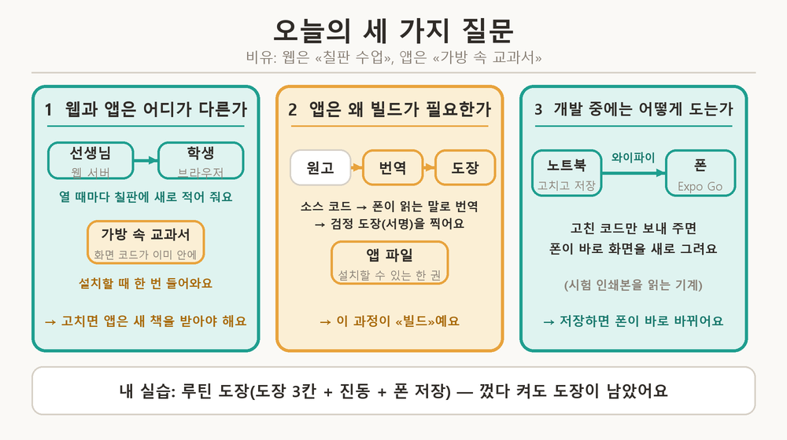
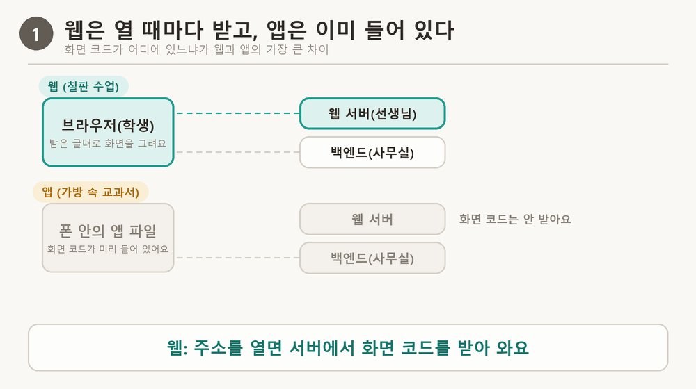
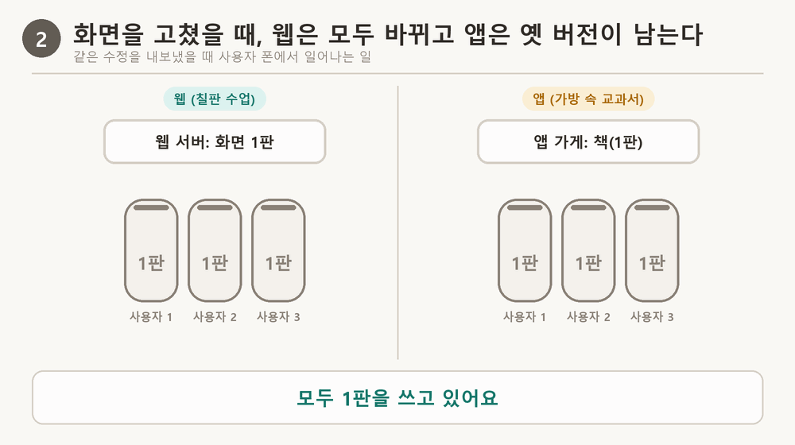
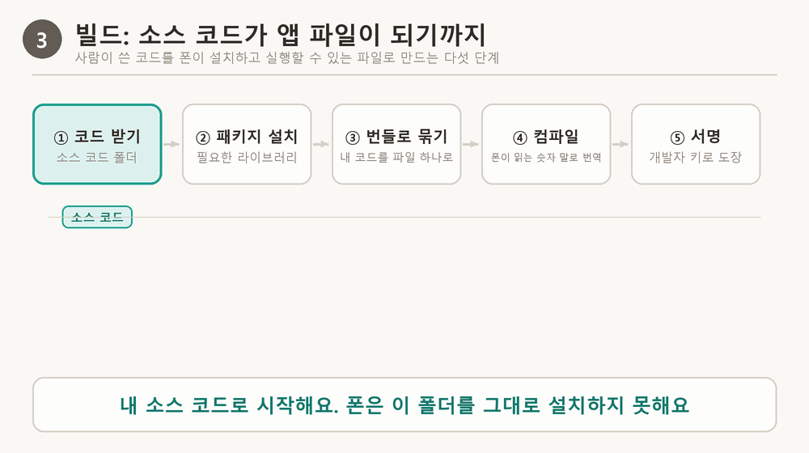
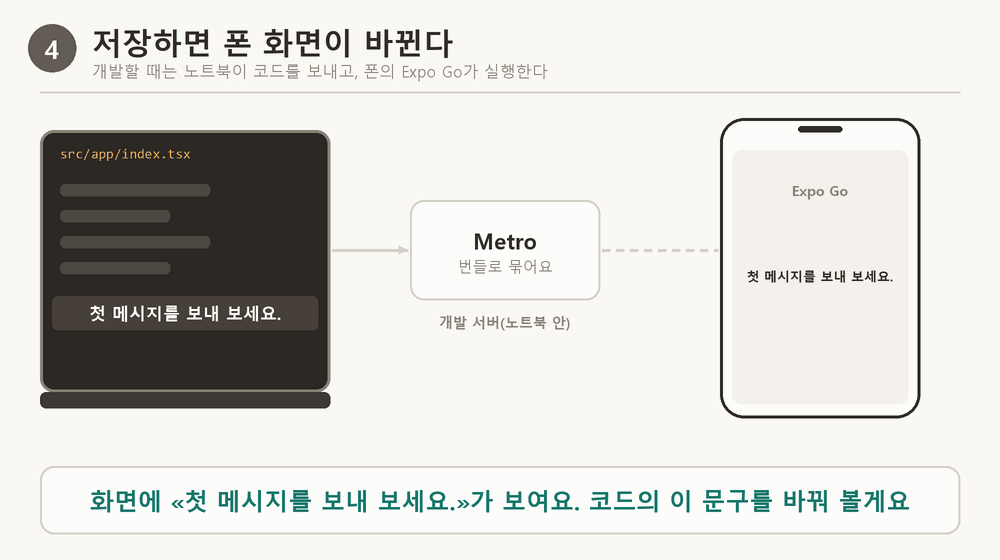
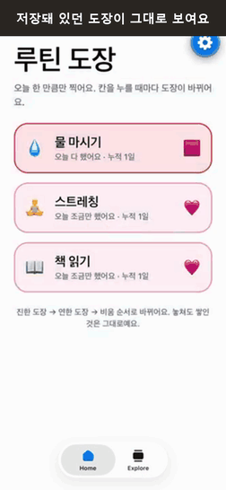
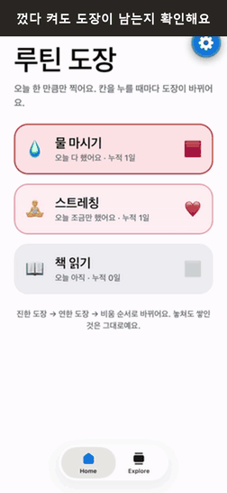
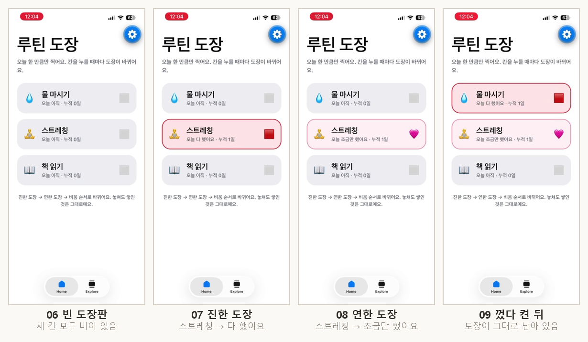

# 신서연 — 모바일 앱 1일차: Expo로 휴대폰 앱 만들기

> 📝 **블로그 글:** [백엔드는 그대로 두고 화면만 새로 — Expo로 휴대폰 앱 만들기 (14)](https://tigermorning.github.io/blog/ko/expo-mobile-app-with-expo-go.html)

> 학습 템플릿 › 신서연 · 오늘 노드 «Expo로 휴대폰 앱 만들기» · 과제: 내가 만들고 싶은 앱(루틴 도장)을 Expo로 만들어 내 폰의 Expo Go에서 실행하기

## 한눈에 보기

- **문제:** 지금까지 만든 서비스는 인터넷 주소로만 열려요. 폰 홈 화면의 아이콘으로 열리는 앱으로 만들고 싶은데, 웹과 앱은 만드는 방식이 달라서 «무엇을 새로 만들고 무엇을 그대로 쓰는지» 알아야 해요.
- **핵심 원리:** 웹은 열 때마다 서버에서 «화면을 그리는 글»을 받아 오고, 앱은 그 글을 **앱 파일에 담아 폰에 미리 설치**해요. 이 차이 하나에서 빌드가 왜 필요한지, 고치면 왜 바로 안 바뀌는지가 모두 나와요.
- **해결:** Expo로 화면을 한 번만 만들어 안드로이드와 iPhone에 모두 써요. 개발 중에는 폰의 Expo Go가 노트북에서 글을 받아 화면을 그려서, 앱 파일을 만들지 않고도 내 폰에서 바로 볼 수 있어요.
- **실습:** 루틴 도장 앱(도장 칸 3개, 진동, 폰 안 저장)을 만들어 내 iPhone에서 확인했어요.
- **가장 헷갈린 것:** «Expo Go로 연 앱»과 «설치해서 쓰는 앱»은 달라요. 앞의 것은 노트북이 켜져 있어야 하고, 뒤의 것은 글이 앱 파일 안에 있어서 노트북 없이도 열려요.

글은 이렇게 흘러요: **웹과 앱의 차이 → 빌드가 필요한 이유 → 개발 중 폰에서 도는 방법 → 앱과 백엔드의 일 나누기 → 방법 고르기 → 실무 판단 → 내 실습.** 모르는 용어은 맨 아래 «용어 사전»에 있어요.

> 그림 색 규칙: **청록은 웹·개발**, **앰버(주황)는 앱·빌드**, 회색은 그 밖의 것이에요.

## 먼저 이 여섯 용어만

비유는 **학교 수업**이에요. 웹은 선생님이 수업 때마다 칠판에 적어 주는 것, 앱은 학생이 사서 가방에 넣고 다니는 교과서예요.

| 용어 | 쉽게 말하면 | 학교 비유 |
| --- | --- | --- |
| 화면 코드 | 화면을 어떻게 그릴지 적은 글(버튼 위치, 글자 색, 누르면 생길 일) | 수업 내용 |
| 웹 서버 / 브라우저 | 서버는 화면 코드를 보내 주는 컴퓨터, 브라우저는 받아서 화면을 그리는 프로그램 | 선생님 / 학생 |
| 앱 파일 | 폰에 설치하는 파일 하나. 화면 코드와 그림, 앱 이름이 들어 있어요 | 교과서 |
| 백엔드 | 정보를 저장하고 계산하는 컴퓨터. 웹과 앱이 같이 써요 | 학교 사무실 |
| 빌드 | 소스 코드를 폰에 설치할 수 있는 앱 파일로 만드는 일 | 원고를 인쇄·제본해서 교과서로 만들기 |
| Expo Go | 만드는 중인 앱을 폰에서 바로 열어 보게 해 주는 앱 | 시험 인쇄본을 읽는 기계 |

## 1. 웹과 앱은 어디가 다른가

사용자 눈에는 화면이 비슷해 보여요. 다른 것은 **화면 코드가 어디에 있느냐**예요.

**웹이 움직이는 순서**

1. 주소를 열면 브라우저가 웹 서버에게 «화면 코드를 보내 주세요»라고 해요.
2. 서버가 화면 코드를 보내 주고, 브라우저가 그 글대로 화면을 그려요.
3. 탭을 닫으면 받은 글은 사라져요. 다음에 열면 1번부터 다시 해요.

**앱이 움직이는 순서**

1. 앱 가게에서 앱 파일을 내려받아 설치해요. 화면 코드가 이때 한 번 폰으로 들어와요.
2. 아이콘을 누르면 폰이 **자기 안에 있는 화면 코드**로 화면을 그려요. 서버에서 받아 오지 않아요.

> [그림 1] 웹은 열 때마다 선생님(웹 서버)이 칠판에 새로 적어 주고, 앱은 교과서 안에 이미 적혀 있어요. 바뀌는 정보(대화 내용 등)는 둘 다 사무실(백엔드)에서 받아요.

이 차이에서 세 가지가 따라와요.

| 따라오는 것 | 웹 | 앱 |
| --- | --- | --- |
| 화면을 고치면 | 서버의 글만 고치면 다음에 여는 모든 사람이 바로 새 화면을 봐요 | 새 앱 파일을 만들어 올리고, 사용자가 업데이트해야 바뀌어요 |
| 옛 버전 | 안 남아요(열 때마다 새로 받아요) | 업데이트하지 않은 폰에 옛 앱이 계속 남아요 |
| 쓸 수 있는 폰 기능 | 브라우저가 허락한 것만 | 카메라, 진동 같은 폰 기능(사용자가 권한을 허락하면) |

> [그림 2] 같은 수정을 해도 칠판 수업은 다음 시간부터 모두 새 내용을 보지만, 교과서는 새 책을 산 학생만 새 내용을 봐요.

> **먼저 생각해 보기:** 서버의 화면 코드를 고치면 웹 사용자와 앱 사용자는 각각 어떻게 되나?
>
> 💡 답: 웹 사용자는 다음에 열 때 새 글을 받아 모두 바로 바뀌어요. 앱 사용자는 화면 코드가 폰의 앱 파일 안에 있어서, 새 앱 파일을 만들어 올리고 사용자가 업데이트해야 바뀌어요.

## 2. 앱에는 왜 빌드가 필요한가

폰은 사람이 쓴 소스 코드를 **그대로 읽지 못하고**, 정해진 모양의 파일만 설치해요. 그래서 소스 코드를 앱 파일로 바꾸는 일이 필요해요. 그게 빌드예요. 이유는 세 가지예요.

1. **번역(컴파일):** 폰의 두뇌(CPU)는 사람이 쓴 글을 못 읽어서, 폰이 읽는 숫자 말로 번역해야 해요.
2. **정해진 모양:** 안드로이드는 APK·AAB, iPhone은 IPA 모양의 파일만 설치돼요. 코드, 그림, 앱 이름, 권한 정보를 그 모양의 파일 하나에 담아야 해요.
3. **도장(서명):** 도장이 없는 파일은 폰과 앱 가게가 설치를 거부해요. 도장은 «누가 만들었고 중간에 바뀌지 않았는지»를 확인하는 표시예요. 새 버전도 같은 사람의 도장이어야 같은 앱의 업데이트로 인정돼요.

웹은 브라우저가 받은 글을 그 자리에서 실행하니, 설치할 파일이 없어서 이 과정이 필요 없어요.

**빌드는 5단계로 일어나요.** ① 소스 코드를 받아요. ② 코드가 쓰는 도구(패키지)를 설치해요. ③ 내 코드(JavaScript)를 번들 하나로 묶어요(번역은 안 하고 묶기만 해요). ④ 카메라나 화면 부품을 쓰는 네이티브 부분을 번역(컴파일)해요. ⑤ 개발자의 도장으로 서명해서 앱 파일을 완성해요.

> [그림 3] 빌드는 원고를 책으로 만드는 5단계예요. 원고를 받고, 도구를 챙기고, 한 권으로 묶고, 번역하고, 도장을 찍어요.

**왜 «Android SDK와 Xcode가 필요하다»고 하나요?** ④번 번역과 ⑤번 도장 도구가 폰 회사의 개발 도구 안에 들어 있기 때문이에요. 구글의 도구는 Windows·맥·리눅스 어디서든 돌아가지만, 애플의 도구(Xcode)는 맥에서만 돌아가요. 그래서 iPhone 앱을 내 컴퓨터에서 직접 만들려면 맥이 필요해요. Expo는 이 일을 인터넷의 컴퓨터(클라우드 빌드, EAS)에 맡기기 때문에 Windows 노트북으로도 iPhone용 앱 파일을 만들 수 있어요.

> **먼저 생각해 보기:** 빌드를 하지 않고도 내 앱을 폰에서 볼 수 있을까?
>
> 💡 답: 볼 수 있어요. 개발하는 동안에는 Expo Go가 «미리 번역해 둔 네이티브 부분»을 갖고 있어서 내 코드만 받으면 돼요(다음 장). 다만 다른 사람의 폰에 설치할 앱 파일을 만들려면 빌드가 필요해요.

## 3. 개발하는 동안 폰에서는 어떻게 도는가

앱은 두 부분으로 나뉘어요.

- **내 코드(JavaScript):** 내가 쓴 화면과 동작. 묶기만 하면 바로 실행돼요.
- **네이티브 부분:** 화면 부품, 카메라, 진동처럼 폰이 원래 가진 기능을 쓰는 부분. 폰 회사의 방식으로 번역해야 해요.

**Expo Go**는 자주 쓰는 네이티브 부분을 Expo 팀이 **미리 번역해서** 앱 가게에 올려 둔 앱이에요. 그래서 내가 번역할 필요 없이, 내 코드만 보내 주면 Expo Go가 그 위에서 실행해요.

**코드를 저장하면 일어나는 일**

1. 노트북에서 코드를 고치고 저장해요.
2. 개발 서버(Metro)가 바뀐 코드를 번들로 다시 묶어요.
3. 같은 와이파이로 폰의 Expo Go에 번들을 보내요.
4. Expo Go가 화면을 새로 그려요. 앱을 다시 만들거나 설치하지 않았는데도 몇 초 안에 바뀌어요.

> [그림 4] 노트북에서 저장하면 개발 서버가 새로 묶어 와이파이로 보내고, 폰의 Expo Go가 화면을 새로 그려요.

**설치한 앱은 왜 다른가요?** 빌드할 때 내 코드가 앱 파일 안에 **굳어서** 들어가요. 그래서 코드를 고쳐도 폰의 앱은 그대로이고, 바꾸려면 다시 빌드해서 새 앱 파일로 교체해야 해요. 반대로 Expo Go는 코드를 개발 서버에서 받아 오기 때문에 고친 코드가 바로 반영돼요. 개발 서버를 끄면 Expo Go는 받아 올 곳이 없어 멈추고, 설치한 앱은 코드가 안에 있어서 서버 없이도 열려요.

> [그림 5] 같은 수정을 해도 Expo Go(시험 인쇄본)는 곧바로 바뀌고, 설치한 앱(완성된 책)은 다시 인쇄(빌드)해야 바뀌어요.

**Expo Go의 한계.** Expo Go 안에 번역돼 들어 있지 않은 네이티브 기능(카카오 로그인 같은 회사별 SDK, 안드로이드 서버 푸시 알림 등)은 쓸 수 없어요. 그럴 때는 그 기능까지 번역해 넣은 «내 앱 전용 Expo Go»인 **개발용 빌드**를 따로 만들어요. 한 번 설치해 두면 Expo Go처럼 코드를 받아 바로 바뀌고, 네이티브 라이브러리를 더하거나 `app.json`의 권한을 바꿀 때만 다시 만들어요.

**연결은 어떻게 되나요?** 노트북에서 `npx expo start`를 켜면 개발 서버가 같은 와이파이 안의 주소(예: `192.168.x.x:8081`)로 열려요. 앞의 숫자는 «같은 와이파이 안의 노트북 주소(집 안의 호수 번호)», 뒤의 `8081`은 «그 노트북에서 개발 서버가 쓰는 출입구 번호»예요. 폰의 Expo Go가 이 주소를 찾아가요(QR 코드를 찍거나 홈의 목록에서 눌러요). 같은 와이파이가 아니면 `--tunnel`로 인터넷 중계소를 거쳐 연결하지만 느리고 주소가 인터넷에 공개돼요. 또 프로젝트의 SDK 숫자(이번엔 58)와 폰 Expo Go가 지원하는 SDK 숫자가 같아야 열려요.

> **먼저 생각해 보기:** 개발 서버를 끄면 Expo Go로 연 앱과 설치한 앱은 각각 어떻게 될까?
>
> 💡 답: Expo Go로 연 앱은 코드를 개발 서버에서 받아 오므로 멈춰요. 설치한 앱은 코드가 앱 파일 안에 있어서 서버 없이도 열려요.

## 4. 앱과 백엔드는 일을 어떻게 나누는가

앱은 **화면과 폰 기능**을 맡고, **데이터·판단·비밀**은 백엔드가 맡아요. 웹과 앱이 같은 백엔드를 쓰므로 백엔드는 새로 만들 필요가 없어요. 앱을 켜면 이런 순서로 오가요.

1. 앱이 백엔드에게 «설정을 알려 주세요»(`/api/config`)라고 물어요. 로그인 서비스(Supabase) 주소와 공개용 열쇠를 받아요.
2. 앱이 로그인 서비스에게 «익명 로그인(게스트)»을 요청해요. 이름과 비밀번호 없이 임시 사용자 번호가 만들어져요.
3. 토큰(그 번호의 사람이라는 증표)을 받아 폰 안에 저장해요. 그래서 앱을 껐다 켜도 같은 게스트로 이어져요.
4. 이후 모든 요청에 토큰을 붙여 «내 정보와 지난 대화를 주세요»라고 해요. 백엔드는 토큰으로 누구인지 확인하고 **그 사람의 데이터만** 줘요.
5. 메시지를 보내면(`/api/chat`) 답이 한 번에 오지 않고 «조각»으로 이어서 와요(스트리밍): 글자 조각(`delta`), 약속이 만들어졌다는 알림(`reminder`), 기억 정리(`memory`), 끝 신호(`done`). 앱은 글자 조각이 올 때마다 화면에 이어 붙여요.

> [그림 6] 앱은 설정을 받고, 임시 사용자 번호(토큰)를 받은 뒤, 토큰을 붙여 데이터를 받고, 답은 조각으로 이어서 받아요.

**«API 응답의 모양을 함부로 바꾸면 안 돼요»가 무슨 말인가요?** 앱이 서버에 물으면 서버는 `{"reply": "안녕"}`처럼 «이름표: 값» 모양으로 답해요. 앱 코드는 `reply`라는 이름표로 값을 꺼내 화면에 보여 주게 짜여 있어요. 서버가 이름표를 `message`로 바꾸면, 업데이트하지 않은 옛 앱은 여전히 `reply`를 찾다가 값을 못 꺼내 빈 화면이나 오류가 나요. 이름표를 **더하는** 것은 옛 앱이 모르는 이름표라서 무시하니 안전하고, 이름을 **바꾸거나 지우는** 것은 위험해요(자세한 사례는 실무 판단의 유형 2).

**숨길 값과 공개해도 되는 값.** 앱 환경변수 중 이름이 `EXPO_PUBLIC_`으로 시작하는 것은 앱 파일 안에 그대로 들어가고, 앱 파일은 누구나 내려받아 열어 볼 수 있어요. 그래서 백엔드 주소와 Supabase publishable key는 넣어도 되지만, Supabase secret key와 LLM API 키는 넣으면 안 돼요. 숨길 값은 서버에만 두고 앱은 서버를 거쳐서만 써요.

**기억해 두는 곳도 기기마다 따로예요.** 껐다 켜도 남길 값(도장 기록, 로그인 토큰)은 어딘가에 적어야 하는데, 적는 곳에 따라 누가 볼 수 있는지가 달라요. ① 폰 안 저장소(AsyncStorage): 그 폰의 그 앱만 읽어요. ② 브라우저 저장소(localStorage): 그 브라우저의 그 사이트만 읽어요. ③ 서버의 데이터베이스: 같은 계정이면 어느 기기에서든 같아요. ①과 ②는 **서로 이어지지 않은 별개의 공책**이라서, 같은 앱 코드를 폰과 브라우저에서 열어도 각자 자기 공책에만 적혀요. 그래서 폰에서 찍은 도장은 브라우저에서 안 보이고, 폰과 웹에서 대화가 다르게 보이는 것(둘이 다른 게스트 번호를 받아요)도 같은 이유예요. 두 곳에서 같은 기록을 보려면 서버에 적어야 해요.

## 5. 웹 서비스를 폰으로 가져가는 방법 고르기

방법마다 «앱 파일을 어떻게 만드는지»가 달라서, 필요한 도구와 쓸 수 있는 기능이 달라져요.

| 방법 | 어떻게 앱이 되나요 | 한계 |
| --- | --- | --- |
| PWA | 웹사이트에 «홈 화면에 추가»를 하면 앱 아이콘처럼 설치돼요. 앱 파일을 만들지 않아요 | 앱 가게에 못 올려요. 폰 기능은 브라우저가 허락한 만큼만 써요 |
| 웹 래핑(Capacitor 등) | 웹사이트를 앱 껍데기 안의 작은 브라우저에 넣어 앱 가게용 파일로 만들어요. 화면은 여전히 웹이에요 | 파일을 만들려면 내 컴퓨터에 Android Studio와 Xcode가 필요해요 |
| 네이티브(Swift·Kotlin, Flutter) | 폰 회사의 방식으로 화면을 직접 만들어요 | 도구를 설치해야 하고 iPhone 앱은 맥에서만 만들 수 있어요. 안드로이드와 iOS를 따로 만들어요 |
| React Native + Expo | JavaScript로 쓰면 폰의 진짜 화면 부품으로 바꿔 그려요. 앱 파일은 클라우드 빌드가 만들어요 | 무료 플랜은 클라우드 빌드 횟수에 제한이 있고, Expo Go에 없는 기능은 개발용 빌드가 필요해요 |

고르는 기준은 ① 앱 가게에 올려야 하나, ② 내 컴퓨터에 어떤 도구가 있나, ③ 폰 기능을 얼마나 쓰나예요. 내 조건은 «Windows 노트북, 코딩 에이전트와 함께, 백엔드는 이미 있음»이었고, iPhone까지 다루면서 내 컴퓨터에 설치할 것이 가장 적은 방법이 Expo라서 Expo를 골랐어요.

**Expo가 하는 일.** React Native는 «JavaScript로 쓴 화면을 폰의 화면 부품으로 바꿔 그리는 일»까지만 해요. 화면 이동, 기기 기능, 빌드와 서명 도구는 하나씩 직접 골라 맞춰야 하는데, Expo가 이 도구들을 서로 맞는 버전으로 한 묶음으로 줘요. `app.json` 한 파일에 앱 이름, 아이콘, 패키지 이름, 권한 설명을 적으면 빌드할 때 Expo가 안드로이드·iOS용 폴더를 알아서 만들어요. `npx expo install`은 내 프로젝트의 SDK 숫자에 맞는 버전으로 설치해 줘요.

## 오늘의 목표

- 웹과 앱이 사용자에게 닿고 실행되는 방식의 차이를 말한다.
- PWA, 웹 래핑, 네이티브, React Native와 Expo 중 내 상황에 맞는 방법을 고른다.
- Expo Go와 개발용 빌드의 차이와 한계를 말한다.
- 앱이 백엔드와 주고받는 순서를 읽는다.
- 내 폰의 Expo Go에서 앱을 실행하고, 안 될 때 원인을 찾는다.
- 기기 기능을 붙일 때 앱이 맡는 일과 백엔드가 맡는 일을 나눈다.

## 실무에서 이렇게 판단해요 (퀴즈에서 자주 틀리는 8가지)

노드의 객관식 퀴즈는 «이론을 아는가»가 아니라 «이 상황에서 어떻게 하겠는가»를 물어요. 이론을 열심히 읽어도 틀리는 이유는, 이론이 «개념»으로만 머리에 있고 «상황»과 연결돼 있지 않아서예요. 그래서 퀴즈 문항을 옮기지 않고, 같은 판단이 필요한 **실무 상황**을 유형별로 모았어요. 각 유형은 «판단 규칙 → 왜 그런가(원리) → 비유 → 상황표» 순서예요.

### 먼저, 모든 판단에 쓰는 세 가지 질문

> 학교 수업 하나로 생각해요. **칠판 수업**은 웹, **가방 속 교과서**는 폰에 설치된 앱 파일, **학교 사무실**은 백엔드, **교정쇄**(인쇄 전 시험 인쇄본)는 Expo Go, **인쇄소**는 클라우드 빌드예요.

| 질문 | 답이 «안»이면 | 답이 «밖»이면 |
| --- | --- | --- |
| 1. 어디에 있나? (앱 파일 안 vs 밖) | 앱을 다시 빌드, 사용자가 업데이트해야 바뀜 (화면 코드, 이미지, 앱 이름, 권한) | 서버만 배포, 앱은 그대로 (백엔드 코드, DB, 서버 프롬프트) |
| 2. 누가 볼 수 있나? | 앱 파일을 받은 누구나 볼 수 있으니 시크릿 금지 | 서버 안의 것은 숨길 수 있음 |
| 3. 옛 앱이 남아 있나? | 업데이트 안 한 폰이 있으니 백엔드 응답을 함부로 바꾸지 않음 | — |

외울 틀은 **어디에 있나 → 누가 보나 → 옛 앱이 남나**예요. 아래 8가지 유형은 모두 이 세 질문의 변형이에요.

### 유형 1. «이 수정, 앱을 다시 만들어야 하나?»

- **판단 규칙:** 고치려는 것이 **앱 파일 안**에 있으면 다시 빌드하고, **밖**(서버)에 있으면 서버만 배포해요.
- **왜 그런가:** 앱 파일은 빌드할 때 한 번 만들어지면 안의 내용이 고정돼요. 폰에 설치된 앱 파일은 내가 서버를 고쳐도 바뀌지 않아요. 반대로 서버 안의 것은 서버를 고치면 앱이 다음 요청부터 새 결과를 받아요.
- **비유:** 이미 학생들에게 나눠 준 교과서 속 문장은 바꿀 수 없지만, 학교 사무실의 성적 기록은 언제든 고칠 수 있어요.

| 상황 | 앱을 다시 빌드? | 왜 그런가 |
| --- | --- | --- |
| 서버에서 AI 캐릭터의 말투 지시문(프롬프트)을 바꿈 | 아니요 | 말투 지시문은 서버 컴퓨터 안에 있어요. 앱은 서버가 준 답을 받아 보여 줄 뿐이라, 서버만 고치면 다음 대화부터 바로 달라져요. |
| 앱 화면의 «전송» 버튼 글자를 바꿈 | 네 | 버튼 글자는 화면 코드에 적혀 있고, 그 화면 코드는 앱 파일 안에 들어 있어요. 앱 파일을 새로 만들어야 해요. Expo Update를 쓰면 JavaScript와 이미지는 앱 가게 심사 없이 바꿀 수 있다고 해요(오늘은 해 보지 않았어요). |
| 사진 속 글자를 읽는 OCR 엔진을 더 정확한 것으로 교체 | 아니요 | 글자를 읽는 일은 서버가 해요. 앱은 사진을 보내고 읽은 글을 받는 일만 해요. 서버 안의 엔진을 바꿔도 앱이 보내고 받는 방식은 같아서 앱은 그대로예요. |
| 약속을 만드는 규칙을 고침 | 아니요 | 약속을 만드는 판단도 서버가 해요. 앱은 결과만 받아요. |
| 앱 이름이나 아이콘을 바꿈(`app.json`) | 네 | 이름과 아이콘은 앱 파일 안에 들어가는 정보예요. |
| 카메라 기능을 새로 추가하고 권한 문구를 적음 | 네 | 카메라는 폰의 네이티브 기능이라 번역(컴파일)이 필요한 부분이 바뀌어요. 이런 변경은 Expo Update로 못 바꾸고, 새 앱 파일을 만들어 앱 가게에 올려야 해요. |
| 카카오 로그인 SDK를 붙임 | 네(개발용 빌드부터) | 회사가 만든 SDK는 네이티브 코드라서 Expo Go 안에 없어요. 그 SDK까지 번역해 넣은 내 앱 전용 개발용 앱이 필요해요. |
| 데이터베이스에 새 칸을 추가함 | 아니요 | 데이터베이스는 서버 쪽이에요. 다만 옛 앱이 새 칸 때문에 깨지지 않는지는 유형 2에서 확인해요. |

### 유형 2. «옛 앱이 새 백엔드를 부를 때»

- **판단 규칙:** 사용자 중에는 **업데이트하지 않은 폰**이 항상 있어요. 백엔드 응답에 «더하는 것»은 안전하고, «이름을 바꾸거나 없애거나 모양을 바꾸는 것»은 옛 앱을 깨뜨려요.
- **왜 그런가:** 앱은 서버의 답에서 «이름표»(필드 이름)를 보고 값을 꺼내 화면에 보여 줘요. 예를 들어 `reply`라는 이름표가 붙은 값을 꺼내요. 서버가 이름표를 `message`로 바꾸면, 옛 앱은 `reply`를 찾다가 값을 못 꺼내서 빈 화면이나 오류가 나요. 반대로 새 이름표를 추가하는 것은 옛 앱이 모르는 이름표라서 그냥 무시해요.
- **비유:** 학교 사무실이 신청 양식의 칸 이름을 바꿨는데, 옛 교과서에는 옛 칸 이름으로 신청하는 방법이 적혀 있어요. 칸을 못 찾으면 신청이 접수되지 않아요.

| 상황 | 옛 앱에 일어나는 일 | 안전하게 하려면 |
| --- | --- | --- |
| 응답에 새 필드를 추가 | 안전해요. 옛 앱은 모르는 이름표를 무시해요. | 그대로 추가 |
| 필드 이름 `reply`를 `message`로 변경 | 위험해요. 옛 앱은 `reply`를 찾는데 없어서 빈 화면이나 오류가 나요. | 한동안 두 이름을 모두 내려주고, 대부분이 업데이트한 뒤에 옛 이름을 지워요(일반적인 실무 방법이고, 노드는 «응답 모양을 함부로 바꾸지 않는다»까지 설명해요) |
| 필드를 삭제 | 위험해요. 꺼낼 값이 없어요. | 지우기 전에 그 필드를 쓰는 앱 버전이 남아 있는지 확인 |
| 새 API 경로를 추가 | 안전해요. 옛 앱은 그 경로를 부르지 않아요. | 그대로 추가 |
| 응답을 «배열»에서 «객체»로 변경 | 위험해요. 옛 앱은 «여러 개가 줄 선 목록»으로 읽는데 모양이 달라져요. | 새 경로를 만들고 옛 경로는 유지 |
| 앱도 새 이름을 읽도록 고쳐 앱 가게에 올림 | 이것만으로는 부족해요. 업데이트하지 않은 사용자의 폰에는 옛 앱이 남아 있어요. | 위의 «두 이름 함께 내려주기» |

### 유형 3. «Expo Go로 확인되나, 개발용 빌드가 필요한가?»

- **판단 규칙:** 그 기능이 **Expo Go 안에 미리 번역돼 들어 있나**를 먼저 봐요. 회사가 만든 SDK나 직접 짠 네이티브 코드가 필요하면 개발용 빌드가 필요해요. 에이전트가 새 라이브러리를 설치하자고 하면 설치 전에 이걸 확인해요.
- **왜 그런가:** Expo Go는 «자주 쓰는 네이티브 기능»만 미리 번역해서 담아 둔 앱이에요. 안에 없는 기능은 번역이 안 된 상태라 쓸 수 없어요. 그 기능을 쓰려면 내 앱에 필요한 네이티브 부분을 직접 번역해서 넣은 앱(개발용 빌드)을 따로 만들어야 해요.
- **비유:** 교정쇄 기계(Expo Go)에는 자주 쓰는 활자와 도구가 미리 들어 있어요. 그걸로 만든 쪽은 바로 확인되고, 특수한 활자(회사별 SDK)가 필요하면 내 전용 교정 기계(개발용 빌드)를 따로 마련해야 해요.

| 기능 | Expo Go에서 확인 | 왜 그런가 |
| --- | --- | --- |
| 카메라로 촬영 | 가능 | Expo Go 안에 미리 들어 있는 기능이에요. |
| 사진첩에서 사진 고르기 | 가능 | 미리 들어 있어요. |
| 내일 아침 8시에 울리도록 폰 안에서 알림 예약(로컬 알림) | 가능 | 폰이 스스로 정한 시각에 울리는 알림은 미리 들어 있어요. |
| 서버가 보내는 푸시 알림(안드로이드) | 불가 | SDK 53부터 Expo Go에서 빠졌어요. 개발용 빌드와 Firebase 설정이 필요해요. |
| 카카오 로그인 같은 회사별 SDK | 불가 | 회사가 만든 네이티브 SDK는 Expo Go에 없어요. |
| 앱 안 결제 | 불가 | 회사별 SDK예요. |
| 홈 화면 위젯, 애플워치 앱 | 불가 | 네이티브 코드를 따로 써서 번역해야 해요. |
| 답을 글자 단위로 스트리밍해서 보여 주기 | 가능 | 네이티브 기능이 아니라 JavaScript만으로 돼요. |
| 진동(`expo-haptics`) | **오늘 내 iPhone의 Expo Go에서 동작 확인** | SDK 58 문서에는 Expo Go 지원 여부가 적혀 있지 않았지만, 직접 해 보니 진동이 느껴졌어요. |
| 폰 안 저장(`async-storage`) | 가능 | SDK 58 문서에 «Included in Expo Go»(Expo Go에 포함됨)라고 적혀 있어요. |

### 유형 4. «`EXPO_PUBLIC_`에 넣어도 되나?»

- **판단 규칙:** `EXPO_PUBLIC_`으로 시작하는 값은 앱 파일 안에 그대로 들어가서 **앱을 받은 누구나** 꺼내 볼 수 있어요. 공개돼도 되는 값만 넣어요.
- **왜 그런가:** 앱 파일은 앱 가게에서 누구나 내려받을 수 있고, 내려받은 파일은 열어서 안의 글자를 읽을 수 있어요. 파일 안에 적힌 글자는 모두 공개된 것이에요.
- **비유:** 교과서에 인쇄된 글은 책을 산 누구나 읽어요. 학교 금고의 비밀번호를 교과서에 인쇄하면 안 돼요.

| 값 | 넣어도 되나 | 왜 그런가 |
| --- | --- | --- |
| 백엔드 주소 | 넣어도 돼요 | 앱이 서버를 찾아가려면 주소를 알아야 하고, 주소는 원래 공개되는 값이에요. |
| Supabase publishable key | 넣어도 돼요 | 공개해도 되도록 만든 키(공개용 열쇠)예요. |
| Supabase secret key | 안 돼요 | 앱을 받은 누구나 이 키로 모든 사용자의 데이터를 읽을 수 있어요. |
| LLM API 키 | 안 돼요 | 누구나 이 키로 내 비용을 써서 LLM을 부를 수 있어요. |
| 데이터베이스 비밀번호 | 안 돼요 | 서버만 알아야 하는 값이에요. |
| Expo 액세스 토큰(`EXPO_TOKEN`) | 안 돼요 | 내 계정 권한이 담긴 값이에요. 오늘은 터미널에서만 입력했어요. 이 프로젝트의 `.gitignore`는 `.env*.local` 파일만 막아서, 그냥 `.env`에 넣으면 깃에 올라갈 수 있어요. |

숨겨야 하는 값은 **서버에만 두고, 앱은 서버를 거쳐서만** 써요. 그러면 앱을 받은 사람이 파일을 열어 봐도 숨길 값이 안에 없어요.

### 유형 5. «이 일은 앱이 하나, 백엔드가 하나?»

- **판단 규칙:** **폰의 기능과 화면**은 앱이 하고, **판단·데이터·비밀**은 백엔드가 해요. 어느 쪽 일인지는 «바꿀 때 앱을 다시 빌드해야 하나»와 같은 질문이에요.
- **왜 그런가:** 폰의 카메라, 진동, 화면은 폰 안에 있는 앱만 다룰 수 있어요. 반면 «사진 속 글자 읽기», «약속 만들기», «LLM 부르기» 같은 판단과 비밀 열쇠는 서버에 둬야 앱을 받은 사람에게 새어 나가지 않고, 서버만 고쳐서 바꿀 수 있어요.
- **비유:** 교과서(앱)는 학생 손에 닿는 쪽을 맡고, 성적 계산과 금고 관리는 학교 사무실(백엔드)이 맡아요.

| 일 | 누가 | 왜 그런가 |
| --- | --- | --- |
| 사진을 받고 카메라 권한을 묻기 | 앱 | 폰의 기능이라 폰 안의 앱만 할 수 있어요. |
| 사진 속 글자 읽기(OCR) | 백엔드 | 글자를 읽는 판단은 서버가 해요. |
| 읽은 글을 보내기 전에 사람이 확인·수정하게 하기 | 앱 | OCR은 손글씨나 흐린 사진을 틀리게 읽을 수 있어서, 틀린 날짜로 약속이 만들어지기 전에 사람이 고치게 해요. |
| 약속을 만들기 | 백엔드 | 판단과 데이터 저장이에요. |
| 카메라 화면의 «글자가 들어오게 찍어 주세요» 안내 문구 | 앱 | 화면에 보이는 글이에요. |
| 카메라 권한을 거부했을 때 안내 | 앱 | 폰의 기능에 대한 반응이에요. |
| 로그인 토큰을 모든 요청에 붙이기 | 앱의 `api.ts` 한 곳 | 서버 주소와 토큰을 붙이는 일을 한곳에 모아 두면 고칠 곳이 하나예요. |
| LLM을 부르는 일과 그 키 | 백엔드 | 키는 비밀 값이라 서버에만 둬요. |
| 도장 칸을 누를 때의 진동 | 앱 | 폰의 기능이에요. |
| 도장 누적 일수 계산 | 루틴 도장에서는 앱 | 서버 없이 폰 안 저장소만 쓰는 앱이라서, 앱이 저장된 기록을 읽어 세요. |

### 유형 6. «이 정보는 앱을 껐다 켜도 남나?»

- **판단 규칙:** 화면에 보이는 정보마다 **어디서 오는지**를 확인해요. 세 곳이에요. ① 백엔드에서 «조회»해서 오는 것, ② 그 순간 «스트리밍 조각»으로만 오는 것, ③ 폰 안 저장소에 적혀 있는 것. 껐다 켜면 ①과 ③은 다시 불러올 수 있고, ②는 사라져요.
- **왜 그런가:** 앱을 끄면 앱이 메모리에 들고 있던 값은 모두 지워져요. 껐다 켜도 남으려면 «다시 불러올 곳»(서버나 폰 저장소)에 적혀 있어야 해요. 스트리밍 조각은 그 순간 화면에 이어 붙였다 사라지는 것이라 어디에도 적혀 있지 않아요.
- **비유:** 사무실에 기록된 내용(①)와 내 필기 노트(③)는 다시 볼 수 있지만, 수업 시간에 선생님이 말로만 한 설명(②)은 기록이 없어요.

| 정보 | 껐다 켜면 | 왜 그런가 |
| --- | --- | --- |
| 답 아래의 «기억했어요» 메모 | 사라져요 | 답을 받는 그 순간에 스트리밍 조각(`memory`)으로만 오고, 지난 대화를 조회하는 API에는 들어 있지 않아요. 지난 대화에도 보이려면 서버가 메모를 저장해서 돌려줘야 해요. |
| 지난 대화 목록 | 남아요 | 서버가 저장해 두고, 앱이 켜질 때 조회해서 가져와요. |
| 로그인(게스트) 정보 | 남아요 | 앱이 토큰을 폰 안에 저장해 두었다가, 다시 켜면 같은 게스트로 로그인해요. |
| 입력창에 쓰다 만 글자(저장하지 않음) | 사라져요 | 화면이 들고 있던 값일 뿐이라 어디에도 적히지 않았어요. |
| **루틴 도장** | **직접 확인: 남아요** | 도장을 찍을 때마다 폰 안 저장소(`AsyncStorage`)에 적어서, 앱을 종료했다가 다시 열어도 저장소에서 읽어 와 도장이 그대로였어요. |
| (가정) 루틴 도장을 화면 상태(`useState`)에만 뒀다면 | 사라졌을 거예요 | 화면 상태는 메모리에만 있어서 앱이 종료되면 지워져요. 코드 구조에서 따른 설명이고, 직접 실험해 본 것은 아니에요. |
| 웹에서 만든 대화가 앱에 보이나 | 안 보여요 | 브라우저와 폰은 각자 임시 사용자 번호(게스트)를 따로 받아서, 서버는 둘을 다른 사람으로 봐요. 서버는 사용자 번호별로 기록을 나눠 두어요. |

### 유형 7. «방법 고르기: PWA, 웹 래핑, 네이티브, Expo»

- **판단 규칙:** 세 가지 조건으로 골라요. ① 앱 가게에 올려야 하나, ② 내 컴퓨터에 어떤 도구가 있나, ③ 폰의 기능을 얼마나 쓰나.
- **왜 그런가:** 방법마다 «앱 파일을 어떻게 만드는지»가 달라서, 필요한 도구와 쓸 수 있는 기능이 달라져요. PWA는 앱 파일이 없고, 웹 래핑과 네이티브는 내 컴퓨터에서 빌드하고, Expo는 클라우드가 빌드해요.
- **비유:** 게시판에 붙여 두고 보는 인쇄물(PWA)은 책 없이 바로 보고, 칠판 수업에 표지만 씌워 교과서처럼 내는 방식(웹 래핑), 교과서를 처음부터 새로 집필하는 방식(네이티브), 한 원고로 인쇄소에서 두 가지 판형을 한꺼번에 찍는 방식(Expo)이 있어요.

| 상황 | 알맞은 방법 | 왜 그런가 |
| --- | --- | --- |
| 앱 가게에 안 올려도 되고, 웹 화면 그대로, 가장 빨리 | PWA | 웹사이트를 «홈 화면에 추가»하면 앱처럼 설치돼서 빌드가 없어요. |
| 잘 만든 웹 화면이 있고 맥과 Xcode, Android Studio가 있는 팀, 앱 가게에도 올려야 함 | 웹 래핑 | 웹사이트를 앱 껍데기 안의 작은 브라우저에 넣어 앱 가게용 파일로 만들어요. 그 파일을 만들려면 두 도구가 내 컴퓨터에 필요해요. |
| Windows 노트북인데 iOS 앱 파일까지 만들고 싶음 | Expo | 앱 파일을 클라우드의 컴퓨터(맥 서버 포함)가 만들어 줘서, 내 컴퓨터에는 Node.js만 있으면 돼요. |
| 그래픽이 무거운 게임, 최신 OS 기능을 바로 써야 함 | 네이티브 | 폰 회사의 방식으로 직접 만들어서 폰의 모든 기능을 쓸 수 있어요. |
| «PWA도 앱 가게에 올라가나?» | 아니요 | 앱 파일이 없고 «홈 화면에 추가»로 설치해요. |
| «웹 래핑은 웹 화면을 네이티브 부품으로 바꿔 그리나?» | 아니요 | 화면은 여전히 웹이에요. 껍데기만 앱이에요. |

### 유형 8. «연결이 안 될 때 어디부터 보나»

- **판단 규칙:** 오류 문구를 **그대로 읽는 것**이 첫 단계예요. 문구가 «무엇이 없다, 무엇이 다르다»를 말해 줘요.
- **왜 그런가:** 연결은 «폰 → 같은 와이파이 → 노트북의 개발 서버 → 로그인 확인 → 번들 받기» 순서로 이어져요. 어느 단계에서 끊겼는지가 오류 문구에 나와요.

| 보이는 문구 | 먼저 볼 것 | 오늘 겪은 일 |
| --- | --- | --- |
| QR을 찍어도 계속 불러오다 실패 | 폰과 노트북이 같은 와이파이인지, 방화벽에서 Node.js의 «개인 네트워크»를 허용했는지 봐요. 안 되면 `--tunnel`(인터넷 중계소를 거쳐 연결하는 방법)을 써요. | 처음 연결 때 폰 Expo Go 홈에 개발 서버가 자동으로 떴어요. |
| «호환되지 않는 프로젝트» | 프로젝트의 SDK 숫자(58)와 폰 Expo Go가 지원하는 SDK 숫자가 같은지 봐요. | 해당 없음 |
| «Expo Go와 Expo CLI 모두 로그인 필요» | 노트북(Expo CLI)과 폰(Expo Go) **양쪽**에서 같은 계정으로 로그인했는지 봐요. | 겪었어요. 노트북은 액세스 토큰, 폰은 «Forgot password?»로 비밀번호를 만들어 해결했어요. |
| «Could not connect to development server» | 개발 서버가 켜져 있는지, 같은 와이파이인지 보고 «Try again»을 눌러요. | 녹화 영상 시작 직후에 겪었어요. «Try again»으로 열렸고 원인은 확인하지 못했어요. |
| «백엔드 주소가 비어 있습니다» | `.env`의 `EXPO_PUBLIC_API_URL`을 확인하고, 고친 뒤 `npx expo start --clear`(저장된 임시 기억을 지우고 다시 시작)를 해요. | 루틴 도장은 서버를 안 써서 해당 없음 |

### 혼자 풀어 보기 (섞어서)

답을 손으로 가리고 먼저 풀어 본 뒤 확인해요.

> **1. 서버에서 AI의 말투를 바꿨어요. 사용자에게 앱 업데이트를 부탁해야 하나요?**
>
> 💡 답: 아니요. 말투 지시문은 앱 파일 밖의 서버 안에 있어서, 서버만 배포하면 모두에게 바로 적용돼요. (유형 1)

> **2. API의 날짜 필드 이름을 `date`에서 `created_at`으로 바꿨어요. 지난달 앱 버전을 쓰는 사용자는 어떻게 되나요?**
>
> 💡 답: 옛 앱은 `date`라는 이름표로 값을 꺼내는데 이름표가 없어져서, 날짜가 빈칸이 되거나 오류가 나요. 한동안 두 이름을 함께 내려주는 것이 안전해요. (유형 2)

> **3. 앱에 카카오 로그인을 붙이려고 해요. Expo Go로 시험할 수 있나요?**
>
> 💡 답: 없어요. 회사가 만든 SDK는 Expo Go에 들어 있지 않아서, 그 SDK까지 번역해 넣은 개발용 빌드가 필요해요. (유형 3)

> **4. 앱 설정에 OpenAI 키를 `EXPO_PUBLIC_OPENAI_KEY`로 넣었어요. 무엇이 문제인가요?**
>
> 💡 답: 이 이름으로 넣으면 키가 앱 파일 안에 그대로 들어가요. 앱을 받은 누구나 파일을 열어 키를 꺼내서 내 비용으로 LLM을 부를 수 있어요. 키는 서버에만 두고 앱은 서버를 거쳐 써요. (유형 4)

> **5. 도장 기록을 화면 상태에만 두면, 앱을 종료했다 다시 열었을 때 도장은 어떻게 되나요?**
>
> 💡 답: 사라져요. 화면 상태는 메모리에만 있어서 앱이 종료되면 지워져요. 오늘 만든 앱은 폰 안 저장소(`AsyncStorage`)에 적어서 남았어요. (유형 6)

> **6. OCR이 손글씨를 자꾸 틀려요. 앱 코드를 고쳐야 하나요?**
>
> 💡 답: 글자를 읽는 일은 서버가 하니, 읽는 방법을 바꾸는 것은 서버 쪽이에요. 앱에서 할 일은 «보내기 전에 사람이 읽은 글을 확인하고 고치게 하는» 정도예요. (유형 5)

## 6. 내가 해 본 것: 루틴 도장 앱

**환경.** 노트북은 Windows, 폰은 iPhone(Expo Go)이에요. 노드의 «친구 에이전트 앱 템플릿» 대신 `npx create-expo-app@latest routine-stamp-mobile`의 기본 프로젝트로 시작했어요. 과제가 «내가 만들고 싶은 앱»이고, 루틴 도장은 서버 없이 폰 안에 저장하는 앱이라 백엔드가 들어 있는 템플릿이 필요 없었어요. Node는 `v24.19.0`(요구: 22.13 이상), `expo-doctor`가 20개 검사를 모두 통과했어요.

**앱 계획.** 하루에 세 가지 루틴(물 마시기·스트레칭·책 읽기)에 도장을 찍고 칸마다 누적 일수를 봐요. 정보는 폰 안 저장소에 적고 서버는 없어요. 폰 기능은 진동(`expo-haptics`)이고, 숨길 값은 없어요.

**연결하기.** ① `npx expo start`로 개발 서버를 켜요(`Metro: exp://192.168.x.x:8081`). ② 폰 Expo Go 홈의 «DEVELOPMENT SERVERS»에 `routine-stamp-mobile`이 자동으로 떠요. ③ 눌러서 열어요(처음엔 로그인 오류, 아래 «막힌 곳»). 앱 이름은 `app.json`의 `name`을 `routine stamp`, `slug`를 `routine-stamp`로 바꿨어요.

**도장은 이렇게 움직여요.**

1. 칸을 누르면 앱이 그 칸의 오늘 상태를 보고 다음 상태를 정해요(비움 → 진한 도장 → 연한 도장 → 비움).
2. 새 상태에 맞는 진동을 울려요(진한 도장은 묵직하게 `Heavy`, 연한 도장은 가볍게 `Light`, 비울 때는 짧게 `selectionAsync`).
3. 화면을 새 상태로 바꿔요.
4. 바뀐 기록 전체를 폰 안 저장소(`AsyncStorage`, 이름 `routine-stamp:v1`)에 적어요.
5. 앱을 껐다 켜면 시작할 때 저장소에서 기록을 읽어 와 그려요. 그래서 도장이 남아요.

바꾼 파일은 `src/lib/stamps.ts`(상태 계산·저장), `src/components/stamp-board.tsx`(도장판과 진동), `src/app/index.tsx`(제목과 도장판)예요.

> [그림 7] 도장 칸을 누를 때마다 도장이 바뀌고 진동이 와요. (진동은 영상에 찍히지 않아서, 코드가 정한 진동 종류를 누른 순간에 표시했어요)

> [그림 8] 앱을 위로 밀어 종료했다가 Expo Go로 다시 열어도 도장이 그대로예요.

**확인한 것**

- 폰에서 도장판이 열렸고, 칸을 누르면 진동이 느껴졌어요. 앱을 완전히 종료했다 다시 열어도 도장이 남았어요.
- 녹화 영상(35.6초)을 프레임별로 분석해 칸을 7번 눌렀을 때의 변화 순서와 종료 전·후 도장 상태가 같음을 확인했어요.
- 노트북 브라우저(`localhost:8081`)에서도 같은 앱이 열렸고, 브라우저 저장소에 `{"2026-11-05":{"water":2}}`가 적혀 있었어요. 폰의 저장소와는 **별개의 공책**이에요.
- 진동(`expo-haptics`)은 SDK 58 문서에 Expo Go 지원 여부가 적혀 있지 않았는데, 내 iPhone의 Expo Go에서 직접 해 보니 느껴졌어요. `async-storage`는 문서에 «Included in Expo Go»라고 적혀 있어요.
- 내 파일은 `eslint` 오류가 없고, `tsc` 오류는 템플릿의 웹 전용 파일 한 곳뿐이에요.

**한계.** 웹에서는 진동 코드를 건너뛰게 만들었어요(코드로 확인했고 눈으로 본 것은 아니에요). 안드로이드 폰에서는 해 보지 않았어요. 다른 사람의 폰에는 설치할 방법이 없어요(앱 파일을 안 만들었고, iPhone에 Expo Go 밖에서 설치하려면 유료 Apple 개발자 계정이 필요해요). 오늘 앱은 개발 서버가 켜져 있을 때만 폰에서 열려요.

**이어서 할 실습.** 노드의 사진·OCR·백엔드 실습은 오늘 하지 않았어요. 루틴 도장에 «사진을 넣는 기능»을 먼저 붙인 뒤 그 위에 사진 → OCR → 백엔드를 이어서 하기로 했어요(아직 하지 않았어요).

## 잘 된 점 · 막힌 점 · 어떻게 해결했나

**잘 된 것**

| 잘 된 것 | 근거 |
| --- | --- |
| 개발 도구가 한 번에 맞았어요 | Node 24.19.0, `expo ~58.0.23`, `expo-doctor` 20/20 통과 |
| 폰이 개발 서버를 자동으로 찾았어요 | Expo Go 홈 «DEVELOPMENT SERVERS»에 서버가 떠 있었어요. |
| 진동이 Expo Go에서 됐어요 | 문서에는 지원 여부가 없었지만 내 iPhone에서 느껴졌어요. |
| 껐다 켜도 도장이 남았어요 | 폰 안 저장소(`AsyncStorage`)에 적어 두었기 때문이에요. |

**막힌 곳 (무슨 일이었고, 왜 그랬고, 어떻게 풀었나)**

| 막힌 곳 | 왜 그랬나(원리) | 어떻게 풀었나 |
| --- | --- | --- |
| Chrome 주소창에 `exp://…` 주소를 넣으니 구글 검색이 됨 | 주소의 맨 앞 글자(`https://`, `exp://`)는 «어느 프로그램이 이 주소를 여는지»를 정해요. `exp://`는 Expo Go가 여는 주소라서, 크롬은 모르는 글자로 보고 검색어로 처리해요. | Expo Go 홈의 개발 서버 목록에서 눌러서 열었어요. |
| 터미널에서 `PS C:\Users\…>` 줄을 입력해 «프로세스를 찾을 수 없다» 오류 | 그 줄은 명령이 아니라 «지금 위치는 여기예요»를 알려 주는 프롬프트였어요. 맨 앞의 `PS`는 PowerShell에서 `Get-Process`(실행 중인 프로그램 찾기)의 줄임말이라 그렇게 읽혔어요. | `PS`와 `>`를 빼고 `cd`로 폴더를 옮겼어요. |
| 폰에서 «Expo Go와 Expo CLI 모두 로그인 필요» 오류 | 개발 서버가 «내 앱을 여는 사람이 누구인지» 확인하려고 Expo 계정 로그인을 요구해요. 노트북 쪽(Expo CLI)과 폰 쪽(Expo Go)이 **둘 다 같은 계정**으로 로그인돼야 같은 사람으로 인정돼요. | 아래 두 줄처럼 노트북과 폰을 각각 로그인했어요. |
| 노트북 `npx expo login`이 오류로 중단 | 이 명령은 브라우저를 자동으로 열어 로그인하게 하는데, 그 «브라우저를 여는 단계»(`cmd /c start`)가 실패했어요(로그인 주소 속 `&` 때문으로 추정하고, 오류 줄은 확인했어요). | 액세스 토큰(비밀번호 대신 쓰는 긴 열쇠 글자)을 만들어 터미널에서 `$env:EXPO_TOKEN`으로 입력한 뒤 `npx expo start`를 했어요. |
| 폰 Expo Go 로그인 화면에 아이디·비밀번호만 있고 GitHub 버튼이 안 보임 | GitHub로 가입한 계정은 비밀번호를 따로 만든 적이 없어서 없을 수 있어요(추정이에요). | «Forgot password?»로 비밀번호를 새로 만든 뒤 로그인했어요. |
| Expo Go를 다시 열자 «Could not connect to development server» 오류(녹화 영상 시작 직후) | 화면에는 «서버가 켜져 있는지, 같은 와이파이인지 확인하라»고 나와요. 이번에 실제 원인은 확인하지 못했어요. | «Try again»을 눌러 다시 불러오니 앱이 열렸어요. |
| 내가 번들을 잘못된 주소로 확인해 «서버가 옛 코드를 준다»고 오진 | 폰이 쓰는 주소와 다른 주소로 확인했어요(원인은 확인하지 못했어요). | 폰 화면을 기준으로 삼기로 했어요. 서버는 처음부터 새 코드를 보내고 있었어요. |

- **알아 둔 것:** 액세스 토큰은 내 계정 권한이 담긴 비밀 값이라, 파일(`.env` 등)이나 채팅에 남기지 않고 터미널 탭에만 입력해요. 이 프로젝트의 `.gitignore`는 `.env*.local` 파일만 막고 있어서, 그냥 `.env`에 토큰을 넣으면 깃에 올라갈 수 있어요. 실습이 끝나면 expo.dev에서 토큰을 삭제할 예정이에요.
- **새로 알게 된 것:** 같은 코드라도 폰과 브라우저는 각자 자기 저장소(공책)에 적기 때문에 도장이 이어지지 않는다는 것, 그리고 Expo Go에서는 로그인해야 개발 서버를 열 수 있다는 것.

## 이 세션에서 내가 던진 질문과 답

| 질문 | 답 요약 |
| --- | --- |
| 오늘 노드가 두 개인데 왜 내용이 간단한가 | 요약하면서 스텝별 내용이 빠졌어요. 스텝별로 다시 썼어요. |
| 폰에서 QR로 앱을 여는 방법 | 같은 와이파이에서 Expo Go로 QR을 찍거나, Expo Go 홈의 개발 서버 목록을 눌러요. |
| 무슨 카드를 눌러야 하나 | 홈의 «DEVELOPMENT SERVERS» 아래 `routine-stamp-mobile` 상자예요. |
| 프로젝트 이름을 `tigermorning`이 아닌 routine stamp로 | 안내 페이지의 `tigermorning`은 예시 폴더 이름이에요. 프로젝트 이름은 `app.json`의 `name`과 `slug`에서 정해요. |
| 토큰 이름은 왜 `…-laptop`인가, 따로 만들어야 하나 | 이름은 «어느 PC용인지» 알아보려는 라벨일 뿐이에요. PC마다 하나씩 만들면 한 곳만 지울 수 있어 안전하지만 필수는 아니에요. |
| 토큰을 터미널에 바로 입력해도 되나, `.env` 파일은 | 터미널 입력이 안전해요. `.env`는 이 프로젝트에서 깃에 올라갈 수 있어요. |
| 터미널 디렉토리는 기본으로 하나 | 프로젝트 폴더(`routine-stamp-mobile`)에서 실행해야 해요. 다른 폴더에서는 프로젝트를 못 찾아요. |
| 따옴표가 필요한가 | 작은따옴표로 감싸면 안전해요. 큰따옴표 안에서는 `$` 글자가 변수로 해석돼요. |
| 폰에서 찍은 도장이 브라우저에 보이지 않는 이유 | 폰 안 저장소와 브라우저 저장소는 서로 연결되지 않은 별개의 공책이라서, 한쪽에 적은 것이 다른 쪽에 나타나지 않아요. |

## 오늘의 회고 (직접 쓰기)

1. 스텝 1에서 «웹 서비스를 앱으로 만들 때 새로 필요한 것과 그대로 쓸 것»을 적었다면, 지금 다시 읽고 맞았던 것과 새로 알게 된 것을 비교해 적기.
2. 오늘 새로 만든 것(도장판 화면, 진동, 폰 저장)과 그대로 쓴 것(Expo의 도구들, 기본 프로젝트)을 나눠 적기.
3. 질문 1·2·3(웹앱과 모바일앱의 차이, 빌드가 필요한 이유, 구동 방식)을 내 말로 한 문장씩 적기.
4. 남은 의문: (채우기)

## 용어 사전

그림에 나오는 용어을 먼저 풀어요. 비유는 **학교 수업**이에요. 웹은 선생님이 수업 때마다 칠판에 적어 주는 것이고, 앱은 학생이 사서 가방에 넣고 다니는 교과서예요. 용어은 그대로 쓰되, 뜻과 움직이는 방식을 표로 먼저 잡고 가요.

### 1. 웹과 앱에 나오는 용어

| 용어 | 무엇이고, 어떻게 움직이나요 | 학교 비유 |
| --- | --- | --- |
| 화면 코드 | 화면을 어떻게 그릴지 적어 둔 글이에요. 버튼은 어디에 두고, 글자는 무슨 색이고, 누르면 무슨 일이 일어나는지가 적혀 있어요. 폰이나 브라우저는 이 글을 읽어서 화면을 그려요. | 칠판에 적힌 수업 내용, 교과서에 인쇄된 내용 |
| 웹 서버 | 인터넷에 늘 켜져 있는 컴퓨터예요. 누가 주소로 찾아오면 화면 코드를 보내 줘요. | 칠판에 내용을 적어 주는 선생님 |
| 브라우저 | 크롬, 사파리 같은 프로그램이에요. 웹 서버가 보낸 화면 코드를 받아서, 그 글대로 화면을 그려요. | 칠판을 보고 받아 적는 학생 |
| 앱 파일 | 폰에 설치하는 파일 하나예요. 안에 화면 코드, 그림, 앱 이름, 쓸 권한(카메라 등)이 모두 들어 있어요. 설치하고 나면 폰이 이 파일 안의 화면 코드로 화면을 그려요. | 가방에 넣어 다니는 교과서 |
| 백엔드(서버) | 앱이나 웹 뒤에서 일하는 컴퓨터예요. 대화 기록 저장, 로그인 확인, 크레딧 계산처럼 «기억하고 계산하는 일»을 해요. 웹과 앱이 같은 백엔드를 함께 써요. | 학교 사무실 |
| 데이터 | 시간이 지나면 바뀌는 정보예요. 대화 내용, 크레딧 잔액, 도장 기록이 데이터예요. 화면 코드와 달리 사용자마다, 순간마다 달라요. | 내 출석과 성적 |

### 2. 기억해 두는 곳에 나오는 용어

| 용어 | 무엇이고, 어떻게 움직이나요 | 학교 비유 |
| --- | --- | --- |
| 저장소(저장 공간) | 껐다 켜도 남겨야 하는 값(도장 기록 같은 것)을 적어 두는 곳이에요. 어디에 적었는지(폰 안, 브라우저 안, 인터넷 서버)에 따라 «누가 그 기록을 볼 수 있는지»가 달라져요. | 공책(내 사물함 안인지, 학교 게시판인지) |
| 폰 안 저장소(AsyncStorage) | 앱마다 폰이 따로 마련해 주는 공간이에요. 그 폰 안에만 있어서 다른 폰이나 브라우저는 볼 수 없어요. 앱을 지우면 같이 지워져요. | 내 사물함 |
| 브라우저 저장소(localStorage) | 브라우저가 웹사이트마다 마련해 주는 공간이에요. 그 브라우저 안에만 있고, 폰 앱의 저장소와는 이어져 있지 않아요. | 또 다른 사물함 |
| 서버의 데이터베이스 | 인터넷 서버가 관리하는 큰 저장 공간이에요. 같은 계정으로 접속하면 어느 기기에서든 같은 기록이 보여요. | 학교 전체가 보는 게시판 |
| 게스트(익명 로그인) | 이름과 비밀번호 없이, 서버가 «임시 사용자 번호»를 만들어 주는 방식이에요. 번호는 그 기기 안에 저장돼서, 같은 사람이 폰과 브라우저를 쓰면 번호가 둘 생겨 서로 다른 사용자로 취급돼요. | 이름 없이 받는 임시 학생 번호 |
| 토큰 | 서버가 «이 번호의 사람이에요»를 확인하도록 주는 긴 글자예요. 앱은 서버에 요청할 때마다 이 글자를 함께 보내요. | 학생증 번호 |

### 3. 빌드에 나오는 용어

| 용어 | 무엇이고, 어떻게 움직이나요 | 학교 비유 |
| --- | --- | --- |
| 소스 코드 | 사람이 쓴 프로그램 글이에요. 사람이 읽기 쉽게 쓰여 있어서, 폰은 이 글을 그대로 실행하지 못해요. | 선생님이 쓴 원고 |
| 빌드 | 소스 코드를 폰이 설치할 수 있는 앱 파일로 만드는 일이에요. 번들, 컴파일, 서명을 차례로 해요. 한 번 만든 앱 파일은 안의 내용이 고정돼요. | 원고를 인쇄·제본해서 교과서로 만들기 |
| 번들 | 여러 개로 흩어진 코드 파일을 파일 하나로 묶은 것이에요. | 낱장 원고를 한 권으로 제본하기 |
| 컴파일 | 사람이 쓴 글을 폰의 두뇌(CPU)가 실제로 읽는 숫자 말로 번역하는 일이에요. 번역된 결과는 사람이 읽을 수 없어요. | 원고를 인쇄 기계가 읽는 판으로 바꾸기 |
| 서명 | 개발자의 비밀 열쇠로 앱 파일에 도장을 찍는 일이에요. 폰과 앱 가게는 이 도장으로 «누가 만들었고 중간에 바뀌지 않았는지»를 확인하고, 도장이 없으면 설치를 거부해요. | 교과서에 찍는 검정 도장 |
| 앱 파일 형식(APK·AAB·IPA) | 폰이 설치할 수 있는 정해진 파일 모양이에요. 안드로이드는 APK(바로 설치용)와 AAB(앱 가게에 올리는 용), iPhone은 IPA예요. | 책의 규격(판형) |
| 클라우드 빌드(EAS) | 인터넷에 있는 컴퓨터가 빌드를 대신 해 주는 서비스예요. 번역에 필요한 큰 도구를 내 노트북에 깔지 않아도 돼요. | 대신 인쇄해 주는 외주 인쇄소 |
| 네이티브 | 폰이 원래 갖고 있는 기능(카메라, 진동, 위치)과 화면 부품을 쓰는 부분이에요. 폰 회사의 방식에 맞게 번역(컴파일)해야 해요. | 교실에 원래 있는 시설(방송실, 실험실) |

### 4. 개발하는 동안 나오는 용어

| 용어 | 무엇이고, 어떻게 움직이나요 | 학교 비유 |
| --- | --- | --- |
| React Native | JavaScript로 화면을 쓰면 폰의 진짜 화면 부품으로 바꿔 그려 주는 도구예요. 그래서 한 번 쓴 화면을 안드로이드와 iPhone에서 함께 써요. | 한 원고로 두 가지 판형을 만들 수 있게 해 주는 조판 도구 |
| Expo | React Native로 앱을 만들 때 필요한 도구들(개발 서버, 기기 기능 모음, 클라우드 빌드)을 서로 맞게 묶어 둔 것이에요. | 원고 작성부터 인쇄 의뢰까지 한곳에서 되는 출판사 |
| Metro(개발 서버) | 내 노트북에서 켜 두는 프로그램이에요. 코드를 저장하면 바뀐 글을 번들로 묶어서 폰에 보내 줘요. | 편집실의 시험 인쇄기 |
| Expo Go | 폰에 설치하는 앱이에요. 안에 자주 쓰는 네이티브 부분이 이미 번역돼 있어서, 노트북이 보낸 번들(내 코드)만 받으면 바로 화면을 그려 줘요. 내 앱을 따로 설치하지 않아도 돼요. | 시험 인쇄본(교정쇄)을 읽는 기계 |
| SDK(Expo SDK 58) | 개발 도구와 기능 모음의 묶음이고, 숫자는 «버전»이에요. 내 프로젝트와 폰의 Expo Go가 같은 숫자여야 앱이 열려요. | 교과서 개정판 번호 |
| 개발용 빌드 | Expo Go에 들어 있지 않은 기능(카카오 로그인 같은 것)이 필요할 때, 그 기능까지 번역해 넣어서 내 앱 전용으로 만드는 개발용 앱이에요. | 내 전용 교정 기계 |

### 5. 실무에서 자주 나오는 용어

| 용어 | 무엇이고, 어떻게 움직이나요 | 학교 비유 |
| --- | --- | --- |
| 스트리밍 | 답이 한 번에 오지 않고 «조각»으로 이어서 오는 방식이에요. 앱은 조각이 올 때마다 화면의 글자를 이어 붙여요. | 선생님이 말하는 대로 칠판에 글자가 이어서 써지는 것 |
| 하위 호환 | 새 버전의 서버가 옛 버전 앱의 요청도 계속 알아듣는 성질이에요. 업데이트하지 않은 사용자가 항상 있어서 필요해요. | 새 양식 사무실이 옛 양식 신청서도 받아 주는 것 |
| 시크릿(비밀 값) | 남이 알면 안 되는 값이에요(API 키, 데이터베이스 비밀번호, 액세스 토큰). | 학교 금고 비밀번호 |
| 환경변수 | 코드 밖에 적어 두고 실행할 때 읽어 오는 설정값이에요. 이름이 EXPO_PUBLIC_으로 시작하면 앱 파일 안에 그대로 들어가요. | 교과서 맨 뒤에 인쇄된 안내문(산 사람 누구나 읽음) |
| OCR | 사진 속 글자를 읽어서 글(텍스트)로 바꾸는 기술이에요. 손글씨나 흐린 사진은 틀리게 읽을 수 있어요. | 손글씨 신청서를 읽어 입력해 주는 사람 |
| Expo Update | 앱 가게에 다시 올리지 않고 JavaScript(화면 코드)와 이미지만 인터넷으로 바꿔 보내는 서비스예요. 네이티브 부분은 못 바꿔요. 오늘은 써 보지 않았어요. | 교과서 정오표를 인터넷으로 보내는 것(본문 구조는 못 바꿈) |
