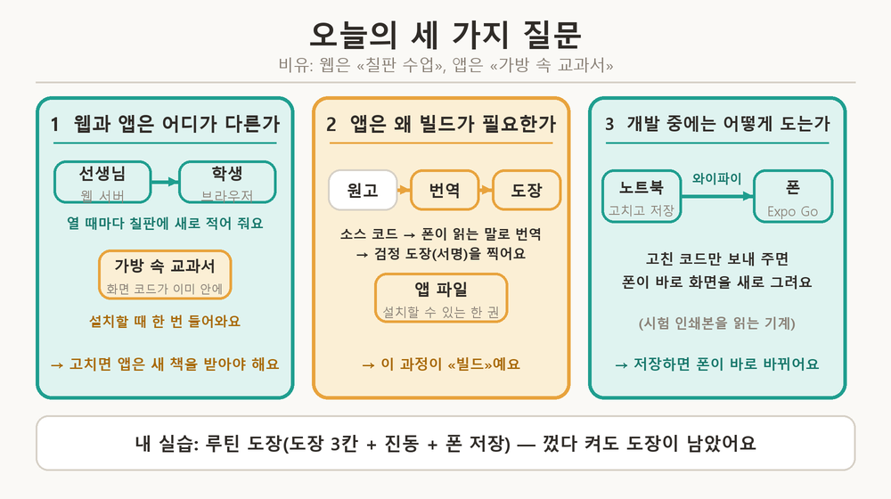
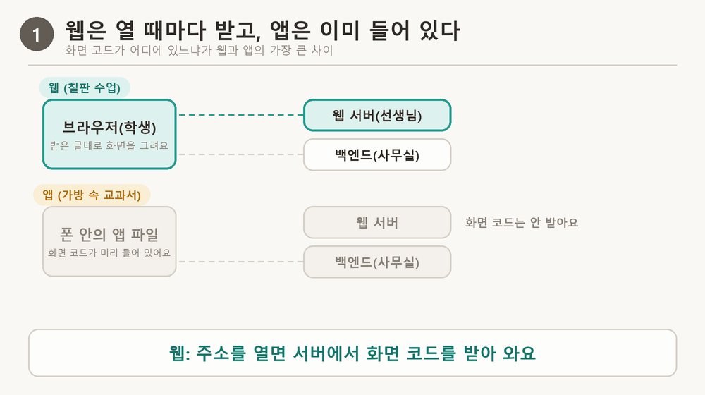
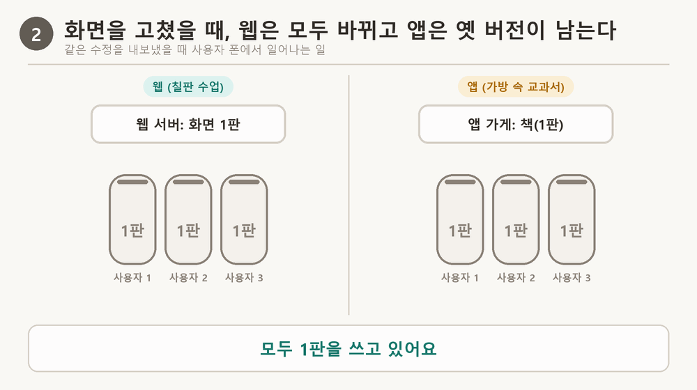
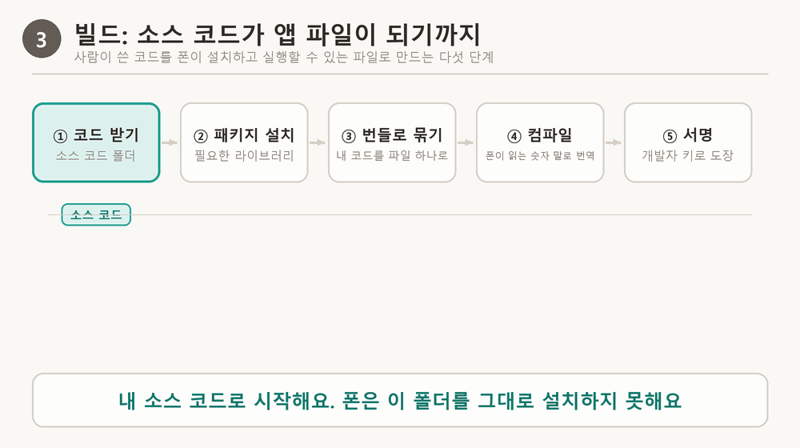
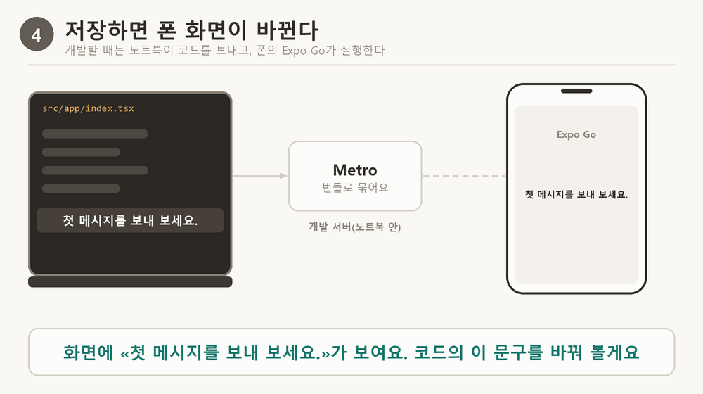
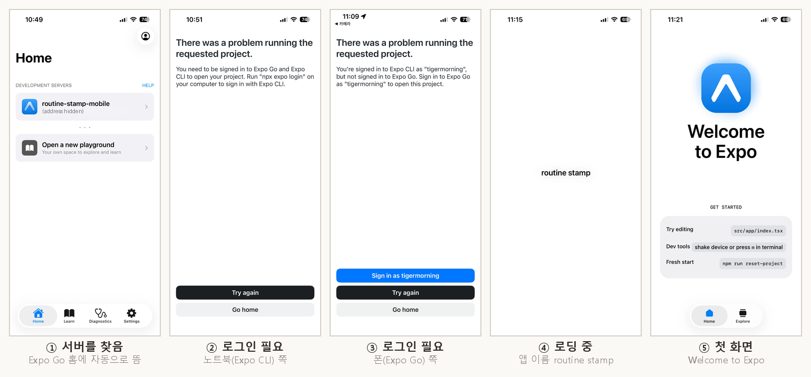
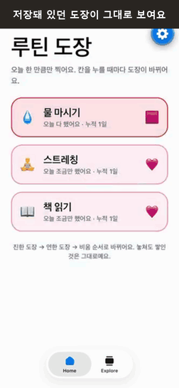
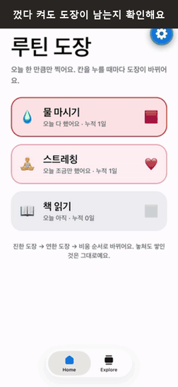
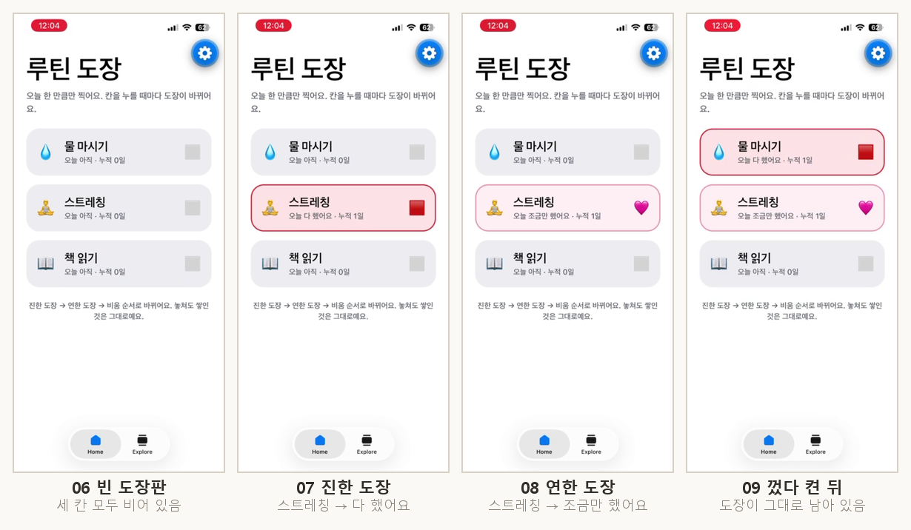

# 신서연 — 모바일 앱 1일차: Expo로 휴대폰 앱 만들기

> 📝 **블로그 글:** [백엔드는 그대로 쓰고 앱 화면만 새로 만들기 — Expo로 휴대폰 앱 만들기 (14)](https://tigermorning.github.io/blog/ko/expo-mobile-app-with-expo-go.html)

## 한눈에 보기

- **문제:** 인터넷 주소로만 열리던 서비스를 폰 홈 화면의 앱으로 만들려면, 웹과 앱이 무엇이 다른지 알아야 해요.
- **핵심:** 웹은 열 때마다 서버에서 화면 코드를 받아 오고, 앱은 화면 코드를 앱 파일에 담아 폰에 미리 설치해요. 빌드가 필요한 이유도, 고쳐도 바로 안 바뀌는 이유도 여기서 나와요.
- **방법:** Expo로 화면을 한 번 만들어 안드로이드와 iPhone에 같이 써요. 개발 중에는 폰의 Expo Go가 노트북에서 코드를 받아 바로 보여 줘요.
- **실습:** 루틴 도장 앱(도장 3칸, 진동, 폰 안 저장)을 만들어 내 iPhone에서 확인했어요.

> 그림 색 규칙: **청록은 웹·개발**, **앰버(주황)는 앱·빌드**

## 내 실습은 이렇게 됐어요 (루틴 도장)

오늘 노드의 설명이 내 앱에서 어디에 나타났는지 먼저 정리해요. 아래 개념 설명을 읽다가 «이게 내 실습에서는?»이 궁금하면 이 표로 돌아오세요.

### 실습 한눈에 보기

| 항목 | 내용 |
| --- | --- |
| 만든 앱 | 루틴 도장: 하루 세 가지 루틴(물 마시기·스트레칭·책 읽기)에 도장을 찍고 칸마다 누적 일수를 봐요 |
| 플랫폼 | Expo SDK 58(`expo ~58.0.23`), React Native 0.88.1, iPhone의 Expo Go |
| 언어 | TypeScript |
| 저장 | 폰 안 저장소(`AsyncStorage`, 이름 `routine-stamp:v1`). 서버는 없어요 |
| 폰 기능 | 진동(`expo-haptics`): 진한 도장 `Heavy`, 연한 도장 `Light`, 비울 때 `selectionAsync` |
| 확인한 것 | iPhone Expo Go에서 도장판이 열리고 진동이 느껴졌어요. 앱을 종료했다 다시 열어도 도장이 남았어요. 노트북 브라우저(`localhost:8081`)에서도 열렸고, 저장소는 폰과 별개였어요 |
| 진행 중 | 사진 → OCR → 백엔드(노트북 서버)로 «루틴 목록 사진을 도장 칸으로» 만드는 실습. 아직 하지 않았어요 |
| 하지 않은 것 | 설치용 앱 파일 빌드, 스토어 제출, 안드로이드 폰 확인 |

### 오늘 노드의 내용이 실습에 반영된 곳

| 노드의 내용 | 내 실습에서 나타난 곳 | 확인한 정도 |
| --- | --- | --- |
| 웹과 앱은 화면 코드가 있는 곳이 다르다 | 같은 도장 코드를 폰 Expo Go와 브라우저(`localhost:8081`)에서 열었어요 | 직접 확인 |
| 기억해 두는 곳은 기기마다 따로다 | 폰에서 찍은 도장이 브라우저에는 안 보였고, 브라우저 저장소에는 `{"2026-11-05":{"water":2}}`가 따로 적혔어요 | 직접 확인 |
| 앱에는 빌드가 필요하다 | 이번에는 앱 파일을 만들지 않고 Expo Go만 썼어요. 그래서 다른 사람 폰에는 설치할 수 없어요 | 하지 않음(한계로 정리) |
| 개발 중에는 Expo Go가 노트북의 코드를 받아 실행한다 | `npx expo start`를 켜니 폰 Expo Go 홈의 «DEVELOPMENT SERVERS»에 `routine-stamp-mobile`이 자동으로 떴어요(`exp://192.168.x.x:8081`) | 직접 확인 |
| 코드를 저장하면 폰 화면이 바로 바뀐다 | 앱이 열리는 것까지는 확인했고, 저장하자마자 바뀌는 시간은 따로 재지 않았어요 | 확인 못 함 |
| Expo Go로 되는 기능과 안 되는 기능이 있다 | 진동(`expo-haptics`)은 SDK 58 문서에 Expo Go 지원 여부가 적혀 있지 않았는데, 내 iPhone에서 직접 해 보니 됐어요 | 직접 확인 |
| 앱은 화면, 백엔드는 데이터·판단을 맡는다 | 루틴 도장은 서버가 없어서 해당 없음. 사진 → OCR 실습에서 노트북 서버로 다룰 예정이에요 | 진행 중 |
| 숨길 값은 앱 파일에 넣지 않는다 | 루틴 도장에는 숨길 값이 없어요. Expo 액세스 토큰은 `.env`가 아니라 터미널에만 입력했어요 | 직접 한 것 |
| 연결이 안 될 때 오류 문구부터 읽는다 | «Expo Go와 Expo CLI 모두 로그인 필요» 오류를 노트북은 액세스 토큰, 폰은 비밀번호 만들기로 풀었어요(아래 «막힌 곳») | 직접 겪고 해결 |

## 오늘 나오는 용어

비유는 학교 수업이에요. 웹은 수업 때마다 칠판에 적어 주는 것, 앱은 가방에 넣고 다니는 교과서예요.

| 용어 | 한 줄 뜻 |
| --- | --- |
| 화면 코드 | 화면을 어떻게 그릴지 적은 글(칠판·교과서에 적힌 수업 내용) |
| 앱 파일 | 폰에 설치하는 파일 하나. 화면 코드, 그림, 앱 이름, 권한이 들어 있어요(교과서) |
| 백엔드 | 데이터를 저장하고 판단하는 서버. 웹과 앱이 같이 써요(학교 사무실) |
| 빌드 | 소스 코드를 앱 파일로 만드는 일. 코드를 묶고(번들), 번역하고(컴파일), 도장을 찍어요(서명). 안드로이드는 APK·AAB, iPhone은 IPA가 나와요. 클라우드 빌드(EAS)는 인터넷의 컴퓨터가 대신 해 줘요 |
| 네이티브 | 카메라, 진동, 화면 부품처럼 폰이 원래 가진 기능을 쓰는 부분. 폰 회사의 방식으로 번역해야 해요 |
| React Native · Expo | JavaScript로 쓴 화면을 폰의 진짜 화면 부품으로 그려 주는 도구와, 여기에 필요한 도구들을 한 묶음으로 맞춰 둔 것 |
| Expo Go | 자주 쓰는 네이티브 부분이 미리 번역돼 있어, 내 코드만 받아 바로 실행해 주는 앱(시험 인쇄본을 읽는 기계) |
| 개발용 빌드 | Expo Go에 없는 기능까지 넣어 따로 만드는 내 앱 전용 Expo Go |
| 개발 서버 | 노트북에서 켜 두는 프로그램(`npx expo start`). 저장하면 바뀐 코드를 묶어 폰에 보내요 |
| SDK | Expo 도구 묶음의 버전 숫자. 프로젝트와 폰 Expo Go의 숫자가 같아야 열려요(이번엔 58) |
| 게스트 · 토큰 | 이름·비밀번호 없이 받는 임시 사용자 번호와, 그 번호의 사람임을 보여 주는 증표 |
| `EXPO_PUBLIC_` | 이 이름으로 시작하는 설정값은 앱 파일 안에 그대로 들어가요. 누구나 볼 수 있어요 |
| 스트리밍 | 답이 한 번에 오지 않고 조각으로 이어서 오는 방식 |
| PWA · 웹 래핑 | 웹사이트를 홈 화면에 추가해 앱처럼 쓰는 것과, 웹사이트를 앱 껍데기에 넣어 앱 가게용 파일로 만드는 것 |

## 1. 웹과 앱은 어디가 다른가

화면은 비슷해 보여도 **화면 코드가 있는 곳**이 달라요. 웹은 주소를 열 때마다 서버에서 화면 코드를 받아 그리고, 탭을 닫으면 버려요. 앱은 설치할 때 화면 코드가 폰에 한 번 들어오고, 그다음부터는 폰 안의 코드로 화면을 그려요.

> [그림 1] 웹은 열 때마다 선생님(웹 서버)이 칠판에 새로 적어 주고, 앱은 교과서 안에 이미 적혀 있어요. 바뀌는 정보(대화 내용 등)는 둘 다 사무실(백엔드)에서 받아요.

| 따라오는 것 | 웹 | 앱 |
| --- | --- | --- |
| 화면을 고치면 | 서버만 고치면 다음에 여는 모든 사람이 바로 새 화면을 봐요 | 새 앱 파일을 만들어 올리고, 사용자가 업데이트해야 바뀌어요 |
| 옛 버전 | 안 남아요 | 업데이트하지 않은 폰에 옛 앱이 계속 남아요 |
| 쓸 수 있는 폰 기능 | 브라우저가 허락한 것만 | 카메라, 진동 같은 폰 기능 |

거꾸로, 앱 파일 밖(서버)에 있는 것은 서버만 고치면 돼요. 예를 들어 서버에 있는 AI 캐릭터의 말투 지시문을 바꾸면, 앱을 업데이트하지 않아도 다음 대화부터 바로 달라져요.

> [그림 2] 같은 수정을 해도 칠판 수업은 다음 시간부터 모두 새 내용을 보지만, 교과서는 새 책을 산 학생만 새 내용을 봐요.

## 2. 앱에는 왜 빌드가 필요한가

폰은 사람이 쓴 소스 코드를 그대로 읽지 못하고, 정해진 모양의 파일만 설치해요. 그래서 세 가지를 해야 해요. 폰이 읽는 말로 **번역**하고, APK·IPA 같은 **정해진 모양**의 파일 하나에 담고, 개발자의 **도장**(서명)을 찍어요. 도장이 없으면 폰과 앱 가게가 설치를 거부해요. 웹은 브라우저가 받은 코드를 바로 실행하니 이 과정이 없어요.

> [그림 3] 빌드는 원고를 책으로 만드는 5단계예요. 원고를 받고, 도구를 챙기고, 한 권으로 묶고, 번역하고, 도장을 찍어요.

번역과 도장 도구는 폰 회사의 개발 도구 안에 있어요. 애플의 도구(Xcode)는 맥에서만 돌아서, 원래 iPhone 앱은 맥이 있어야 만들어요. Expo는 이 일을 클라우드 빌드(EAS)에 맡겨서 Windows 노트북으로도 iPhone용 앱 파일을 만들 수 있어요.

## 3. 개발하는 동안 폰에서는 어떻게 도는가

앱은 JavaScript로 쓴 **내 코드**와 **네이티브 부분**으로 나뉘어요. Expo Go는 자주 쓰는 네이티브 부분을 미리 번역해 둔 앱이라, 노트북의 개발 서버가 내 코드만 묶어 같은 와이파이로 보내 주면 바로 화면을 그려요. 그래서 저장하면 몇 초 안에 폰 화면이 바뀌어요.

> [그림 4] 노트북에서 저장하면 개발 서버가 새로 묶어 와이파이로 보내고, 폰의 Expo Go가 화면을 새로 그려요.

설치한 앱은 달라요. 빌드할 때 내 코드가 앱 파일 안에 굳어서 들어가, 고치려면 다시 빌드해야 해요. 대신 개발 서버가 꺼져도 열려요. Expo Go로 연 앱은 코드를 개발 서버에서 받아 오니, 서버를 끄면 멈춰요.

> [그림 5] 같은 수정을 해도 Expo Go(시험 인쇄본)는 곧바로 바뀌고, 설치한 앱(완성된 책)은 다시 인쇄(빌드)해야 바뀌어요.

**Expo Go의 한계.** Expo Go에 미리 들어 있지 않은 기능은 쓸 수 없어요. 카카오 로그인처럼 회사가 만든 SDK가 그래요. 이런 기능은 Expo Go로 시험할 수 없고, 그 기능까지 넣은 개발용 빌드를 먼저 만들어야 해요. 새 라이브러리를 설치하기 전에 «Expo Go에 들어 있나»부터 확인해요.

**연결.** `npx expo start`를 켜면 개발 서버가 같은 와이파이 안의 주소(예: `192.168.x.x:8081`)로 열리고, 폰의 Expo Go가 그 주소를 찾아가요(QR을 찍거나 홈 목록에서 눌러요). 안 열리면 오류 문구를 먼저 읽어요. 같은 와이파이인지, SDK 숫자가 같은지, 노트북과 폰이 같은 Expo 계정으로 로그인했는지가 흔한 원인이에요.

## 4. 앱과 백엔드는 일을 어떻게 나누는가

앱은 **화면과 폰 기능**을 맡고, **판단·데이터·비밀**은 백엔드가 맡아요. 예를 들어 사진 속 글자를 읽는 OCR이 손글씨를 틀리게 읽는 것은 서버 쪽 문제예요. 앱이 할 수 있는 일은 보내기 전에 사람이 읽은 글을 확인하고 고치게 하는 화면 정도예요. 웹과 앱은 같은 백엔드를 쓰므로 백엔드는 새로 만들지 않아요.

앱은 켜질 때 설정을 받고, 게스트로 로그인해 토큰을 폰에 저장한 뒤, 모든 요청에 토큰을 붙여 내 데이터만 받아요. 대화의 답은 스트리밍 조각으로 이어서 와요.

> [그림 6] 앱은 설정을 받고, 임시 사용자 번호(토큰)를 받은 뒤, 토큰을 붙여 데이터를 받고, 답은 조각으로 이어서 받아요.

**응답 모양을 함부로 바꾸지 않아요.** 앱은 서버의 답에서 이름표(필드 이름)로 값을 꺼내요. 서버가 날짜 이름표를 `date`에서 `created_at`으로 바꾸면, 업데이트하지 않은 옛 앱은 `date`를 찾다가 날짜가 빈칸이 되거나 오류가 나요. 그래서 한동안 두 이름을 함께 내려줘요. 새 이름표를 더하는 것은 옛 앱이 무시하니 안전해요.

**숨길 값은 서버에만.** `EXPO_PUBLIC_`으로 시작하는 값은 앱 파일 안에 그대로 들어가요. 백엔드 주소나 공개용 키는 괜찮지만, LLM API 키를 `EXPO_PUBLIC_OPENAI_KEY`로 넣으면 앱을 받은 누구나 파일을 열어 키를 꺼내 내 비용으로 쓸 수 있어요. 키는 서버에 두고 앱은 서버를 거쳐 써요.

## 5. 웹 서비스를 폰으로 가져가는 방법 고르기

| 방법 | 어떻게 앱이 되나요 | 한계 |
| --- | --- | --- |
| PWA | 웹사이트를 «홈 화면에 추가»해요. 앱 파일이 없어요 | 앱 가게에 못 올려요. 폰 기능은 브라우저가 허락한 만큼만 |
| 웹 래핑(Capacitor 등) | 웹사이트를 앱 껍데기 안의 작은 브라우저에 넣어요. 화면은 여전히 웹이에요 | 내 컴퓨터에 Android Studio와 Xcode가 필요해요 |
| 네이티브(Swift·Kotlin, Flutter) | 폰 회사의 방식으로 화면을 직접 만들어요 | iPhone 앱은 맥에서만. 안드로이드와 iOS를 따로 만들어요 |
| React Native + Expo | JavaScript로 쓰면 폰의 진짜 화면 부품으로 그려요. 앱 파일은 클라우드 빌드가 만들어요 | 무료 플랜은 클라우드 빌드 횟수 제한. Expo Go에 없는 기능은 개발용 빌드 필요 |

고르는 기준은 앱 가게에 올려야 하나, 내 컴퓨터에 어떤 도구가 있나, 폰 기능을 얼마나 쓰나예요. 나는 Windows 노트북으로 iPhone까지 다루면서 설치할 것이 가장 적은 Expo를 골랐어요.

## 6. 내가 해 본 것: 루틴 도장 앱

**환경.** Windows 노트북, iPhone(Expo Go). 서버 없이 폰 안에 저장하는 앱이라 노드의 템플릿 대신 `npx create-expo-app@latest routine-stamp-mobile`의 기본 프로젝트로 시작했어요. Node `v24.19.0`, `expo-doctor` 20개 검사 통과.

**앱.** 세 가지 루틴(물 마시기·스트레칭·책 읽기)에 도장을 찍어요. 칸을 누르면 비움 → 진한 도장 → 연한 도장 → 비움 순서로 바뀌고, 상태마다 다른 진동(`expo-haptics`)이 울려요.

> [그림 7] 도장 칸을 누를 때마다 도장이 바뀌고 진동이 와요. (진동은 영상에 찍히지 않아서, 코드가 정한 진동 종류를 누른 순간에 표시했어요)

**껐다 켜도 남게.** 도장을 화면 상태(`useState`)에만 두면 메모리에만 있어서 앱을 끌 때 사라져요. 그래서 찍을 때마다 기록을 폰 안 저장소(`AsyncStorage`)에 적고, 켤 때 읽어 와 그리게 했어요.

> [그림 8] 앱을 위로 밀어 종료했다가 Expo Go로 다시 열어도 도장이 그대로예요.

**확인한 것**

- 폰에서 도장판이 열리고, 칸을 누르면 진동이 느껴졌어요. 앱을 완전히 종료했다 다시 열어도 도장이 남았어요.
- 노트북 브라우저(`localhost:8081`)에서도 같은 앱이 열렸어요. 브라우저는 자기 저장소(`localStorage`)에 따로 적어서, 폰에서 찍은 도장은 브라우저에 안 보여요. 두 곳에서 같은 기록을 보려면 서버에 적어야 해요.
- 진동은 SDK 58 문서에 Expo Go 지원 여부가 없었지만, 내 iPhone의 Expo Go에서 직접 해 보니 느껴졌어요.

**한계.** 안드로이드 폰에서는 해 보지 않았어요. 앱 파일을 만들지 않아서, 오늘 앱은 개발 서버가 켜져 있을 때만 폰에서 열려요. 노드의 사진·OCR·백엔드 실습은 아직 하지 않았어요.

## 막힌 곳과 해결

| 막힌 곳 | 왜 그랬나 | 어떻게 풀었나 |
| --- | --- | --- |
| Chrome 주소창에 `exp://…`를 넣으니 구글 검색이 됨 | `exp://`는 Expo Go가 여는 주소라 크롬은 검색어로 처리해요 | Expo Go 홈의 개발 서버 목록에서 눌러 열었어요 |
| 폰에서 «Expo Go와 Expo CLI 모두 로그인 필요» | 노트북과 폰이 같은 Expo 계정으로 로그인돼야 해요 | 아래 두 줄처럼 양쪽을 로그인했어요 |
| 노트북 `npx expo login`이 중단 | 브라우저를 여는 단계(`cmd /c start`)가 실패했어요 | 액세스 토큰을 만들어 터미널에서 `$env:EXPO_TOKEN`으로 넣었어요 |
| 폰 Expo Go 로그인에 GitHub 버튼이 없음 | GitHub로 가입한 계정은 비밀번호가 없을 수 있어요(추정) | «Forgot password?»로 비밀번호를 만들었어요 |
| «Could not connect to development server» | 원인은 확인하지 못했어요 | «Try again»으로 열렸어요 |

액세스 토큰은 내 계정 권한이 담긴 비밀 값이라 파일이나 채팅에 남기지 않고 터미널에만 넣었어요. 실습이 끝나면 expo.dev에서 지울 예정이에요.

## 이 세션에서 내가 던진 질문과 답

| 질문 | 답 요약 |
| --- | --- |
| 폰에서 QR로 앱을 여는 방법 | 같은 와이파이에서 Expo Go로 QR을 찍거나, Expo Go 홈의 개발 서버 목록을 눌러요 |
| 프로젝트 이름을 routine stamp로 | `app.json`의 `name`과 `slug`에서 정해요 |
| 토큰을 터미널에 바로 넣어도 되나, `.env`는 | 터미널이 안전해요. 이 프로젝트의 `.gitignore`는 `.env*.local`만 막아서 `.env`는 깃에 올라갈 수 있어요 |
| 터미널은 어느 폴더에서 | 프로젝트 폴더(`routine-stamp-mobile`)에서 실행해야 해요 |
| 폰에서 찍은 도장이 브라우저에 안 보이는 이유 | 폰 저장소와 브라우저 저장소는 서로 이어지지 않은 별개의 공책이에요 |

## 오늘의 회고 (직접 쓰기)

1. 스텝 1에서 «웹 서비스를 앱으로 만들 때 새로 필요한 것과 그대로 쓸 것»을 적었다면, 지금 다시 읽고 맞았던 것과 새로 알게 된 것을 비교해 적기.
2. 오늘 새로 만든 것(도장판 화면, 진동, 폰 저장)과 그대로 쓴 것(Expo의 도구들, 기본 프로젝트)을 나눠 적기.
3. 질문 1·2·3(웹앱과 모바일앱의 차이, 빌드가 필요한 이유, 구동 방식)을 내 말로 한 문장씩 적기.
4. 남은 의문: (채우기)
