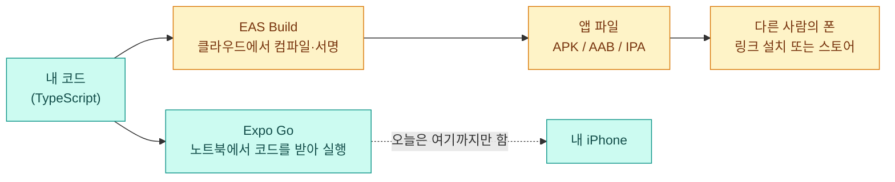
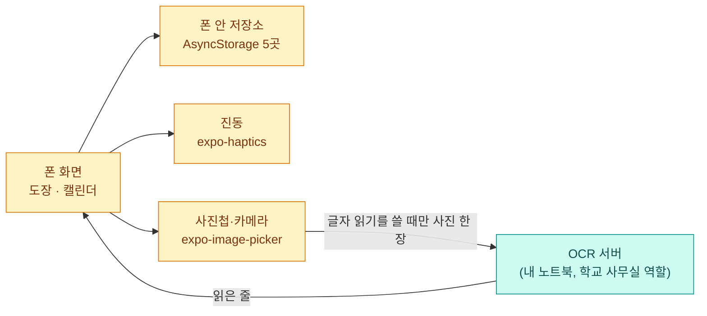

# 신서연 — 모바일 앱 2일차: 내가 만든 앱(루틴 도장)과 빌드 준비

> 이 페이지는 «만든 앱»이 중심이에요. 앱이 무엇을 하고 어떻게 짜여 있는지를 먼저 적고, 오늘 노드(Expo 앱 빌드하고 출시 준비하기)의 내용을 «이 앱을 빌드하려면 무엇이 비었나»로 옮겨 적었어요. 오늘은 Expo Go만 쓰고 앱 파일 빌드는 하지 않았어요.

## 한눈에 보기

- **만든 앱:** 루틴 도장. 하루 세 가지 루틴에 도장을 찍고, 날짜 일정을 캘린더로 보고, 손글씨 메모 사진을 글자로 읽어 일정으로 넣어요.
- **돌아가는 곳:** 내 iPhone의 Expo Go. 설치용 앱 파일은 만들지 않았어요.
- **오늘 노드의 핵심:** 개발 중에는 Expo Go가 노트북에서 코드를 받아 실행하고, 다른 사람에게 주려면 EAS Build로 앱 파일을 만들어요. 빌드에 들어가는 값은 `.env`가 아니라 `eas.json`에 적어요.
- **내 앱의 빌드 준비 상태:** `eas.json` 없음, 안드로이드 패키지 이름 없음, 글자 읽기 서버 주소가 내 노트북 안에서만 닿아요. 그래서 지금 빌드해도 다른 폰에서는 글자 읽기가 안 돼요.

> 그림 색 규칙: **청록은 웹·개발**, **앰버(주황)는 앱·빌드**

## 만든 앱: 루틴 도장

### 앱 한눈에 보기

| 항목 | 내용 |
| --- | --- |
| 하는 일 | 루틴 칸을 눌러 도장(진한 → 연한 → 비움)을 찍고, 캘린더에서 날짜 일정을 보고, 손글씨 메모 사진을 읽어 일정으로 넣어요 |
| 화면 | 아래 탭 둘(Home, Explore). Explore는 Expo 템플릿 안내 화면 그대로예요. 기능은 모두 Home 안에 있고 «도장»과 «캘린더» 보기를 버튼으로 바꿔요 |
| 만든 도구 | Expo SDK 58(`expo ~58.0.23`), React Native 0.88.1, TypeScript |
| 저장 | 폰 안 저장소(`AsyncStorage`) 5곳. 서버에 계정이나 데이터베이스는 없어요 |
| 폰 기능 | 진동(`expo-haptics`), 사진첩·카메라(`expo-image-picker`) |
| 서버로 나가는 것 | 글자 읽기를 쓸 때 사진 한 장이 내 OCR 서버로 가요. 그 밖에 밖으로 나가는 요청은 코드에서 못 찾았어요 |
| 숨길 값 | 코드에서 키·토큰은 못 찾았어요(키워드 검색 기준). 환경변수는 `EXPO_PUBLIC_OCR_SERVER_URL` 하나예요 |

### 기능과 담당 파일

| 기능 | 무엇을 하나 | 담당 파일 | 확인한 정도 |
| --- | --- | --- | --- |
| 도장판 | 칸을 누를 때마다 진한 → 연한 → 비움 | `stamp-board.tsx`, `stamps.ts` | 폰에서 직접 확인(어제) |
| 진동 | 진한 도장은 강하게, 연한 도장은 약하게 | `stamp-board.tsx`(`expo-haptics`) | 폰에서 직접 확인(어제) |
| 저장 | 앱을 껐다 켜도 도장이 남음 | `stamps.ts` | 폰에서 직접 확인(어제) |
| 칸 안 증거 사진·메모 | 칸마다 사진과 메모를 붙임 | `slot-evidence.tsx`, `evidence.ts` | 폰에서 직접 확인(어제) |
| 사진 → 글자 읽기 | 사진을 서버로 보내 줄 단위 글자를 받음 | `photo-import.tsx`, `ocr.ts` | 폰에서 직접 확인(어제) |
| 글자 → 일정 | 날짜·시간을 읽어 일정 후보로 만듦. 사람이 고치고 눌러야 반영 | `schedule.ts`, `events.ts` | 폰에서 직접 확인(어제) |
| 캘린더 | 월 달력, 날짜 선택, 그날의 루틴과 일정 | `calendar-view.tsx` | 보기만 폰에서 확인. 추가·수정·삭제를 폰에서 눌러 본 것은 확인 못 함 |

### 데이터는 어디에 저장되고 어디로 나가나

| 저장 이름 | 들어 있는 것 |
| --- | --- |
| `routine-stamp:v1` | 날짜별 도장 기록 |
| `routine-stamp:slots:v1` | 칸 목록 |
| `routine-stamp:evidence:v1` | 칸 안 증거 사진·메모 정보(사진 파일은 앱 문서 폴더에 복사) |
| `routine-stamp:events:v1` | 날짜 일정 |
| `routine-stamp:ocr-server:v1` | 글자 읽기 서버 주소 |

모두 폰 안에만 있어요. 서버로 나가는 것은 글자 읽기용 사진 한 장뿐이에요.

### 폰에서 본 모습

사진을 읽어 일정으로 넣는 화면이에요(공유기 내부 주소는 가렸어요).

◆IMG:ocr◆

> 위 화면에서 읽은 3줄이 날짜 일정 미리보기(`2026-11-07 10:30 · 미용실 예약`)가 됐어요. 사람이 확인하고 «캘린더에 일정 넣기»를 눌러야 반영돼요.

월 달력에서 7일을 선택하면 그날의 루틴과 일정이 같이 보여요.

◆IMG:calendar◆

### 진행 순서와 겪은 문제

1. **도장판 만들기:** 도장 3칸, 진동, 저장을 만들고 iPhone Expo Go에서 확인했어요.
2. **사진으로 칸 만들기 → 증거 사진으로 변경:** «사진으로 칸 추가가 이상하다»는 판단으로, 사진을 칸 안 증거로 넣는 쪽으로 바꿨어요.
3. **업로드 오류:** 폰에서 사진을 올리자 `Unsupported FormDataPart implementation`이 났어요. 이 Expo 버전의 `fetch`가 `{uri, name, type}` 꼴 파일 항목을 받지 못하는 것이 원인이었고(앱 폴더의 `node_modules` 코드를 읽어 찾음), `expo-file-system`의 `File` 객체를 `FormData`에 넣어 풀었어요.
4. **글자 읽기가 엉망:** 처음 엔진(tesseract)은 손글씨 사진에서 쓸 수 없는 조각 23줄을 돌려줬어요. 같은 사진 한 장을 세 방법으로 비교해, 줄 위치는 EasyOCR 검출기로 찾고 줄마다 TrOCR 한국어 모델로 읽는 방법이 가장 정확했어요(«오전»을 «8전»으로 읽은 것만 틀림, 앱의 규칙 코드가 보정). 비교는 사진 한 장 기준이에요.
5. **쓰임새를 두 번 바꿈:** 손글씨 목록으로 칸 만들기 → 칸 안 증거 사진 → 손글씨 일정 메모를 캘린더 일정으로. 실제 메모(날짜가 있는 일회성 일정)를 받아 본 뒤에야 요일 반복이 아닌 날짜 일정이 맞다는 것을 알았어요.

## 오늘 노드는 이 앱에 어떻게 적용되나

오늘 노드(Expo 앱 빌드하고 출시 준비하기)는 «Expo Go로 보던 앱을 앱 파일로 만들어 폰에 설치하고, 스토어에 올리기 전에 점검하는 것»이에요. 비유는 학교 수업이에요. 웹은 칠판 수업, 앱은 가방 속 교과서, 빌드는 원고를 인쇄·제본해서 검정 도장을 찍는 일, Expo Go는 시험 인쇄본(교정쇄)을 읽는 기계, EAS는 외주 인쇄소, 백엔드는 학교 사무실이에요.

### 실습 한눈에 보기 (오늘)

| 항목 | 내용 |
| --- | --- |
| 한 것 | 노드 7스텝 읽기, 루틴 도장 앱의 빌드 준비 상태를 코드·설정 파일로 점검 |
| 하지 않은 것 | EAS 로그인, `eas build`, 앱 파일 설치, 스토어 제출 |
| 하지 않은 이유 | 내 폰이 iPhone이라 안드로이드용 설치 파일(APK)은 내 폰에 못 깔고, iPhone용은 유료 Apple 개발자 계정 또는 Mac과 Xcode가 필요해요. 오늘은 Expo Go로만 확인하기로 했어요 |
| 확인 못 한 것 | 이 앱을 실제로 빌드했을 때 성공하는지, 안드로이드 폰에서 도는지 |

### 오늘 노드의 내용이 내 앱에 반영된 곳

| 노드의 내용 | 내 앱에서는 | 확인한 정도 |
| --- | --- | --- |
| 빌드하려면 앱 이름·패키지 이름을 정해야 한다 | `app.json`의 `name`은 `routine stamp`예요. `android.package`와 `ios.bundleIdentifier`는 없어요 | 설정 파일을 읽어 확인 |
| 빌드 방법은 `eas.json` 프로필에 적는다 | `eas.json` 자체가 없어요 | 파일 목록으로 확인 |
| `.env` 값은 클라우드 빌드에 안 올라간다 | 글자 읽기 서버 주소(`EXPO_PUBLIC_OCR_SERVER_URL`)를 쓰는데 `.env`는 저장소에 없고, 빌드하려면 `eas.json`의 `env`에 적어야 해요 | 코드를 읽어 확인 |
| `EXPO_PUBLIC_` 값은 앱 안에서 누구나 볼 수 있다 | 서버 주소는 앱 파일에 그대로 들어가요. 내 노트북 안에서만 닿는 주소를 넣으면 다른 폰에서는 안 닿아요 | 코드를 읽어 확인 |
| 코드를 고치면 설치한 앱은 다시 빌드해야 한다 | 지금은 Expo Go만 써서 저장하면 바로 바뀌어요 | 해 보지 않음(노드 설명) |
| 시크릿은 앱에 넣지 않는다 | 키·토큰은 코드에서 못 찾았어요(키워드 검색 기준, 전수 검사는 안 함) | 일부 확인 |
| 서명 키는 EAS가 보관하게 한다 | 아직 빌드 전이라 만들어지지 않았어요 | 해당 없음 |

### 빌드를 한다면 비어 있는 것

| 할 일 | 이유 |
| --- | --- |
| `app.json`에 `android.package`(예: `kr.study.routinestamp.<별칭>`) 정하기 | 스토어에 한 번 올리면 못 바꿔요. 같은 이름의 앱은 폰에 하나만 설치돼요 |
| `eas.json`의 `preview` 프로필 만들기(`build:configure`) | 안드로이드를 APK로 만드는 방법을 적는 곳이에요 |
| 글자 읽기 서버 주소 정하기 | 내 노트북 안 주소를 앱 파일에 넣으면 다른 폰에서는 안 돼요. 비워 두고 앱에서 입력하게 하거나, 밖에서 닿는 서버가 필요해요 |
| 권한 문구를 실제 쓰임에 맞추기 | 사진첩·카메라 권한 문구가 «글자 읽기»만 말하는데 같은 권한을 칸 안 증거 사진에도 써요 |

### 출시 점검 7가지, 내 앱 기준

| 항목 | 내 앱에서 | 현재 상태 |
| --- | --- | --- |
| 개인정보처리방침 | 사진을 외부 서버로 보내고 카메라·사진첩 권한을 써서 필요해요 | 없음 |
| 데이터 안전 항목 | 수집·공유 후보는 사진과 입력한 일정·메모예요. 계정·광고·분석 도구는 없어요 | 작성 근거 정리 안 됨 |
| 계정·데이터 삭제 | 로그인이 없어 계정 삭제는 해당 없어요. 칸·일정·증거를 하나씩 지우는 기능은 있고 전체 초기화는 못 찾았어요. 서버에 올린 사진의 보관·삭제 정책은 이 저장소로는 알 수 없어요 | 일부 있음 |
| AI 답 신고 | 글자 인식 결과를 사람이 고치고 지운 뒤 반영해요. 서버가 생성형 AI를 쓰는지는 이 저장소로는 알 수 없어요 | 확인 못 함 |
| AI임 표시 | 위와 같은 이유로 판단 보류 | 확인 못 함 |
| 앱 안 판매 | 결제·구독·광고 코드가 없어요 | 해당 없음 |
| 연령 등급 | 채팅·공유·결제·로그인이 없어요. 설문은 쓰지 않았어요 | 설문 미작성 |

## 오늘 나오는 용어

| 용어 | 한 줄 뜻 |
| --- | --- |
| 빌드 | 소스 코드를 폰이 설치할 수 있는 앱 파일로 만드는 일. 컴파일(번역), 정해진 파일 모양으로 묶기, 서명(도장) 세 가지를 해요 |
| EAS Build | Expo의 클라우드 서버가 대신 빌드해 주는 서비스(외주 인쇄소). 내 노트북에는 Node.js만 있으면 돼요 |
| APK / AAB / IPA | 안드로이드 설치용 파일 / 안드로이드 스토어 제출용 파일 / iPhone용 파일 |
| 서명 키 | 내가 만든 앱임을 보여 주는 도장. 스토어는 처음 올린 키를 기억하고, 같은 키로 서명한 파일만 새 버전으로 받아요 |
| `eas.json` | 어떤 앱 파일을 어떻게 만들지 프로필(`preview`, `production`)로 적는 파일 |
| `preview` / `production` | 설치 링크로 나눠 주는 APK 프로필 / 스토어에 올리는 AAB·iOS 프로필 |
| 패키지 이름 | 스토어와 폰이 앱을 구분하는 이름(`kr.회사.앱` 꼴). 한 번 올리면 못 바꿔요 |
| 빌드 번호 | 스토어가 파일을 구분하는 번호. 올릴 때마다 커져야 해요 |
| 개발용 빌드 | Expo Go에 없는 기능까지 넣은 내 앱 전용 Expo Go |
| 내부 테스트 / 비공개 테스트 | 스토어에서 정식 공개 전에 일부 사람만 받아 보는 단계 |

## 오늘 개념 정리

### 세 가지 길

같은 코드가 폰에 들어가는 길은 세 가지예요.

1. **개발 실행(Expo Go):** 노트북의 개발 서버가 코드를 보내 줘요. 저장하면 바로 바뀌지만 노트북이 꺼지면 멈춰요. 내 폰에서만 열 수 있어요.
2. **빌드해서 설치(`preview` APK):** EAS가 앱 파일을 만들어 링크로 줘요. 노트북 없이 돌고, 링크를 받은 안드로이드 폰이면 설치돼요. iPhone은 스토어 밖 설치가 막혀 있어서 유료 Apple 개발자 계정에 그 iPhone을 등록해야 해요.
3. **스토어 배포(`production`):** AAB(안드로이드)나 iOS 파일을 스토어에 올려요. 개발자 계정, 테스트 단계, 심사가 필요해요.

### 앱은 빌드한 시점에 고정된다

웹은 배포하면 모든 사용자가 새 버전을 쓰지만, 앱은 사용자가 업데이트해야 바뀌어요. 앱 파일 밖에 있는 것(백엔드 코드, 데이터베이스, 서버의 프롬프트)은 고쳐도 다시 빌드하지 않아요. 앱 안의 화면 문구는 고치면 다시 빌드해야 해요.

### 판단 연습 (내 앱 기준)

> **질문 1.** 글자 읽기 서버에서 읽는 방식을 바꿨어요. 앱을 다시 빌드해야 하나요?
> **답.** 아니요. 서버 쪽 변경이에요. 다만 앱이 읽는 응답 모양(`lines`, `text`)을 바꾸면 옛 앱이 못 읽을 수 있어서, 필드를 지우지 않고 더하는 쪽으로 해요.

> **질문 2.** 설치한 앱을 열었더니 서버 주소가 비어 있어요. Expo Go에서는 잘 됐어요. 어디부터 볼까요?
> **답.** `eas.json`의 해당 프로필 `env`에 주소가 있는지부터 봐요. `.env`는 클라우드 빌드에 올라가지 않아요.

> **질문 3.** 사진첩 권한 창의 문구를 고치고 싶어요. 다시 빌드해야 하나요?
> **답.** 네. 권한 문구는 `app.json`에서 앱 파일에 들어가는 설정이라 고치면 다시 빌드해야 해요.

### 출시 전 단계

스토어에 올린 앱은 저절로 공개되지 않아요. 내부 테스트(등록한 테스터만) → 비공개 테스트 → 프로덕션 순으로 사람이 넘겨요. 2023년 11월 이후 만든 개인 구글 개발자 계정은 테스터 12명이 14일 동안 비공개 테스트를 해야 프로덕션을 신청할 수 있어요. 무료 EAS 빌드는 월 횟수가 정해져 있어요(노드 기준 2026년 10월 월 30회).

## 아직 확인 못 한 것

1. 이 앱을 EAS로 실제 빌드해 본 것: 하지 않음
2. 안드로이드 폰에서 앱이 도는 것: 하지 않음(안드로이드 폰 없음)
3. 캘린더의 일정 추가·수정·삭제·완료를 폰에서 눌러 본 것: 확인 못 함
4. 폰에서 사진·카메라 권한을 거부했을 때 안내가 나오는지: 확인 못 함
5. 글자 읽기 정확도: 손글씨 사진 한 장 기준이고, 서명·흘려 쓴 글씨는 못 읽었어요
6. 서버가 사진을 얼마나 보관하는지, 생성형 AI를 쓰는지: 이 저장소로는 알 수 없음
7. 코드 전체에서 비밀값 전수 검사: 하지 않음(키워드 검색만)
