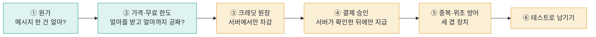
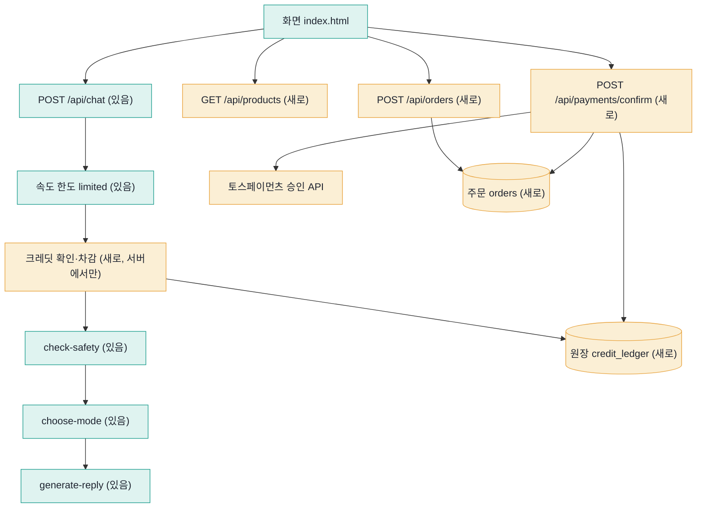
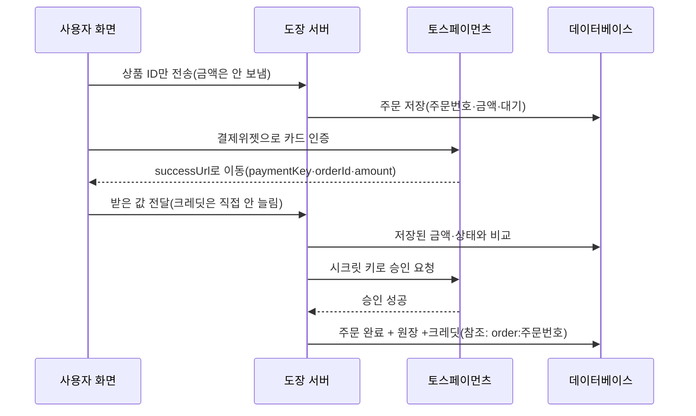

# 신서연 — 11월 4일: 원가를 계산하고 크레딧 결제 붙이기

> 학습 템플릿 (2조) › 신서연 · 노드 12(8스텝) · 내 서비스 «루틴 도장»에 크레딧·결제를 실제로 구현해 토스페이먼츠 테스트 결제까지 해 보고, 「더 해보기: 내 서비스 공격해 보기」를 실행한 기록

## 한눈에 보기

- 문제: 도장 도우미는 대화 한 번마다 LLM 비용이 나가고, 지금은 만든 사람(나)이 전부 낸다. 한도 숫자는 아직 «미정»이다(PRD 비용 항목).
- 원인(알게 된 것): 메시지 한 건의 원가는 약 $0.000534(≈0.75원, 1달러=1,400원으로 가정)로 작지만, 사용량에 비례하므로 하루 20개 쓰는 사람과 3,000개 보내는 계정의 한 달 원가가 1 : 15 : 150으로 벌어진다.
- 해결(설계): 원가 → 가격과 무료 한도 → 크레딧 원장 → 서버가 승인하는 결제 → 중복·위조 방어 순서로 정한다. 도장에 붙일 자리를 지도로 그린 뒤 실제로 구현했다(시험용 작업 폴더의 브랜치 credit-payment-trial에 커밋, push는 안 함). 토스페이먼츠 테스트 키로 100크레딧(1,000원) 테스트 결제를 한 번 성공시켰고, 그 결과를 아래 «실제로 해 본 기록»에 스크린샷과 함께 적었다.
- 과제: 「더 해보기」 공격 시험을 두 번 했다. 구현 전의 기존 서버에는 속도 한도를 5가지로, 구현한 크레딧·결제 서버(가짜 LLM, 내 컴퓨터)에는 동시 요청·무료 크레딧 반복·결제 조작을 시험했다. 크레딧 차감을 «잔액 읽기 → 쓰기»로 따로 하면 잔액 1에 동시 10건이 들어와 잔액이 -9까지 내려갔고, 트랜잭션으로 묶으면 3번 모두 1건만 통과했다. 새 구멍도 하나 남았다: 요청마다 X-Forwarded-For를 바꾸면 주소당 무료 크레딧 상한이 듣지 않았다(50/50).
- 가장 헷갈린 것: «결제 성공 페이지가 열렸다 = 돈이 들어왔다?» → 아니다. 카드 인증이 끝났을 뿐이고, 서버가 승인해야 끝난다(그림 4·5).

## 오늘의 주제

서비스에서 돈이 나가는 곳(원가)을 숫자로 말하고, 그 숫자로 가격과 한도를 정한 뒤, 크레딧을 서버가 안전하게 받고 쌓는 순서.

## 오늘의 목표

1. Langfuse 기록으로 메시지 한 건의 원가를 재고, 사용자 유형별 한 달 원가를 계산한다.
2. 원가, 결제 수수료, 고정비로 크레딧 가격과 무료 한도를 정하는 방법을 안다.
3. 크레딧을 잔액 하나가 아니라 원장(거래 기록)으로 설계하고, 차감은 서버에서만 한다.
4. 결제 요청 → 금액 검사 → 서버 승인 → 크레딧 지급 흐름을 그림으로 설명한다.
5. 같은 결제가 두 번 승인되거나 금액이 바뀐 요청이 와도 크레딧이 잘못 지급되지 않게 막는 세 겹 장치를 안다.
6. 더 해보기: 내 서비스를 직접 공격해 보고 어디까지 막히는지 기록한다.

## 영상으로 먼저 보기 (약 2분 16초)

【VIDEO】

## 먼저 용어 (처음 보는 말만 한 줄로)

| 말 | 뜻 |
| --- | --- |
| 원가 | 서비스를 제공하는 데 드는 돈. 쓸수록 늘면 변동비, 쓰든 안 쓰든 매달 나가면 고정비 |
| 토큰 | LLM이 글을 세는 단위. 입력 토큰(보낸 글)과 출력 토큰(받은 글)에 각각 단가를 곱해 요금이 나온다 |
| generation | Langfuse에서 «LLM을 한 번 부른 기록» 하나. 모델 이름, 토큰 수, 비용이 붙는다 |
| 크레딧 | 사용자가 미리 사 두는 이용권. 메시지 하나에 1개가 줄어든다 |
| 원장(ledger) | 늘고 줄어든 기록을 한 줄씩 쌓기만 하는 표. 잔액은 그 합계(가계부와 같다) |
| PG(결제 대행사) | 카드사와의 연결을 대신 맡는 회사. 이번에는 토스페이먼츠 |
| 결제 인증 / 결제 승인 | 인증은 사용자가 결제창에서 카드사 확인을 마치는 것, 승인은 우리 서버가 «이 결제를 확정해 달라»고 요청해 돈이 빠지는 것 |
| successUrl | 인증이 끝나면 토스페이먼츠가 브라우저를 보내는 우리 서버 주소. 결제 정보가 주소 뒤에 붙어 온다 |
| 클라이언트 키 / 시크릿 키 | 클라이언트 키는 화면에 있어도 되는 키, 시크릿 키는 돈이 움직이는 일에 쓰며 서버에만 둔다 |
| 멱등성(Idempotency-Key) | 같은 요청이 여러 번 와도 결과가 한 번 받은 것과 같게 만드는 성질. 같은 값의 키를 보내면 토스페이먼츠가 다시 처리하지 않는다 |
| 전환율 | 무료 사용자 가운데 크레딧을 실제로 사는 사람의 비율 |

### 용어 보충 (본문에 나오는 말)

| 말 | 뜻 |
| --- | --- |
| 웹훅 | 결제 대행사가 결제 결과를 우리 서버의 주소로 직접 알려 주는 호출. 토스페이먼츠 문서는 요청과 승인을 한 번에 처리하면 웹훅 연동이 필수가 되고, 웹훅을 못 받으면 상점과 토스페이먼츠의 결과가 어긋날 수 있다고 설명한다 |
| 대사(reconciliation) | 토스페이먼츠 기록, 우리 주문, 원장 세 곳의 금액과 주문 번호가 서로 맞는지 맞춰 보는 일. 교안은 실제 서비스가 매일 맞춰 보는 작업을 따로 둔다고 말한다 |
| 샌드박스 | 토스페이먼츠 개발자센터에서 SDK를 연동하지 않고도 테스트용 paymentKey를 받아 볼 수 있는 곳. 실제로 결제되지 않는다(토스페이먼츠 문서) |
| 시퀀스 다이어그램 | 누가 누구에게 어떤 순서로 요청하는지를 위에서 아래로 그린 도표. 그림 4와 아래 Mermaid가 이 형식이다 |
| 402 | «결제가 필요하다»는 뜻의 HTTP 상태 코드. 교안이 크레딧 부족 응답에 쓰라고 한 값 |
| 429 | 도장 서버가 속도 한도를 넘은 요청에 돌려주는 값(`busy`). 크레딧 부족(402)과 구별한다 |

## 오늘의 흐름 한 장

---

## 1. 원가: 메시지 한 건은 얼마인가 (스텝 2)

원리: 메시지 한 건을 처리할 때 서비스는 LLM을 여러 번 부른다. 요금은 호출마다 입력 토큰 수와 출력 토큰 수에 단가를 곱해 매기므로, 메시지 한 건의 원가는 그 호출들의 요금을 더한 값이다. 같은 «안녕»이라도 대화가 쌓인 사용자의 메시지가 더 비싸다(지난 대화가 입력에 같이 들어가므로).

【GIF1】

> [그림 1] 도장 도우미에 한 줄을 보내면 서버가 모델을 두 번 부른다(모드 고르기, 답 쓰기). 위기 표현 검사는 낱말로만 보므로 비용이 없다.

### 내 서비스(도장 도우미)에서 읽은 값

Langfuse에 쌓인 도장 도우미의 진짜 gpt-4o-mini 호출(11월 3일 기록)을 단계별로 합쳤다.

| 단계(generation 이름) | 호출 수 | 입력 토큰 합 | 출력 토큰 합 | Langfuse가 계산한 비용 |
| --- | --- | --- | --- | --- |
| choose-mode(어떻게 답할지 고르기) | 4 | 3,947 | 59 | $0.000627 |
| generate-reply(답 쓰기) | 4 | 8,865 | 296 | $0.001507 |
| 합계(메시지 4건) | 8 | 12,812 | 355 | $0.002135 |
| 한 건 평균 | 2 | 3,203 | 89 | $0.000534 |

- 같은 기록의 다른 파일(11월 3일 트레이스 147개 중 비용이 있는 4개)의 합도 $0.002135로 같았다.
- 한 건 $0.000534는 gpt-4o-mini 단가(입력 $0.15, 출력 $0.60, 백만 토큰당)로 다시 계산해도 같다. 원으로는 약 0.75원인데, 1달러=1,400원은 내가 가정한 값이다(실제 환율은 확인 못 함).
- 막힌 곳: 같은 기간에 모델 이름이 비어 비용 칸이 빈 generation이 237개(choose-mode 132, generate-reply 105) 있었다. 토큰은 있다(답 쓰기 평균 입력 2,170·출력 59, 모드 고르기 평균 입력 1,054·출력 14). 노드가 말한 «비용이 비어 있으면 모델 정의를 추가한다»에 해당하는 상황으로 보이나, 모델 이름이 왜 비었는지는 확인 못 함. 가짜 LLM으로 보낸 344개는 토큰도 비용도 0이다.
- 못 잰 것: 대화 첫 메시지와 열 번째 이후 메시지의 비용 차이(긴 대화 트레이스를 열어 보지 않았다), 도장 그림(/api/stamp) 한 건의 원가.
- 조회 방법: Langfuse 공개 API v2로 11월 1~4일 generation을 요청(최대 1,000건 요청에 999건이 돌아왔고, 더 있었는지는 확인 못 함).

### 사용자 유형별 한 달 원가 (한 건 $0.000534 × 하루 메시지 × 30일)

【GIF2】

> [그림 2] 원가는 사용자 수가 아니라 사용량에 비례한다.

| 사용자 유형 | 하루 메시지(가정) | 한 달 원가 | 원으로(1달러=1,400원 가정) |
| --- | --- | --- | --- |
| 보통 사용자 | 20 | $0.32 | 약 450원 |
| 많이 쓰는 사용자 | 300 | $4.80 | 약 6,700원 |
| 자동화 악용 계정 | 3,000 | $48.05 | 약 67,000원 |

- 한 건은 작아 보여도 «평균 사용자»만 보면 놓친다. 가격과 한도는 사용량의 분포를 보고 정한다.
- 이 값은 첫 메시지 기준 평균이라 긴 대화에서는 더 클 수 있다(위에서 못 잰 것).
- 참고로 같은 Langfuse 프로젝트에는 claude-sonnet-5-5 호출 408개가 있고 Langfuse가 계산한 비용 합이 $1.60이었다. 개발 중 돌린 평가 심사 호출로 보이지만(? 추정, 호출 이름이 anthropic.messages.create라는 것만 확인), 맞다면 서비스 사용자 원가와 별개로 품질을 확인하는 일에도 돈이 든다는 뜻이다.

---

## 2. 가격과 무료 한도 (스텝 3)

원리: 원가가 몇 원이면 크레딧 가격은 원가를 넘기기만 하면 되므로, 가격은 «사용자가 낼 마음이 있는 값»과 비슷한 서비스의 값으로 정한다. 손익을 가장 크게 바꾸는 것은 무료 한도다. 무료 사용자의 원가는 전부 운영자가 내고, 무료 사용자가 유료 사용자보다 훨씬 많기 때문이다. 크레딧은 결제 한 번에 몇 원짜리를 팔 수 없어(카드 인증, 건당 최저 수수료) 1,000원에 100개처럼 묶음으로 판다. 교안 기준으로 토스페이먼츠 카드 수수료는 결제 금액의 3.4%에 부가세 10%를 더한 3.74%다(교안이 적은 2026년 11월 값이고, 내가 공시 요금을 따로 확인하지는 않았다).

### 내 서비스에 대입해 본 계산 (내가 세운 단순 모델, 교안의 계산기와 다름)

가정: 사용자 1,000명, 5%인 50명만 1,000원(100크레딧)을 한 번 사서 다 쓴다, 무료 사용자 950명은 하루 무료 한도를 매일 다 쓴다(최악), 한 건 0.747원, 수수료 3.74%, 고정비는 넣지 않았다.

| 하루 무료 메시지 | 무료 사용자 한 달 원가 | 유료 50명의 수입 − 수수료 − 그들의 원가 | 한 달 손익 |
| --- | --- | --- | --- |
| 10개 | 213,006원 | 44,393원 | −168,613원 |
| 3개 | 63,902원 | 44,393원 | −19,509원 |
| 1개 | 21,301원 | 44,393원 | +23,092원 |

- 크레딧 1개로는 남는데(1,000원 − 수수료 − 원가 75원) 전체로는 손해가 나는 경우가 있고, 그 원인은 무료 사용자의 원가다. 한도를 줄일수록 흑자 쪽으로 간다.
- 다만 한도를 줄이면 써 보기 전에 떠나 전환율이 내려갈 수 있다. 전환율은 정할 수 있는 값이 아니라 재 봐야 아는 값이라, 처음에는 한도를 작게 잡고 재 본 뒤 늘린다.

### 도장에서 따로 생각해야 하는 점 (코드와 문서에서 확인한 것)

| 도장의 사실 | 크레딧에 미치는 영향 |
| --- | --- |
| 사용자가 «내 OpenAI 키(선택)»를 넣으면 그 키로 호출한다(BYOK, `pick_llm`) | 그 경우 운영자 원가가 없다. 크레딧 차감은 운영자 키로 부르는 경로에만 걸면 된다 |
| 계정과 로그인이 없고 기록은 브라우저에만 저장된다(README) | «처음 온 사용자에게 무료 크레딧»을 정하려면 먼저 사용자를 알아볼 방법이 필요하다. 브라우저 데이터를 지우면 산 크레딧도 사라진다는 노드의 경고가 그대로 해당한다 |
| 서버는 상태를 갖지 않는다(`main.py` 설명) | 원장과 주문을 담을 저장소가 새로 필요하다. 서버 구조가 바뀌는 결정이다 |
| PRD 원칙: 줄어드는 숫자를 보여 주지 않는다 | «남은 크레딧 N개»가 줄어드는 숫자라서 이 원칙과 부딪힌다. 어떻게 보여 줄지는 내가 정할 일로 남겨 둔다 |
| 대화 한 턴 = 트레이스 하나(chat-turn) | 차감 단위를 «메시지 1건 = 크레딧 1개»로 두면 Langfuse 트레이스와 일대일로 맞출 수 있다 |
| 도장 그림(/api/stamp)은 «비용이 커서» 한도가 더 빡빡하다(분당 5, 코드 주석) | 크레딧을 더 받는 기능의 후보. 실제 원가는 아직 안 재 봤다 |

정하지 않은 것: 차감 개수, 상품표(금액·크레딧), 처음 받는 무료 크레딧, 하루 무료 메시지. 위 표와 계산은 정할 재료이고, 값은 내가 정한다.

---

## 3. 크레딧은 잔액이 아니라 원장으로 (스텝 4)

원리: 사용자 테이블에 «잔액» 칸 하나를 두고 메시지마다 1씩 빼면 가장 쉽다. 하지만 잔액이 이상해졌을 때 이유를 알 수 없고, 두 요청이 같은 잔액을 동시에 읽고 고치면 한쪽의 변경이 사라진다. 그래서 늘고 준 기록을 한 줄씩 쌓는 원장을 두고, 잔액은 합계로 본다. 참조 칸을 유일하게 두면 같은 일이 두 번 기록되는 것을 데이터베이스가 막는다.

【GIF3】

> [그림 3] 왼쪽은 두 요청이 같은 «1»을 읽고 둘 다 «0»을 쓰는 모습, 오른쪽은 줄이 쌓이고 합계가 잔액이 되는 모습.

차감은 반드시 서버에서 한다. 화면 코드에서만 확인하면 개발자 도구로 /api/chat을 바로 불러 크레딧 없이 쓸 수 있다. 크레딧이 모자라면 결제가 필요하다는 뜻의 402를 돌려준다(401은 로그인, 500은 서버 고장으로 읽혀 화면이 오해한다).

### 구현 전에 정할 것 (노드의 표를 도장에 놓아 본 것)

| 노드의 질문 | 도장의 현재 상태 | 내가 정할 것 |
| --- | --- | --- |
| 언제 차감하나 | 지금은 차감 자체가 없다. 요청이 오면 한도 검사(`limited`) 후 바로 처리 | 받자마자(동시 요청 방어가 쉬움) 또는 답 뒤(실패한 요청에 돈을 안 받기 쉬움) |
| 답이 실패하면 | 오류 이벤트로 끝남 | 차감 안 함 / 되돌리는 줄(+1) |
| 크레딧이 0이면 | 속도 한도 초과는 429(`busy`) | 크레딧 부족은 402로 따로, 문구는 내가 정함 |
| 어디서 차감하나 | 서버(/api/chat)에서만 | 서버(화면은 보여 주기만) |
| 처음 온 사용자 | 계정 없음 | 식별 방법부터 필요 |
| 시험 방법 | 테스트에서 `get_llm`을 바꿔 끼우는 방식이 이미 있다 | 결제 승인 호출도 같은 방식으로 바꿔 끼운다 |

도장에 붙일 자리를 지도로 그리면 다음과 같다(청록은 원래 있던 것, 앰버는 새로 만든 것. 이 지도대로 실제로 구현했고, 결과는 아래 «실제로 해 본 기록»에 있다).

---

## 4. 결제 흐름: 인증과 승인은 다르다 (스텝 5·6)

원리: 카드 정보를 직접 다루는 대신 결제 대행사(토스페이먼츠)의 결제위젯을 쓰면 우리 서버는 카드 번호를 보지 않는다. 결제는 두 단계다. 사용자가 카드사 인증을 끝내는 것이 인증, 그 결과를 받은 서버가 승인 API로 확정해야 돈이 빠지는 것이 승인이다. 인증만 하고 승인하지 않은 결제는 일정 시간 뒤에 사라진다.

【GIF4】

> [그림 4] 결제 한 번의 여정. 위쪽 두 칩이 바뀌는 시점(8번)까지는 크레딧이 늘지 않는다.

### 주소의 금액을 고치면?

successUrl 주소의 amount는 브라우저 주소창에 그대로 보이므로 사용자가 1000을 100으로 바꿔 보낼 수 있다. 그래서 서버는 받은 금액을 믿지 않고, 2번에서 저장해 둔 주문의 금액과 같은지, 주문이 아직 대기 상태인지 먼저 확인한다. 둘 다 맞을 때만 시크릿 키로 승인을 요청한다.

【GIF5】

> [그림 5] 금액이 다르면 승인 API는 한 번도 불리지 않고, 주문은 대기 그대로, 원장도 그대로다.

| 지킬 것 | 이유 |
| --- | --- |
| 주문을 먼저 서버에 저장 | 승인할 때 비교할 기준 금액이 있어야 한다 |
| successUrl의 금액을 저장한 금액과 비교 | 브라우저가 주소를 바꿀 수 있다 |
| 승인은 서버가 시크릿 키로 | 시크릿 키가 화면에 있으면 누구나 결제를 승인·취소할 수 있다 |
| 크레딧은 승인 성공 뒤에만 | successUrl로 이동했다는 것만으로는 돈이 들어온 것이 아니다 |
| 같은 주문은 한 번만 처리 | 새로고침·재시도로 승인 요청이 두 번 올 수 있다 |

도장에 대입하면: 시크릿 키를 서버에만 두는 방식은 이미 LLM 키(`llm-api-key`)를 Secret Manager에 두는 방식과 같다(`DEPLOY.md`). 도장 화면은 10개 언어를 지원하므로, 교안의 «PG사 고르기» 표에서 해외 사용자 행(MoR 같은 곳)이 해당하는지는 내가 정해야 한다. 이번 노드의 결제 시험 키는 토스페이먼츠 개발자센터에서 발급받은 테스트 키(클라이언트 키 test_gck_, 시크릿 키 test_gsk_)를 서버의 .env 파일에만 두고 썼다. 도장에 결제를 구현해 테스트 결제를 실제로 해 봤고, 그 기록은 «실제로 해 본 기록»에 있다.

### 노션에 걸려 있던 자료 3개에서 읽은 것

오늘 노션 페이지에 걸려 있던 토스페이먼츠 문서 두 개(결제 흐름 이해하기, 주문서형 결제 연동하기)는 본문 전체를 읽었다. 첨부된 D75_03_payment_sequence.html은 화면에 열어 위쪽만 봤다.

| 자료 | 읽은 내용 | 이 보고서·도장과의 관계 |
| --- | --- | --- |
| 결제 흐름 이해하기 | 결제는 요청 → 인증 → 승인 세 단계다. 인증이 성공하면 토스페이먼츠가 결제 기록을 만들고 paymentKey를 발급해 성공 URL로 보낸다. 서버가 쿼리 값이 요청 때 보낸 값과 같은지 확인하고 승인 API를 부르면 카드사가 금액을 차감하고, 그 뒤에 상품·서비스를 제공한다 | 교안은 인증·승인 두 단계로 설명하고, 문서는 앞의 «요청»까지 세 단계로 부른다. 같은 흐름이고, 크레딧 지급이 승인 뒤인 것도 같다 |
| 결제 흐름 이해하기: 요청과 승인을 왜 따로 하나 | 한 번에 처리하면 더 간단해 보이지만 결과를 받으려면 웹훅이 필수가 되고, 웹훅을 못 받으면 상점 시스템과 토스페이먼츠의 결제 결과가 어긋날 수 있다. 그래서 따로 하는 방식으로 데이터 정합성을 보장한다 | 그림 4에서 «서버가 직접 승인»하는 단계가 있는 이유 |
| 결제 흐름 이해하기: paymentKey | 각 결제의 식별값이고 승인·취소·조회에 필요하다. 승인 뒤 받는 Payment 객체의 paymentKey를 데이터베이스에 저장하라고 한다. 외부에 노출되어도 괜찮은데, 시크릿 키가 없으면 paymentKey로 어떤 API도 부를 수 없기 때문이다 | 교안의 확인 목록은 서버 로그에 paymentKey 전체를 남기지 말라고 한다. 문서는 노출돼도 괜찮다고 하므로 교안이 더 조심하는 쪽이다. 두 설명의 차이를 정리했을 뿐 어느 쪽이 맞다고 판단한 것은 아니다 |
| 결제 흐름 이해하기: 정보 검증 | 결제 요청 전에 orderId와 최종 금액을 서버에 임시로 저장하고(문서는 클라이언트가 보낸 값을 저장하는 흐름), 승인 전에 성공 URL의 값과 저장해 둔 값이 같은지 확인한다. 쿠폰·적립금 때문에 금액이 바뀌는 경우를 예로 든다 | 교안은 한 걸음 더 나아가 화면이 상품 ID만 보내고 금액은 서버 상품표에서 찾게 해서, 클라이언트가 금액을 보내는 길 자체를 없앤다 |
| 주문서형 결제 연동하기 | SDK 설치 → setAmount()로 금액 설정, renderPaymentMethods()·renderAgreement()로 결제 UI → requestPayment()로 요청 → successUrl에서 서버가 승인, 4단계다. successUrl 쿼리는 paymentType, orderId, paymentKey, amount 네 가지이고, amount가 setAmount의 값과 다르면 결제를 취소하고 구매자에게 알리라고 한다 | 그림 5의 «금액이 다르면 승인하지 않는다»와 같은 이야기다. 문서는 «취소하고 알림»이라고 쓰고, 교안 그림은 승인 API를 부르지 않는 쪽을 보여 준다 |
| 주문서형 결제 연동하기: 시크릿 키와 승인 | 승인 API는 서버에서 부르고, 시크릿 키 뒤에 콜론(:)을 붙여 base64로 만든 Basic 인증 헤더를 쓴다(콜론을 빠뜨리지 말 것). 시크릿 키는 클라이언트나 GitHub 같은 외부에 노출하면 안 된다 | 도장의 LLM 키를 Secret Manager에 두는 방식과 같은 원칙이다 |
| 주문서형 결제 연동하기: 승인 결과 | 성공하면 HTTP 200과 Payment 객체를 받고 paymentKey·orderId는 서버에 필수로 저장한다(조회·취소에 쓰는 값). 실패하면 4XX 또는 5XX와 에러 객체를 받는다(예: 결제 시간이 만료되면 NOT_FOUND_PAYMENT_SESSION). 실패 URL에는 code, message, orderId가 붙는다. 가상계좌는 웹훅 연동이 필수다 | 교안의 orders 표(paymentKey, 승인 시각 칸)가 이 저장 요구에서 나온 것으로 보인다(? 추정) |
| 첨부 D75_03_payment_sequence.html | 브라우저(결제위젯이 뜬 화면) / 우리 서버(FastAPI 백엔드) / 데이터베이스 세 줄의 시퀀스 다이어그램이고 제목은 «결제는 서버가 승인해야 끝난다». 화면에서 크레딧 100개 사기 → 주문 저장 → orderId·금액 돌려줌 → 결제 요청 → successUrl 이동 → 승인 요청까지 위쪽을 봤고, 아래쪽은 보지 못했다 | 교안 스텝 5의 시각화와 같은 흐름이지만, 제목 문구를 파일에서 대조하니 같은 파일은 아니었다 |

확인하지 못한 것: 첨부 HTML의 아래쪽 단계와 상호작용, 두 문서의 링크된 세부 문서(SDK 문서, 에러 코드 목록, 웹훅).

---

## 5. 같은 요청이 두 번 오면: 세 겹 장치 (스텝 7)

원리: 성공 페이지를 새로고침하거나 네트워크가 느려 재시도하면 같은 승인 요청이 두 번 온다. 두 번째도 금액이 맞고 주문도 있으니, 아무 장치가 없으면 크레딧이 두 번 들어간다. 그래서 세 겹으로 막는다.

【GIF6】

> [그림 6] 상황마다 결정적인 장치가 다르다. 새로고침은 ①, 응답이 끊겨 다시 보내는 경우는 ③, 동시에 도착한 경우는 ②가 막는다. 앰버 칸은 ①이 꺼졌을 때 이어서 막는 장치다(교안의 멱등성 시각화에서 장치를 하나씩 꺼 보며 확인한 결과).

| 장치 | 막는 것 | 어디의 장치인가 |
| --- | --- | --- |
| ① 주문 상태 확인 | 이미 완료된 주문이면 승인 API를 다시 부르지 않음 | 우리 서버 |
| ② 원장 참조 유일 | 같은 order:주문번호로 + 줄을 두 번 쌓으려 하면 DB가 거절 | 우리 데이터베이스 |
| ③ Idempotency-Key | 같은 키로 승인을 다시 부르면 토스페이먼츠가 첫 응답을 그대로 돌려줌 | 토스페이먼츠 |

- 키 값은 같은 주문이면 몇 번을 다시 보내도 같아야 한다. 요청마다 새 무작위 값을 만들면 다시 보낸 요청이 새 요청으로 보여 아무것도 막지 못한다. 주문 번호(추측할 수 없는 값)를 그대로 쓰는 방법이 있다.
- 금액 조작과 남의 주문은 브라우저에서 만들기 어려워 테스트로 남긴다. 테스트에서는 승인 API 호출을 가짜로 바꿔 끼우고(도장에서 가짜 LLM으로 시험하는 것과 같은 방식), 거절돼야 하는 경우에는 가짜 승인 API가 한 번도 불리지 않았는지도 확인한다.

---

## 오늘의 미션 — 내가 한 것과 하지 않은 것

| 노드의 과제 | 도장에서 한 일 | 상태 |
| --- | --- | --- |
| Langfuse에서 원가 표 채우기 | 진짜 gpt-4o-mini 호출 4건 평균 + 모델 이름 빈 237건 확인 | 했음(긴 대화 비교는 못 함) |
| 사용자 유형별 한 달 원가 | 위 1절 표 | 했음(계산) |
| 같은 메시지로 두 모델 비교 | 진짜 LLM을 큰 모델로 한 번 더 불러야 해서 하지 않음 | 안 함 |
| 가격·무료 한도·차감 단위 정하기 | 재료와 단순 계산, 도장의 특수한 점까지 정리 | 값은 정하지 않음. 시험용으로 무료 20개, 상품 3종(100개 1,000원 / 550개 5,000원 / 1,200개 10,000원)을 넣어 둠 |
| 크레딧 원장·402·결제 구현 | 원장·402·주문·결제 승인을 도장 서버에 구현(브랜치 credit-payment-trial에 커밋, push 안 함). pytest 224개 통과 | 했음 |
| 토스페이먼츠 테스트 결제 | 결제위젯 → 결제창 → 승인 → 크레딧 지급까지 한 번 성공 | 했음(1회) |
| 더 해보기: 내 서비스 공격해 보기 | 구현 전 서버 5가지 + 구현 뒤 서버 동시 요청·무료 크레딧·결제 조작 | 했음(고친 것과 남은 구멍을 함께 적음) |

### 실제로 해 본 기록: 도장에 크레딧과 결제를 붙이고 눌러 보기

환경: 내 컴퓨터의 도장 서버(127.0.0.1:8130). 도우미 답은 가짜 LLM(`LLM_PROVIDER=fake`)이라 OpenAI 비용은 나가지 않았다. 토스페이먼츠는 테스트 키라서 실제로 돈이 빠지지 않는다. 코드는 시험 작업 폴더의 브랜치 `credit-payment-trial`에 있고, 글을 쓰는 동안 같은 브랜치에 한 번 커밋됐다(c22443f, 원격에는 올리지 않았다). 그 커밋에는 상점 탭(테마·오늘의 좋은 말)도 함께 들어갔는데, 아래 시험과 캡처는 상점 탭이 없던 때의 것이다.

만든 것: 원장 `credit_ledger`와 주문 `orders` 표, 메시지 1건당 -1 차감(실패하면 같은 번호로 +1 되돌림), 크레딧이 0이면 402, 상품 목록·주문 만들기·결제 승인 길, 결제 페이지.

【SHOT1】

> [실제 화면 1] 크레딧을 붙인 도장 첫 화면. 맨 위에 «남은 크레딧 20개»(처음 온 브라우저에 무료로 20개)가 보인다.

【SHOT2】

> [실제 화면 2] 크레딧을 다 쓰면 충전 팝업이 뜬다. 상품 3종과 «테스트 환경에서만 진행돼요(실제로 돈이 빠져나가지 않음)» 안내가 있다.

【SHOT3】

> [실제 화면 3] 결제 페이지. 토스페이먼츠 결제위젯이 «테스트 환경이에요. 실제로 결제되지 않아요.»라는 안내와 함께 결제 방법 목록을 보여 준다.

【SHOT4】

> [실제 화면 4] «결제하기»를 누르면 열리는 토스 퀵계좌이체 결제창. 테스트용 휴대폰번호가 미리 들어 있고 «다음»을 누르면 된다.

【SHOT5】

> [실제 화면 5] 내가 직접 테스트 결제를 마친 뒤 도장 첫 화면. 맨 위가 «남은 크레딧 100개»로 바뀌었다.

결제가 끝난 뒤 서버 쪽에서 확인한 것(주문 번호와 paymentKey는 가렸다):

- 서버 로그: 성공 페이지(`/pay/success?…&amount=1000`) → 토스 승인 호출(`idempotencyKey`는 주문 번호와 같은 값) → `order completed … credited=True` → `POST /api/payments/confirm 200`.
- DB: 주문 `status=done`, 금액 1000, 크레딧 100, 승인 시각 2026-11-04 13:51:27(+09:00). 원장에는 +100 줄이 참조 `order:<주문번호>`로 정확히 한 줄 쌓였다.
- 같은 승인 요청을 서버에 두 번 더 보냈더니(우리 서버에만) 둘 다 200이 돌아왔고, 원장의 `order:` 줄은 그대로 한 줄이었다.
- 클라이언트 키는 화면 설정(`/api/config`)에 있고 시크릿 키는 없다. 서버 로그와 캡처 실행 기록에서 `test_gsk` 문자열은 0건이었다.

【SHOT6】

> [실제 화면 6] 원장 표를 터미널에서 조회한 출력(파이썬 sqlite3). 메시지 -1, 실패한 답의 되돌림 +1(`refund`), 무료 지급 `signup`, 대기 중인 주문이 보인다.

한계: 결제는 한 번, 내 컴퓨터에서, 토스페이먼츠 테스트 환경으로만 했다. 어떤 결제수단으로 눌렀는지는 이 보고서에 기록하지 않았다. 환불·결제 취소, 웹훅, 배포된 서비스에서의 결제는 구현하거나 시험하지 않았다. DB에는 결제하다 만 «대기» 주문이 5개 남아 있다.

### 더 해보기 ①: 구현 전 도장 서버의 속도 한도 공격하기

방법: 도장 서버(`server/main.py`)를 가짜 LLM(`LLM_PROVIDER=fake`)으로 내 컴퓨터(127.0.0.1:8123)에서 띄우고, 시험마다 서버를 새로 띄워 한도 카운터를 0으로 맞춘 뒤 요청을 보냈다. 외부 API는 부르지 않았고, 토스페이먼츠에는 요청을 보내지 않았다. 도장 서버에는 잔액과 계정이 없어서 노드의 «잔액 1에서 동시 10건»과 «게스트 새로 만들어 무료 크레딧 반복»을 그대로 할 수 없었다(이 시험은 크레딧을 구현하기 전 서버로 한 것이다. 크레딧을 붙인 뒤의 같은 공격은 아래 ②). 가장 가까운 것으로 «같은 주소에서 한도 이상을 동시에 보내기»와 «주소를 바꿔 가며 보내기»를 했다.

【GIF7】

> [그림 7] 요청 수 대비 통과(200)와 막힘(429).

| 시험 | 요청 수 | 통과(200) | 막힘(429) |
| --- | --- | --- | --- |
| A. 같은 주소에서 동시에 10건(대화) | 10 | 10 | 0 |
| B. 같은 주소에서 동시에 30건(대화) | 30 | 20 | 10 |
| C. 요청마다 X-Forwarded-For를 바꿔 130건(대화) | 130 | 120 | 10 |
| D. 같은 주소에서 10건(도장 그림) | 10 | 5 | 5 |
| E. 요청마다 X-Forwarded-For를 바꿔 50건(도장 그림) | 50 | 30 | 20 |

읽은 것:

- B: 동시에 30건을 보내도 주소당 한도(분당 20)를 넘어 통과한 요청은 없었다. 이 크기에서는 «동시에 보내 한도를 뚫는» 일이 보이지 않았다(더 많은 동시 요청은 시험하지 않았다).
- C·E: 서버는 요청 헤더 `X-Forwarded-For`의 첫 값을 그대로 사용자 주소로 쓴다(`client_ip`). 이 값을 요청마다 바꾸면 주소당 한도(대화 20, 도장 그림 5)를 피해 가고, 전체 한도(대화 120, 도장 그림 30)에서만 멈춘다. 노드의 «게스트를 새로 만들어 무료 크레딧을 반복해서 받는 것»과 같은 모양의 구멍이다.
- 돈으로 환산하면(상한 계산): 전체 한도 분당 120이 하루 내내 차면 172,800건 × $0.000534 ≈ $92(약 13만 원, 환율 가정)이다. 이 한도는 인스턴스 안에서만 세므로(코드 주석) 최대 인스턴스 2개면 그 두 배까지 될 수 있다. 어느 설정(2 또는 3)이 적용되는지는 문서에도 «확인하지 못함»으로 적혀 있다. 그리고 이 상한은 한도가 끝까지 차는 최악의 경우다.
- 확인 못 한 것: 배포된 Cloud Run 서비스에서 X-Forwarded-For를 실제로 클라이언트가 정할 수 있는지(? 추정, 배포 서비스에 헤더를 달아 요청하고 서버가 본 주소를 로그로 확인해야 함). 이번 시험은 내 컴퓨터에서만 했다.
- 이 시험(①)에서는 통과한 구멍을 고치지 않았다. 후보는 ㄱ. 주소를 믿을 수 있는 위치의 값으로 읽기, ㄴ. 크레딧·일일 한도처럼 주소와 상관없는 한도 추가, ㄷ. 인스턴스 합산 한도다. 이 가운데 ㄴ에 해당하는 크레딧과 주소당 무료 상한은 아래 ②에서 구현해 다시 시험했다.
- 시험 스크립트와 결과: `_drafts/pay-attack-test.py`, `_drafts/pay-attack-results.json`

### 더 해보기 ②: 크레딧·결제를 붙인 서버 공격하고, 고치고, 다시 시험하기

가짜 LLM, 내 컴퓨터, 토스페이먼츠 승인 API는 가짜로 바꿔 끼운 서버(시험 서버 8133)와 진짜 키 서버(8130)로 했다. 8131~8133 시험 서버는 크레딧 로직만 보려고 속도 제한을 1분 1,000회로 올렸다(실제 기본값은 주소당 1분 20회).

| 공격 | 결과 | 숫자 |
| --- | --- | --- |
| 잔액 1인 id로 `/api/chat` 10개 동시: 잔액을 읽고 → 쓰기를 따로 하는 «안일한 구현» | 막지 못함 | 3번 시도 중 답을 받은 수 5·10·10, 끝 잔액 -4·-9·-9 |
| 같은 공격: 트랜잭션(`BEGIN IMMEDIATE`)으로 확인과 기록을 한 번에 | 막음 | 3번 모두 답 1건, 402 9건, 끝 잔액 0 |
| 새 client_id 50개로 무료 20개씩 받기: 상한 없음 | 막지 못함 | 50/50 받음, 합계 1,000크레딧 |
| 같은 주소 하루 3번 상한을 넣은 뒤 | 막음 | 3개만 받음, 합계 60크레딧 |
| 상한을 넣은 뒤에도 요청마다 X-Forwarded-For 첫 값을 바꿈 | **못 막음(남은 구멍)** | 50/50 받음, 합계 1,000크레딧 |
| 주문할 때 화면이 `amount=1`을 같이 보냄 | 막음 | 서버 상품표의 1000으로 저장 |
| 금액을 바꾼 승인 요청(1000 → 100) | 막음 | 400 `amount_mismatch`, 승인 API 호출 0회 |
| 남의 주문 승인 요청 | 막음 | 404 `order_not_found`, 승인 API 호출 0회 |
| 같은 승인 요청을 차례로 두 번 | 한 번만 반영 | 둘 다 200, 두 번째는 `already: true`, 원장 `order:` 줄 1개 |
| 같은 승인 요청 5개 동시 | 크레딧은 한 번만 | 승인 API는 5번 불림(① 주문 상태 확인이 뚫림). 원장 `order:` 줄은 1개(② 원장 참조 유일이 막음) |

읽은 것:

- 안일한 구현은 일부러 늦추지 않아도(지연 0ms) 잔액보다 많이 통과했고 잔액이 음수가 됐다. 그림 3에서 그린 경쟁 상태가 실제로 일어났다. 트랜잭션으로 확인과 기록을 한 번에 하자 통과가 1건으로 줄었다.
- 동시 5개 승인 요청에서 ①이 뚫려 승인 API가 5번 불린 것은 그림 6의 «동시 도착은 ②가 막는다»와 같다. 실제 토스페이먼츠에서는 같은 `Idempotency-Key`(= 주문 번호)라서 첫 응답을 돌려준다고 멱등키 문서에 적혀 있다. 이 부분은 가짜 승인 서버로만 시험했고 실제 토스페이먼츠로는 확인하지 못했다.
- 무료 크레딧 공격은 같은 주소 하루 3번 상한으로 줄였지만, 이 상한은 `X-Forwarded-For`의 첫 값을 주소로 믿기 때문에 요청마다 값을 바꾸면 다시 뚫린다. 고치려면 배포 환경의 프록시가 붙이는 값 중 어느 자리를 믿을지 정해야 하는데, Cloud Run이 이 헤더를 어떻게 붙이는지는 확인하지 못해서 고치지 않았다.
- 상한 없는 상태는 상한 코드를 넣은 뒤 `FREE_GRANTS_PER_IP_PER_DAY=0`(제한 없음)으로 띄워 재현한 것이다. 상한 코드가 없던 시점에 따로 돌린 것은 아니다.
- 원문: 시험 결과 정리 `_evidence/RESULTS.md`와 `attack-*.txt`(시험 작업 폴더). 이 보고서의 숫자는 그 파일에서 옮겼다.

---

## 잘 된 점 · 막힌 점 · 어떻게 해결했나

| 잘 된 것 | 근거 |
| --- | --- |
| 원가를 추측이 아니라 기록으로 계산 | Langfuse generation 4건의 합 $0.002135가 다른 파일의 비용 있는 4개 합과 같았다 |
| 공격 시험을 다시 돌릴 수 있게 남김 | 스크립트와 결과 파일 보관 |
| 한도와 구멍을 숫자로 말할 수 있게 됨 | 130건 중 120건(주소 위장), 한도 120이 차면 하루 약 $92(상한) |

| 막힌 곳 | 원인 | 어떻게 풀었나 |
| --- | --- | --- |
| LMS 노드를 받는 기존 도구가 연결되지 않음 | 도구가 붙는 Orca 앱이 꺼져 있었다 | 로그인된 Chrome에서 각 스텝을 열어 본문·그림·시각화 소스를 받았다 |
| Langfuse 조회가 응답 없이 끝남 | 환경 파일의 호스트 변수 이름이 내 짐작(LANGFUSE_HOST)과 달랐다(LANGFUSE_BASE_URL) | 변수 이름을 확인해 다시 호출 |
| Langfuse 조회가 빈 결과 | v1 조회 주소가 곧 없어진다는 안내와 함께 데이터를 주지 않았다 | v2 주소(observations)에 기간을 넣어 호출 |
| 모델 이름이 빈 generation 237개 | 확인 못 함 | 토큰 평균만 적고, 비용은 계산하지 않았다 |
| 노션 커넥터로 참고 페이지가 열리지 않음 | 확인 못 함(다른 워크스페이스로 추정) | 로그인된 Chrome으로 읽었다 |

새로 알게 된 것

- 원가는 «평균 사용자»가 아니라 사용량의 분포로 봐야 한다. 한 건 원가가 0.75원이어도 악용 계정 하나는 한 달 약 6만 7천 원이다.
- 가격보다 무료 한도가 손익을 크게 움직인다. 크레딧 1개로 남아도 전체로 적자일 수 있다.
- 한도는 «누구의 요청인지»를 믿을 수 있어야 한다. 구별 기준(주소 표시)이 바꿀 수 있는 값이면 한도가 사용자마다 다시 시작된다.
- 결제에서는 서버가 받은 값을 믿지 않고 저장해 둔 값과 비교하고, 같은 일이 두 번 일어나도 한 번만 반영되게 세 겹으로 막는다.

---

## 이 세션에서 내가 던진 질문과 답

노드의 주관식 질문 세 개에 오늘 배운 것으로 답해 본 것이다(내 말로 고쳐 쓸 초안).

| 질문 | 답 요약 |
| --- | --- |
| [시작 질문] 무료로 열어 둔 서비스에서 사용자 한 명이 하루 300개를 보내면 생기는 문제와, 막으려면 정할 것 | 한 달 원가가 보통 사용자의 15배($4.80, 첫 메시지 기준)이고 전부 내가 낸다. 막으려면 무료 한도와 하루 상한, 넘으면 크레딧을 받는 규칙을 정하고, 한도가 «누구의 요청인지» 믿을 수 있게 만든다 |
| [이해 점검] 같은 승인 요청이 거의 동시에 두 번 와서 둘 다 «대기»를 읽었다면 어느 장치가 막나, 그 장치가 없다면? | 원장의 참조 유일(order:주문번호)이 두 번째 + 줄을 데이터베이스에서 거절한다. 없었다면 크레딧이 두 번 들어간다. 토스페이먼츠 멱등키가 승인 자체의 중복도 막는다 |
| [회고] 만든 원가표·한도·결제 흐름이 그 문제를 어디까지 막고 무엇을 못 막나 | 아래 회고 표 |

---

## 오늘의 회고

도장 도우미 기준으로, 시작 질문(하루 300개 사용자)에 대해 지금 어디까지 막혀 있는지 표로 정리했다.

| 문제 | 지금 막혀 있나 | 근거 |
| --- | --- | --- |
| 한 주소에서 쏟아지는 요청 | 막힘 | 대화는 분당 20에서 멈춤(시험 B) |
| 주소를 바꿔 가며 쏟아지는 요청 | 일부만 | 주소당 한도는 피해 가고 전체 한도(120)에서만 멈춤(시험 C) |
| 한 사람이 하루 종일 쓰는 경우 | 시험 서버에서는 크레딧으로 막힘 | 잔액이 0이면 402. 배포된 도장에는 아직 크레딧이 없다 |
| 돈을 받는 흐름 | 로컬 브랜치에 구현·커밋, 배포는 안 됨 | 테스트 결제 1회 성공, 금액 조작·남의 주문·중복 승인은 시험에서 막힘. 실제 서비스(Cloud Run)에는 아직 없다 |
| 인스턴스가 여러 개일 때의 합산 | 못 막음 | 한도 카운터가 인스턴스 안에서만 센다(코드 주석) |

같은 문제가 다시 생기면 확인할 순서

1. Langfuse에서 그 기간의 generation 비용 합과 호출 수를 본다(모델 이름이 비면 먼저 모델 정의를 확인).
2. 한 사용자(또는 한 주소)가 쏟아 낸 것인지, 주소가 여러 개인지 본다.
3. 서버가 사용자를 구별하는 기준(주소 표시)을 믿을 수 있는지 본다.
4. 전체 한도와 최대 인스턴스 수로 하루 상한을 계산한다.
5. 결제를 붙인 뒤에는 토스페이먼츠 기록, 주문, 원장의 세 곳이 서로 맞는지 본다(이번에는 주문과 원장만 DB에서 맞춰 봤고, 토스페이먼츠 쪽 기록 대조는 하지 않았다).

남은 의문과 숙제

- 내가 정할 것: 크레딧 사용 여부, 무료 한도, 줄어드는 숫자를 보여 주지 않는다는 PRD 원칙과 지금 화면의 «남은 크레딧 N개» 표시를 어떻게 맞출지, PG 선택(10개 언어). 충전 화면을 더 눈에 띄게 하는 일과 크레딧을 쓸 곳을 늘리는 일은 도장 프로젝트 쪽 세션에서 따로 하고 있다.
- 확인해야 할 것: 배포 서비스에서 X-Forwarded-For의 첫 값을 클라이언트가 정할 수 있는지, 적용되는 최대 인스턴스 수(2 또는 3), 긴 대화의 원가, 도장 그림 한 건의 원가, 모델 이름이 빈 이유, 실제 환율.
- 하지 않은 것: 두 모델 비교, 환불·결제 취소·웹훅, 배포 서비스에서의 결제, 운영용 데이터베이스(지금은 로컬 SQLite 파일) 선택, X-Forwarded-For 구멍 수정. 크레딧 코드는 시험 작업 폴더의 브랜치 credit-payment-trial에 커밋했고(c22443f) 원격에는 올리지 않았다.

---

## 부록

### 오늘 쓴 것

| 무엇 | 어떻게 |
| --- | --- |
| 도장 서버 공격 시험 ① | `python pay-attack-test.py`(내 컴퓨터, LLM_PROVIDER=fake, 시험마다 서버 재시작) |
| 크레딧·결제 서버 시험 ② | 시험 작업 폴더 `_evidence/`의 시험 스크립트와 결과 파일, pytest 224개 통과 |
| 테스트 결제 | 서버 `python -m uvicorn main:app --port 8130 --env-file .env` 뒤 브라우저에서 충전 → 결제 |
| Langfuse 원가 조회 | 공개 API v2 observations(기간·type=GENERATION, 키는 환경 파일에서 읽고 출력하지 않음) |
| 계산 | 한 건 = 입력 토큰 × $0.15/백만 + 출력 토큰 × $0.60/백만 |

### 확인하지 못한 것 (한눈에)

- 1달러=1,400원은 가정이고, 토스페이먼츠 수수료 3.74%와 단가·고정비는 교안의 값을 옮긴 것(내가 공식 문서로 다시 확인하지 않음)
- 긴 대화의 원가, 도장 그림 원가, 모델 이름이 빈 이유
- 배포 서비스의 주소 표시 처리와 적용 인스턴스 수
- 환불·취소·웹훅과 배포 서비스에서의 결제, 실제 토스페이먼츠로 한 «동시 승인 5개» 시험(가짜 승인 서버로만 함)

### 같이 정리한 것

- 노드 원문 보관본(LMS 폴더): `08_AI 서비스 인 프로덕션/12_원가를 계산하고 크레딧 결제 붙이기.md`(본문·그림 4장·시각화 HTML 3개)
- 노드가 걸어 둔 자료: 토스페이먼츠 결제위젯 연동, 멱등키, AI로 결제 연동하기, Langfuse 토큰·비용 추적(교안 5·8절 참고 자료)
- 교안의 움직이는 시각화 원본(원가와 가격 계산, 결제 흐름, 멱등성 장치)은 위 보관본의 `_files/12/frames/`에 있다.
